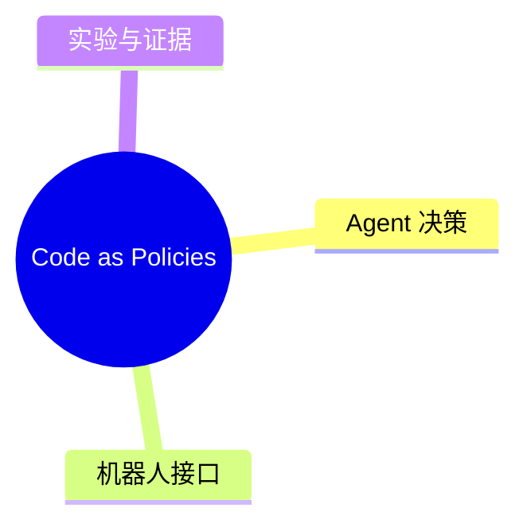

## Summary

LLM 将自然语言指令写为可调用机器人感知和动作的程序。 [原文](https://arxiv.org/html/2209.07753v4)

## Problem & Motivation

固定技能序列难以表示用户指令中的循环、条件与空间计算。论文探索用编程语言表达这些决定。

## Method

少样本提示提供接口和示例。模型生成 Python，递归补全未定义的辅助函数。程序在执行时可查询感知 API 并调用现有控制原语。

## Key Results

论文展示真实 UR5e 白板和桌面任务、移动厨房操作。Table III 的未见指令及属性组合实验在仿真，长程条件中 CaP 为 80%，自然语言规划器为 64%。

## Evidence Ledger

| Claim ID | Claim | Type | Source locator | Evidence excerpt | Status |
|:--|:--|:--|:--|:--|:--|
| C1 | 生成可运行的控制程序并递归补全未定义函数 | causal-mechanism | §III | Language Model Programs | source-verified |
| C2 | 实验覆盖真机，但长程比较的 80% 对 64% 来自仿真 | benchmark-setting | §IVB–E, Table III | Table III | source-verified |

## Strengths & Weaknesses

程序执行可以读反馈。实验通常先生成程序再执行，语言模型没有义务在当前任务中逐次消费物理回执，使其成为在线 coding agent 的前作。

## Mind Map

## Notes

- [[Topics/RobotUseAgents-Survey]]
