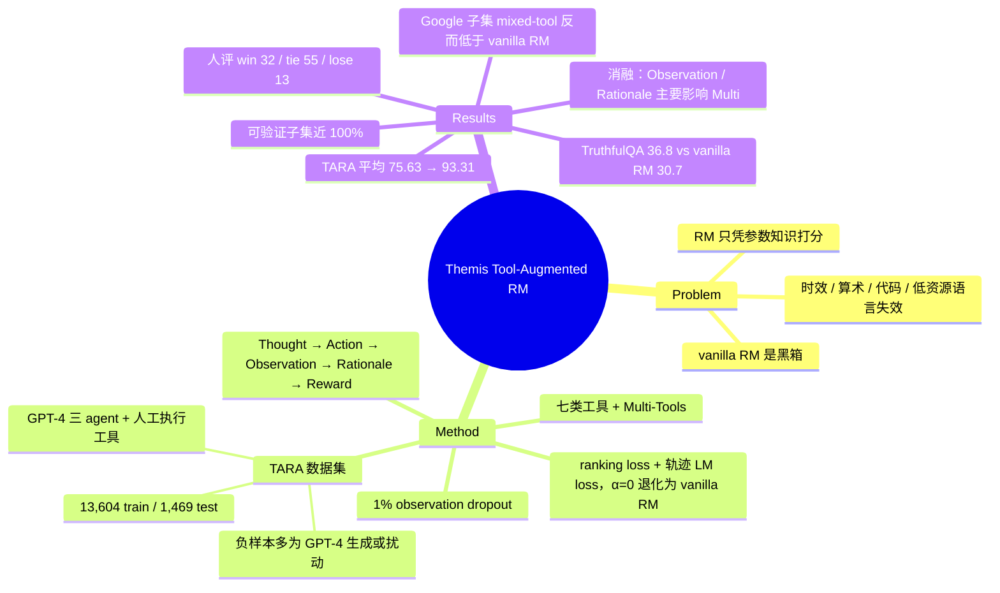

## Summary
Themis 把 RLHF 的 reward model 从"读完 (x, y) 直接出标量"改成先自回归地生成 Thought → Action（调用 calculator / code interpreter / translator / Google / weather / calendar / WikiSearch 七类工具）→ Observation → Rationale，再由一个 feed-forward 头输出标量奖励，训练目标是 pairwise ranking loss 加上工具轨迹的 language-modeling loss；配套用三个 GPT-4 agent 加人工执行工具构建了 TARA 数据集（13,604 train / 1,469 test）。Vicuna-7B 基座的 Themis 在 TARA mixed-tool 设置下平均 accuracy 93.31，对 vanilla RM（Vicuna-7B）的 75.63 高出 17.7 个百分点，但唯一来自真实人类偏好的 Google 子集反而低于 vanilla RM（64.92 vs 72.39）。用它做 PPO reward 的人评结果是 win / tie / lose = 32 / 55 / 13。

## Problem & Motivation
RLHF 中的 reward model 只凭参数内的静态知识打分，因此在需要实时信息（时事）、算术、代码执行、低资源语言理解的场景会给错分，且容易被幻觉事实误导。作者给出两个动机：一是人类标注员遇到这类问题时本来就会去查搜索引擎或按计算器，RM 没有理由不这样做；二是 CoT 与 ReAct 已证明分步推理与工具调用能显著提高 LLM 完成复杂任务的能力，把同样的机制搬到 RM 上是自然的。附带的收益是可解释性：vanilla pairwise RM 是黑箱，而显式的工具调用与 Rationale 轨迹让人能看到奖励是怎么来的，也能通过修改中间步骤干预奖励。

## Method
**结构（§2.2，Figure 1）**。沿用 ReAct 的 (thought, action) 状态定义。给定问题 x 与候选回答 y，RM agent 逐步生成：Thought（是否需要调工具）、Action（API 名与参数）、Observation（工具返回，训练时作为上下文）、重复至多数步，最后生成 Rationale（综合前述信息的推理段），再用 FFN 头在该上下文上输出标量 r_θ(x, y, c_{1..T})。除 Reward 阶段外全部用 LM head 生成文本。

**训练目标（Eq. 2）**。L = L_RM + α [ Σ_t (L_tool(t) + β L_Observation(t)) + ω L_Rationale ]，ω L_Rationale 在 α 括号之内（初稿误写在括号外，已按 verifier 更正）。L_RM 是标准的 pairwise ranking loss −log σ(r(x, y_w) − r(x, y_l))；后项是对 Thought / Action、Observation、Rationale 三类 token 的自回归 LM loss。α = 1；β、ω ∈ {0, 1} 作为消融开关（Table 8）。α = 0 时退化为 vanilla RM。值得注意的是 β = 1 意味着模型也被训练去预测工具的输出 token，而不只是消费它。训练时混入非工具数据让模型学会何时不调工具；另加入 1% 的随机 observation dropout 模拟 API 失败，并按 Askell et al. 的做法对正样本整体做 LM 训练。

**TARA 数据集（§3，Appendix B）**。四步：
1. 问答对收集。开源数据集给正样本：GSM-8K（Calculator）、HumanEval + MBPP（Code）、MLQA 七种语言（Translator）、Natural Questions（WikiSearch）、WebGPT Comparisons（Google，自带人类偏好的正负对）；Weather、Calendar、Multi-Tools 用模板 + ChatGPT 扩写生成（城市集、日期集、天气属性集填模板），Weather 正确答案来自 weatherAPI，负样本由正确值扰动得到。
2. ToolBank：basic（Calculator、Code Interpreter、Baidu Translator）、query-based（Google、Weather、Calendar）、knowledgeable（WikiSearch），加 Multi-Tools（Calendar → Weather 链式调用）。
3. 三个 GPT-4 agent 加人类：negative generation agent 为只有正样本的问题生成"难以区分"的错误答案（Code 例外，用 StarCoderBase 生成不过测试的代码）；tool agent 产出 Thought 与 Action；人类实际执行工具得到 Observation；rationale agent 综合写出 Rationale。
4. 过滤：格式非法、超过三步交互、无相关函数调用、执行结果解析错误的轨迹全部丢弃；负样本的标点、空格、句式与正样本统一，防止表面模式泄漏。

Table 6 给出各工具 train / test 条数：Calculator 877 / 154、Code 486 / 189、Translator 1,682 / 300、Google 3,932 / 134、Calendar 320 / 166、Weather 476 / 158、WikiSearch 5,399 / 284、Multi 432 / 144。

**实验设置（§4.1，Appendix C.1）**。基座 Vicuna-7B 全参微调（5 epoch、lr 1e-5、batch 64、输入 512 / 输出 1024），对照 RM (Bert-Large) 与 RM (Vicuna-7B)；另有 Vicuna-7B / 13B / 33B 的 LoRA 版（rank 8、alpha 16、lr 1e-4）与 Vicuna-33B 全参版。8 × A100 40G。评测指标为 r(y_w) > r(y_l) 的 accuracy。single-tool 设置按工具切分数据分别训练，mixed-tool 设置用全部数据训一个模型。RLHF 部分按 DeepSpeed-Chat 三阶段，TARA 的 20% 做 SFT、40% 做 PPO。

## Key Results
**主结果（Table 1，accuracy %）**。single-tool：RM (Bert-Large) 65.01、RM (Vicuna-7B) 75.04、Themis 94.23（+19.2）。mixed-tool：69.10、75.63、93.31（+17.7）。分工具看 single-tool 的提升集中在可被工具直接验证的子集：Calendar 80.91 → 100.00、Weather 86.08 → 100.00、Code 85.19 → 99.47、Translator 34.33 → 88.40、Multi 79.17 → 99.31；Calculator（98.05 → 98.70）与 Wiki（93.31 → 95.07）本来就高。Google 在 single-tool 下 65.13 → 76.12，但在 mixed-tool 下 Themis 64.92 低于 RM (Vicuna-7B) 的 72.39 和 RM (Bert-Large) 的 70.15，作者归因于 Reddit 来源数据域重叠、需要更细的数据清洗。

**消融（Table 1 mixed-tool）**。去掉 Observation 的 LM loss（β = 0）平均 90.90，去掉 Rationale（ω = 0）89.31；两者对 Multi 子集影响最大（99.31 → 73.51 / 68.72），其余子集差异在 2 点以内，Wiki 和 Translator 上 β = 0 反而略高。

**规模（Table 1 末三行）**。LoRA 版 7B / 13B / 33B 为 82.57 / 85.26 / 90.74，全参 33B 为 95.21。LoRA-7B 比全参 7B 低 10.7 点，LoRA 版的 Google 子集只有 46.26–58.95，远低于 vanilla RM。

**工具使用动态（Figure 3、4）**。RM (Vicuna-7B) 一个 epoch 即收敛，Themis 需要更多 epoch 学工具调用但第一个 epoch 就已超过 RM。训练过程中总调用次数先升后降、错误调用持续下降；Google 是被调用最多的工具。"篡改 Observation 后模型是否跟着改判"的实验只有定性描述（"marginal decrease in accuracy"），没有数字。

**域外与下游（Table 2、3、11）**。HH-RLHF* 150 条 zero-shot：RM (Bert-Large) 51.66、RM (Vicuna-7B) 35.78、Themis 55.00、Themis w/o L_Observation 55.83；加 500 条微调后为 52.50 / 65.83 / 70.00 / 71.67。TruthfulQA MC1 zero-shot：GPT-3 175B 21.0、OPT 175B 21.0、Galactica 120B 26.0、Gopher 280B 29.5、RM (Vicuna-7B) 30.7、Themis 36.8；Retarded-bar (en) 68.0 → 73.3。标准 RM 数据集（Table 11）：WebGPT Comparison 上 Themis 69.53 vs RM (Vicuna-7B) 66.68 vs RM (Bert-Large) 66.57；HH-RLHF 上 77.59 vs 72.34，低于 RAFT (LLaMA-7B) 的 79.52。

**RLTAF（Table 4、Figure 5）**。PPO 后 perplexity：Vicuna-7B 11.19、SFT 8.14、PPO (RM) 8.10、PPO (Themis) 7.88。200 条 prompt 的人评 win / tie / lose：全部 0.32 / 0.55 / 0.13；Google 0.54 / 0.26 / 0.20；WikiSearch 0.32 / 0.54 / 0.14；Code 0.18 / 0.72 / 0.10；Calculator 0.22 / 0.68 / 0.10。摘要中的 "average win rate of 32%" 是四个域 win 比例的均值，tie 占多数。

## Evidence Ledger
| Claim ID | Claim | Type | Source locator | Evidence excerpt | Status |
|:--|:--|:--|:--|:--|:--|
| C1 | 训练目标 L = L_RM + α [ Σ_t (L_tool + β L_Observation) + ω L_Rationale ]，α = 1，β、ω ∈ {0,1}；α = 0 时退化为 vanilla RM（初稿把 ω L_Rationale 写在 α 括号外，verifier 按原文 underbrace 范围判 contradicted，已更正；常数均无误） | causal-mechanism | §2.2 Eq. 2 p.4; Table 8 p.20 | "α = 1 in our experiments ... When α is set to zero ... reducing Themis to standard RMs" | contradicted → corrected |
| C2 | TARA 共 13,604 train / 1,469 test，七类工具加 Multi-Tools | number | §3.2 p.5; Table 5 p.16 | "TARA comprises a total of 13,604 training datasets and 1,469 test sets" | source-verified |
| C3 | 负样本主要由 GPT-4 negative generation agent 生成；Google 子集用 WebGPT Comparisons 自带正负对；Code 用 StarCoderBase 生成不过测试的代码；Weather 负样本由正确值扰动得到 | benchmark-setting | §3.1 Step 3 p.5; Appendix B.1 pp.17–19 | "we leverage StarCodeBase to generate negative code answers that fail to pass all the test lists" | source-verified |
| C4 | 过滤规则：丢弃格式非法、超过三步交互、无相关函数调用、解析错误的轨迹 | benchmark-setting | §3.1 Step 4 p.5 | "discard processes exceeding three interaction steps, lacking relevant function calls, or manifesting parsing errors" | source-verified |
| C5 | Table 1 平均 accuracy：single-tool RM (Vicuna-7B) 75.04 → Themis 94.23；mixed-tool 75.63 → 93.31 | number | Table 1 p.6 | "RM (Vicuna-7B) ... 75.04 / Themis (Vicuna-7B) ... 94.23 ... 75.63 ... 93.31" | source-verified |
| C6 | mixed-tool 下 Google 子集 Themis 64.92 低于 RM (Vicuna-7B) 72.39 与 RM (Bert-Large) 70.15 | comparison | Table 1 p.6; §4.2 p.6 | "Google Search exhibits a slight decline during mixed-tool training" | source-verified |
| C7 | 消融：β = 0 平均 90.90、ω = 0 平均 89.31；Multi 子集 99.31 → 73.51 / 68.72 | number | Table 1 p.6 | "w/o LObservation (β = 0) ... 73.51 90.90 / w/o LRationale (ω = 0) ... 68.72 89.31" | source-verified |
| C8 | LoRA 版 7B / 13B / 33B 平均 82.57 / 85.26 / 90.74；全参 33B 95.21；LoRA-7B 低于全参 7B 的 93.31 | number | Table 1 p.6 | "Themis (Vicuna-7B + LoRA) ... 82.57 ... (Vicuna-33B + LoRA) ... 90.74 / Themis (Vicuna-33B) ... 95.21" | source-verified |
| C9 | HH-RLHF* 为 150 条；zero-shot Themis 55.00、RM (Vicuna-7B) 35.78、RM (Bert-Large) 51.66；w/o L_Observation 55.83 高于完整 Themis | number | §4.4 p.8; Table 2 p.7 | "we select 150 instances ... 51.66 35.78 55.00 55.83" | source-verified |
| C10 | TruthfulQA MC1 zero-shot：Themis 36.8、RM (Vicuna-7B) 30.7、Gopher 280B 29.5；对比对象是未经训练的 LLM | comparison | Table 3 p.7; §4.4 p.8 | "Gopher 280B 29.5 ... RM (Vicuna) 7B 30.7 ... Themis 7B 36.8" | source-verified |
| C11 | 人评（200 prompt）win / tie / lose：All 0.32 / 0.55 / 0.13；Code 0.18 / 0.72 / 0.10；Calculator 0.22 / 0.68 / 0.10 | number | Figure 5 p.8 | "All 0.32 0.55 0.13 ... Code 0.18 0.72 0.10 ... Calcualtor 0.22 0.68 0.10" | source-verified |
| C12 | PPO 后 perplexity：Vicuna-7B 11.19、SFT 8.14、PPO (RM) 8.10、PPO (Themis) 7.88 | number | Table 4 p.8 | "11.19 / 8.14 / 8.10 / 7.88" | source-verified |
| C13 | 标准 RM 数据集：HH-RLHF 上 Themis 77.59 低于 RAFT (LLaMA-7B) 79.52、高于 RM (Vicuna-7B) 72.34；WebGPT Comparison 上 Themis 69.53 vs RM (Vicuna-7B) 66.68 vs RM (Bert-Large) 66.57，Deberta-v3-large-v2 与 GPT-Neo-2.7B 无 WebGPT 结果（送审 claim 曾把 66.57 / 66.68 误归为 Deberta / GPT-Neo，verifier 判 contradicted，已更正） | number | Appendix C.3; Table 11 p.23 | "RM (Bert-Large) 66.57 64.20 / RM (Vicuna-7B) 66.68 72.34 / Themis (Vicuna-7B) 69.53 77.59" | contradicted → corrected |
| C14 | 篡改 Observation 的反事实实验只有定性描述，未给出数字 | benchmark-setting | §4.3 p.7 | "we observed only a marginal decrease in accuracy" | source-verified |
| C15 | 基座 Vicuna-7B 全参微调；8 × 40G A100；训练时 1% 随机 observation dropout；对正样本做整体 LM 训练 | benchmark-setting | Appendix C.1 p.22; Table 9 | "we intentionally introduce a 1% random observation dropout during training" | source-verified |
| C16 | Table 6 各工具 test 条数之和为 1,529（154+189+300+134+166+158+284+144），与 §3.2 所述 1,469 不一致 | number | Table 6 p.16 vs §3.2 p.5 | "# Test 154 189 300 134 166 158 284 144" | source-verified |
| C17 | 代码、数据与 checkpoint 公开于 GitHub ernie-research/Tool-Augmented-Reward-Model | license-code | p.1 footnote 1; Reproducibility Statement p.10 | "https://github.com/ernie-research/Tool-Augmented-Reward-Model" | source-verified |

## Strengths & Weaknesses
**亮点**
- 想法干净：RM 与 ReAct 式 agent 的结合只需在 LM 轨迹末尾接一个标量头，α = 0 即退化为 vanilla RM，不引入新架构。
- 在可被工具直接核验的域（日期、天气、代码测试、算术过程）上，7B 模型能把判别准确率推到接近 100%，并且 Table 12 这类案例显示它能定位到具体哪一步算错。这是 vanilla RM 做不到的。
- 对工具不可靠的情况有设计上的考虑：训练时注入 observation 失败样本，依赖 Rationale 做二次判断（Table 18、19）。这比后来很多"工具返回即真理"的做法更谨慎。
- 显式轨迹带来可审计性。对于 reward hacking 排查（见 [[2411-RewardHacking]]），能看到 RM 为什么给高分比一个标量有用得多。

**局限与疑问**
- benchmark 是按"工具足以解决"构造的。Weather / Calendar / Multi 的负样本是对工具返回真值的扰动，Themis 在这些子集上 100% 是构造使然，衡量的是"能否学会查表比对"，不是 preference modeling。
- 唯一来自真实人类偏好的子集（Google，WebGPT Comparisons）恰恰是 mixed-tool 下 Themis 输给 vanilla RM 的地方；Table 11 的 WebGPT 全量实验增益也只有约 3 点。论文没有证据表明工具对"回答质量偏好"这类非事实性判断有帮助。
- 人评 tie 占 55%，Code 与 Calculator 域 tie 接近七成；摘要的 "32% win rate" 不配上 13% lose 与 55% tie 会被误读。
- TruthfulQA 的对比对象是 zero-shot LLM，而 Themis 在 Natural Questions 与 WebGPT 上训练过；vanilla RM (Vicuna-7B) 本身已超过 Gopher，Themis 相对 vanilla RM 的真实增益是 6.1 点。
- HH-RLHF* 只有 150 条，RM (Vicuna-7B) zero-shot 35.78 低于随机水平，说明分布偏移严重，Themis 的 55.00 也只略高于随机。
- "模型是跟着 Observation 判断还是靠先验"是这篇最该回答的问题，但反事实实验没有数字（C14）。Table 19 中模型发出空参数的 Google 调用、拿回字典释义后仍给出合理分数，恰恰说明它可以绕过工具；这与"决策基于工具"的主张方向相反。
- 工具调用增加推理延迟，作者承认但未量化；RLHF 实验只在 TARA 域内，PPL 差异 8.10 vs 7.88 很小。
- Table 6 的 test 条数合计 1,529 与正文 1,469 不一致（C16），属于小的内部不一致。

**对领域的意义**。这是 2023 年 10 月的工作，是"RM 需要外部取证"这条线的早期数据点。它与同期 [[2312-MathShepherd]] 走的是两条路：Math-Shepherd 用 rollout 把 outcome 信号转为 step 标签，Themis 直接让 RM 在打分时执行验证。在 GUI 方向，[[2607-InteractiveRewardAgent]] 的 propose-then-verify（调用系统 / 应用工具核验 post-execution 状态）与 [[2500-A3AndroidAgentArena]] 的 A3RM（看截图窗口判里程碑）是同一思想在不同取证媒介上的延伸。Themis 留下的开放问题是最关键的一个：当工具能给出 ground truth 时 RM 退化为比对器，当工具给不出时（质量偏好）工具似乎没帮上忙，那么 tool-augmented RM 的真正适用边界在哪里。

## Mind Map

## Notes
- 与 Supervisor 同批给出的 [[2500-A3AndroidAgentArena]] 并读：两篇第一作者 / 二作虽同姓 Chai 但不是同一人（Yekun Chai 在 Baidu，Yuxiang Chai 在 CUHK）。共同点是都把 reward model 的判断建立在外部证据上，差别在证据媒介（工具返回 vs 截图窗口）与评价取向（Themis 报 accuracy，A3RM 强调 precision）。
- 可追问：把 Themis 的框架用于 GUI 轨迹判定时，"工具"应是什么？IRA 的答案是系统状态查询；A3 的答案是截图。两者都还没有回答 Themis 留下的问题：当工具无法给出 ground truth 时，RM 是否会退回到先验。
