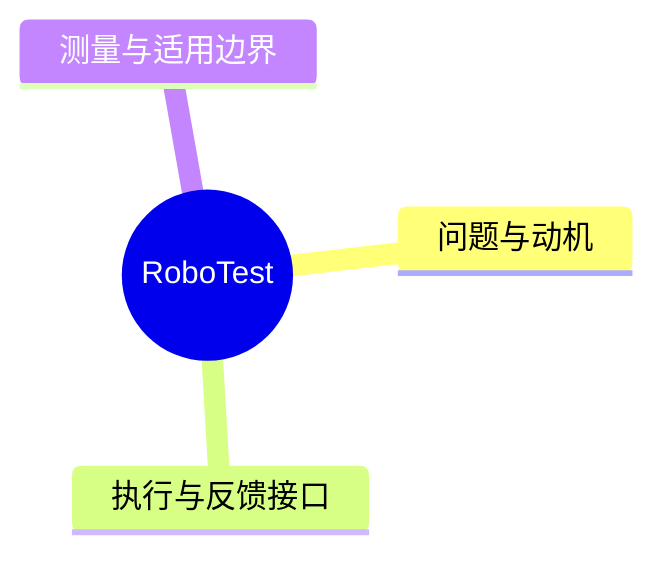

## Summary

RoboTest 通过外部摄像与四自由度触屏机械臂探索 App，使用控件提取和距离优先策略减少物理运动成本。 [原文与版本](https://arxiv.org/html/2312.10655v1)

## Problem & Motivation

依赖 App 注入、系统驱动或标准形状触控面的测试方法难以覆盖某些定制设备。RoboTest 把测试操作放到设备外部，通过视觉观测和真实物理交互访问应用。

## Method

先识别相机画面中的目标屏幕，再在屏幕坐标下检测可交互控件。执行模块将选中的控件映射为触屏动作。Principle of Proximity 优先探索距离前一触点较近的控件，比较模块用于辅助发现异常。

## Key Results

主要对象为 Huawei Mate20（Android 9）上的 20 个 App，考察 code coverage、bug detection 与时间开销。定制 XiUOS 另选两个 LVGL 应用做案例。Android 的 Jacoco instrumentation 用于事后评估覆盖率。

## Evidence Ledger

| Claim ID | Claim | Type | Source locator | Evidence excerpt | Status |
|:--|:--|:--|:--|:--|:--|
| C1 | 真实四自由度机械臂通过外部视觉执行触屏动作 | causal-mechanism | §§3.1–3.3 | 4-DOF robotic arm | source-verified |
| C2 | 20 个 Android App，XiUOS 另有两个 LVGL App；覆盖率评估使用 Jacoco | benchmark-setting | §§4.1.2, 5 | Experiment Subject | source-verified |

## Strengths & Weaknesses

真实设备和外部摄像使它成为物理 GUI 的直接先例。评估目标是探索和发现异常，未报告语言指令驱动的跨应用目标完成率。设备、探头与 UI 检测方案会影响外推。

## Mind Map

## Notes

- [[Topics/AgenticRobotArm-Survey]]
