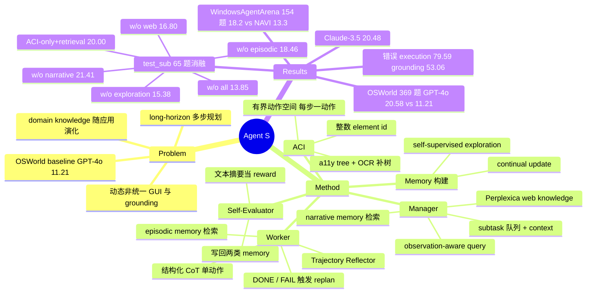

## Summary

Agent S 是 Simular 的第一代开源 computer-use 框架：用 Manager/Worker 两层 hierarchical planning，把 Perplexica 在线搜索（web knowledge）、narrative memory（整任务经验摘要）与 episodic memory（成功 subtask 经验）三种"经验"注入规划与执行，再配一个基于 accessibility tree + OCR + 整数 element id 的 Agent-Computer Interface（ACI）。在 OSWorld 全集 369 题上，GPT-4o backbone 的成功率从 baseline 11.21% 提到 20.58%（+9.37 绝对、83.6% 相对）；65 题子集消融显示去掉 web knowledge 是单项损失最大的一刀（26.15 → 16.80）。

## Problem & Motivation

作者把 MLLM 操作桌面 GUI 的难点归为三条：(1) 应用与网站持续演化，agent 需要专门且最新的 domain knowledge，并能从开放世界经验中学习；(2) 桌面任务是 long-horizon、步骤相互依赖的多步规划，需要显式的中间 subgoal 与进度跟踪；(3) 界面动态且不统一，agent 要在大量视觉/文本信息和巨大动作空间中分辨相关元素、读懂图形提示并响应反馈。

当时的 OSWorld baseline（直接把带坐标的 accessibility tree + screenshot 喂给 GPT-4o 输出坐标动作）在 369 题上只有 11.21%，grounding 被先前工作（OSWorld、SeeAct）认定为主要瓶颈。Agent S 的立场是：不训练模型，而是靠"经验检索 + 分层规划 + 接口抽象"把现成 MLLM 的推理能力引出来。

## Method

整体是一个闭环（Figure 3）：Manager 做 experience-augmented hierarchical planning 产出 subtask 队列，Worker 逐个执行，ACI 负责感知与动作落地，Self-Evaluator 把经验写回两类 memory。

**Manager（Section 3.1.1）。** 接收用户任务 $T_u$ 与初始观测 $O_0$（标注后的 accessibility tree + screenshot），先生成一个 "How to do X" 形式的 observation-aware query $Q$。$Q$ 用于两路检索：通过 Perplexica 搜索引擎做 online web search 得到 $K_{web}$；再按 embedding 相似度（text-embedding-3-small）从 narrative memory $M_n$ 取相似任务的经验摘要 $E_{n_u}$。两者由 Experience Context Fusion 融合成 $K_{fused}$，Subtask Planner 据此输出拓扑排序的 subtask 队列 $\langle s_0 \dots s_n\rangle$，每个 subtask 附带 context $C_{s_i}$。

**Worker（Section 3.1.2）。** 每个 subtask 由一个 Worker 执行多步。用 $\langle T_u, s_i, C_{s_i}\rangle$ 做 key 从 episodic memory $M_e$ 取相似 subtask 经验 $E_{s_i}$；Trajectory Reflector 观察本 episode 并给出避免重复动作的反思。Action Generator 输出一个结构化响应（上一步状态检查 → 观测分析 → 语义动作 → grounded 动作），即模板化 chain-of-thought，最终产生单个 grounded action 交 ACI 执行。Worker 判断 subtask 完成则发 DONE；也可发 FAIL，此时层级重置，Manager 基于当前环境重新规划（reactive replanning）。

**Self-Evaluator（Section 3.1.3）。** 以文本摘要充当 "textual reward"：Worker 以 DONE 结束一个 subtask 时，总结其策略写入 $M_e$；整任务结束（全部 subtask 完成或触及最大步数）时，总结整个过程写入 $M_n$。成功/失败由 Self-Evaluator 自判，不用人工反馈或 ground truth。作者把这套"观测 → 分层动作 → 文本摘要回写 memory"类比为 Hierarchical RL，但学习手段是 retrieval 而非参数更新。

**两类 memory 的区别。** Narrative memory 存成功与失败两种整任务轨迹的抽象摘要（去掉具体动作），key 是 $Q$；episodic memory 只存被 Worker 标为 DONE 的 subtask，含完整计划与具体 grounding 动作，key 是 $\langle Q, s_i, C_{s_i}\rangle$。

**Memory 构建与更新（Section 3.2，Figure 4）。** 初始 memory 靠 self-supervised exploration 冷启动：用 task generator 为 OSWorld 与 WindowsAgentArena 涉及的各应用生成 top-50 常见任务（environment-independent），再基于两个 benchmark 任务的初始环境生成不同任务（environment-aware）；在这些合成任务上只带 web knowledge 跑 Agent S，收集 narrative/episodic 经验。此后在推理任务上持续更新（continual memory update）。

**ACI（Section 3.3，Appendix A）。** 双输入：screenshot 用于观察弹窗、按钮状态、上一步是否生效；accessibility tree 用于推理与精确 grounding。树中每个元素打唯一整数 tag；与 Set-of-Mark 相反，作者用 PaddleOCR 从截图抽文本块，经 IOU 匹配后把树里没有的文本块补成可交互元素。动作空间有界（Table 5：click / type / scroll / hotkey / hold_and_press / drag_and_drop / save_to_buffer / switch_applications / wait / done / fail），agent 以 `primitive(element_id, ...)` 指代元素，由 ACI 翻译为可执行 Python；每步只允许一个离散动作，以便观察即时反馈。

## Key Results

**OSWorld 全集（Table 1，369 题，Successful Rate %）。** 两种 backbone 都用 accessibility tree + screenshot 输入，baseline 取 OSWorld 论文同输入设置的报告值。

| Method | OS | Office | Daily | Profess. | Workflow | Overall |
|:--|:--|:--|:--|:--|:--|:--|
| GPT-4V (baseline) | 16.66 | 6.99 | 24.50 | 18.37 | 4.64 | 12.17 |
| GPT-4o (baseline) | 41.67 | 6.16 | 12.33 | 14.29 | 7.46 | 11.21 |
| Agent S w/ Claude-3.5 | 41.66 | 13.83 | 30.46 | 32.65 | 9.54 | 20.48 |
| Agent S w/ GPT-4o | 45.83 | 13.00 | 27.06 | 36.73 | 10.53 | 20.58 |

摘要口径的 "+9.37%、83.6% relative" 即 20.58 − 11.21 与 9.37/11.21。注意正文说 Daily/Professional 的 "best baseline results" 是 12.33/14.29，但那是 GPT-4o 行；表内 GPT-4V 的 Daily 24.50、Professional 18.37 更高，所以正文措辞应读作"对应 backbone 的 baseline"。

**经验来源消融（Table 2，OSWorld test_sub，GPT-4o，SR %）。** 子集为从全集分层抽样的 65 题（OS 6 / Office 17 / Daily 16 / Profess. 10 / Workflow 16）；作者认为官方 test_small（39 题、OS 仅 2 题）太小且失衡。所有消融（含 baseline）都用 GPT-4o。论文未写明每题的最大步数。

| Method | OS (6) | Office (17) | Daily (16) | Profess. (10) | Workflow (16) | Overall (65) |
|:--|:--|:--|:--|:--|:--|:--|
| baseline (OSWorld Agent) | 33.33 | 5.88 | 12.50 | 10.00 | 6.25 | 10.77 |
| Agent S | 50.00 | 11.76 | 37.50 | 40.00 | 12.50 | 26.15 |
| − w/o Web Knowledge | 16.60 | 11.76 | 24.49 | 30.00 | 6.25 | 16.80 |
| − w/o Narrative Memory | 33.33 | 11.76 | 36.99 | 20.00 | 12.50 | 21.41 |
| − w/o Episodic Memory | 33.33 | 5.88 | 25.00 | 30.00 | 12.50 | 18.46 |
| − w/o All | 33.33 | 5.88 | 18.75 | 20.00 | 6.25 | 13.85 |

三种经验单独去掉时 web knowledge 掉得最多（26.15 → 16.80，OS 与 Daily 两类掉幅最大），作者据此称 web knowledge "has the most significant impact"；三者全去只剩 13.85，仍高于 baseline 10.77。

**ACI 与 hierarchical planning 消融（Table 6 / Figure 6，test_sub，GPT-4o）。**

| Method | Overall (65) |
|:--|:--|
| Baseline | 10.77 |
| Baseline + Retrieval | 12.31 |
| Agent S (ACI-only，无 hierarchical planning) | 12.31 |
| Agent S (ACI-only) + Retrieval | 20.00 |
| Agent S 完整 | 26.15 |

读法：同样加 retrieval，baseline 只 +1.54，ACI-only 版 +7.69，作者据此说 ACI "supports better agentic learning"；hierarchical planning 在有经验时贡献 20.00 → 26.15（+6.15），而无经验时（w/o All 13.85 vs ACI-only 12.31）只有 +1.54——分层规划的收益依赖 Manager 能拿到的经验。

**Memory 构建消融（Table 7 / Figure 7，test_sub，GPT-4o）。** Agent S 26.15；w/o Continual Memory Update 23.08；w/o Self-Evaluator（用原始完整轨迹替代摘要）18.46；w/o Self-supervised Exploration 15.38。冷启动探索比推理期持续更新重要得多。

**错误分析（Table 3，test_sub 中失败任务的 Error Rate %，单任务可含多种错误）。** Overall：Planning 34.69、Grounding 53.06、Execution 79.59，Subtask Failure Rate 57.17。Appendix D.2 复核了 39 个 execution error，46% 由 planning 或 grounding 错误直接引发。

**WindowsAgentArena（Table 4，154 题，GPT-4o，Image + Accessibility Tree + OCR，SR %）。** 不做任何适配。

| Method | Office | Web Browser | Windows System | Coding | Media & Video | Windows Utils | Overall |
|:--|:--|:--|:--|:--|:--|:--|:--|
| NAVI | 0.0 | 20.0 | 29.2 | 9.1 | 25.3 | 0.0 | 13.3 |
| Agent S | 0.0 | 13.3 | 45.8 | 29.2 | 19.1 | 22.2 | 18.2 |

对比对象是与 Agent S 相近配置（论文原话 "similar configuration"：同为 GPT-4o + a11y tree + image 输入，但 NAVI 另用 Set-of-Marks 与链式动作）的 NAVI 行；WindowsAgentArena 最强 agent 用的是 Microsoft 内部 grounding 模型，未纳入对比（footnote 5）。

**按应用拆分（Table 8 / Table 9，GPT-4o）。** OSWorld 上 Agent S 在 LibreOffice Calc 只有 2.13，低于 baseline 4.26，是唯一倒退的应用；Thunderbird 40.00、VS Code 52.17、GIMP 23.08 提升最大。WindowsAgentArena 上 Notepad / LibreOffice Calc / Windows Calc / Paint / Writer 全为 0.00，Settings 80.00、Clock 50.00。

## Evidence Ledger

| Claim ID | Claim | Type | Source locator | Evidence excerpt | Status |
|:--|:--|:--|:--|:--|:--|
| C1 | OSWorld 全集 369 题，Agent S w/ GPT-4o Overall 20.58 vs GPT-4o baseline 11.21 | number | §4.2, Table 1 | "Agent S achieves an overall success rate of 20.58%, nearly doubling … GPT-4o with 11.21%" | source-verified |
| C2 | 摘要口径：+9.37% 绝对、83.6% 相对提升 | number | Abstract; §1 | "outperforms the baseline by 9.37% on success rate (an 83.6% relative improvement)" | source-verified |
| C3 | Agent S w/ Claude-3.5 在 OSWorld 全集 Overall 20.48 | number | Table 1 | "Agent S w/ Claude-3.5 … 20.48" | source-verified |
| C4 | 正文称 Daily/Profess. 的 "best baseline" 为 12.33/14.29，但 Table 1 中 GPT-4V 为 24.50/18.37 | comparison | §4.2 vs Table 1 | "compared to the best baseline results of 12.33% and 14.29%" | source-verified |
| C5 | 消融子集 test_sub 为 65 题分层抽样（OS 6/Office 17/Daily 16/Profess. 10/Workflow 16），全部消融用 GPT-4o | benchmark-setting | §4.3, footnote 3, Table 2 header | "stratified sampled a subset of 65 instances … utilized GPT-4o as the LLM backbone for all ablation studies" | source-verified |
| C6 | Table 2：Agent S Overall 26.15，w/o Web Knowledge 16.80 | number | §4.3, Table 2 | "Agent S … 26.15 / - w/o Web Knowledge … 16.80" | source-verified |
| C7 | Table 2：w/o Narrative Memory 21.41、w/o Episodic Memory 18.46、w/o All 13.85、baseline 10.77 | number | Table 2 | "21.41 … 18.46 … 13.85 … 10.77" | source-verified |
| C8 | w/o Web Knowledge 分类别：OS 16.60、Office 11.76、Daily 24.49、Profess. 30.00、Workflow 6.25 | number | Table 2 | "- w/o Web Knowledge 16.60 11.76 24.49 30.00 6.25 16.80" | source-verified |
| C9 | Table 6：Baseline 10.77、Baseline+Retrieval 12.31、ACI-only 12.31、ACI-only+Retrieval 20.00 | number | Appendix A.2, Table 6; §4.3 | "performance drop (26.15% to 20.00%) compared to the full Agent S" | source-verified |
| C10 | Table 7：w/o Continual Memory Update 23.08、w/o Self-Evaluator 18.46、w/o Self-supervised Exploration 15.38 | number | Appendix A.3, Table 7 | "23.08 … 18.46 … 15.38" | source-verified |
| C11 | WindowsAgentArena 154 题、GPT-4o、Image+A11y+OCR：NAVI 13.3 → Agent S 18.2 | number | §4.5, Table 4 | "Agent S outperforms the Navi agent without any adaptation" | source-verified |
| C12 | Table 3 Overall：Planning 34.69、Grounding 53.06、Execution 79.59、Subtask Failure 57.17；单任务可含多种错误 | number | §4.4, Table 3 | "A single task may contain multiple errors" | source-verified |
| C13 | test_sub 失败任务中 39 个 execution error，46% 由 planning 或 grounding 错误引发 | number | Appendix D.2, Figure 13 | "reviewed all 39 execution errors … found that 46% were caused by planning or grounding errors" | source-verified |
| C14 | Web knowledge 经 Perplexica 搜索；memory 检索用 text-embedding-3-small；OCR 用 PaddleOCR | benchmark-setting | §3.1.1 footnote 1; §4.1 footnote 2 | "Online Web Search through Perplexica Search Engine … embedding model … text-embedding-3-small" | source-verified |
| C15 | 初始 memory 由 self-supervised exploration 构建：各应用 top-50 常见任务 + 基于初始环境生成的任务，只带 web knowledge 运行 | causal-mechanism | §3.2, Figure 4 | "generate the top 50 most common tasks … run Agent S on these tasks by only taking web knowledge" | source-verified |
| C16 | Narrative memory 存成功与失败轨迹的抽象摘要（去掉具体动作）；episodic 只存 DONE 的 subtask 且含 grounding 动作；成败由 Self-Evaluator 自判 | causal-mechanism | §3.1.1, §3.1.2, §3.1.3 | "summaries of both successful and failed trajectories with specific actions removed … without any human feedback or ground truth" | source-verified |
| C17 | ACI：a11y tree 元素打整数 tag，用 OCR 文本块经 IOU 匹配补入树；动作空间为 Table 5 的 11 个 primitive；每步一个动作 | causal-mechanism | §3.3; Appendix A.1, Table 5 | "we augment the tree with details from the image … perform only one discrete action at each time step" | source-verified |
| C18 | Worker 发 FAIL 后层级重置、Manager 基于当前环境重新规划（reactive replan） | causal-mechanism | §3.1.2 | "FAIL signal, in which case the hierarchical operation is reset and the Manager replans" | source-verified |
| C19 | 论文未给出每题最大步数的具体数值，只提到 "maximum number of steps limit" | benchmark-setting | §3.1.3; §4.1 | "indicated either by the successful completion of all subtasks or by the maximum number of steps limit" | source-verified |
| C20 | 论文内部 backbone 命名不一致：§4.1 写 Claude-3-Sonnet，Table 1 / §4.2 / §5 写 Claude-3.5(-Sonnet) | benchmark-setting | §4.1 vs Table 1, §4.2, §5 | "we leverage GPT-4o and Claude-3-Sonnet, respectively" | source-verified |
| C21 | 正文把 ACI 消融归于 "Figure 7"，但 Figure 6 的 caption 才是 ACI 消融，Figure 7 是 memory update 消融 | benchmark-setting | §4.3; Figure 6/7 captions | "Figure 7 presents the results of the ablation study on the ACI module" | source-verified |
| C22 | 代码开源于 github.com/simular-ai/Agent-S；arXiv HTML 标注论文 License CC BY 4.0 | license-code | Abstract; arXiv HTML header | "Code available at https://github.com/simular-ai/Agent-S" | source-verified |
| C23 | 分层规划无经验时仅 +1.54（12.31 → 13.85），有经验时 +6.15（20.00 → 26.15）；作者称其效果在有 experiential learning 时才显著 | comparison | §4.3; Table 2, Table 6（本笔记自行相减） | "effect of hierarchical formulation becomes pronounced in the presence of Experiential learning" | source-verified |
| C24 | 作者称三种经验中 web knowledge 影响最大 | sota-novelty | §4.3 | "Learning from universal experience available as web knowledge … has the most significant impact" | source-verified |
| C25 | Table 8 的 baseline OS 1.67 与 Table 1 的 GPT-4o OS 41.67 不一致（Agent S OS 45.84 vs 45.83 一致） | number | Appendix B, Table 8 vs Table 1 | "Baseline 1.67 4.26 6.81 …" | source-verified |
| C26 | Table 8：Agent S 在 LibreOffice Calc 2.13 低于 baseline 4.26；Thunderbird 40.00、VS Code 52.17、GIMP 23.08 | number | Appendix B, Table 8 | "Agent S 45.84 2.13 15.34 30.42 30.06 40.00 21.74 52.17 23.08 10.53" | source-verified |
| C27 | Table 2 的 Overall 16.80 与 21.41 不能表示为 k/65（其余行均可），论文未解释是否为多次运行平均或部分得分 | benchmark-setting | Table 2（算术核对） | "16.80 … 21.41"（65 × 0.1680 = 10.92；65 × 0.2141 = 13.92） | source-verified |
| C28 | Table 9：WindowsAgentArena 上 Notepad / Lib_Calc / Win_Calc / Paint / Writer 为 0.00，Settings 80.00，Clock 50.00 | number | Appendix B, Table 9 | "Agent S 17.65 7.69 29.17 0.00 0.00 80.00 0.00 50.00 0.00 36.84 0.00 19.05" | source-verified |
## Strengths & Weaknesses

**Strengths**

1. **经验来源拆得干净。** Web knowledge、narrative memory、episodic memory 各自单独消融，再加 memory 构建的三个环节（exploration / continual update / self-evaluator）单独消融，这在 2024 年的 CUA 框架论文里少见。结论也有层次：web knowledge > episodic > narrative；冷启动探索 > 推理期更新。
2. **交互效应有数据支撑。** Table 2 与 Table 6 合起来能读出"分层规划只有在 Manager 有经验可用时才值钱"（+1.54 vs +6.15），以及"ACI 让 retrieval 的收益放大"（baseline +1.54 vs ACI-only +7.69）。这比单个组件的 SOTA 数字更有信息量。
3. **ACI 的设计方向正确。** 把 a11y tree 当 grounding 源、截图当状态源，用 OCR 反向补树而非 Set-of-Mark 画图，整数 id 替代坐标回归，每步单动作——这些都在降低 MLLM 的 grounding 负担。WindowsAgentArena 零适配 13.3 → 18.2 说明抽象层确实跨 OS。
4. **错误分析不掩饰。** 允许一个任务多标签，execution error 79.59% 这个数字很难看但如实报了，并追到 46% 的 execution error 源自 planning/grounding。

**Weaknesses**

1. **消融证据薄。** 全部消融在 65 题子集、单次运行、无方差；Overall 16.80 与 21.41 不是 k/65，意味着至少这两行是多次平均或含部分得分，但论文没说。OS 类只有 6 题，w/o Web Knowledge 在 OS 上 50.00 → 16.60 相当于 3 题 → 1 题，噪声很大。
2. **w/o Web Knowledge 的口径有混杂。** 初始 memory 是"只带 web knowledge 探索"构建的，消融时 narrative/episodic memory 仍在，而论文没说是否重建了无 web 的 memory。所以 16.80 衡量的是"推理期去掉在线搜索"，不是"系统从未接触过 web knowledge"。
3. **Self-Evaluator 无 ground truth 自判成败。** 被误判为成功的 subtask 会以"成功经验"写入 episodic memory 并被检索复用；论文没有报告 self-evaluator 的误判率，也没分析错误经验的累积效应。
4. **测试期在线搜索的可复现性与数据边界未讨论。** Perplexica 结果随时间漂移；OSWorld 任务公开，"How to do X" 的搜索可能命中与 benchmark 相关的教程。论文未做离线快照或污染检查。
5. **依赖 a11y tree 的代价在数据里可见。** LibreOffice Calc 2.13 低于 baseline 4.26；WindowsAgentArena 的 Office/Notepad/Paint/Writer 全 0。凡是 a11y tree 不暴露单元格/画布状态的应用，ACI 就失效。
6. **对比口径松。** "best baseline" 实为同 backbone baseline；Claude-3 / Claude-3.5 命名不一致；Table 8 baseline OS 1.67 与 Table 1 的 41.67 冲突；Figure 6/7 引用错位；最大步数未写明。这些不改变主结论，但引用本文数字时需逐一标注设定。
7. **成本未报。** 作者在 Future Work 自承未报步数与 wall-clock；每个 subtask 一次 episodic 检索、每任务一次 web 搜索 + 多次 LLM call，与 baseline 的算力不对等。

**对领域的位置。** 这篇是 Agent S 系列的根，也是"经验增强 + 分层规划 + 接口抽象"三件套在 CUA 上的早期完整实现。一年内，三件套里两件被同一团队放弃：S2 去掉 a11y tree（换成 screenshot-only 的 Mixture of Grounding），S3 去掉 Manager/Worker 层级（flat policy，并报告去层级本身 +9.1）。留下来的是 knowledge base——S2 明确沿用；S3 论文正文对 memory/web knowledge 的去留只字未提。所以本文今天的价值主要是 Table 2 / 6 / 7 这组关于"经验从哪来、值多少"的消融数据，而非框架本身。

## Connections

- [[Papers/2504-AgentS2]]：直接后继。保留 Manager/Worker 与 S1 的 knowledge base（S2 原文："also uses the knowledge base from Agent S, featuring high-level task interaction experience, low-level subgoal interaction experience, and contextual web knowledge"）；**放弃 a11y tree 与 element_id grounding**，改为 screenshot-only 的 Mixture of Grounding（UI-TARS 视觉 / Tesseract OCR 文本 / UNO 结构）；**把 S1 的 reactive replan（仅 FAIL 后）改为 proactive replan（每个 subgoal 后）**；动作空间 save_to_buffer → save_to_knowledge，新增 highlight_text_span / set_cell_values。S2 Table 1 把 S1 的 OSWorld 成绩列为 15-step 下的 20.6 / 20.5。
- [[Papers/2510-ScalingAgents]]：Agent S3。**去掉 hierarchical planning**（flat policy，GPT-5 下 Agent S2 去层级 48.8 → 57.9），加入可调用的 coding agent；S3 论文正文未提及 narrative/episodic memory 或 web knowledge（grep 无命中），其去留不明。S1 的 Self-Evaluator"文本摘要当 reward"思路与 S3 的 behavior narrative 有形式上的呼应，但 S3 用于跨 rollout 选优而非写回 memory。
- [[Papers/2409-WindowsAgentArena]]：S1 的跨 OS 泛化 benchmark；对比的 NAVI 行（GPT-4o + a11y + OCR）是 13.3。
- [[Papers/2506-OSWorldHuman]] / [[Papers/2606-OSWorld2]]：OSWorld 后续；S1 的 369 题全集口径与后来 361 题（去 Google Drive）/ OSWorld-Verified 不同，跨论文比较时注意。
- [[Papers/2409-AgentWorkflowMemory]]：同期的"从轨迹归纳可复用 workflow"路线，与 S1 的 episodic memory 可对照：AWM 归纳的是动作模板，S1 存的是 self-evaluator 摘要。
- [[Papers/2401-SeeAct]]：S1 引用其作为"grounding 是瓶颈"的证据来源之一。
- [[Papers/2501-UITARS]]：monolithic native agent 路线；S2 后来把它收编为 visual grounding expert。
- [[Papers/2508-OSAgentsSurvey]] / [[Papers/2411-GUIAgentSurvey]]：综述中对 Agent S 的定位。
- [[Topics/NonInvasive-GUI-Scheduling]]：该 Topic 表格引用了本文 "26.15 → 16.80" 作为 web knowledge 价值的证据并标 "待核"；本笔记 Table 2 节给出完整口径（65 题子集、GPT-4o、单项去除、步数未写明），可据此更新。

## Mind Map

## Notes

- **Rating 3 的理由。** 在 GUI Agent 方向上这是 Agent S 系列的根、也是 CUA "经验增强"路线最早的完整消融，vault 里已有 Topic 直接引用其 Table 2 数字，所以必须有可核的一手笔记；但框架的两大支柱（a11y ACI、Manager/Worker）已被同团队在 S2/S3 相继放弃，方法本身不再是必读。按 1–5 制给 3（有参考价值），不到 4 的原因是消融证据薄（65 题、单次、口径混杂）。
- **关于 "26.15 → 16.80" 的精确口径（供 [[Topics/NonInvasive-GUI-Scheduling]] 更新）。** 来源是 §4.3 Table 2，"Agent S" 行 Overall (65) = 26.15，"- w/o Web Knowledge" 行 Overall (65) = 16.80；子集 test_sub 65 题分层抽样（OS 6 / Office 17 / Daily 16 / Profess. 10 / Workflow 16），backbone GPT-4o，单项去除（narrative/episodic memory 仍在），论文未写最大步数（S2 论文事后把 S1 全集成绩归入 15-step 列）。分类别：OS 50.00 → 16.60、Office 11.76 → 11.76、Daily 37.50 → 24.49、Profess. 40.00 → 30.00、Workflow 12.50 → 6.25。该 Topic 表格里 "任务开始 + 每个 subgoal" 的时机描述需要拆开：web 搜索只在 Manager 规划（任务开始或 FAIL 后 replan）时发生，每个 subtask 做的是 episodic memory 检索。
- **本文没有 learning curve。** v1 全文（含附录）没有"随经验积累成功率变化"的曲线；关于学习的证据只有 Table 7 的三项去除。若其他笔记引用了 Agent S 的学习曲线，来源应另查。
- **值得追问的点。** (1) Self-Evaluator 的误判率与错误经验在 episodic memory 中的累积，是 S1 最大的未报风险，也是后来 self-evolving agent 文献反复出现的问题。(2) 分层规划"有经验才值钱"与 S3 "去层级反而 +9.1" 并不矛盾：前者在 GPT-4o 时代、后者在 GPT-5 时代，说明层级结构的价值随 backbone 变强而消失，而经验检索是否也如此，S3 没有回答。(3) 去掉 web knowledge 在 OS 类掉幅最大（3 题 → 1 题）但样本只有 6，不能据此说 OS 任务最依赖在线知识。
- **版本。** arXiv 仅有 v1（2024-10-10，23 pages / 16 figures / 9 tables）。S2 论文引用本文时写 "CoRR abs/2410.08164, 2024"，未标会议；vault 的 S2 笔记写 ICLR 2025，本笔记未从一手来源核实该录用信息。
