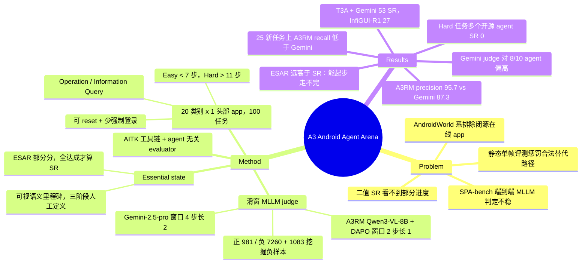

## Summary
A3 是面向真实在线 Android app 的 mobile GUI agent 评测系统：从 Google Play 20 个类别各选一个头部 app（Amazon、YouTube、Gmail、Omio、Pinterest 等）设计 100 个任务，每个任务由人工定义一组 "essential state"（必须达成的、可从截图判定的语义里程碑），用 MLLM judge 沿轨迹滑窗逐个判定，输出 ESAR（已达成里程碑比例）与全部达成才计成功的 SR。judge 有两种：Gemini-2.5-pro（窗口 4 / 步长 2）或在 Qwen3-VL-8B 上用 DAPO 微调的 A3RM（窗口 2 / 步长 1），后者在 held-out 测试上 essential-state precision 95.7 高于 Gemini 的 87.3，但 recall 略低。A3RM 评分下最好的开源单模型 InfiGUI-R1-3B SR 27.0、T3A + Gemini-2.5-pro 53.0，Hard 任务上四个开源 agent 的 SR 为 0。

## Problem & Motivation
mobile GUI agent 的评测分两支，作者认为各有结构性缺陷。静态单帧评测（AITW、AndroidControl、AMEX）只测"给定截图预测下一步"，无法反映早期错误的级联后果，还会把合法的替代路径（例如用 ADB 而非从 launcher 打开 app）判错。动态评测（AndroidWorld、AndroidLab、B-MoCA、AndroidArena）通过改造开源 / 离线 app 的源码来读取内部状态，代价是把购物、出行、新闻、票务这类闭源主流 app 全部排除；任务也偏向"开计时器、录音"这种 API 助手就能做的系统工具操作。SPA-bench 虽然纳入在线 app，但环境不稳定、无法自动 reset，且用 MLLM 对整条轨迹做端到端判定（A3 转述其准确率约 80%）。指标层面，AndroidWorld 的二值 SR 看不到部分进度；AndroidLab 的 sub-goal SR 绑定到预定义的 JSON key-value（如 `Phone: 12345678`），只适用于部分 operation 任务。

因此需要同时满足三件事：任务来自用户真正使用的在线 app、环境可重置、判定对 UI 变动和多路径鲁棒且能给部分分。A3 的回答是把"任务是否完成"降解为"若干语义里程碑是否逐个达成"，再用 MLLM 做每个里程碑的局部判定。

## Method
**App 与任务（§3.1、Appendix A.1）**。自顶向下筛选：先从 Google Play 榜单取 20 个类别，每类评估多个候选后保留一个 app，硬性标准是"最少强制登录 + 支持可靠的环境 reset"；最终 20 个 app 平均下载量 1.15 亿。100 个任务对齐各 app 的核心功能（Amazon 只做购物、CNN 只做新闻检索）。两条分类轴：按目标分 Operation（改变状态的动作序列）与 Information Query（还要抽取信息回答问题）；按人类专家步数 N 分 Easy（N < 7）、Medium（7 ≤ N ≤ 11）、Hard（N > 11）。Table 1 把 A3 定位为唯一同时覆盖 Operation、Information Query 与 Online app 的英文动态 benchmark（SPA-bench 为中文、Table 1 记其无 Information Query）。

**Essential state 与指标（§3.2）**。essential state 定义为任务成功必经的、可从连续截图与动作观察到的语义里程碑，与 AndroidLab 绑定 view ID / 字符串匹配的 sub-goal 的区别在于它描述"达成了什么"而非"代码如何渲染"，因此 app 内容刷新不影响定义。例：Pinterest 搜 "marvel comics" 问第一个 pin 作者，三个状态为 (1) 已搜索该关键词 (2) 已选中第一个 pin (3) 已识别作者。定义走三阶段人工流程：两名操作员用不同策略各完成一次任务；二人基于轨迹共同提出状态集合，须满足 visual verifiability / criticality / sufficiency；再由独立评估者审核。指标 ESAR = N_AES / N_TES；任务成功当且仅当该任务全部 essential state 判为达成。Table 8 列出 10 个样例任务，状态数 3–7 个不等。

**滑窗 MLLM 判定（§3.3、Appendix A.3）**。预设大小的窗口按固定步长扫过轨迹截图序列，每个窗口内的帧拼成一张合成图交给 MLLM，问其中是否有任一 essential state 被达成。作者解释两端失效的原因：窗口小且不重叠时，动作与其屏幕结果可能被切到相邻窗口；窗口大于 4 时每帧被大幅缩放，小字与控件不可读。Gemini-2.5-pro 上窗口 2–6 的扫描（Table 5）显示窗口 3–4 最好（essential-state acc 0.95、task acc 0.91），其中 (4, 2) 被选中的理由是"成本最低"（表中 $0.098，注释为三个 MLLM 在 30 个任务上的总 API 花费，单位口径不清）。但这只在同时达到 0.95 / 0.91 的配置中成立：(4, 3) 为 $0.071、精度 0.95 / 0.90，更便宜且只差一个点。

**A3RM（§4.1、Appendix A.8）**。为去掉 API 成本，在 Qwen3-VL-8B 上用 DAPO（EasyR1 代码库）微调一个专用 judge，L40s 上 600 GPU-hour。8B 模型的初步实验显示窗口 2 最好，故数据与训练统一用窗口 2 / 步长 1。数据来自每个任务平均 3 条人工成功轨迹：标注者标出 essential state 达成的那个状态转移作为正样本（981 条），专家轨迹内其余转移为负样本（7,260 条）；再利用 Gemini judge "高 recall 低 precision" 的特性，从 agent 轨迹中挖出 1,083 条额外负样本。训练时正样本过采样 4 倍以防坍缩到全负预测。

**工具链（§3.4）**。AITK（Android Interaction Toolkit）负责 agent 动作到统一动作空间的翻译、设备控制、逐步状态采集与数据保存，插件式接入 agent 与任务；evaluator 与 agent 无关，可对任意标准轨迹数据运行。代码在 GitHub（AITK 仓库）。

## Key Results
**judge 质量（Table 2，held-out A3 测试集，规模未给出）**。essential-state 层面 Gemini-2.5-pro P / R / F1 / Acc = 87.3 / 96.3 / 91.5 / 89.5，A3RM = 95.7 / 94.8 / 95.3 / 96.6；task 层面 Gemini 85.7 / 96.0 / 90.6 / 95.0，A3RM 96.0 / 96.0 / 96.0 / 98.0。作者强调 precision 对 reward modeling 更关键（避免奖励失败轨迹），并承认 A3RM 是针对 A3 任务分布的专用模型。

**agent 表现（Table 3，A3RM 判定，SR / ESAR，%）**。T3A + Gemini-2.5-pro 53 / 66.4；InfiGUI-R1-3B 27 / 52.1；UI-Venus-7B 20 / 32.0；Qwen3-VL-8B 17 / 38.2；Mobile-Use + Qwen2.5-VL-7B 16 / 39.5；T3A + Qwen2.5-VL-7B 15 / 30.7；GUI-OWL-7B 14 / 32.0；UI-Genie-7B 13 / 32.1；UI-TARS-1.5-7B 12 / 28.2；Qwen2.5-VL-7B 3 / 14.2。Hard 子集上 UI-Genie、GUI-OWL、Qwen3-VL、Mobile-Use 的 SR 为 0.0，T3A + Gemini 为 44.0。Information Query 普遍远低于 Operation（InfiGUI-R1 7.1 vs 34.7；T3A + Gemini 46.6 vs 55.6）。所有 agent 的 ESAR 都明显高于 SR，作者据此把主要失败模式定为"能起步、走不完"。

**框架 vs 基座**。Qwen2.5-VL-7B 裸跑 SR 3.0，套 Mobile-Use 升到 16.0、套 T3A 升到 15.0；同一 T3A 换 Gemini-2.5-pro 为 53.0。Qwen3-VL-8B 裸跑 17.0。

**Gemini 判定（Appendix A.4，Table 6）**。T3A + Gemini 58、InfiGUI-R1 29、T3A + Qwen2.5-VL 24、Qwen3-VL 23、Mobile-Use 19、Qwen2.5-VL 5。10 个 agent 中 8 个在 Gemini 判定下分数更高（58 vs 53、29 vs 27、19 vs 16），例外是 UI-TARS-1.5（8 vs 12）与 GUI-OWL（12 vs 14）。作者称之为商业 judge 的 "optimism bias"，排序基本一致。

**judge 泛化（Appendix A.6，Table 7，25 个新任务）**。essential-state 层面 Gemini 87.5 / 93.3 / 90.3 / 87.1，A3RM 93.1 / 91.1 / 92.1 / 90.0，用新任务数据继续训练的 A3RM-Continued 97.7 / 95.6 / 96.6 / 95.7；task 层面 Gemini 93.4 / 88.2 / 90.7 / 88.0，A3RM 94.1 / 94.1 / 94.1 / 92.0，Continued 100.0 / 94.1 / 97.0 / 96.0。正文称 A3RM 在新任务上"across all metrics"优于 Gemini，但表中 essential-state recall 为 91.1 < 93.3，与该表述不符。

**失败案例（Appendix A.5）**。通用问题：progress unawareness（重复做已完成的步骤、完成后不发 stop 直到超步数被终止）、screen misunderstanding（认错元素、坐标偏移）。在线 app 特有：相似结果中的排序干扰（YouTube 总点第一个视频而不滚动找目标）、弹窗广告与赞助内容造成死锁（Chrome、Home Workout）、Amazon / Omio 的密集信息与多级筛选菜单。

**作者自述局限**。仅 Android（iOS 无法虚拟化与程序化控制）；排除即时通讯类（账号 reset 不可行）；A3RM 仍是概率模型、存在幻觉。

## Evidence Ledger
| Claim ID | Claim | Type | Source locator | Evidence excerpt | Status |
|:--|:--|:--|:--|:--|:--|
| C1 | 100 个任务、20 个 app、20 个 Google Play 类别；20 个 app 平均下载量 1.15 亿 | number | §3.1 p.3777 | "final selection of 20 applications, averaging 115 million downloads each" | source-verified |
| C2 | 难度按人类专家步数 N 划分：Easy N<7、Medium 7≤N≤11、Hard N>11；任务分 Operation 与 Information Query | benchmark-setting | §3.1 p.3777 | "Easy (N < 7), Medium (7 ≤ N ≤ 11), and Hard (N > 11)" | source-verified |
| C3 | essential state 由三阶段人工流程定义：两名操作员各走一条不同策略轨迹 → 共同提出满足 visual verifiability / criticality / sufficiency 的状态集 → 独立评估者审核 | benchmark-setting | §3.2 p.3778 | "Trajectory Diversity ... Collaborative Definition ... Independent Audit" | source-verified |
| C4 | ESAR = 已达成 essential state 数 / 总数；任务成功当且仅当全部 essential state 达成 | benchmark-setting | §3.2 p.3778 Eq. | "ESAR = N_AES / N_TES ... determined by the successful completion of all its associated essential states" | source-verified |
| C5 | Gemini-2.5-pro 滑窗扫描中窗口 3–4 最优（essential-state acc 0.95、task acc 0.91）；选 (4, 2) 因成本最低 0.098 | number | Appendix A.3; Table 5 p.3784 | "window size of 4 and an interval size of 2 achieves the lowest average computational cost" | source-verified |
| C6 | A3RM 基座 Qwen3-VL-8B，DAPO（EasyR1）训练，L40s 600 GPU-hour；窗口 2 / 步长 1 | benchmark-setting | §4.1 p.3779; Appendix A.8 p.3787 | "We use L40s (48G) to train A3RM for 600 GPU-hour" | source-verified |
| C7 | A3RM 训练数据：专家轨迹 8,241 条逐步样本（981 正 / 7,260 负）+ agent 轨迹挖掘 1,083 条负样本；正样本过采样 4 倍 | number | §4.1 p.3779–3780 | "8241 stepwise samples ... (981 positive and 7260 negative samples), augmented with 1083 negative samples" | source-verified |
| C8 | Table 2：essential-state 层 A3RM precision 95.7 vs Gemini 87.3、recall 94.8 vs 96.3；task 层 precision 96.0 vs 85.7、recall 均 96.0 | number | Table 2 p.3780 | "Precision 87.3 95.7 / Recall 96.3 94.8 ... Precision 85.7 96.0 / Recall 96.0 96.0" | source-verified |
| C9 | Table 3（A3RM 判定）overall SR / ESAR：T3A + Gemini-2.5-pro 53 / 66.4；InfiGUI-R1 27 / 52.1；Qwen2.5-VL 3 / 14.2 | number | Table 3 p.3781 | "T3A + Gemini-2.5-pro SR ... 53 ESAR ... 66.4" | source-verified |
| C10 | Table 3 Hard 子集 SR 为 0.0 的 agent：UI-Genie、GUI-OWL、Qwen3-VL、Mobile-Use + Qwen2.5-VL | number | Table 3 p.3781 | "Hard ... 0.0" rows for UI-Genie / GUI-OWL / Qwen3-VL / Mobile-Use | source-verified |
| C11 | Qwen2.5-VL 裸跑 SR 3.0，套 Mobile-Use 16.0、T3A 15.0；T3A 换 Gemini-2.5-pro 为 53.0 | comparison | §4.2 p.3780–3781 | "performance jumps to 16.0% and 15.0% respectively ... skyrockets to 53.0%" | source-verified |
| C12 | Table 6（Gemini 判定）：T3A + Gemini 58、InfiGUI-R1 29、Mobile-Use 19；Gemini 判定几乎对所有 agent 高于 A3RM 判定 | comparison | Appendix A.4; Table 6 p.3786 | "scored at 58.0% by the Gemini evaluator but drops to 53.0% under A3RM" | source-verified |
| C13 | Table 7（25 个新任务）essential-state recall：Gemini 93.3、A3RM 91.1，而正文称 A3RM "across all metrics" 优于 Gemini | comparison | Appendix A.6; Table 7 p.3787 | "A3RM still outperforms Gemini-2.5-pro on unseen tasks across all metrics" vs Table 7 Recall 93.3 / 91.1 | source-verified |
| C14 | Table 1 中 A3 是唯一 Operation ✓ / Inf. Query ✓ / Online ✓ 的条目；SPA-bench 记为 Online ✓ 但 Inf. Query ✗，且为中文 | benchmark-setting | Table 1 p.3776 | "SPA-bench provides another 20 apps and 170 tasks in Chinese" | source-verified |
| C15 | A3 转述 SPA-bench 的端到端 MLLM 轨迹判定准确率约 80%（非本文复测） | comparison | §3.3 p.3779 | "resulted in an accuracy of approximately only 80% in trajectory evaluations" | source-verified |
| C16 | 代码与工具链发布在 GitHub YuxiangChai/AITK；所用 agent 的 license 为 MIT（GUI-OWL、UI-Genie）与 Apache（UI-TARS、UI-Venus、InfiGUI-R1、Qwen2.5/3-VL） | license-code | p.3774 footnote; Appendix A.7 p.3787 | "MIT license: GUI-OWL, UI-Genie. Apache: UI-TARS, UI-Venus, InfiGUI-R1, Qwen2.5/3-VL" | source-verified |
| C17 | 作者自述局限：仅 Android、排除即时通讯类 app、A3RM 仍有幻觉 | benchmark-setting | Limitations p.3782 | "we exclude specific high-frequency categories like instant messaging" | source-verified |
| C18 | 论文未给出 Table 2 所用 held-out A3 测试集的样本数 | benchmark-setting | §4.1; Table 2 p.3780 | "on a held-out A3 test set"（无规模说明） | source-verified |

## Strengths & Weaknesses
**亮点**
- 瞄准的是真正的空白：AndroidWorld 一系的动态评测把闭源在线 app 整体排除，而那才是用户日常使用的 app。A3 用"可 reset 且少强制登录"作为硬筛选条件，在 ecological validity 和可复现之间给出一个明确的工程折中。
- essential state 是一种与 UI 内部实现解耦的里程碑定义，只描述达成了什么。它天然容忍多路径，给出部分进度（ESAR），且 app 内容刷新不需要重标。这与 [[2510-ColorBench]] 的图节点 milestone 是同一思路的两端：ColorBench 用静态图换确定性判定，A3 用 MLLM 判定换真实在线环境。
- 把 judge 任务从"看整条轨迹判成败"拆成"看一个窗口判一个里程碑"，是让 MLLM 判定可靠的正确方向。精度数据与 vault 中 [[2607-OSReward]]（judge 整体偏宽松）、[[2607-SeekJudge]]（先定位再抽取）的结论一致。
- A3RM 的结果有一个值得记住的点：专用 8B judge 在 precision 上大幅高于 Gemini-2.5-pro（95.7 vs 87.3），而 Gemini 的优势在 recall。对 RL reward 而言 precision 更重要，这与 [[2510-CUARewardBench]] 用 UPE 牺牲覆盖换 precision 的取向一致。
- Appendix A.5 对在线 app 特有失败（排序干扰、弹窗广告、赞助内容）的归纳是离线 benchmark 给不出的信息。

**局限与疑问**
- judge 是 in-distribution 的：A3RM 用这 100 个任务的人工轨迹训练，又用来给这 100 个任务打分。Table 2 的 held-out 测试集规模未说明（C18），泛化只在 25 个新任务上测过，而且那里 essential-state recall 已低于 Gemini（C13）。把 A3RM 当通用 GUI reward model 使用缺乏证据。
- 在线 app 的可复现性只被断言、未被描述："reliable programmatic resets" 的实现机制（清数据、重装、还是账号级 reset）正文没有交代。Information Query 任务的答案随内容实时变化，没有固定 ground truth，judge 实际只能核对"答案与截图一致"而非"答案正确"（这是我的推断，论文未讨论）。
- judge 与 agent 共用模型家族：最强 agent 是 T3A + Gemini-2.5-pro，Gemini 又是 judge 之一。A3RM 判定下差距仍在，部分缓解了这一担忧，但 A3RM 的 hard negative 也是用 Gemini 标签挖出来的。
- 100 个任务意味着 SR 的分辨率是 1 个百分点，没有多次运行或方差报告。UI-Genie 13 / GUI-OWL 14 / UI-TARS-1.5 12 这类差异不应解读为排序。
- 滑窗判定对每个窗口问"是否有任一 essential state 达成"，未说明是否强制状态顺序，也未说明一个状态被多窗口重复判定时如何合并。
- 成本数字（Table 5）的单位口径含混，无法与其他 benchmark 比较。

**对领域的意义**。A3 是"里程碑式过程评测"这条线在闭源在线 app 上的 MLLM 判定版本，与 ColorBench（静态图）、[[2500-ProbenchBenchmarkingGuiAgents]]（过程信息提供者）、[[2600-Adaptive Milestone Reward for GUI Agents]]（里程碑作 RL reward）构成同一问题的不同实现。它最有价值的产出可能不是排行榜，而是"专用小 judge 的 precision 可以超过商业大模型"这一数据点，以及对在线 app 失败模式的归纳。

## Mind Map

## Notes
- **笔记重写记录**：本笔记 2026-10-15 依据 ACL 2026 Findings 全文（pp. 3774–3789）重写。2026-04-21 的旧版 Key Results 中"成功完成率 85%、响应时间减少 15%、用户满意度"等数字在原文中不存在，已全部删除。CUA-Survey 与 ColorBench 笔记中对本文的引用（essential state 程序化评测、依赖 MLLM reward model）与新版内容一致，无需改动。
- **版本差异**：arXiv v1（2025-01）为早期版本；ACL 2026 Findings 版新增 A3RM、Qwen3-VL 系列 agent、泛化与滑窗实验。本笔记数字均以 ACL 版为准。
- **与 [[2310-ThemisToolAugmentedRM]] 的关联**：两篇都在回答"reward model 的判断依据从哪来"。Themis 让 RM 调用外部工具取证，A3RM 让 judge 看截图窗口取证；A3 的 precision-over-recall 取向正是 Themis 没有讨论的问题。
- **可追问**：A3RM 在 OSWorld / AndroidWorld 轨迹上的 precision 是多少？若能保持 90% 以上，它就是一个可用的 mobile GUI RL reward；若不能，A3 的贡献仍限于 benchmark 本身。
