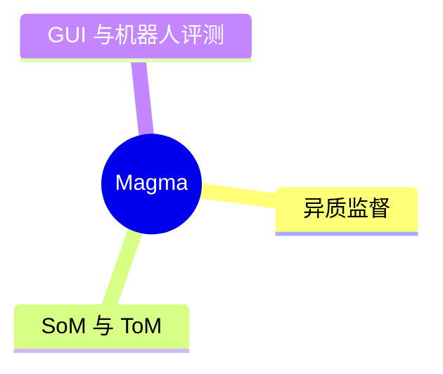

## Summary

Magma 通过统一预训练接口在一个模型上学习数字 GUI 的元素定位和物理世界的动作预测，并分别评估软件操作与机械臂操控。 [原文](https://arxiv.org/html/2502.13130v1)

## Problem & Motivation

GUI 数据多用二维动作坐标，机器人数据还包含位姿与夹爪等自由度。论文研究异质监督怎样形成可复用的空间能力。

## Method

Set-of-Mark 用视觉标记连接可操作目标与语言。Trace-of-Mark 用视频中的标记轨迹提供时间和运动监督。预训练将两种表示用于界面图、视频和机器人数据。真机场景另以任务示范做适配。

## Key Results

共同预训练模型分别参加 ScreenSpot、VisualWebBench 和 SimplerEnv 评测。真机 WidowX-250 实验覆盖四种桌面任务，每种用约 50 条示范微调并评测 10 次。Table 3 中，简单混合 UI 与机器人数据时 ScreenSpot 和两个 SimplerEnv 机器人指标均低于对应单域设置。使用 SoM 和 ToM 后，Full 设置三个指标均高于其未用 SoM 和 ToM 的对应行。

## Evidence Ledger

| Claim ID | Claim | Type | Source locator | Evidence excerpt | Status |
|:--|:--|:--|:--|:--|:--|
| C1 | 同一预训练模型分别做软件端 GUI 与仿真机器人评测 | benchmark-setting | §5.1.1 Table 2 | ScreenSpot, SimplerEnv | source-verified |
| C2 | 微调后的模型在 WidowX-250 评估四任务，每任务 10 次 | benchmark-setting | §5.1.2 Figure 9, Appendix B.2.2 | Robot Manipulation | source-verified |
| C3 | 直接混合数据使部分 GUI 及机械臂指标下降，统一标记监督后改善 | comparison | §5.1.1 Table 3 | Ablation Studies | source-verified |

## Strengths & Weaknesses

同时提供跨域学习证据和朴素混合对照。真实机器人和数字界面各自有独立的任务与适配条件，论文没有以需要交替使用两类执行器的混合工作流验证一个在线策略。

## Mind Map

## Notes

- [[Topics/AgenticRobotArm-Survey]]
