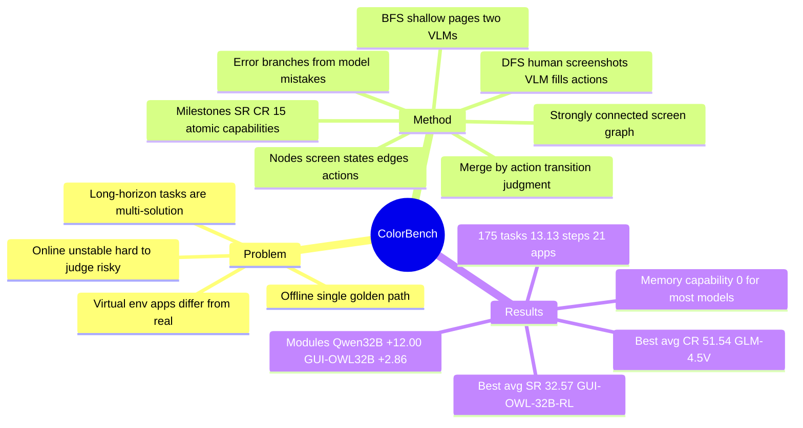

## Summary
把真实手机 app 中有限的屏幕状态抽成一张强连通有向图（节点 = 屏幕状态、边 = 动作），让 agent 在预采集的静态截图上做"准动态"交互，从而在离线轨迹匹配与在线真机评测之间取一个可复现、可自动判定的中间点。在此之上构建 ColorBench：175 个以中文 app 为载体的长程任务（74 单应用 / 101 跨应用，平均最优路径超过 13.13 步），每题至少两条正确路径，用子任务 milestone 给出 SR / CR 与 15 项 atomic capability 诊断。13 个模型中最高平均 SR 仅 32.57%（用 ColorBench-train 微调的 GUI-OWL-32B），最高 CR 51.54%（GLM-4.5V）；外挂 planning / reflection / memory 模块给 Qwen2.5-VL-32B 带来 +12.00pp SR，给 GUI-OWL-32B 仅 +2.86pp。

## Problem & Motivation
mobile GUI agent 的评测被两种范式撕开。离线静态评测（AndroidControl、GUI-Odyssey、Meta-GUI 一类）只能对一条 golden path 做 step-level 匹配：真实任务常有多条合法解，匹配不上就算错；指标偏向步级正确率而非任务完成；也无法定位是哪一种原子能力拖垮了任务。作者把这归结为"offline-online evaluation discrepancy"——离线分数与真机表现不一定正相关。在线动态评测则分两支：AndroidWorld / AndroidLab 这类虚拟环境里的 app 与真实商业 app 的交互模式不同；真机评测最真实，但页面加载延迟、广告弹窗造成不稳定，高度动态的 GUI 难以自动判定、依赖人工，且登录态下存在误付款、删数据、泄露隐私的风险，可复现性差。

作者的切入点是：真机交互中 agent 实际经历的屏幕状态是有限的，可以用一张有限状态图做"静态模拟动态"，保留离线的稳定与可复现，同时允许多解、回退与重试。长程复合任务（多个原子子任务串行 / 并行 / 递归组合、天然多解）恰好是最需要这种评测形态的场景。

## Method
**图的定义（§3.1）**：强连通有向图 G = (V, E)。V 是屏幕状态集合，以"动作转移"为粒度区分节点——功能相同但推荐内容随机变化的页面归入同一节点、保留多张截图，评测时随机返回一张以模拟真机随机性；E 是动作转移，每条边对应一个具体动作（如 click bbox[x1,y1,x2,y2]、type[TEXT]），与真机评测的 action space 一一对应。所有任务都从统一的 HOME 节点出发，agent 根据指令与当前截图选动作、沿边转移。动作空间 9 个：click、long press、swipe、type、wait、open、navigate back、navigate home、complete（Appendix A.1）。

**构建流程（§4.2）**，两阶段：
- *轨迹采集*。BFS 覆盖每个 app 的浅层高频页面：VLM A 识别页面上所有可交互元素，VLM B 逐个点击并记录轨迹。DFS 覆盖复杂长程任务：专家团队设计多解任务，操作员在真机上逐步截图，再由 VLM 在相邻截图之间补全动作（"screenshot-based action completion"），人工核验；之后让模型自己跑同样任务，把模型实际点错的区域当作高概率分支，补采对应的错误分支轨迹（"branch trajectory supplementation"）。
- *合并成图*。先用 LLM 给每张截图生成语义描述、做 embedding 相似度粗筛，再把高相似对交给 VLM 做细判：判据不是内容相似，而是两图之间是否存在改变界面状态的 action transition（如"关注"按钮状态变化、购物车计数更新）——有则分属不同节点。最后人工纠正误判并补标各状态节点上的通用动作。bbox 标注用两个 VLM 分别出大 / 小候选框、第三个 VLM 选优、专家复核（Appendix A.2）。

自动化流程中 Qwen2.5-VL-72B 负责元素识别、动作补全与页面描述，bge-large-zh-v1.5 做 embedding，GUI-OWL-32B 专做 bbox 标注（Appendix A.3.1）。BFS 阶段覆盖 Weixin、Meituan、Jingdong、Xiaohongshu 四个 app 得 6300 张截图，DFS 阶段 1343 张，人工补 50 张，去重后最终图含 1989 张截图（Appendix A.3.2）。

**任务与指标（§4.1、§5.1.1）**：任务指令刻意"部分模糊"以产生有限、可控的多解集合（做法参照 Mobile-Bench-v2）。175 个任务（101 跨应用 / 74 单应用），排除广告、弹窗、次优路径后平均最优路径超过 13.13 步（Table 1 记 13.13），Table 1 记为 21 个 app（完整清单未给出；BFS 阶段的四个 app 与 Table 6 任务涉及的 app 均为中文应用）。每个子任务对应图上一个 milestone 节点：到达全部 milestone 记 SR 成功，到达比例记为 CR；把所有 milestone 按共性归为 15 项 atomic task capability（follow、pay、save、search、share、set、find、copy、filter、like、send、location、navigation、others、memory），AC = 该类子任务成功数 / 实际执行数，分母排除因前序子任务失败而从未执行的子任务。

**基线（§5.1.2）**：闭源 GPT-4o、Qwen-VL Max、GLM-4.5V（因 grounding 弱，统一挂 Qwen2.5-VL-7B 做 click / long-press 的目标定位）；开源 OS-Atlas-Pro-7B、UI-TARS-1.5-7B、UI-TARS-7B-DPO、UI-TARS-72B-DPO、GUI-OWL-7B / 32B、Qwen2.5-VL-7B / 32B / 72B、Qwen3-VL-235B-A22B-Instruct；两个定制 baseline——用静态中文 app 训练集（ColorBench-train）对 GUI-OWL 做 RL 微调，以及一个带 planning / reflection / memory 的简单 multi-agent 系统。开源模型用 vLLM 0.10.1 跑在 A100 80G，temperature 0.1、top_k 5、top_p 0.9、max_tokens 1024，节点多图随机返回的种子为 2025（Appendix B.1）。

## Key Results
- **图的可构建性（§5.2，Figure 4）**：统计所有模型在各节点上倾向执行的动作数（排除 back / home / open app），最大 17（app 首页）、最小 0（任务终点）、平均 1.9。作者以此论证真机评测中模型实际经历的状态与分支是有限的。
- **真机 vs 图（Appendix Table 6）**：挑了一部分可在真机上执行的任务做对照，逐条记录两种环境下的失败原因（如真机"误点广告" vs 图上"未搜到店铺"）；作者据此称图覆盖了真机失败的主要原因。只有 10 条任务的定性对照，没有定量相关性。
- **主表（Table 2，平均 SR / CR，%）**：闭源 GLM-4.5V 28.57 / 51.54，Qwen-VL Max 17.14 / 30.74，GPT-4o 15.43 / 24.10。开源 Qwen3-VL-235B-A22B-Instruct 30.86 / 46.06，GUI-OWL-32B 28.57 / 42.78，UI-TARS-72B-DPO 28.00 / 46.01，GUI-OWL-7B 20.57 / 36.29，Qwen2.5-VL-72B 18.86 / 33.16，Qwen2.5-VL-32B 17.14 / 32.53，Qwen2.5-VL-7B 15.43 / 33.51，OS-Atlas-Pro-7B 6.86 / 19.04，UI-TARS-1.5-7B 4.00 / 15.15（cross-app SR 为 0.00），UI-TARS-7B-DPO 4.00 / 11.91。全表最高平均 SR 是用 ColorBench-train 微调后的 GUI-OWL-32B-RL 32.57，最高平均 CR 是 GLM-4.5V 51.54。跨应用一致低于单应用。
- **ColorBench-train 微调**：GUI-OWL-7B 平均 SR 20.57→24.57、CR 36.29→43.83；GUI-OWL-32B SR 28.57→32.57、CR 42.78→47.10。
- **multi-agent 模块消融（Table 3）**：三模块全开时 Qwen2.5-VL-32B 平均 SR 17.14→29.14（+12.00）、CR 32.53→46.58（+14.05）；GUI-OWL-32B 平均 SR 28.57→31.43（+2.86）、CR 42.78→48.67（+5.89）。对 Qwen2.5-VL-32B，单加 reflection 是最大的单项增益（single-app SR 24.32→37.84，+13.52）；在 reflection 之上再加 planning，single-app SR 反而降到 35.14，CR 则从 48.65 升到 51.35。对 GUI-OWL-32B，单加 planning 使 single-app SR 36.49→35.14、平均 SR 28.57→28.00；其 cross-app CR 随模块增加而下降（plan 46.03 / reflection 46.26 → plan+reflection 44.82 → 三模块 43.40），但仍高于 baseline 39.31。作者解释为模块间能力失衡、低质量信息增加系统熵。
- **atomic capability（Table 5）**：作者强调应看低分而非高分——GLM-4.5V 的 SR / CR 都高，但 save 为 0.00；UI-TARS-72B-DPO 的 filter 仅 22.22。memory 一列只有 GLM-4.5V（45.45）、UI-TARS-72B-DPO（28.57）、Qwen3-VL-235B-A22B-Instruct（50.00）非零，其余模型全是 0.00，即绝大多数模型无法跨子任务记住关键信息（典型失败：在小红书查到论文标题后到 arXiv 搜索时已忘记标题、陷入循环）。
- **作者的三条判断（§5.3）**：(1) 大模型普遍更好，GUI-OWL 与 Qwen 系列都随规模单调上升；(2) GUI 专用微调模型不必然优于通用模型——作者以 UI-TARS 与 OS-Atlas-Pro 的 7B 为证（Table 2 平均 SR 4.00 / 4.00 / 6.86，低于通用的 Qwen2.5-VL-7B 15.43；原文未点名比较对象，此对照是本笔记据表读出），归因于微调过拟合，但 GUI-OWL 系列的强表现说明专用模型仍有前景；(3) 对手机操作知识的缺失（复制、粘贴、分享等基本动作）是 GPT-4o 落后的主因。

## Evidence Ledger
| Claim ID | Claim | Type | Source locator | Evidence excerpt | Status |
|:--|:--|:--|:--|:--|:--|
| C1 | ColorBench 含 175 个任务：74 single-app、101 cross-app | number | Abstract; §4.1 | "comprises 175 such tasks—101 cross-app and 74 single-app" | source-verified |
| C2 | 排除广告、弹窗、次优路径后，平均最优路径 13.13 步（§4.1 写 "exceeds 13.13"，Table 1 记 13.13） | number | §4.1; Table 1 | "the average optimal path length exceeds 13.13 steps" | source-verified |
| C3 | 每个任务至少含 2 条正确路径与若干典型错误路径 | benchmark-setting | Abstract | "Each task includes at least two correct paths and several typical error paths" | source-verified |
| C4 | Table 1 中 ColorBench 覆盖 21 个 app | number | Table 1 | "ColorBench 175 13.13 21 ✓ ✓ ✓" | source-verified |
| C5 | 定义 15 种 atomic task capability；AC 分母排除因前序子任务失败而从未执行的子任务 | benchmark-setting | §4.1; §5.1.1 Eq.(1) | "The denominator excludes subtasks that were never executed due to failure in preceding subtasks." | source-verified |
| C6 | 强连通有向图，节点 = 屏幕状态、边 = 动作；所有任务从统一 HOME 节点出发 | benchmark-setting | §3.1 | "strongly connected directed graph ... each task originates from a unified 'HOME' node" | source-verified |
| C7 | BFS（VLM A 识别元素、VLM B 执行）+ DFS（人工截图、VLM 补动作、人工核验）+ 按模型实际错误补分支；合并用 embedding 粗筛 + VLM 判 action transition + 人工核验 | causal-mechanism | §4.2.1; §4.2.2 | "VLM A first identifies and stores all interactive UI elements ... VLM B performs interaction operations on each identified UI element" | source-verified |
| C8 | Qwen2.5-VL-72B 做元素识别 / 动作补全 / 页面描述，bge-large-zh-v1.5 做 embedding，GUI-OWL-32B 专做 bbox 标注 | benchmark-setting | Appendix A.3.1 | "GUI-OWL-32B ... is employed exclusively for bounding box annotation" | source-verified |
| C9 | BFS 四个 app 6300 张、DFS 1343 张、人工补 50 张，最终图 1989 张截图 | number | Appendix A.3.2 | "yielding 6300 trajectory screenshots ... additional 1343 ... supplemented 50 screenshots ... contains 1989 carefully curated screenshots" | source-verified |
| C10 | 各节点潜在动作数（排除 back / home / open app）：最大 17（app 首页）、最小 0、平均 1.9 | number | §5.2; Figure 4 | "the maximum value is 17 corresponding to the APP's home page ... The average value is 1.9" | source-verified |
| C11 | 部分任务做真机对照，Table 6 列两种环境的失败原因；作者据此称图覆盖真机失败主因（定性，10 条） | comparison | §5.2; Appendix Table 6 | "These examples demonstrate that ColorBench covers the primary causes of task failure in real-device evaluations." | source-verified |
| C12 | 最高平均 SR 32.57%（GUI-OWL-32B-RL），最高平均 CR 51.54%（GLM-4.5V） | number | Table 2 | "GUI-OWL-32B-RL ... 32.57 47.10"; "GLM-4.5V ... 28.57 51.54" | source-verified |
| C13 | 平均 SR / CR：GLM-4.5V 28.57 / 51.54；Qwen-VL Max 17.14 / 30.74；GPT-4o 15.43 / 24.10 | number | Table 2 | "GLM-4.5V 36.49 56.64 23.23 47.72 28.57 51.54" | source-verified |
| C14 | UI-TARS-1.5-7B cross-app SR 0.00、平均 4.00；UI-TARS-7B-DPO 平均 4.00；OS-Atlas-Pro-7B 平均 6.86 | number | Table 2 | "UI-TARS-1.5-7B 9.46 16.89 0.00 13.88 4.00 15.15" | source-verified |
| C15 | GUI-OWL-7B 20.57 vs Qwen2.5-VL-7B 15.43；GUI-OWL-32B 28.57 vs Qwen2.5-VL-32B 17.14；Qwen2.5-VL-72B 18.86；UI-TARS-72B-DPO 28.00 / 46.01；Qwen3-VL-235B-A22B-Instruct 30.86 / 46.06 | number | Table 2 | "UI-TARS-72B-DPO ... 28.00 46.01"; "Qwen3-VL-235B-A22B-Instruct ... 30.86 46.06" | source-verified |
| C16 | ColorBench-train 微调：GUI-OWL-7B SR 20.57→24.57、CR 36.29→43.83；GUI-OWL-32B SR 28.57→32.57、CR 42.78→47.10 | number | Table 2 | "GUI-OWL-32B-RL 40.54 53.72 26.73 42.25 32.57 47.10" | source-verified |
| C17 | 三模块 multi-agent：Qwen2.5-VL-32B 平均 SR 17.14→29.14（+12.00）、CR +14.05；GUI-OWL-32B 平均 SR +2.86、CR +5.89 | number | Table 3; Table 2 | "29.14+12.00 46.58+14.05"; "31.43+2.86 48.67+5.89" | source-verified |
| C18 | Qwen2.5-VL-32B 单加 reflection single-app SR 24.32→37.84；再加 planning 降至 35.14，CR 48.65→51.35 | number | Table 3（HTML 勾选确认行序）; §5.5 | "SR on single-app tasks decreases. Meanwhile, CR increases" | source-verified |
| C19 | GUI-OWL-32B 单加 planning single-app SR −1.35、平均 −0.57；cross-app CR 46.03 / 46.26 → 44.82 → 43.40，仍高于 baseline 39.31 | number | Table 3（HTML 勾选确认行序）; §5.5 | "35.14-1.35 ... 28.00-0.57"; cross CR "46.03", "46.26", "44.82", "43.40" | source-verified |
| C20 | 闭源模型统一用 Qwen2.5-VL-7B 做 click / long-press 的 grounding | benchmark-setting | §5.1.2 | "we employed Qwen2.5-VL-7b as the grounding model to identify the target UI element for click and long-press actions" | source-verified |
| C21 | vLLM 0.10.1、A100 80G；temperature 0.1、top_k 5、top_p 0.9、max_tokens 1024；节点多图随机返回 seed 2025 | benchmark-setting | Appendix B.1 | "VLLM(0.10.1) on A100 80G ... random seed to 2025 ... temperature=0.1, top_k=5, top_p=0.9, max_tokens=1024" | source-verified |
| C22 | GLM-4.5V save 0.00；UI-TARS-72B-DPO filter 22.22；memory 仅 GLM-4.5V 45.45、UI-TARS-72B-DPO 28.57、Qwen3-VL-235B 50.00 非零，其余 0.00 | number | Appendix B.2; Table 5 | "GLM-4.5V exhibits high SR and CR but a 'save' score of 0 ... 'filter' score is as low as 22.22" | source-verified |
| C23 | 摘要称 code and data 可用于 github.com/MadeAgents/ColorBench；Appendix B.1 写 "将来开源"，正文内部不一致 | license-code | Abstract（HTML href）; Appendix B.1 | "We will open-source the project code in the future." | source-verified |
| C24 | app 以中文应用为主（BFS 四个 app 与 Table 6 任务均为中文 app；21 个 app 完整清单未给出），任务以中文评测、合并 prompt 为中文 | benchmark-setting | Appendix A.3.2; Table 6 caption; Figure 5 caption; §5.1.2 | "The tasks in the table are actually evaluated in Chinese." | source-verified |
| C25 | 作者承认 Mobile-Bench-v2 首次引入 graph-structured benchmark 但缺系统阐释；ColorBench 自称首个 "comprehensive" 长程图式 mobile benchmark | sota-novelty | §2.2; §1 Contributions | "introducing a graph-structured benchmark for the first time, but it lacks systematic explanations" | source-verified |
| C26 | 9 个动作：click、long press、swipe、type、wait、open、navigate back、navigate home、complete | benchmark-setting | Appendix A.1; Table 4 | "Our ColorBench includes nine actions" | source-verified |
| C27 | 作者结论：GUI 专用微调模型不必然优于通用模型，以 UI-TARS / OS-Atlas-Pro 7B 为证（"低于 Qwen2.5-VL-7B" 是本笔记据 Table 2 的对照，原文未点名比较对象）；GUI-OWL 说明专用模型仍有前景 | comparison | §5.3; Table 2 | "Specialized foundation models do not necessarily outperform general-purpose models ... as evidenced by the results of UI-TARS and OS-Atlas-Pro (7B)" | source-verified |
| C28 | 基线：3 闭源 + 10 开源 + 2 定制 baseline（ColorBench-train 微调、multi-agent） | benchmark-setting | §1; §5.1.2; Table 2 | "three commonly used closed-source models and ten open-source models, alongside two customized baselines" | source-verified |
| C29 | 指令"部分模糊"以产生有限可控的多解集合，参照 Mobile-Bench-v2 | benchmark-setting | §4.1 | "we employed partially ambiguous instructions, similar to those in Mobile-Bench-v2 ... to create a finite and controlled set of correct solutions" | source-verified |

## Strengths & Weaknesses
**优点**
- 问题切分清楚：把 mobile 评测的张力定义为"离线可复现 vs 在线真实"，并给出一个具体的中间形态——有限状态图上的准动态交互。对比 AndroidWorld 式的"换一套开源 app 做在线环境"（[[2512-MobileWorld]] 走的路线），这是另一个方向的妥协：保留真实商业 app 的界面，牺牲状态的开放性。
- 指标设计比 SR 有信息量。CR 把"走了多远"量化，AC 把失败定位到原子能力；作者明确说 Table 5 应看低分不看高分，这个读法是对的——GLM-4.5V save = 0、多数模型 memory = 0 比平均 SR 更能指出改进方向。
- 消融结果诚实且有信号：外挂模块的收益高度依赖底座（Qwen2.5-VL-32B +12pp vs GUI-OWL-32B +2.9pp），叠加模块可以让 SR 回落、cross-app CR 单调下降。这与"多 agent 一定更好"的默认叙事相反，值得记。
- 构建流程可复用：BFS/DFS 采集 + action-transition 判据的节点合并 + 人工核验，是一套能扩到其他 app 的 recipe，而非一次性数据集。

**缺点与边界**
- 中心命题"图能缩小 offline-online gap"没有定量验证。证据只有 Appendix Table 6 的 10 条任务定性失败原因对照，没有报告同一组模型在真机与图上的 SR 相关性或排序一致性；而 Figure 4 的"平均 1.9 个后继"是从模型**在 ColorBench 上**的轨迹统计出来的——图只允许它包含的动作，这个数字说明的是图的分支度，不能反推真机状态空间有限。
- 出图动作如何处理，全文未说明（不知道）：agent 执行一个图中不存在的边（点到未标注区域、type 了采集时没有的文本）时是停在原节点、判失败、还是跳随机节点？这直接决定 SR 的含义与"支持回退重试"的真实程度，也决定 type 动作的文本匹配口径。
- 错误分支按模型定制（§4.2.1 "branch trajectory supplementation"、§5.2 "customized testing environment for the model"）：错误路径来自构建时所用模型的实际错误，对这些模型是"熟悉的失败"，对其他模型则可能根本没有对应分支。GUI-OWL-32B 既参与构建（bbox 标注）又是被评测对象与微调底座。
- ColorBench-train 与测试图的关系不清：Table 1 脚注说第三节统计"include the training set"，但没有说明训练集截图 / 任务与评测图是否共享节点。若共享，GUI-OWL 微调后的 +4pp 是 in-distribution 增益，不能当作"补充中文 app 知识"的证据。
- 规模与语言边界：BFS 只覆盖 4 个中文 app，总图 1989 张截图、175 任务；任务用中文评测、合并 prompt 用中文。GPT-4o 的 15.43 里有多少是"不会中文 app"而非"不会手机操作"，无法区分；闭源模型统一挂 Qwen2.5-VL-7B 做 grounding，闭源 vs 开源的比较实际上混入了 grounder 的上限。
- 单次运行、temperature 0.1、无方差；175 任务下 1pp ≈ 1.75 个任务，Table 3 里 ±1.35 的"下降"落在噪声内，作者却据此展开"模块耦合、系统熵增"的机制解释，推测成分大于证据。
- novelty 边界：作者自己承认 Mobile-Bench-v2 已经先引入了 graph-structured benchmark，本文的贡献是系统化的构建方法与 milestone / AC 评测，而非图范式本身。
- code / data：摘要说已可用，Appendix B.1 又说"将来开源"，正文内部不一致；本笔记外部观测到仓库存在（Apache-2.0，2026-04 仍有提交），内容完整性未核。

## Mind Map

## Notes
- 与 [[2512-MobileWorld]] 是同一张力的两个相反解：MobileWorld 用开源替身 app 换后端可验证的在线环境，ColorBench 把真实商业 app 冻结成静态图换可复现；前者保状态开放、后者保界面真实。两者都承认 AndroidWorld 式虚拟环境与真实 app 有分布差。
- 与 [[2500-A3AndroidAgentArena]]：A3 在真实在线 app 上用"essential state"做程序化过程评估、判定依赖 MLLM reward model；ColorBench 的 milestone 是同一思路的确定性版本——因为图是静态的，到达节点即判定，不需要 judge。代价是覆盖范围只有图内状态。
- 与 [[2400-GuiodysseyComprehensiveDatasetCross]]：GUI-Odyssey 是本文 Table 1 里的典型离线跨应用数据集（15.4 步、无交互、单解）；ColorBench 的 175 任务比它小两个数量级，换来多解与回退。
- 与 [[2505-BacktrackAgent]]：BacktrackAgent 的"检测出错→回到执行前页面→重写动作"机制，恰好需要 ColorBench 这种强连通图才能在离线条件下被计分；本文的消融也显示 reflection 是 Qwen2.5-VL-32B 最有效的单项模块。
- 与 [[2500-MobileAgentV3Fundamental]]：GUI-Owl 是本文最强的开源家族，同时被用于构建（bbox 标注）与评测、微调，构建-评测纠缠是解读 GUI-OWL 分数时要带上的边界。
- 与 [[2600-Adaptive Milestone Reward for GUI Agents]]：同一 OPPO / SJTU 团队（Qiqiang Lin、Yin Zhao、Xingyu Lou、Jun Wang、Zhaoxiang Wang、Weiwen Liu 重叠），把本文的 milestone 从评测指标转成 RL 的 process reward；两篇合读可看该组"milestone 作为 credit assignment 单元"的路线。
- 与 [[2504-AgentRewardBench]]：该文测得 LLM judge precision 不过 70%、规则判定 recall 仅 55.9%；ColorBench 用确定性 milestone 绕开 judge 不可靠，但把问题转成了"图外合法路径一律判错"的 recall 风险，正好是规则判定的弱侧。
- **survey 归属**：属于 `Topics/CUA-Survey.md` §8.4 Mobile Agent 的 benchmark 表——应新增一行，类型为"static graph + interaction"（介于 §8.2 Offline Action/Trajectory 与 emulator 之间），verifier 列填"milestone node reached（deterministic）"，解释边界填"仅 4 个中文 app / 1989 截图；出图动作处理未说明；真机对照仅定性"。CR / AC 两个指标可交叉引用到 §8.11 Evaluation Metrics 的能力层级分解，offline-online gap 的定性对照可作 §8.13 Reproducibility 的反例（声称缩小 gap 但未量化）。
- 待追：仓库里有没有出图动作的处理逻辑与 type 文本匹配规则；ColorBench-train 与评测图的节点是否重叠。
