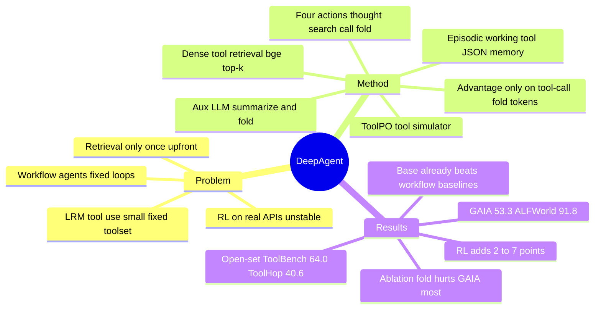

## Summary
DeepAgent 把 tool search、tool call 与 memory fold 都做成大推理模型（LRM）单一推理流里的特殊 token 动作：按需从最多 16k 规模的工具库做 dense retrieval，用 `<fold_thought>` 触发辅助 LLM 把交互历史压成 episodic / working / tool 三段 JSON 记忆，再用 ToolPO（LLM 模拟 API 替代真实调用 + 只落在 tool-call / fold token 上的局部 advantage）做端到端 RL。以 QwQ-32B 为底座，在 5 个通用 tool-use benchmark 与 ALFWorld / WebShop / GAIA / HLE 上全面超过 32B 的 workflow baseline（open-set ToolBench 64.0、GAIA 53.3），但增益的大头来自推理期框架本身——未经 RL 的 Base 版已大幅领先 baseline，ToolPO 再加 2–7 点。

## Problem & Motivation
现有 agent 多数走 ReAct / Plan-and-Solve / CodeAct 这类预定义 workflow：执行步骤与整体流程固定、工具集在任务开始前给定、交互记忆不由模型自主管理、推理被切成一次次孤立的 Reason-Act-Observe。另一条线是把工具调用放进 LRM 的长推理里（Search-o1、Search-R1、ToRL、DeepResearcher、WebThinker），但工具集小且固定（搜索、浏览、代码），不适用于 MCP 式"工具无法预先穷举"的场景。工具检索方向的工作（ToolLLM、ToolGen）又大多只在任务开始时检索一次，不在执行过程中动态发现。

训练侧还有两个具体障碍：直接对接成千上万真实 API 做 RL 不稳定、慢、贵；只用最终结果的稀疏 reward 无法保证中间 tool call 的正确性。DeepAgent 想同时解决"推理期工具规模"和"训练期 tool-use 信号"两个问题。

## Method
**Problem formulation（§3.1）**：序列决策，策略在每步从四类动作里选一个——Internal Thought、Tool Search（自然语言查询 → 返回工具列表）、Tool Call（名字 + 参数 → 执行结果）、Memory Fold（把历史压成结构化记忆并以此重置状态）。目标是最大化轨迹级 reward。

**框架（§3.2–3.3）**：主 LRM（QwQ-32B）在一条连续推理流里生成所有动作；系统拦截特殊 token 并执行。辅助 LLM（Qwen2.5-32B-Instruct）负责三件事：过滤/摘要过长的工具文档、压缩冗长的工具返回、生成折叠记忆。Tool search 是 dense retrieval：用 bge-large-en-v1.5 对每个工具的文档（OpenAI function-definition JSON 格式）预先编码，推理时按 cosine 取 top-k，经辅助 LLM 摘要后以 `<tool_search_result>` 回填。Tool call 用 `<tool_call>{"name":..., "arguments":...}</tool_call>`，结果经辅助 LLM 压缩后以 `<tool_call_result>` 回填。附录 B 注明工具结果的过滤/摘要同样施加于所有 baseline。

**Autonomous memory folding（§3.4，附录 C）**：主模型在任何"逻辑节点"（完成子任务、意识到走错路）可生成 `<fold_thought>`；辅助 LLM 读完整历史，并行生成三段固定 JSON schema 的记忆并替换原始历史：
- Episodic memory：task_description、key_events[{step, description, outcome}]、current_progress；
- Working memory：immediate_goal、current_challenges、next_actions[{type, description}]；
- Tool memory：tools_used[{tool_name, success_rate, effective_parameters, common_errors, response_pattern, experience}]、derived_rules。
作者把这叫"take a breath"——既省 token，也给模型一个脱离错误探索路径的机会。

**ToolPO（§3.5，附录 A.1 / B）**：
- 数据约 4.6k 条：ToolBench 1k 有标注工具 + 1k 需检索；ALFWorld 500 + WebShop 500（取自各自训练集）；WebDancer 200 + WebShaperQA 500；DeepMath 0.9k。
- Tool Simulator：训练期由辅助 LLM 模拟 RapidAPI 等真实 API 的返回，避免真实调用的不稳定与成本。
- 两类 reward：任务成功 reward（最终答案质量）与 tool-call reward；后者由"tool call 是否正确（1/0）"和"memory folding 效率偏好分（对比有折叠与无折叠的轨迹）"组成。按 group-relative 方式分别算全局 advantage（落在全部 token）和动作级 advantage（**只落在 tool-call 与 memory-fold 的 token 上**），逐 token 求和后用 clipped surrogate 优化。
- 训练 100 步，batch 64，最长序列 32,768，最多 50 个动作，VeRL 框架，64 张 H20-141GB。rollout size 与 fold 偏好分的具体公式在 HTML 转文本中被剥离，无法核对。

**推理设置（§4.3）**：最长 81,920 token 生成，temperature 0.7 / top_p 0.8 / top_k 20 / repetition penalty 1.05；搜索与浏览用 Serper 与 Jina Reader，VQA 用 Qwen2.5-VL-32B-Instruct；最多 50 个动作。

## Key Results
全部报 Pass@1；32B 模型内比最优（粗体），更大或闭源模型灰色仅供参考。

- **通用 tool-use，给定 ground-truth 工具（Table 1 Scenario 1）**：DeepAgent-32B-RL 在 ToolBench 69.0、TMDB 89.0、Spotify 75.4，对应最优 32B workflow baseline 分别为 55.0（Plan-and-Solve+QwQ-32B）、55.0 与 52.6（后两者均为 CodeAct+QwQ-32B）。API-Bank 上 RL 75.3 **低于** Base 76.2，也低于 ReAct+GPT-4o 的 79.2；ToolHop 51.3 仅略高于 ReAct+DeepSeek-R1 的 50.2。
- **Open-set 工具检索（Table 1 Scenario 2）**：DeepAgent-32B-RL ToolBench 64.0、ToolHop 40.6；§5.1 称最优 baseline 为 54.0 / 29.0，但表中 ReAct+Qwen2.5-32B 的 ToolBench 为 55.0。API-Bank 开放检索下所有方法都很低（DeepAgent 24.0，baseline 12–22）。
- **ToolPO 相对 Base（§5.1）**：ToolBench 最多 +6.0（有标注 63.0→69.0），Spotify 有标注 +5.2（70.2→75.4）；open-set ToolBench +4.0、ToolHop +2.2。
- **下游应用（Table 2）**：DeepAgent-32B-RL ALFWorld 91.8、WebShop success 34.4 / score 56.3、GAIA All 53.3、HLE All 20.2；同底座的 HiRA 为 84.3 / 23.2 / 42.5 / 13.6。ToolPO 带来 GAIA 46.7→53.3（+6.6）、ALFWorld 88.1→91.8（+3.7），但 GAIA MM 子集 37.5→33.3 下降。灰色参考行：ReAct+Claude-4 ALFWorld 93.3、WebShop score 56.6 高于 DeepAgent；OpenAI Deep Research GAIA 67.4、HLE 26.6 高于 DeepAgent。
- **框架 vs. RL 的贡献拆分（本笔记据 Table 1/2 推算）**：Base 版（无 RL）在 open-set ToolHop 38.4 vs 最优 32B workflow 29.0、WebShop 32.0 vs 21.6（Reflexion+QwQ）、GAIA 46.7 vs 35.2（Reflexion+QwQ）已全部领先；§5.2 把 CodeAct 34.5 / 18.0 称作最优 workflow baseline，与表中 Reflexion 的 35.2 / 21.6 不一致。
- **消融（Table 3，ToolBench / ToolHop / WebShop / GAIA 四项平均）**：完整 48.1；w/o Training 44.3；w/o Memory Folding 44.2（GAIA 53.3→44.7，ToolBench 仅 −1.0）；w/o Tool Simulation 44.8；w/o Tool Adv. Attribution 46.1。
- **检索策略（Table 4，open-set 四项平均）**：DeepAgent 自主检索 52.6 vs 预检索输入 42.0；workflow 方法自主检索最高 28.5（Plan-and-Solve）。§5.5 说自主检索"在所有框架上一致优于预检索"，但 ReAct 在 ToolBench 上是 35.0（预检索）vs 34.0（自主）。
- **换底座（Table 5，五项平均）**：Qwen3-30B-A3B-Thinking 上 DeepAgent(Base) 46.9 vs ReAct 35.7 / Plan-and-Solve 37.0；Qwen3-235B-A22B-Thinking 上 55.7 vs 45.1 / 46.0。
- **训练动态与动作预算（Figure 4 / 5，仅文字描述）**：作者称 ToolPO 比 GRPO reward 与 validation 上限更高、波动更小；在 WebShop / GAIA 上任意最大动作数下 DeepAgent 均优于 ReAct 且差距随预算扩大。图中具体数值无法核查。

## Evidence Ledger
| Claim ID | Claim | Type | Source locator | Evidence excerpt | Status |
|:--|:--|:--|:--|:--|:--|
| C1 | WWW '26 论文，DOI 10.1145/3774904.3792460；作者来自 RUC / Xiaohongshu / Tsinghua，一作在 Xiaohongshu 实习期间完成，通讯作者 Zhicheng Dou | metadata | 页眉 / 作者栏（文本 L110–166） | "Proceedings of the ACM Web Conference 2026 (WWW '26), April 13–17, 2026, Dubai … DOI: 10.1145/3774904.3792460" | source-verified |
| C2 | 代码与 demo 公开于 github.com/RUC-NLPIR/DeepAgent | license-code | Abstract（L170） | "The code and demo are available at https://github.com/RUC-NLPIR/DeepAgent." | source-verified |
| C3 | 四类动作：Internal Thought、Tool Search、Tool Call、Memory Fold | mechanism | §3.1（L271–287） | "An action can be one of four types: Internal Thought … Tool Search … Tool Call … Memory Fold" | source-verified |
| C4 | Tool search 为 dense retrieval（cosine top-k），嵌入模型 bge-large-en-v1.5，工具文档用 OpenAI function-definition JSON | mechanism | §3.3 L314 / §4.3 L1027 / App. B L2236 | "tool retriever operates via dense retrieval … cosine similarity"; "bge-large-en-v1.5"; "standard OpenAI function definition format" | source-verified |
| C5 | `<fold_thought>` 触发辅助 LLM 并行生成 episodic / working / tool 三段 JSON 记忆并替换原始历史 | mechanism | §3.4 L329–337 / App. C L2242 | "generating a special token: <fold_thought>"; "three structured memory components in parallel"; "replace the raw interaction history" | source-verified |
| C6 | ToolPO：任务 reward + tool-call reward（正确调用 1/0 + 折叠效率偏好分）；动作级 advantage 只落在 tool-call / fold token；总 advantage = 全局 + mask×局部；clipped surrogate | mechanism | §3.5 L967–994（Eq. 5–8 已剥离） | "attributed only to the specific tokens that constitute the tool call and memory folding actions"; "clipped surrogate objective" | source-verified |
| C7 | 训练期用辅助 LLM（Qwen2.5-32B-Instruct）模拟 RapidAPI 等真实 API | mechanism | §3.5 L963 / App. B L2234 | "LLM-based Tool Simulator … mimics the responses of real-world APIs (e.g., RapidAPI)" | source-verified |
| C8 | 训练数据：ToolBench 1k+1k、ALFWorld 500、WebShop 500、WebDancer 200、WebShaperQA 500、DeepMath 0.9k | benchmark-setting | App. A.1 L2170–2182 | "1k instances for labeled-tool scenarios and 1k for tool-retrieval"; "500 instances from ALFWorld and 500 from WebShop"; "0.9k problems from the DeepMath" | source-verified |
| C9 | 主模型 QwQ-32B + 辅助 Qwen2.5-32B-Instruct；81,920 token、温度 0.7 等；最多 50 动作；100 步 ToolPO、batch 64、序列 32,768、64×H20、VeRL | benchmark-setting | §4.3 L1027 / App. B L2234–2238 | "100 steps of ToolPO with a batch size of 64 … 32,768 … 64 NVIDIA H20-141GB GPUs" | source-verified |
| C10 | 辅助 LLM 对工具结果的过滤/摘要同样施加于所有 baseline | benchmark-setting | App. B L2234 | "filtering lengthy tool search results and execution outputs (this is also applied to all baselines)" | source-verified |
| C11 | Table 1 有标注：RL 版 ToolBench 69.0 / TMDB 89.0 / Spotify 75.4；TMDB、Spotify 最优 32B workflow 为 55.0 / 52.6（CodeAct+QwQ） | number | Table 1 Scenario 1 L432–523 / §5.1 L1084 | RL 行 "69.0 | 78.6 | 75.3 | 80.2 | 89.0 | 94.8 | 75.4"; CodeAct-QwQ TMDB "55.0"、Spotify "52.6" | source-verified |
| C12 | API-Bank 有标注：RL 75.3 < Base 76.2 < ReAct+GPT-4o 79.2 | number | Table 1 Scenario 1 L475 / L503 / L516 | ReAct GPT-4o API-Bank "79.2"; Base "76.2"; RL "75.3" | source-verified |
| C13 | Open-set：RL 版 ToolBench 64.0、ToolHop 40.6；§5.1 称最优 baseline 54.0 / 29.0 | number | Table 1 Scenario 2 L663 / L671；§5.1 L1086 | RL "64.0"、"40.6"; "surpassing the best baselines (54.0% and 29.0%)" | source-verified |
| C14 | Open-set ToolBench 上 ReAct+Qwen2.5-32B 为 55.0，高于正文所称最优 54.0 | number | Table 1 Scenario 2 L531 vs §5.1 L1086 | ReAct Qwen2.5-32B open-set ToolBench "55.0"; 正文 "best baselines (54.0% …)" | source-verified |
| C15 | ToolPO 相对 Base：ToolBench 最多 +6.0（63.0→69.0）、Spotify 有标注 +5.2（70.2→75.4） | number | §5.1 L1088 / Table 1 L501–520 | "increasing ToolBench success by up to 6.0% and Spotify (labeled) by 5.2%"; 63.0→69.0、70.2→75.4 | source-verified |
| C16 | Table 2：RL 版 ALFWorld 91.8、WebShop 34.4/56.3、GAIA 53.3、HLE 20.2；HiRA 84.3 / 42.5 / 13.6 | number | Table 2 L911–951 | RL "91.8 | 92.0 | 34.4 | 56.3 | … 53.3 … 20.2"; HiRA "84.3 … 42.5 … 13.6" | source-verified |
| C17 | ReAct+Claude-4 ALFWorld 93.3、WebShop score 56.6；OpenAI Deep Research GAIA 67.4、HLE 26.6，均高于 DeepAgent-32B-RL | comparison | Table 2 L867–895 | ReAct Claude-4 ALFWorld "93.3"、WebShop Score "56.6"; Deep Research GAIA "67.4"、HLE "26.6" | source-verified |
| C18 | §5.2 以 CodeAct 34.5 / 18.0 为最优 workflow baseline，但 Reflexion+QwQ 为 GAIA 35.2、WebShop 21.6 | number | §5.2 L1094 vs Table 2 L773–792 | "best workflow baseline CodeAct (34.5); on WebShop … 32.0 vs. 18.0"; Reflextion-QwQ GAIA "35.2"、WebShop "21.6" | source-verified |
| C19 | ToolPO 下游增益：GAIA 46.7→53.3、ALFWorld 88.1→91.8 | number | §5.2 L1098 / Table 2 L927–948 | "GAIA 46.7 53.3 (+6.6) and ALFWorld 88.1% 91.8% (+3.7)" | source-verified |
| C20 | 未经 RL 的 Base 版已超过所有 32B workflow baseline：ToolHop 38.4 vs 29.0、WebShop 32.0 vs 21.6、GAIA 46.7 vs 35.2 | comparison | Table 1 L529–658 / Table 2 L699–934 | Base ToolHop "38.4"（最优 workflow 29.0）; WebShop "32.0"（21.6）; GAIA "46.7"（35.2） | source-verified |
| C21 | 消融平均：48.1 / 44.3 / 44.2（GAIA 53.3→44.7）/ 44.8 / 46.1 | number | Table 3 L1043–1076 / §5.4 L1180 | "48.1"; "44.3"; w/o Memory Folding "44.7 | 44.2"; "44.8"; "46.1" | source-verified |
| C22 | Table 4：DeepAgent 自主检索 52.6 vs 预检索 42.0；workflow 最优 28.5 | number | Table 4 L1116–1168 / §5.5 L1190 | DeepAgent Input "42.0"、Auto "52.6"; ReAct Auto "28.0"、Plan-and-Solve Auto "28.5" | source-verified |
| C23 | §5.5 称自主检索在所有框架上一致更优，但 ReAct ToolBench 35.0（预检索）> 34.0（自主） | number | §5.5 L1188 vs Table 4 L1120 / L1128 | "consistently outperforms pre-retrieved tools across all frameworks"; ReAct ToolB. Input "35.0"、Auto "34.0" | source-verified |
| C24 | Table 5：Qwen3-30B-A3B 上 46.9 vs 35.7 / 37.0；Qwen3-235B-A22B 上 55.7 vs 45.1 / 46.0 | number | Table 5 L1212–1262 | 30B: "35.7"、"37.0"、"46.9"; 235B: "45.1"、"46.0"、"55.7" | source-verified |
| C25 | ToolPO 比 GRPO reward / validation 上限更高、波动更小 | mechanism | §5.3 L1173（Figure 4 不可读） | "higher upper bounds on both reward and validation scores compared to the commonly used GRPO" | source-verified |
| C26 | 任意动作上限下 DeepAgent 优于 ReAct，差距随预算扩大 | comparison | §5.6 L1195–1197（Figure 5 不可读） | "outperforms the ReAct baseline across all tested action limits on both datasets" | source-verified |
| C27 | 作者自称"第一个"让推理模型在统一推理流中自主思考、发现工具、执行动作的框架 | sota-novelty | §1 contributions L225 | "the first agentic framework that enables reasoning models to autonomously think, discover tools, and execute actions" | source-verified |
| C28 | ToolBench G3 子集 100 例 / 16k+ API；API-Bank 73 API；TMDB 100 问 / 54 工具；Spotify 57 问 / 40 工具；ToolHop 995 问 / 3,912 工具；两种设置均报 Pass@1 | benchmark-setting | §4.1 L1016 / App. A.2 L2194–2210 / Table 1 caption L355 | "G3 subset"; "100 test cases"; "73 API tools"; "54 local tools"; "40 local tools"; "995 complex questions … 3,912"; "Pass@1" | source-verified |
| C29 | 论文未说明 GAIA 用的是 validation 还是 held-out test、HLE 是全量 2,500 还是子集 | benchmark-setting (absence) | §4.1 L1019 / App. A.2 L2226–2230 / App. B | "466 real-world questions (with a 300-question held-out test set)"; 全文无句子指明评测 split / 子集 | source-verified |
| C30 | ToolBench、ALFWorld、WebShop 三个评测 benchmark 的训练集进入了 ToolPO 训练数据 | benchmark-setting | App. A.1 L2170 / L2174 | "from the ToolBench … training set"; "500 instances from ALFWorld and 500 from WebShop, sampled from their training sets" | source-verified |
| C31 | 有标注 ToolHop：ReAct+DeepSeek-R1 50.2、RL 51.3；有标注 ToolBench 最优 32B workflow 55.0（Plan-and-Solve+QwQ） | number | Table 1 L447 / L494 / L522 | ReAct DeepSeek-R1 ToolHop "50.2"; RL "51.3"; Plan-and-Solve QwQ ToolBench "55.0" | source-verified |
| C32 | GAIA MM：Base 37.5、RL 33.3；该列所有值为 1/24 的整数倍 | number | Table 2 GAIA MM 列 L932 / L946 | Base "37.5", RL "33.3"; 列值 {8.3, 16.7, 20.8, 25.0, 29.2, 33.3, 37.5} | source-verified |
| C33 | Open-set API-Bank：RL 24.0、Base 22.0；所有 baseline（含灰色参考行）在 12.0–22.0 | number | Table 1 Scenario 2 L533–665 | RL "24.0", Base "22.0"; baselines 16.0/22.0/18.0/20.0/16.0/18.0/14.0/18.0/12.0 | source-verified |
| C34 | Open-set Base：ToolBench 60.0、ToolHop 38.4 → RL 增益 +4.0 / +2.2 | number | Table 1 Scenario 2 L650–671 | Base "60.0", "38.4"; RL "64.0", "40.6" | source-verified |
| C35 | Table 3 w/o Memory Folding：63.0 / 36.6 / 32.4 / 44.7（完整 64.0 / 40.6 / 34.4 / 53.3） | number | Table 3 L1043–1062 | "w/o Memory Folding \| 63.0 \| 36.6 \| 32.4 \| 44.7 \| 44.2" | source-verified |
| C36 | Table 4：ReAct / Plan-and-Solve 预检索平均 22.4 / 24.2，自主检索 28.0 / 28.5 | number | Table 4 L1124–1150 | ReAct Input "22.4", Auto "28.0"; Plan-and-Solve Input "24.2", Auto "28.5" | source-verified |

> 证据边界：C6 的 Eq. 5–8 在文本转换中被剥离，两个 tool-call 子 reward 的组合算子与 Eq. 7 的精确形式无法核对，机制描述以正文文字为准；C25 / C26 只核对了 §5.3 / §5.6 的文字陈述，Figure 4 / 5 的曲线数值不可读；C29 为"缺失"型 claim，核查方式是全文检索 split / subset 相关措辞。

## Strengths & Weaknesses
**优点**
- Problem formulation 干净：把"发现工具"和"折叠记忆"与"调用工具"一样当作策略动作，整个系统就是一个带四类动作的 LRM 加一个辅助 LLM，没有 planner / executor / coordinator 分层。Table 4 是全文最有信息量的一张表：把 workflow 方法也接上自主检索后，它们只从 22–24 提到 28，而 DeepAgent 从 42.0 提到 52.6——说明"检索动作"本身的价值依赖于谁来用它，这是对论文主张（动态发现要放进推理流里）最直接的支持。
- ToolPO 的两个训练技巧都便宜且可迁移：用辅助 LLM 模拟 API 把 RL 从真实 API 的延迟与不稳定里解耦；局部 advantage 只落在 tool-call / fold token 上，是 token-level credit assignment 里最简单的一种"先验 mask"做法，不需要 PRM。
- 评测覆盖面广（9 个 benchmark、有标注 / open-set 两种设置、3 个底座），并且把 Claude-4 / DeepSeek-R1 / OpenAI Deep Research 这些更强参照放进表里没有藏起来。

**缺点与边界**
- **增益归因偏向框架而非 RL**：Base（无训练）已在多数设置上大幅领先 workflow baseline，RL 再加 2–7 点；而 baseline 并没有拿到 tool search 动作和 memory folding（只共享了辅助 LLM 的结果摘要）。所以 Table 1/2 的"端到端推理 vs. workflow"对比同时混入了动作空间差异与推理流差异，Table 4 只补了检索这一项。
- **正文与表格不一致**（C14 / C18 / C23 已核对）：§5.1 的"最优 baseline 54.0"（表中 55.0）、§5.2 的"最优 workflow CodeAct 34.5 / 18.0"（表中 Reflexion 35.2 / 21.6）、§5.5 的"所有框架一致更优"（ReAct ToolBench 反而降 1 点）。方向性结论不受影响，但说明数字挑选不严谨。
- **RL 并非处处正向**：API-Bank 有标注 76.2→75.3、GAIA MM 37.5→33.3。GAIA MM 的数值均为 1/24 的整数倍（8.3、16.7、20.8、…）——我推断该子集只有 24 题，一题之差就是 4.2 点；ToolBench / TMDB 各 100 题、Spotify 57 题，很多 1–3 点的差距落在单题噪声内。全文没有方差或多次运行。
- **Memory folding 的机制证据弱于叙事**：消融里折叠主要影响 GAIA（−8.6），对 ToolBench 只有 −1.0、WebShop −2.0；没有与 ReSum / Context-Folding 这类纯摘要式压缩对比，也没有分析 fold 频率、fold 时机与 token 节省，所以"take a breath 使模型脱离错误路径"与"单纯省 context 预算"两个解释没有被区分。"w/o Memory Folding"是推理期关闭还是重新训练，文中未说明。
- **Tool simulator 的保真度未测量**："w/o Tool Simulation"（44.8）大概率意味着改用真实 API 训练，衡量的是训练稳定性而非模拟器与真实 API 的分布差；训练只有 100 步，稳定性结论的外推范围有限。
- **In-distribution 训练**：ToolBench、ALFWorld、WebShop 的训练集都在 ToolPO 数据里，GAIA / HLE 则用 WebDancer / WebShaperQA 的同类数据；GAIA 的 split 与 HLE 的子集未说明，与 WebThinker / WebSailor 等报告的数字不能直接横向比较。
- **"第一个"是 overclaim**：同组的 Search-o1 / WebThinker 已经把工具调用放进 LRM 推理流，ToolGen 把检索做成生成；本文的新意在于三件事的组合（动态检索 + 折叠 + 带 tool-call 归因的 RL），而非任何单项。
- 系统实际是 32B 主模型 + 32B 辅助模型 + 32B VQA 模型，推理成本未报告；fold 偏好分 r_fold 需要"有折叠 vs. 无折叠"两条轨迹，训练开销如何摊销也未说明。

## Mind Map

## Notes
- **与 vault 已有笔记的关系**
  - [[2510-ContextFolding]]：同月工作，同样把"折叠"做成策略动作，但用 branch/return 把子任务隔离在独立上下文里并用 FoldGRPO 给 token 级 process reward；DeepAgent 的 fold 是整段历史的摘要替换，折叠信号只是一个轨迹级偏好分。两者是 context-as-action 路线的两个端点。
  - [[2512-FoldAct]]：指出"summary 当动作"会让 observation 分布依赖策略、破坏 policy gradient 的平稳假设。DeepAgent 的 fold 恰是这类动作且压缩由外部辅助 LLM 完成（策略只学"何时折叠"），FoldAct 的不稳定性批评理论上适用，但 DeepAgent 只训 100 步、报告稳定，没有到暴露该问题的训练长度。
  - [[2510-MemAct]]：把 working memory 的 prune/write 做成策略自己执行的动作并配 DCPO；DeepAgent 把压缩外包给辅助 LLM，代价是主模型无法学习"压什么"，只能学"何时压"。
  - [[2511-DreamGym]] / [[2608-EnvACE]]：都用 LLM 合成环境响应替代真实交互做 RL。DeepAgent 的 Tool Simulator 是 tool-API 版本的同一思路，但没有像 DreamGym 那样分析合成与真实的差距，也没有像 EnvACE 那样让策略自己扮演环境。
  - [[2608-JITAgent]]：把 DeepAgent 列为 13 个 seed scaffold 之一（与 ReSum / AgentFold / HiAgent / MemoBrain 并列），说明本文已被当作一个 canonical 的研究型 scaffold；JIT-Agent 的 instance-dependent harness 主张与本文"一个统一推理流适配所有任务"的主张方向相反。
  - [[2505-WebDancer]]：ToolPO 的 deep-research 训练数据直接取自 WebDancer（200 条）与 WebShaperQA；[[2311-GAIA]] 是本文下游评测之一；[[2507-WebSailor]] 的 GAIA 55.4（72B）与本文 53.3（32B）工具栈与 split 都不同，不可直接比。
- **与 Topics 的关系**：`Topics/CUA-Survey.md` 不收——本文不研究 UI observation、GUI action 或 computer-use 环境，WebShop / ALFWorld 都是文本环境且只是 9 个 benchmark 中的 2 个，按 `references/tags.md` 的复合归属规则不加 umbrella tag，因此不会路由到 CUA-Survey；至多在其 memory / context management 小节作为非 GUI 对照 cross-link。更合适的家是 `Topics/StepCreditAssignment-Survey.md`（ToolPO 的 tool-call advantage attribution 是"先验 mask 决定哪些 token 重要"的最简形式，可与其 token weighting 一族并列）与 `Topics/WebAgent-Survey.md` 的 Deep Research 专题（作为"通用工具 agent 吞并 deep-research 工具栈"的对照）。两者都不会被 survey_updates 自动匹配，需要人工 cross-link。
- **vault 中四处 DeepAgent 提及的归属**：[[2603-EvoScientist]] 明确写的是 LangChain 的 deepagents 框架；[[2605-CHIBench]] 的"DeepAgents 配置"与 Claude Code / Gemini CLI / OpenClaw / OAI Agents 并列、且用复数拼写，应是 LangChain deepagents；[[2605-WorkspaceBench]] 的"DeepAgent + MiniMax-M2.7 / GLM-5.1"出现在 4 个 harness（ClaudeCode / OpenClaw / Hermes / DeepAgent）× 7 模型的配置表里，可换底座模型，推测也是 LangChain deepagents（笔记本身未写明，建议核对原文）；只有 [[2608-JITAgent]] 的 seed scaffold 列表指的是本文（RUC 的 DeepAgent）。这四篇都不是本文笔记，不构成重复。
- **Tag 依据**：`agentic-RL`（ToolPO 端到端 RL 训练 tool use）、`LLM`（LRM 的工具增强推理）。未加 `deep-research`：论文把自己定位为 Deep Research agent 范式的泛化（Figure 2b→2c），GAIA / HLE 只是 9 个 benchmark 中的 2 个；未加 `task-planning`：方法恰恰反对显式 planning 分层；未加 `web-agent` / `gui-agent`：不涉及 DOM / screenshot 观测或 GUI 动作。
- **日期**：date_publish 取 arXiv v1（2025-10-24，从 abs 页核对）；预取文本头部显示的是 v3（2026-02-05），即 WWW camera-ready 版。
- **疑问**：(1) fold 偏好分 r_fold 的"无折叠对照轨迹"是否要为每个 prompt 额外 rollout？(2) 辅助 LLM 的摘要与折叠对所有 baseline 是否同样可用 fold？若不是，Table 1/2 的差距有多少来自 fold 本身？(3) 若把 ToolPO 的 mask 换成 ContextFolding 的 token 级 process reward，折叠时机能否学得更好？
