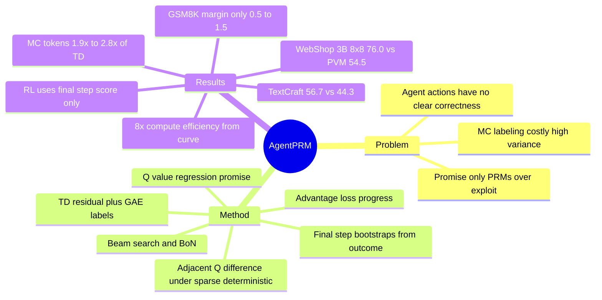

## Summary
把 agent 任务的 process reward 重新定义为 promise + progress：PRM 同时回归每步的 action value Q（从该步出发的期望成功概率）和相邻两步的 Q 差（advantage；在确定性转移 + 稀疏奖励下恰等于 Q(s_t,a_t) − Q(s_{t−1},a_{t−1})），标签不靠逐步 MC rollout，而用 TD 残差 + GAE 从整条轨迹自举估计。在 AgentGym 的 WebShop / BabyAI / TextCraft 上，Qwen2.5-3B 的 beam search @8×8 WebShop 成功率从 PVM 54.5 提到 76.0、TextCraft 44.3→56.7，标注 token 只有 MC 方法的 1/1.9–1/2.8。但评测集每任务仅 90–100 条 query、baseline 全部自训，且 §5.2 的 RL 实验实际只用 PRM 终步分数作轨迹级 reward，没有验证逐步 dense reward。

## Problem & Motivation
LLM reasoning 里的 PRM 按"每步对错"打分，agent 任务的动作却没有清晰的对错：点错页面可以 back 撤回，先去登录页看似远离目标却是发评论的必经之路。作者指出现有 agent 侧 PRM（Q* Agent、DPO-Q、IPR、AgentRM 等，附录 Table 4）有两个问题：一是把每步独立估成"未来成功概率"（promise），不建模相邻决策的依赖与局部推进（progress），搜索时倾向过度 exploitation；二是标签多靠从每一步出发做 MC rollout（Math-Shepherd 式），多步环境里开销大且方差高。由此提出两个问题：RQ1 agent 任务的 process reward 应如何定义；RQ2 如何可扩展地获得训练标签。

## Method
**形式化（§2）**：POMDP，状态转移确定性，outcome reward r(u,τ) 稀疏（t < T 时 r_t = 0）。PRM M_φ 的输入是 (s_t, a_t)，输出标量。

**Promise：回归 action value（§3.2.1）**。Q(s_t,a_t) = E[r(u,τ) | s_t,a_t]，用 MSE 损失 L_Q 让 M_φ 拟合标签 Q̂。

**Progress：拟合 advantage（§3.2.2）**。A(s_t,a_t) = Q(s_t,a_t) − V(s_t)。因为转移确定且中间步无奖励，V(s_t) = Q(s_{t−1},a_{t−1})（沿用 PAV / PQM 的推导），advantage 退化为相邻两步 Q 之差。于是 L_A 让"模型相邻两步预测之差"拟合"标签相邻两步之差"（Eq. 9）。总损失 L_Q + β·L_A，β = 1.0。正 advantage 表示该步有推进，负表示后退。

**标签估计（§3.3）**。对照的 MC-based 方法（Math-Shepherd 式）从每一步的后继状态做 N_mc 次 rollout，任一成功则 Q̂ = 1。本文改用 TD-based with GAE：TD 残差 δ_t = r_t + γ·M_φ(s_t,a_t) − M_φ(s_{t−1},a_{t−1})，GAE 累加 Â_t = Σ_k (γλ)^k δ_{t+k}，再令 Q̂_t = Â_t + M_φ(s_{t−1},a_{t−1})；终步目标直接取环境 outcome reward。标签因此由模型自身上一步的预测自举得到，训练按"采 batch → 用当前模型估标签 → 更新"迭代（Algorithm 1）。每条 query 采 N_TD = 16 条完整轨迹（温度 1.0），不需要从每一步额外 rollout。λ = 0.95；γ 的取值正文未报告。

**推理用法（§2、Algorithm 2）**。BoN 时用终步分数代表整条轨迹；step-level beam search @N×M 每节点扩展 M 个候选、按 PRM 分数保留 N 个，终态分数最高的轨迹作为答案。

**实验设置（§4.1）**。AgentGym 框架、ReAct 格式；策略初始化用 AgentGym 训练集随机抽的 300 条轨迹（紧接着给出 SFT lr 1e-5，原文未逐字写"SFT on 300"，按上下文理解为 SFT 初始化）；backbone Qwen2.5-0.5B/3B/7B-Instruct 与 Llama-3.1-8B-Instruct；RM 训练 ≤5 epochs、lr 1e-6；BoN / beam search 采样温度 0.7，SFT / RFT 用 greedy。三任务最大交互轮数 WebShop 6、BabyAI 20、TextCraft 20；评测 query 数 100 / 90 / 97。WebShop 与 TextCraft 报 success rate，BabyAI 报 reward。

## Key Results
- **Beam search（Table 1，Qwen2.5-3B，@8×8）**：WebShop AgentPRM 76.0 / PVM 54.5 / ORM 57.0（SFT greedy 46.0、RFT 48.0）；TextCraft 56.7 / 44.3 / 43.3（SFT 29.8、RFT 36.0）；BabyAI 89.8 / 89.1 / 83.7（SFT 67.4、RFT 64.5）。正文给的例子是 WebShop @8×8 比 PVM 高 20 分以上（76.0 vs 54.5）。@2×2 时 BabyAI 为 84.4 / 72.7 / 83.9，说明 PVM 在小 beam 下不稳定。
- **Qwen2.5-0.5B（Table 1）**：WebShop AgentPRM 30.5 → 51.5 → 62.5（@2×2 → @4×4 → @8×8），PVM 30.0 → 50.0 → 57.5，ORM 反而随 beam 增大崩掉（19.5 → 18.5 → 8.0）；TextCraft 28.8 / 29.9 / 32.9 vs PVM 25.7 / 26.8 / 26.8；BabyAI @2×2 PVM 84.6 高于 AgentPRM 82.9，是全表唯一 AgentPRM 不是最优的 cell，@8×8 回到 90.4 vs 88.1。
- **Compute efficiency**：摘要与 §1 称 "over 8× more compute-efficient"，§4.2 写作 "8×"；"Qwen2.5-3B、三任务平均"的限定只出现在 §1 文字里，Figure 1 右上的面板本身不标模型。倍数读自该平均 BoN 曲线（横轴是 number of samples），正文没有定义 compute efficiency 的口径（无 FLOPs / token 指标）；§1 还把 8× 扩展到 "multiple sampling strategies"，但没有任何图表支持 beam search 下的 8×。
- **Scaling 趋势（Result 3，Figure 1 / 3）**：采样预算增大时 ORM / PVM 出现瓶颈或退化，AgentPRM 持续上升；仅曲线，无数表。Table 1 中 0.5B WebShop 的 ORM 崩溃是能读到数字的一个实例。
- **TD vs MC 标注（Table 3）**：MC-based 的标注 token 是 TD-based 的 1.9×（WebShop）、2.8×（BabyAI）、1.5×（Math），且 TD-based 在全部 18 个数值 cell 上更高：WebShop beam @8×8 MC 70.5 vs TD 76.0、BoN@64 72.0 vs 74.0；BabyAI beam @8×8 88.3 vs 89.8；GSM8K BoN@8 61.8 vs 68.9。表中没有 TextCraft 行。
- **GSM8K（Table 2，beam @8×8）**：Qwen2.5-0.5B AgentPRM 45.7 / ORM 44.2 / PVM 42.9；3B 73.4 / 72.9 / 71.2。推理任务上领先幅度只有 0.5–1.5 分，远小于 agent 任务。
- **消融（§5.1，Figure 4，Qwen2.5-3B）**：去掉 L_A 后 BoN 与 beam search 都下降。正文说 "on agent tasks"，但 Figure 4 只有 WebShop（BoN N=16/32/64/128，beam 2×2/4×4/8×8）；柱状标签显示 beam @8×8 w/o 68.0 vs w/ 76.0（verifier 读图所得，无数表）。
- **用作 RL reward（§5.2，Figure 5）**：Qwen2.5-3B 在 BabyAI / TextCraft 上跑 PPO（batch 16、lr 1e-6、KL 1e-3、horizon 20），称比 baseline RM 更稳、更高；只有曲线。附录 C 写明用的是 PRM 终步预测分数作整条轨迹的 reward，不是逐步 dense reward。
- **更大模型（§5.6，Figure 8）**：Qwen2.5-7B-Instruct 与 Llama-3.1-8B-Instruct 三任务平均 BoN 上 AgentPRM 持续领先；只有图。
- **代码**：全文未给 AgentPRM 的代码或模型发布链接，脚注里只有三个环境的 license。

## Evidence Ledger
| Claim ID | Claim | Type | Source locator | Evidence excerpt | Status |
|:--|:--|:--|:--|:--|:--|
| C1 | BoN 下比 ORM/PVM "over 8× more compute-efficient"（Qwen2.5-3B 的限定来自 §1 文字），倍数读自 Figure 1 曲线，无形式化口径 | number | Abstract; §1; §4.2 Result 2; Figure 1 upper-right | "Figure 1 (upper right) shows that, on average, AgentPRM is 8× more compute-efficient than PVMs and ORMs." | source-verified |
| C2 | 三任务最大轮数 6 / 20 / 20；评测 query 100 / 90 / 97 | benchmark-setting | §4.1.1; §4.1.4 | "we include 100, 90, 97 queries for evaluation on WebShop ... BabyAI ... TextCraft, respectively" | source-verified |
| C3 | 策略初始化用 AgentGym 训练集随机 300 条轨迹（SFT 由上下文推断）；backbone Qwen2.5-0.5B/3B/7B 与 Llama-3.1-8B；基于 AgentGym 框架 | benchmark-setting | §4.1.1; §4.1.3 | "we randomly select 300 trajectories from the AgentGym training set. For SFT, we set the learning rate to 1 × 10−5." | source-verified |
| C4 | Qwen2.5-3B WebShop @8×8：AgentPRM 76.0 / PVM 54.5 / ORM 57.0；SFT 46.0 / RFT 48.0 | number | Table 1 | "SFT – 46.0 – ; RFT – 48.0 – ; ORM 51.0 59.0 57.0 ; PVM 50.5 59.0 54.5 ; AgentPRM 61.0 72.5 76.0" | source-verified |
| C5 | Qwen2.5-3B TextCraft @8×8：56.7 / 44.3 / 43.3；SFT 29.8 / RFT 36.0 | number | Table 1 | "SFT 29.8 ; RFT 36.0 ; ORM 38.1 41.2 43.3 ; PVM 39.1 40.2 44.3 ; AgentPRM 47.4 51.5 56.7" | source-verified |
| C6 | Qwen2.5-3B BabyAI @8×8：89.8 / 89.1 / 83.7；@2×2：84.4 / 72.7 / 83.9 | number | Table 1 | "ORM 83.9 83.5 83.7 ; PVM 72.7 84.9 89.1 ; AgentPRM 84.4 89.6 89.8" | source-verified |
| C7 | Qwen2.5-0.5B BabyAI @2×2 PVM 84.6 > AgentPRM 82.9，AgentPRM 非全表最优 | number | Table 1 | "PVM ... 84.6 86.5 88.1 ; AgentPRM ... 82.9 87.7 90.4" | source-verified |
| C8 | Qwen2.5-0.5B WebShop ORM 19.5 → 18.5 → 8.0，AgentPRM 30.5 → 51.5 → 62.5 | number | Table 1 | "ORM 19.5 18.5 8.0 ; AgentPRM 30.5 51.5 62.5" | source-verified |
| C9 | 正文：3B WebShop @8×8 超 PVM 20.0 分以上（76.0 − 54.5 = 21.5） | comparison | §4.2 Result 2 | "with an 8 × 8 sampling search setting, our method surpasses PVM by more than 20.0 points." | source-verified |
| C10 | 损失 = Q 的 MSE + β·advantage MSE；advantage 化为相邻步 Q 差；β = 1.0，λ = 0.95 | causal-mechanism | §3.2 Eq.4–10; §4.1.3 | "Q(st,at) − V(st) = ... = Q(st,at) − Q(st−1,at−1)" ; "we set β = 1.0 and λ = 0.95" | source-verified |
| C11 | 标签 Q̂_t = Â_t + M_φ(s_{t−1},a_{t−1})，终步 = outcome reward；无需逐步 rollout | causal-mechanism | §3.3.2 Eq.12–14 | "Q̂(st,at) = Â(st,at) + Mφ(st−1,at−1)" ; "does not require additional rollouts from each state like MC-based method" | source-verified |
| C12 | MC：N_Traj = 1、N_mc = 16/步；TD：N_TD = 16/query；RM ≤5 epochs、lr 1e-6；采集温度 1.0 | benchmark-setting | §4.1.3 | "we set NTraj = 1 for each query, and Nmc = 16 for each step; for TD-based estimation, we set NTD = 16 for each query." | source-verified |
| C13 | Table 3：MC token 1.9× / 2.8× / 1.5×；TD 在全部 18 个 cell 更高（WebShop beam @8×8 70.5 vs 76.0）；无 TextCraft 行 | number | Table 3; §5.4 | "MC-based 1.9× 63.5 67.5 69.0 72.0 67.5 70.5 / TD-based 1.0× 64.5 69.0 71.0 74.0 72.5 76.0" | source-verified |
| C14 | §5.2 RL 用 PRM 终步分数作轨迹 reward，非逐步 dense reward | causal-mechanism | Appendix C | "In the PRM-based RL, we use the PRM's predicted score at the final step as the reward for the trajectory." | source-verified |
| C15 | RL 下更稳更高，仅 Figure 5 曲线（BabyAI / TextCraft 两面板），无数表 | comparison | §5.2; Figure 5 | "AgentPRM delivers a more stable and effective optimization, outperforming the baselines" | source-verified |
| C16 | GSM8K beam @8×8：0.5B 45.7 / 44.2 / 42.9；3B 73.4 / 72.9 / 71.2 | number | Table 2 | "Qwen2.5-0.5B ORM 39.5 42.9 44.2 / PVM 38.9 41.3 42.9 / AgentPRM 41.5 44.7 45.7 ; Qwen2.5-3B ... AgentPRM 65.1 70.5 73.4" | source-verified |
| C17 | 去掉 L_A 性能下降；证据仅 Figure 4，且只覆盖 WebShop（正文泛称 agent tasks） | causal-mechanism | §5.1; Figure 4 | "without LA(φ), the performance on agent tasks drops regardless of the sampling strategy" | source-verified |
| C18 | 预算增大时 ORM/PVM 瓶颈或退化、AgentPRM 持续提升，依据 Figure 1 / 3 | comparison | §4.2 Result 3 | "PVMs and ORMs tend to experience performance bottleneck or even degradation ... AgentPRM consistently shows stable improvement" | source-verified |
| C19 | BoN 用终步分数；BoN/beam 温度 0.7；SFT/RFT greedy | benchmark-setting | §2; §4.1.4 | "the score of the final step is used to represent trajectory quality" ; "setting the sampling temperature to 0.7" | source-verified |
| C20 | 7B / 8B 平均 BoN 上持续领先，仅 Figure 8，无表 | comparison | §5.6; Figure 8 | "AgentPRM consistently outperforms the baseline methods on the two models" | source-verified |
| C21 | 未给 AgentPRM 代码/模型链接；全文无 "code" 一词；仅三个环境 license 脚注 | license-code | §4.1.1 脚注; 全文 | "1 https://github.com/princeton-nlp/WebShop/blob/master/LICENSE.md 2 https://github.com/mila-iqia/babyai/..." | source-verified |
| C22 | Table 4：唯一 TD-based + progress ✓ + Agent & Reasoning；PAV/PQM 有 progress 但 MC-based 且 reasoning-only；Q* Agent TD-based 但无 progress | sota-novelty | Appendix A; Table 4 | "PAV ... MC-based Process ✓ Reasoning ; Q* Agent ... TD-based Process × Agent ; AgentPRM (Ours) TD-based Process ✓ Agent, Reasoning" | source-verified |
| C23 | WebShop / TextCraft 报 success rate，BabyAI 报 reward | benchmark-setting | §4.1.3 | "We report the success rate for WebShop and TextCraft, and the reward for BabyAI." | source-verified |
| C24 | PPO：batch 16、lr 1e-6、KL 1e-3、温度 1.0、horizon 20 | number | Appendix C | "PPO using a batch size of 16, a learning rate of 1 × 10−6, a KL coefficient of 1 × 10−3, and a sampling temperature of 1.0" | source-verified |
| C25 | Figure 4 柱状标签：WebShop beam @8×8 w/o L_A 68.0 vs w/ L_A 76.0（verifier 读图，非正文数字） | number | Figure 4, PDF p.11 bar labels | "beam 8×8: 68.0 w/o vs 76.0 w/"（verifier 转述图中标签） | source-verified |

## Strengths & Weaknesses
**优点**
- Problem formulation 抓到了 agent PRM 与 reasoning PRM 的真实差别：动作可逆、绕路可能是必经之路，所以"对错"标签不成立，应该用"离目标多近"加"这一步推进了多少"。这个区分比方法本身更有价值。
- 把 PAV / PQM 的 advantage-as-progress 思想搬到 agent 任务，并用 TD + GAE 替换逐步 MC rollout，形式上干净：一个 value head、两个 MSE 项、一次完整轨迹采样。Table 3 同时报了 token 成本和下游效果，是本文最扎实的一张表。
- 诚实报告了 Table 1 中的反例（0.5B BabyAI @2×2 PVM 更高）和 ORM 在大 beam 下崩溃（0.5B WebShop 8.0），没有藏。

**缺点与边界**
- **RL 实验名不副实**。§5.2 标题是"Applying AgentPRM to RL"，附录 C 却写明只把 PRM 终步分数当整条轨迹的 reward——这是把 AgentPRM 当学习型 ORM 用，progress 项与逐步 dense reward 在 RL 闭环里完全没被测试。"PRM 做 RL 更稳"的结论只能理解为"用它训出的终步 value 做轨迹打分器更稳"。
- **BoN 也只用终步分数**。两种推理用法里只有 beam search 真正消费了中间步分数；BoN 结果（含 8× 效率的那张图）衡量的其实是终步 value 的质量。advantage 项在这里只是训练时的正则，而非推理时的信号。
- **统计力弱**。评测集 100 / 90 / 97 条 query，WebShop 上 1 条 query = 1 个百分点；Table 1 中许多差距在 0.5–2 分（BabyAI 3B @8×8 89.8 vs 89.1、GSM8K 全部），没有多 seed 或置信区间。8× 效率倍数来自目测曲线，正文没有定义。
- **TD vs MC 的对比混淆了两个变量**。MC baseline 每 query 只有 1 条 seed 轨迹（从每步再 rollout 16 次），TD 每 query 有 16 条完整且多样的轨迹。Table 3 里 TD 更便宜又更好，可能主要来自训练轨迹的多样性而非估计器本身；要分离需要等量 seed 轨迹的 MC 对照，论文没做。
- **baseline 全部自训**。ORM / PVM 是作者按同一数据实现的通用版本，没有与 Table 4 列出的任何 agent PRM（Q* Agent、AgentRM、IPR、DPO-Q）做数值对比；"优于现有 agent PRM"只在表格分类层面成立。
- **策略很弱**。300 条轨迹 SFT 的 Qwen2.5-3B 在 WebShop 上 greedy 只有 46.0，这类弱策略下 test-time search 的收益通常最大；对强策略（如 AgentGym-RL 训练后的模型）增益是否还在，未知。
- **自举标签的稳定性未讨论**。Q̂_t 由模型自己的上一步预测加 GAE 修正得到（Eq. 14），初始化阶段模型随机时标签几乎全是噪声，只靠终步 outcome 向前传播；训练迭代轮数、γ 取值（正文把 λ 称作 discount factor，γ 在 Eq. 12–13 出现但从未给值）、是否会出现 value 漂移，都没有报告。全文也没有多 seed 或误差区间。
- **advantage 项的解释存疑**。在确定性 + 稀疏设定下，L_A 就是"相邻预测之差拟合相邻标签之差"，与 L_Q 高度相关；它更像一个时序一致性正则，而"捕捉 progress"是作者的解读。Figure 4 显示它有效，但没有分析为什么。
- **环境边界**。三个环境都是文本观测、确定性转移、短 horizon（WebShop 6 步）；V(s_t) = Q(s_{t−1},a_{t−1}) 的推导依赖确定性转移，随机或部分可观测的真实 GUI / web 环境下不成立。

## Mind Map

## Notes
- **Tag 依据**：核心是 LLM agent 的 reward model 与 test-time search，归 `agentic-RL`；GSM8K 与通用 PRM 讨论归 `LLM`。三个环境中 WebShop 虽是模拟电商网站，但本文不研究 UI observation / GUI action，WebShop 只是 AgentGym 的文本环境之一，按 `references/tags.md` 的复合归属规则不加 `web-agent` / `gui-agent`。
- [[2312-MathShepherd]]：本文 §5.4 的 MC-based 对照即 Math-Shepherd 式逐步 rollout 标注；GSM8K 实验也沿用其"partial solution = state"的多步形式化。Math-Shepherd 笔记里"每步 N 次 completion 没给算力数字"的缺口，本文 Table 3 用 token 倍数部分补上了。
- [[2412-ImplicitPRM]]：两条不同的"免 MC 标注"路线。Implicit PRM 把 ORM 的 log-ratio 直接当 Q，一个标签都不需要；AgentPRM 仍显式回归 Q 与 advantage，只是用 TD 自举代替 rollout。两者都报告比 Math-Shepherd 便宜且更好，但谁也没和对方比。
- [[2509-AgentGymRL]]：同一 Fudan 团队、同一 AgentGym 框架与环境（BabyAI / TextCraft / WebShop）。AgentGym-RL 用 outcome reward 直接做多轮 RL；本文 §5.2 的 PPO 实验可视为其前身，但只用了终步 value，两篇合起来看 Fudan 这条线至今没有真正验证过 dense step reward 对 agent RL 的价值。
- [[2509-TreeGRPO]]：另一种不训 PRM 就得到 step-level 信号的路线——树采样兄弟子树的回报差。Tree-GRPO 把成本转嫁给环境的 fork / reset 能力，AgentPRM 把成本放在训练一个 value head；在不可 fork 的真实环境里后者更可行，但要承担 value 模型偏差。
- [[2602-ADMIRE]]：同样针对 agent 的 temporal credit assignment，ADMIRE 用 LLM 蒸馏的有序 milestone 给 GUI agent 逐步奖励，AgentPRM 用学得的 Q 差。前者的"progress"可解释、绑定可验证中间状态，后者是隐式标量；两者在 [[2607-EvoCUA15]] 报告的"PRM 分数上升而 outcome 停滞"的 hacking 风险面前，谁更稳健是一个开放问题。
- [[2510-CUARewardBench]]：该 benchmark 直接测 reward model 的 step / trajectory 判定精度，而 AgentPRM 只报下游 BoN / search 效果，从未报告 PRM 本身的判定准确率；要评估它能否迁移到 GUI 场景，CUARewardBench 的协议是现成的检验工具。
- **与 `Topics/CUA-Survey.md` 的关系**：本文不是 GUI 论文，不应作为 CUA-Survey 的 pending 条目路由。但 §7.6 "Reward and Process Models" 讨论的 promise-vs-progress、outcome-anchored credit assignment 与本文的 formulation 直接相关，可作为该节的 cross-link 候选（非 GUI 的方法参照），由主 agent 裁决。
- 疑问：在 WebShop 这种 6 步 horizon 下，"绕路是必经之路"的动机例子（先登录再评论）几乎不会出现；真正需要 progress 信号的长 horizon 任务（BabyAI / TextCraft 20 步）上，AgentPRM 对 PVM 的优势在 BabyAI 反而最小（@8×8 仅 +0.7）。动机与证据之间的这个错位值得追问。
