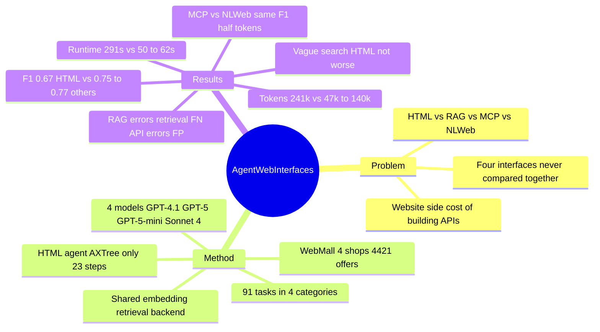

## Summary
在 WebMall 的四个本地托管电商站点上，为 HTML 浏览、RAG（预爬取索引）、MCP（店铺自建 API）、NLWeb（schema.org 标准化自然语言问答端点）四种接口各实现一个 agent，用同一套比价购物任务和四个模型（GPT-4.1 / GPT-5 / GPT-5-mini / Claude Sonnet 4）做受控对照。三种非 HTML 接口的平均 F1 为 0.75–0.77 对 HTML 的 0.67，每任务 token 47k–140k 对 241k、耗时 50–62 s 对 291 s，最佳配置是 RAG + GPT-5（摘要给出 F1 0.87 / CR 0.79，正文无逐配置总表，仅能由 Table 5–8 按任务数加权复算出约 0.875 / 0.79）。但差距集中在明确产品检索与交易任务；模糊搜索上 HTML 并不落后，而 MCP 与 NLWeb 的 F1 几乎相同、token 却差一倍。

## Problem & Motivation
LLM agent 访问网站目前有四条并行路线：像人一样浏览 HTML（点链接、填表单）；对预先爬取并索引的页面做 RAG；网站通过 MCP 暴露站点专属 API；网站实现 NLWeb，用自然语言查询换回 schema.org JSON。已有比较都只对照其中两条——Song et al. 2025（Beyond Browsing）报告 API agent 在 WebArena 上比 HTML agent 成功率高 15%，DeepShop 报告 RAG 比浏览高约 10 个 F1 点但在 live web 上跑、不可复现。作者认为缺的是在同一受控环境、同一任务集上把四种接口放在一起比，并同时报告效果与 token / 成本 / 时延。背后的实际问题是网站方是否值得为 agent 另建 API 或 NLWeb 端点，以及没有 API 时 RAG 能否作为替代。

## Method
**测试床（§2–§3）。** 沿用 WebMall：四个本地可部署的 WooCommerce 电商站点，4,421 条产品 offer 来自 2024 年 10 月 Common Crawl 的 schema.org 标注，91 个任务共 11 类。本文把任务重组为四大类——Specific Product Search（23）、Vague Product Search（19）、Cheapest Product Search（26）、Transactional（15）——并为每个站点额外实现 MCP server 与 NLWeb 端点。

**四个 agent（§2，Table 1）。**
- *HTML*：直接复用 WebMall 的 AX+MEM agent（AgentLab + BrowserGym），观察 accessibility tree，带短期记忆；screenshot 被关掉，理由是 WebMall 实验中 AXTree 叠加截图反而变差。每任务平均 23 步。
- *RAG*：一个搜索引擎爬取四个站点全部 HTML 页，用 unstructured 库去标记与导航元素，OpenAI small embedding 入 Elasticsearch。agent 只查索引、不访问网站，可迭代改写查询；加购物车 / 结账走直接暴露的 Python 函数。
- *MCP*：每个店铺一个 MCP server，暴露搜索、购物车、结账；函数名、参数、JSON 返回格式按店铺各不相同（故意保留异构性）。搜索后端与 RAG 相同的 embedding + Elasticsearch，但数据直接取自 WooCommerce API、不经清洗。
- *NLWeb*：在 MCP 之上加一个标准化的 "ask" 端点，接受自然语言查询、返回 schema.org JSON；检索后端同 MCP，购物车 / 结账仍是 MCP tool。

关键的实验设计事实：RAG / MCP / NLWeb 共用一套 embedding 检索，差别在索引粒度（RAG 是跨店统一索引的清洗页面，MCP / NLWeb 是按店分开的结构化记录）与返回 schema 是否统一；RAG 一次查询覆盖四家店，MCP / NLWeb 每家店要各发一次。

**指标（§4.1）。** 检索任务按返回 URL 集合算 CR（完全匹配）与 P/R/F1；交易任务按最终系统状态算 CR。Token 为输入 + 输出之和（不含 RAG 建索引），成本按各模型公开单价折算（GPT-4.1 $2/$8、GPT-5 $1.25/$10、GPT-5-mini $0.25/$2、Sonnet 4 $3/$15 per MTok），不使用 prompt caching。模型为 gpt-4.1-2025-04-14、gpt-5-2025-08-07、gpt-5-mini-2025-08-07、claude-sonnet-4-20250514。

## Key Results
- **总体（Table 3，四模型平均）**：HTML CR 0.57 / F1 0.67；RAG 0.68 / 0.77；MCP 0.62 / 0.75；NLWeb 0.64 / 0.76。每任务 token：HTML 241,136，RAG 46,667，MCP 139,569，NLWeb 71,214；耗时 291 / 50 / 62 / 53 s；成本 $0.52 / $0.10 / $0.27 / $0.10。Table 9 的 "Average" 行给出另一组略低的数字（HTML 225,090 token / 281 s，MCP 121,624 / 57 s），两表口径不一致，论文未解释。
- **按任务类别（Table 4，F1 跨模型平均）**：Specific 上 HTML 0.77 对 RAG 0.91 / MCP 0.90 / NLWeb 0.92；Transactional 上 0.77 对 0.86 / 0.92 / 0.91。Vague 上 HTML 0.63 反而高于 RAG 0.61 与 MCP 0.59（NLWeb 0.66 最高）；Cheapest 上 RAG 0.68 最高，HTML 0.61 高于 NLWeb 0.60。总体 10 点的 F1 差距几乎全部来自前两类。
- **最佳配置**：摘要称 RAG + GPT-5 总体 F1 0.87 / CR 0.79。> [abstract-only：正文没有任何逐配置总表，Table 3 只按接口、Table 5–8 只按类别；用 Table 2 任务数对 RAG + GPT-5 四行加权得 F1 ≈ 0.875、CR ≈ 0.793，与摘要一致，但该数字本身未在正文出现。]
- **模型 × 接口**：Specific 上 GPT-5 配 RAG / MCP / NLWeb 都到 F1 0.96，且所有非 HTML 组合都高于最强 HTML 配置（HTML + GPT-5，0.83）。Vague 上 MCP + GPT-4.1 的 CR 只有 0.11，最强是 RAG + GPT-5（F1 0.82 / CR 0.74）。Cheapest 上最强仍是 RAG + GPT-5（CR 0.72 / F1 0.78），作者称 precision 与 recall 同时下降。
- **交易任务异常（Table 8）**：HTML + GPT-4.1 拿到 CR 1.00 / F1 1.00，而 HTML + GPT-5 只有 F1 0.64；RAG / MCP / NLWeb 配 GPT-5 或 Sonnet 4 都是 0.98。
- **效率（§4.3，Table 9）**：所有 agent 的 token 都严重偏输入侧，只有 HTML agent 平均输出超过 5k token（最多不超 25k），所以效率差来自输入 token 与导航开销而非输出长度。HTML + GPT-5 每任务平均 522 s / 253,759 token，HTML + GPT-4.1 为 92 s / 146,761 token。相对 HTML，token 降 2–10 倍（平均约 3 倍），时延 281 s 对非 HTML 三者均值 54 s（约 5 倍）。RAG 每任务发 2–6 次查询，MCP / NLWeb 发 4–6 次但其中 4 次只是为了覆盖四家店各一次。
- **MCP 对 NLWeb**：CR / F1 上 NLWeb 没有优势（0.64 / 0.76 对 0.62 / 0.75），但 token 只有 MCP 的一半（71k 对 140k）。
- **成本前沿（Figure 2）**：RAG + GPT-5-mini 在成本—F1 前沿上，RAG + GPT-5 成本右移、F1 增益较小；多数 HTML 点落在前沿之下。GPT-4.1 这类非 reasoning 模型 token 更少、更快，在明确检索与交易任务上效果只略低，在模糊搜索上差距拉大。
- **错误分析（§5，只覆盖 RAG / MCP / NLWeb，只用 GPT-4.1 与 Sonnet 4）**：Table 10 总错误数 RAG 123 / 120，MCP 244 / 185，NLWeb 192 / 175。RAG 的 FP / FN 接近对半（FN 略多），其 FN 又以"未检索到"为主——全部 non-retrieved 错误约一半出在 RAG，在 Specific 类上 RAG 的错误更是被 non-retrieved FN 主导；MCP / NLWeb 则 false positive 更多；最大单类 FP（25%）是"产品不满足某条要求"，典型是满足多数约束但差一个关键属性（RAM 套装当单条）。定性上，agent 在物理 / 空间推理（"紧凑键盘"返回全尺寸）和比较表达（"more than" 当作等于）上系统性出错。正文说手工标注了 729 个 FP，而 Table 10 的 FP 总行六列相加为 693。

## Evidence Ledger
| Claim ID | Claim | Type | Source locator | Evidence excerpt | Status |
|:--|:--|:--|:--|:--|:--|
| C1 | Table 3 总体：HTML CR 0.57 / F1 0.67；RAG 0.68 / 0.77；MCP 0.62 / 0.75；NLWeb 0.64 / 0.76 | number | §4.2 Table 3 | "HTML 0.57 0.67 … RAG 0.68 0.77 … MCP 0.62 0.75 … NLWeb 0.64 0.76" | source-verified |
| C2 | Table 3 每任务：token 241,136 / 46,667 / 139,569 / 71,214；耗时 291 / 50 / 62 / 53 s；成本 $0.52 / $0.10 / $0.27 / $0.10 | number | §4.2 Table 3 | "241,136 $0.52 291 s … 46,667 $0.10 50 s … 139,569 $0.27 62 s … 71,214 $0.10 53 s" | source-verified |
| C3 | Table 9 Average 行与 Table 3 不一致：HTML 225,090 / $0.49 / 281 s；RAG 47,093 / $0.10 / 51 s；MCP 121,624 / $0.25 / 57 s；NLWeb 57,840 / $0.08 / 49 s | number | §4.3 Table 9 | "HTML Average 225,090 $0.49 281 s … MCP Average 121,624 $0.25 57 s"；论文未对账 | source-verified |
| C4 | Table 4 分类 F1：Specific 0.77 / 0.91 / 0.90 / 0.92；Vague 0.63 / 0.61 / 0.59 / 0.66；Cheapest 0.61 / 0.68 / 0.63 / 0.60；Transaction 0.77 / 0.86 / 0.92 / 0.91 | number | §4.2 Table 4 | "Specific Product Search 0.77 0.91 0.90 0.92 … Vague 0.63 0.61 0.59 0.66 … Cheapest 0.61 0.68 0.63 0.60" | source-verified |
| C5 | Vague 上 HTML（0.63）高于 RAG（0.61）与 MCP（0.59）；Cheapest 上 HTML（0.61）高于 NLWeb（0.60） | comparison | Table 4（由表格单元推出，正文未点出） | "Vague Product Search 0.63 0.61 0.59 0.66 … Cheapest Product Search 0.61 0.68 0.63 0.60" | source-verified |
| C6 | 最佳配置 RAG + GPT-5，F1 0.87 / CR 0.79 | number | Abstract；正文无逐配置总表 | "The best overall configuration is RAG with GPT 5 achieving an F1 score of 0.87 and a completion rate of 0.79." | abstract-only |
| C7 | WebMall：4 个本地店铺、4,421 条 offer（2024-10 Common Crawl schema.org）、91 任务 11 类；重组为 23 / 19 / 26 / 15 四类 | benchmark-setting | §3, Table 2 | "four locally hostable shops populated with 4,421 product offers … WebMall defines 91 tasks across eleven task categories" | source-verified |
| C8 | Table 2 四类任务数之和为 83 而非 91，论文未解释 | benchmark-setting | Table 2 vs §3.1（verifier 自行加总） | "we group the 91 WebMall tasks into four higher-level categories"；23+19+26+15 = 83 | source-verified |
| C9 | 模型：gpt-4.1-2025-04-14、gpt-5-2025-08-07、gpt-5-mini-2025-08-07、claude-sonnet-4-20250514 | benchmark-setting | §4 开头 | "(gpt-4.1-2025-04-14, gpt-5-2025-08-07, gpt-5-mini-2025-08-07 and claude-sonnet-4-20250514)" | source-verified |
| C10 | HTML agent = WebMall 的 AX+MEM（AgentLab + BrowserGym），观察 AXTree，带短期记忆；因 WebMall 中加截图变差而关闭视觉 | benchmark-setting | §2 HTML Architecture | "AX+MEM agent … AgentLab library … BrowserGym framework … observes the accessibility tree (AXTree) … disabled visual perception" | source-verified |
| C11 | RAG / MCP / NLWeb 共用 OpenAI small embedding + Elasticsearch；RAG 索引 unstructured 清洗后的爬取页，MCP 索引 WooCommerce API 直取的记录、无清洗（NLWeb 沿用 MCP 的检索设置） | benchmark-setting | §2 RAG / MCP / NLWeb | "all MCP servers use the same embedding-based retrieval setup as the RAG pipeline … obtain product data directly from the underlying WooCommerce APIs" | source-verified |
| C12 | NLWeb 是经 MCP 托管的 "ask" 端点、返回 schema.org JSON；MCP 为每店专属 API，函数名 / 参数 / JSON 格式异构 | benchmark-setting | §2 NLWeb / MCP | "Each provider hosts an "ask" endpoint via MCP … follow the schema.org dictionary"; "Each shop defines its own functions, parameter names, and JSON result format." | source-verified |
| C13 | RAG agent 不访问原网站；交易通过直接暴露的 Python 函数 | benchmark-setting | §2 RAG Architecture | "It does not visit the original websites … dedicated Python functions are exposed that the agent can invoke directly." | source-verified |
| C14 | HTML 平均 23 步 / 任务；RAG 2–6 次查询；MCP / NLWeb 4–6 次，其中 4 次用于覆盖各店 | number | §4.3 | "RAG typically submits two to six search queries … MCP and NLWeb … four to six queries … HTML agent performs on average 23 steps" | source-verified |
| C15 | Specific：GPT-5 配 RAG / MCP / NLWeb 皆 F1 0.96；所有非 HTML 组合高于最强 HTML（GPT-5，0.83）；HTML CR 0.52（GPT-4.1）至 0.74（GPT-5） | number | §4.2 Table 5 | "It reaches an F1 of 0.96 for RAG, MCP, and NLWeb … all model–agent combinations using RAG, MCP, or NLWeb obtain higher F1 scores" | source-verified |
| C16 | Transaction：HTML + GPT-4.1 CR 1.00 / F1 1.00；HTML + GPT-5 F1 0.64；RAG / MCP / NLWeb 配 GPT-5 或 Sonnet 4 为 0.98 | number | §4.2 Table 8 | "HTML agent paired with GPT-4.1 even achieves perfect scores (CR = 1.00, F1 = 1.00) … GPT-5 attains only 0.64 F1" | source-verified |
| C17 | Vague：MCP + GPT-4.1 CR 0.11；RAG + GPT-5 F1 0.82 / CR 0.74 | number | §4.2 Table 6 | "MCP with GPT-4.1 attains a CR of only 0.11 … RAG combined with GPT-5, reaches an F1 of 0.82" | source-verified |
| C18 | Cheapest：RAG + GPT-5 CR 0.72 / F1 0.78；precision 与 recall 皆下降 | number | §4.2 Table 7 | "RAG with GPT-5, reaches a completion rate of 0.72 and an F1 score of 0.78 … declines in both metrics" | source-verified |
| C19 | Table 9：HTML + GPT-5 522 s / 253,759 token；HTML + GPT-4.1 92 s / 146,761 token | number | §4.3 Table 9 | "HTML GPT-4.1 146,761 $0.32 92 s … HTML GPT-5 253,759 $0.50 522 s" | source-verified |
| C20 | token 偏输入侧；只有 HTML 平均输出超 5k、不超 25k；效率增益来自输入 token 与导航开销 | causal-mechanism | §4.3 | "heavily input-skewed. Only the HTML agent ever exceeds 5 k output tokens in an average run and even then never exceeds 25 k" | source-verified |
| C21 | token 相对 HTML 降 2–10 倍（约 3 倍）；时延 281 s 对 54 s（5 倍） | number | §4.3 末段 | "drops by a factor of 2 to 10 relative to HTML, about 3× on average … HTML averages 281 s … 54 s, a 5× speedup"；54 s 用两表均复算不出（52 / 55 s） | source-verified |
| C22 | 错误分析只含 RAG / MCP / NLWeb，只用 GPT-4.1 与 Sonnet 4；正文称手工标注 729 个 FP | benchmark-setting | §5 开头 | "three non-HTML interfaces … runs with GPT-4.1 and Claude Sonnet 4 … Each of the 729 false positive errors was manually annotated" | source-verified |
| C23 | Table 10 总计：FP RAG 60 / 36，MCP 199 / 131，NLWeb 144 / 123；总错误 RAG 123 / 120，MCP 244 / 185，NLWeb 192 / 175 | number | §5 Table 10 | "Total False Positives 60 36 199 131 144 123 … Overall Total 123 120 244 185 192 175" | source-verified |
| C24 | Table 10 FP 总行六列之和 693 ≠ 正文 729 | number | §5 Table 10 vs 正文（verifier 自行加总） | "Total False Positives 60 36 199 131 144 123"；FN 行和 346，693+346 = 1039 = Overall 行和，表内自洽 | source-verified |
| C25 | RAG 的 FP / FN 接近对半、FN 略多，且以 non-retrieved 为主（约一半 non-retrieved 出在 RAG）；MCP / NLWeb FP 更多；最大 FP 类（25%）为 product fails requirements | causal-mechanism | §5 | "RAG shows a near even split, with slightly more false negatives … About half of all non-retrieved errors occur under RAG … largest single class (25 %)" | source-verified |
| C26 | 定性：物理 / 空间推理失败（紧凑键盘→全尺寸）；比较表达当作等于 | causal-mechanism | §5 Qualitative Observations | "requests for compact keyboards often yielded full-sized options … comparative expressions … misinterpreted as equality checks" | source-verified |
| C27 | 代码与数据：github.com/wbsg-uni-mannheim/WebMall-Interfaces | license-code | §1 脚注 3 | "All code and data for reproducing our experiments are available in the accompanying GitHub repository" | source-verified |
| C28 | 自称首个四接口同环境对照；引 Song et al. 2025（API 比 HTML 在 WebArena 高 15%）与 DeepShop（RAG 比浏览高 10 F1，live web） | sota-novelty | Abstract / §6 | "API agents reach 15% higher success rate on the WebArena benchmark … ten-point F1 improvement for RAG over browsing … first comparison of four architectures" | source-verified |
| C29 | 单价：GPT-4.1 $2/$8；GPT-5 $1.25/$10；GPT-5-mini $0.25/$2；Sonnet 4 $3/$15；不用 prompt caching | benchmark-setting | §4.3, §4.1 | "GPT-4.1 at $2.00/MTok input and $8.00/MTok output … Claude Sonnet 4 is $3.00/MTok input and $15.00/MTok output"; "do not use prompt caching" | source-verified |
| C30 | Figure 2：RAG + GPT-5-mini 在成本—质量前沿；RAG + GPT-5 成本右移、增益小；多数 HTML 点在前沿下 | comparison | §4.3 Figure 2 caption 与正文（图像本身不可读） | "RAG + GPT-5-mini sits near the upper left and gives the best price–performance ratio … most HTML points fall below it." | source-verified |
| C31 | NLWeb 在 CR / F1 上无优于 MCP 的优势（+0.02 / +0.01），token 差异显著 | comparison | §4.2 | "NLWeb does not exhibit a effectiveness advantage over MCP when considering CR or F1, although their token requirements differ substantially." | source-verified |
| C32 | 结论称非 HTML 高 9 F1 点（对三者均值 0.76）；§4.2 称约 10 点（对 RAG 0.77）——口径不同 | number | §7 vs §4.2 | "outperform the HTML agent by 9 F1 points on average" / "HTML trails by approximately ten percentage points" | source-verified |
| C33 | GPT-4.1 跨接口 token 更少、更快；明确 / 交易任务效果略低，模糊搜索差距拉大 | causal-mechanism | §4.3 | "it consumes substantially fewer tokens and finishes tasks more quickly than the GPT-5 variants … effectiveness is only moderately lower, whereas the gap widens" | source-verified |
| C34 | 作者三人均属 University of Mannheim Data and Web Science Group；arXiv v1 2025-11-28；cs.CL | benchmark-setting | 页眉 | "arXiv:2511.23281v1 [cs.CL] 28 Nov 2025 … Data and Web Science Group, University of Mannheim" | source-verified |
| C35 | Table 3 的 "Overall." 段落出现两次，两种平均口径描述互相矛盾 | benchmark-setting | §4.2 Table 3 前后 | "computed at the task-set level … macro-averaged across the four models" / "micro-averages per interface, obtained by treating each task–model combination as a separate observation" | source-verified |
| C36 | Token 列 = 输入 + 输出之和，不含 RAG 建索引 token | benchmark-setting | §4.1 | "reports the sum of input and output tokens per task. This excludes indexing tokens for the RAG engine" | source-verified |

## Strengths & Weaknesses
**优点**
- 问题问得对、做法也直接：API-vs-GUI 这条线此前多数主张来自 position paper（[[2605-PlanThenExecuteWeb]]、[[2607-AgentReadyWeb]]）或两两对照，本文在同一套本地站点、同一任务集、同四个模型上一次放进四种接口，并且把 token / 成本 / 时延与 F1 一起报，代码与测试床开源。
- 分类别结果比标题结论更有信息量：Table 4 显示接口差距几乎只来自明确检索与交易，模糊搜索上 HTML 不输；也就是说"API 优于浏览"的成立条件是任务已经能被精确表述为一次结构化查询。
- MCP 与 NLWeb 这对对照最干净：两者共用检索后端，只差返回 schema 是否统一，结果是 F1 持平、token 减半。这是"输出格式同质化本身就省 context"的一个直接数据点，也与 [[Topics/CUA-Survey]] §4.7 对 MCP "返回体量大、易撑爆 context" 的边界描述吻合。
- 错误分析把 RAG 的失败归到检索覆盖（non-retrieved FN）、把 API 接口的失败归到约束判断（FP），与两类接口的结构差异对得上；近失误（差一个属性）的观察指向廉价的后置校验而非更大的模型。

**缺点与边界**
- 接口与 agent 实现是混在一起的。HTML 条件是从 WebMall 原样搬来的 AX+MEM agent（23 步 / 任务、无截图），另外三个是作者为本文写的查询改写 agent；"HTML 差"中有多少是浏览这种接口的固有代价、多少是那个 agent 的 prompt 与 harness，论文无法区分。HTML + GPT-4.1 在交易任务上满分而 HTML + GPT-5 只有 0.64，提示 HTML agent 很可能是围绕 GPT-4.1 调过的（推测，论文未讨论）。
- "RAG 最优"主要是索引拓扑而非协议：RAG 一次查询覆盖四家店，MCP / NLWeb 每家店都要查一次，作者自己也承认这解释了 RAG 在模糊任务上的优势。换成一个跨店的 MCP 聚合端点，排名可能改变。
- 单次运行、无方差。各类别只有 15–26 个任务，接口间 0.01–0.03 的 F1 差（RAG 0.77 / NLWeb 0.76 / MCP 0.75）在噪声内，"RAG 最高"的排序不应被当作结论。
- 报告质量差：Table 3 与 Table 9 的每任务 token / 时延不一致（HTML 241k 对 225k、MCP 140k 对 122k），§4.3 的 "54 s" 均值用两表都算不出来（52 或 55 s），Table 2 四类任务数加起来 83 而非 91，FP 正文 729 对表内 693（表自身 FP + FN = Overall 是自洽的，只有正文数字对不上），Table 3 的 "Overall." 说明段落重复且两种平均口径互相矛盾，页眉还留着模板占位符；结论的 "9 点"（对三者均值）与正文 "10 点"（对 RAG）是口径不同而非错误。数字宜按 ±10% 看，摘要里的 0.87 / 0.79 更是正文复算不出的汇总值。
- 成本结论是上界：不用 prompt caching，而 HTML agent 的开销几乎全在重复输入的页面观察上，正是 caching 最能压缩的部分。单价也是 2025 年的快照。
- 测试床偏向非 HTML 接口：四个 WooCommerce 站点爬取完整、无反爬、无动态渲染，RAG 在真实 web 上的覆盖与新鲜度问题（论文自己在 §2 点出）没有被测；MCP / NLWeb 假设店铺已实现接口。这正是网站方最关心的"要不要建"的成本侧，本文没有量化。
- HTML 条件是纯文本 AXTree，没有视觉通道；对照 [[2604-ReadMoreThinkMore]] 的发现——观察表示的最优选择随模型能力变化——HTML 一侧的数字对更强的 vision agent 或完整 HTML 观察并不成立。
- 没有 hybrid 条件（先 API、失败再浏览），而这是实际部署最可能的形态；错误分析也不含 HTML，无法知道 HTML 的失败是导航还是判断。

## Mind Map

## Notes
- **Tag 判断**：HTML 条件下的 agent 观察 AXTree 并点击 / 填表改变网页状态，属 `web-agent`；按复合归属规则带 umbrella `gui-agent`。RAG agent 虽然只查索引，但本文的研究对象是"agent 与网站的交互接口"而非开放网络检索，不标 `deep-research`。
- [[2412-BrowserGymAgentLab]]：本文 HTML 条件的 harness 就是 AgentLab + BrowserGym 的 AX+MEM agent；BrowserGym 的可配置 observation dict 意味着"HTML 接口"在这里只是其中一种配置（AXTree、无截图），不是浏览接口的上限。
- [[2606-GUIvsCLI]]：桌面侧的 matched 对照得出"screen-only GUI 反而高于 original-skill CLI"，与本文"API / RAG 高于 HTML"方向相反；两者并不矛盾——GUIvsCLI 控制了动作空间与 verifier，本文则让每个接口用各自最自然的 agent，而且本文的差距在模糊任务上也消失了。合起来看，"结构化接口优于 GUI"的成立条件是接口覆盖与任务可结构化程度，不是接口本身。
- [[2604-ToolIllusion]]：在 WebArena 上给浏览 agent 加人工 REST API 对五个 backbone 都有效（+12.4–19.6pp），但 token 从 10.5M 涨到 33.9M；本文则是 API 替代浏览而非叠加，所以 token 反而降 3 倍。两篇放在一起说明：工具的 token 代价取决于它是替代还是附加在观察之上。
- [[2605-PlanThenExecuteWeb]] 与 [[2607-AgentReadyWeb]]：两篇都从立场出发主张网站应为 agent 提供可信 API / agent-ready 结构，本文是这条线上第一个带四接口对照的经验数据；但它同样回避了 PlanThenExecute 指出的关键经验问题——为长尾网站建 API 的成本。
- [[2609-Affora]]：Affora 改的是 DOM 语义层让浏览 agent 更可靠，本文是绕开 DOM 直接给结构化数据；两者是"修 HTML"与"换接口"两条路，在 NLWeb 的 schema.org 要求上会合——都要求站点显式暴露语义。
- [[2510-OSWorldMCP]] / [[2506-MCPWorld]]：桌面 / OS 侧的 MCP 评测关心的是 agent "有工具用不用"（tool invocation rate 36.3%），本文的 MCP 条件没有 GUI 兜底、不存在选择问题，所以无法回答路由；但它补上了 MCP 通道本身的效率画像（token 为 NLWeb 的两倍、RAG 的三倍）。
- **与 [[Topics/CUA-Survey]] 的关系**：落在 §4.7（CLI / Code / API / MCP Actions）与 §4.5（Observation Spaces）。对 §4.7.2 "MCP 证据稀薄"是一个 web 域的同环境四接口数据点，直接支持表中 MCP "返回内容体量大"的已知边界（NLWeb 的 schema 统一把 token 砍半而 F1 不变）；对 §4.9 "三种路由范式尚无同环境对照"不提供证据（无 hybrid 条件）。可考虑并入 §4.7.2 作为"接口替代而非叠加"的效率证据，并在 §4.5 注明其 HTML 基线是 AXTree-only 的单一配置。
- 疑问：如果把 RAG 的统一索引换成"MCP 聚合器"（一次查询扇出到四家店），MCP 的 token 与 F1 会向 RAG 靠拢吗？这是本文设计最容易做、也最能分离"协议 vs 索引拓扑"的消融，作者没做。
- 疑问：Table 2 缺的 8 个任务是哪一类？若被剔除的是 WebMall 里 HTML 相对占优的类别，总体差距会被放大。
