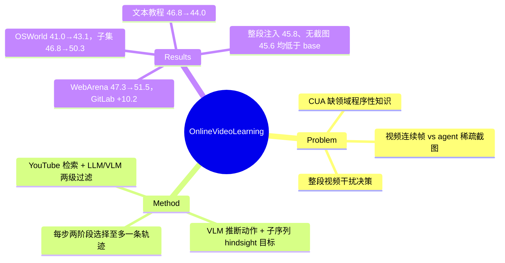

## Summary

这篇工作在推理时为 computer-use agent 检索 YouTube 教程视频，用 VLM 从帧变化推断 UI 动作，把视频切成"目标 + 动作/截图序列"的短轨迹，执行时每步两阶段选出至多一条轨迹放进上下文。在 gpt-5-mini 驱动的 Jedi 上，OSWorld-Verified 361 题从 41.0 提到 43.1（有视频的 211 题子集 46.8→50.3），AgentOccam 在 WebArena（不含 Map）上从 47.3 提到 51.5。三个消融变体（整段视频注入 45.8、不过滤动作 46.6、去掉截图只给文本 45.6）全部低于不用视频的 46.8：增益依赖"切短 + 按步选取 + 带截图"的完整组合，任一组件去掉都不再优于 base agent。

## Problem & Motivation

作者认为 CUA 与人的差距很大一部分来自领域程序性知识（特定软件怎么操作、UI 惯例、依赖版本的多步流程），这类知识在 LLM 训练语料里稀少，人则靠看教程视频补。把视频用起来有两道坎：视频是连续帧而 agent 只看动作前后的稀疏截图，视频里的动作是隐式的、要从屏幕变化反推；视频长且常有离题内容，agent 每步只需要与当前状态和子目标对得上的一小段，整段灌进去反而干扰。与 TongUI、VideoAgentTrek、Watch and Learn（Song et al.）等把视频转成训练数据做 continual pre-training 的路线不同，本文只做推理时、不更新参数。

## Method

三步流水线，检索与处理用开源模型（VLM：Qwen2.5-VL-32B-Instruct；LLM：Qwen3-30B-A3B-Instruct-2507），执行用 gpt-5-mini。

1. **Video retrieval（仅 OSWorld）**：LLM 把任务改写成搜索词（多应用任务每个应用一条），YouTube API 每词取 top-50，只留 <10 分钟的英文视频；LLM 按标题与简介挑 top-10，VLM 再看字幕和均匀采样的 10 帧，确认视频确实展示了相关应用的界面操作。
2. **Video processing**：2 fps 降采样，按像素差找变化帧；VLM 以 20 帧为一个 clip（相邻 clip 重叠 3 帧）标注动作类型、目标元素与起止帧，LLM 合并跨 clip 的同一动作，再按视频标题、简介和字幕滤掉与主任务无关的动作（无目的的移动、悬停等）。随后借 hindsight relabeling 思路，对所有子序列 $a_{i:j}$ 让 VLM 生成"这段能完成什么"的目标，只保留被判为完整、连贯的轨迹，再用 VLM 做一次有效性过滤。
3. **Video application**：每步先判断上一步选中的轨迹是否仍适用，适用就沿用；否则 stage 1 只读各轨迹的文本目标，每个视频取 top-3，stage 2 再看候选的初始截图与动作序列，选一条或一条不选。选中的轨迹（目标、截图、动作）放进上下文生成下一个动作。

WebArena 不做检索，直接用 VideoWebArena 为 672 个任务预录的视频，也不做动作过滤，所有子序列都建轨迹。

## Key Results

- **设置**：OSWorld-Verified 去掉 8 个 Google Drive 任务共 361 题，只给截图，最多 50 步，base agent 为 Jedi；WebArena 去掉 Map 域，a11y tree + 截图，最多 20 步，base agent 为 AgentOccam。所有方法同用 gpt-5-mini-2025-08-07。
- **覆盖率**：361 题中 211 题检索到相关视频，平均每题 3.6 条；其余 150 题与 base agent 行为相同。
- **OSWorld（Table 1，有视频 211 / 全集 361）**：Jedi 46.8 / 41.0；+文本教程（仿 Agent S 的 Perplexica 检索摘要，每步前置）44.0 / 39.0；+字幕 46.7 / 41.0；+视频轨迹 50.3 / 43.1（+3.5 / +2.1）。平均步数 28.8 对 Jedi 30.3。
- **WebArena（Table 2）**：AgentOccam 总体 47.3 → 51.5（+4.2），GitLab 33.9→44.1（+10.2）、Reddit 60.2→60.6（+0.4）；+字幕 47.9。WebArena 上没有跑文本教程基线。
- **消融（Table 3/4，全部在 OSWorld 211 题子集）**：每题只给 1 条视频 46.9，给全部（平均 3.6 条）50.3；去掉逐步轨迹选择、改为始终放整段视频对应的最长轨迹 45.8；去掉动作过滤 46.6；只给文本、不给截图 45.6。

## Evidence Ledger

| Claim ID | Claim | Type | Source locator | Evidence excerpt | Status |
|:--|:--|:--|:--|:--|:--|
| C1 | OSWorld-Verified 361 题（369 去 8 个 Google Drive）、最多 50 步、仅截图；WebArena 不含 Map、最多 20 步、a11y tree + 截图 | benchmark-setting | §4.1；App. Table 6–7 | "we exclude 8 Google Drive tasks"; "maximum number of steps to 50"; "The maximum steps is set to 20." | source-verified |
| C2 | 所有方法推理 backbone 为 gpt-5-mini-2025-08-07；检索/处理用 Qwen2.5-VL-32B-Instruct 与 Qwen3-30B-A3B-Instruct-2507 | benchmark-setting | §4.1；App. A | "we use gpt-5-mini-2025-08-07 as the underlying VLM backbone at inference." | source-verified |
| C3 | OSWorld 361 题中 211 题检索到视频，平均 3.6 条；其余 150 题与 base agent 相同 | number | §4.1 Video sources | "we collect videos for 211 out of 361 tasks, and on average, each task contains 3.6 videos" | source-verified |
| C4 | Table 1（211 / 361）：Jedi 46.8/41.0；文本教程 44.0/39.0；字幕 46.7/41.0；视频 50.3（+3.5）/43.1（+2.1） | number | Table 1 | "Jedi 46.8 41.0 / + Text tutorial 44.0 39.0 / + Transcript 46.7 41.0 / + Video demo 50.3 (+3.5) 43.1 (+2.1)" | source-verified |
| C5 | Table 2：AgentOccam 47.3 → 51.5（+4.2）；GitLab 33.9→44.1（+10.2）；Reddit 60.2→60.6（+0.4）；字幕 47.9 | number | Table 2 | "AgentOccam … 47.3 … + Transcript … 47.9 … Ours … 60.6 (+0.4) 44.1 (+10.2) 51.5 (+4.2)" | source-verified |
| C6 | WebArena 视频来自 VideoWebArena 为 672 个任务预录、专为覆盖 WebArena 所需技能设计的视频；WebArena 上不做动作过滤，也没有文本教程基线 | benchmark-setting | §4.1；§4.2；App. A.1 | "these videos are specifically designed to cover the skills required in WebArena"; "we do not include the text tutorial baseline" | source-verified |
| C7 | OSWorld 平均步数 28.8，Jedi 30.3 | number | §4.2 | "our method takes 28.8 steps … fewer than that of the Jedi baseline (30.3)" | source-verified |
| C8 | Table 3（211 题子集）：每题 1 条视频 46.9，3.6 条 50.3 | number | Table 3 | "1 video per task 46.9 / 3.6 videos per task 50.3" | source-verified |
| C9 | Table 4（211 题子集）：完整 50.3；无轨迹选择 45.8；无动作过滤 46.6；无视觉 45.6；三个消融变体均低于同子集 Jedi 46.8 | comparison | Table 4 vs Table 1 | "Ours 50.3 / No trajectory selection 45.8 / No action filtering 46.6 / No visual information 45.6"（与 46.8 的比较为跨表推算） | source-verified |
| C10 | "无轨迹选择"变体始终前置整段视频对应的最长轨迹 | benchmark-setting | §4.3 | "we always prepend the longest trajectory that corresponds to the entire video." | source-verified |
| C11 | 文本教程基线仿 Agent S：生成查询、Perplexica 检索并汇总成一份文档、每步前置 | benchmark-setting | §4.1 Baselines | "follow Agent S … use Perplexica Search Engine to retrieve and summarize online tutorials" | source-verified |
| C12 | 推理时两阶段选择：stage 1 只按文本目标每视频取 top-3，stage 2 看初始截图与动作序列选一条或不选；每步先判断上一条是否仍适用 | causal-mechanism | §3.4 | "the input only contains the textual objectives without the observation and action sequence"（stage 1 另含当前观测与任务） | source-verified |
| C13 | 检索：YouTube API 每词 top-50，<10 分钟英文；LLM 按标题/简介取 top-10；VLM 看字幕与 10 帧核验 | causal-mechanism | §3.2 | "collect the top-50 results per query … only keep those that are shorter than 10 minutes and in English." | source-verified |
| C14 | 处理：2 fps + 像素差变化检测；20 帧 clip、3 帧重叠；Algorithm 1 对所有子序列 i<j 调 VLM 生成目标 | causal-mechanism | §3.3；Algorithm 1 | "downsample each video with 2 frames per second"; "20 frames with 3 frames of overlap"; Algorithm 1 遍历 i<j | source-verified |
| C15 | 论文未报告随机种子、重复运行或方差，也未报告检索、处理、推理的金钱/token 成本或延迟 | benchmark-setting | 全文 | 全文检索 seed/variance/std/cost/latency/token 无报告；temperature 仅列 "Default" | source-verified |
| C16 | 代码在 github.com/UCSB-NLP-Chang/video_demo | license-code | Abstract | "Our code is available at https://github.com/UCSB-NLP-Chang/video_demo." | source-verified |
| C17 | 论文把 Watch and Learn（Song et al., 2025）与 VideoAgentTrek（Lu et al., 2025）列为另外的并行工作（训练 IDM 做 continual pre-training），本文不是 Watch & Learn | benchmark-setting | §2；References | "two concurrent works (Song et al., 2025; Lu et al., 2025) also conduct continuous pre-training from unlabeled videos" | source-verified |
| C18 | 作者单位为 UC Santa Barbara 与 AMD | benchmark-setting | 首页 | Liu、Chang 为 UC Santa Barbara；其余 8 位为 Advanced Micro Devices, Inc. | source-verified |

## Strengths & Weaknesses

**Strengths**

- 消融比主结果更有信息量，而且是负面信息：同样的视频，整段放进上下文（45.8）、不滤无关动作（46.6）或只给文本描述（45.6）都低于不用视频的 Jedi（46.8）；其中 46.6 与 46.8 的差距落在单次运行的噪声内，可确定的是"缺任一组件即无增益"，而非"缺任一组件即有害"。这是"外部知识的加载粒度决定符号"的一个干净的同 backbone 实例，与 [[Papers/2603-GUIDEWebVideo]] 中原始轨迹 ICL 低于 baseline 的结果方向一致。
- 文本教程基线照搬 Agent S 的 Perplexica 检索摘要，在 gpt-5-mini + Jedi 上反而 46.8→44.0。这与 [[Papers/2410-AgentS]] 中 web knowledge 是最大单项的结论相反，说明那条结论依赖其 backbone（GPT-4o）与整套 memory 框架，不能直接移植为"给 CUA 加检索文本就有用"。
- 检索与处理全用开源 Qwen 模型，代码公开，流水线简单，可复现性好于依赖闭源标注模型的同类工作。

**Weaknesses**

- **增益量级与噪声同级**：全集 +2.1 约等于 361 题中的 7–8 题，211 题子集 +3.5 约 7 题；全文没有 seed、重复运行或置信区间。gpt-5-mini 以默认温度运行，单次结果的随机波动很可能与这个增益同量级。
- **WebArena 的视频与任务高度对齐**：VideoWebArena 的视频本就为覆盖 WebArena 所需技能录制，GitLab +10.2 更接近"同站点操作演示"的上限，而不是开放检索的效果；WebArena 上也没有文本教程基线可比。
- **"更多视频更好"有混杂**：1 条对 3.6 条（46.9 对 50.3）同时改变了候选池大小和选择难度，且只有两个点，不足以支持作者"可继续 scale"的推断。
- **成本缺失**：Algorithm 1 对每个视频的所有子序列逐一调 VLM 生成目标，调用量随动作数平方增长；每步还多两轮选择调用并附带多张截图。论文没有报告任何成本、token 或延迟，也没有等预算对照（例如给 base agent 同样的额外调用或步数）。
- **覆盖率**：OSWorld 中 150/361（41.6%）题检索不到视频，方法在这些题上不起作用；检索失败的原因（应用冷门、Ubuntu 版本差异等）没有分析。

**定位**：属于"推理时外部程序性知识注入"一支，比 GUIDE 早约 5 个月，二者都发现原始轨迹整段注入有害；区别在于本文把视频转成带截图的短轨迹按步选取，GUIDE 把视频改写为 planning / grounding 两类文本知识。

## Mind Map

## Notes

- 名称澄清：vault 内曾把本文（arXiv 2511.04137）误称为 "Watch & Learn"。Watch & Learn 是 Song et al.（2025）的另一篇工作，本文在 §2 把它列为训练 IDM 做 continual pre-training 的并行工作。[[Papers/2603-GUIDEWebVideo]] Table 3 的 "W&L raw traj. ICL" 对照指的是 Song et al. 那一篇。
- 相关：[[Papers/2505-Jedi]]（OSWorld base agent）、[[Papers/2410-AgentOccam]]（WebArena base agent）、[[Papers/2410-AgentS]]（文本教程基线的来源）、[[Papers/2412-AgentTrek]] 与 [[Papers/2500-TonguiInternetScaleTrajectories]]、[[Papers/2605-Video2GUI]]（把教程转成训练数据的一支）、[[Topics/NonInvasive-GUI-Scheduling]]。
