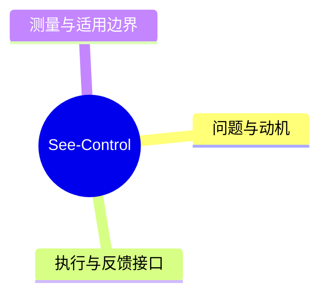

## Summary

See-Control 根据实时手机屏幕镜像规划 GUI 动作，再用真实的三轴单点触屏臂完成输入。 [原文与版本](https://arxiv.org/html/2512.08629v1)

## Problem & Motivation

手机 Agent 常通过 ADB 或系统接口获取状态和执行动作。本文关注在设备侧以真实触碰完成交互，同时让多模态模型通过可获得的视觉画面选择下一步。

## Method

MLLM 利用屏幕镜像、OCR 或元素定位及动作历史，生成 tap、swipe、text、back、exit 等离散原语。触屏指令映射到已标定的三轴机械臂。文字输入使用预先定位的键位。

## Key Results

ESO 共 155 项，其中标准单 App 37、挑战单 App 103、跨 App 15。Table 1 的标准单 App 简单任务完成 11/13，困难任务完成 1/11，跨 App 完成 2/15。

## Evidence Ledger

| Claim ID | Claim | Type | Source locator | Evidence excerpt | Status |
|:--|:--|:--|:--|:--|:--|
| C1 | ESO 共有 155 项，覆盖 140 项单 App 与 15 项跨 App | benchmark-setting | §3.1, §4.2 Table 1 | ESO | source-verified |
| C2 | 视觉来自实时屏幕镜像，动作为真机械臂的单点接触和离散原语 | causal-mechanism | §4.1, Figure 2 | screen mirroring | source-verified |
| C3 | 跨 App 为 2/15，标准单 App 简单 11/13、困难 1/11 | number | §4.2 Table 1 | Cross-app | source-verified |

## Strengths & Weaknesses

这套实验验证了真实触屏执行。镜像将相机视角、眩光和运动模糊排除在测量之外。单触点设计不覆盖多点手势，且动态页面受模型延迟影响。§6 将端到端 VLA 列为后续方向。

## Mind Map

## Notes

- [[Topics/AgenticRobotArm-Survey]]
