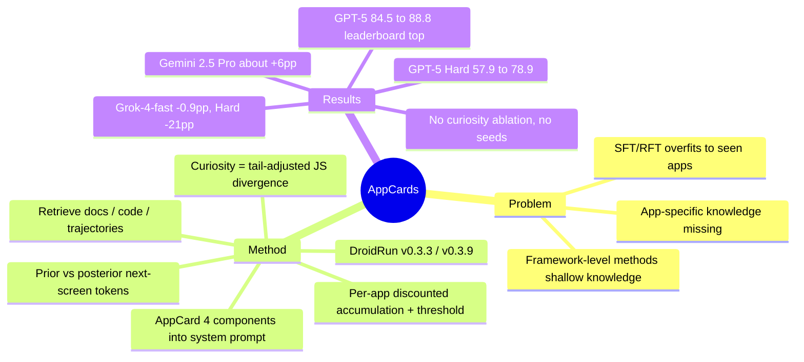

## Summary
在开源 DroidRun 框架上为每个 app 预先整理一张 AppCard（功能语义、输入输出约束、UI 元素到功能的映射、常见交互模式），执行时按任务涉及的 app 把整张卡注入 system prompt；论文另把"何时去检索外部文档"形式化为 curiosity 分数——模型对下一屏描述的 prior/posterior token 分布之间的 tail-adjusted JS 散度，按 app 折扣累积、超阈值触发检索。AndroidWorld 上 GPT-5 从 84.5% 升到 88.8%（作者称 2025-10-01 榜首），Gemini 2.5 Pro 两个 DroidRun 版本各约 +6pp，Grok-4-fast 反降 0.9pp；增益集中在 Hard 任务（GPT-5 57.9→78.9）。curiosity 触发机制本身没有任何消融、阈值或触发频率报告，实验证据只支持"注入 app 文档摘要"这一干预。

## Problem & Motivation
Mobile agent 进入复杂或没见过的 app 时缺少 app-specific 的功能知识：入口在哪、参数怎么填、哪个按钮触发什么。结果是规划错误、调错 app/工具、错误参数在后续步骤里级联，最终任务失败且难以迁移到新 app。作者把现有路线分成两条：(1) 面向特定 app 的端到端 SFT/RFT，在训练 app 内增益大，但过拟合界面布局与动作词表，换 app 就脆；(2) 框架层改进（planning、reflection 架构），能撑更长 horizon，但对 app 功能只编码浅层或隐式知识。本文想做的是在框架层补一个"按需取外部知识、结构化注入"的模块，并用一个 curiosity 门控控制检索频率与 context 预算，把注意力集中在知识缺口最大的状态上。

## Method
**Problem formulation（§3.1）**：在 MDP 五元组上加一个 epistemic uncertainty 量 U 与探索阈值 τ；动作空间是 DroidRun 的 `tap_by_index` / `tap_by_text` / `input_text` / `swipe` 等。

**Curiosity score（§3.2）**：受 Latent Bayesian Surprise 启发，把"预测的下一屏"与"实际的下一屏"之差当作信息增益。
- *Latent state distribution（§3.2.1）*：给定当前界面 s_t 和动作 a_t，模型生成"下一界面描述"的 prior token 分布；观察到 s_{t+1} 后再生成 posterior 分布。每个解码步只保留 Top-K token，其余概率合并进一个 OTHER 残差桶；跨解码步取并集并归一化，得到全局 prior / posterior 分布（Figure 3 示例用 Top-19 token + OTHER）。
- *Information gain（§3.2.2）*：用 base-2 Jensen-Shannon 散度（对称、有界）替代 KL，再加一个基于 OTHER 桶的 tail adjustment（带可调系数），把长尾不确定性显式计入。调整后的散度即单步信息增益。
- *Cumulative uncertainty（§3.2.3）*：按 app 做带权折扣累积（权重反映任务难度与时间衰减），超过阈值 τ 触发外部检索。
- 阈值 τ、K、tail 系数、折扣权重的数值在可读正文里找不到（HTML 转文本时公式体被剥离，不能排除写在公式里）。

**Retrieval & AppCards（§3.3）**：三类来源——在线文档（开发者手册、API 文档、用户指南）、源码与版本历史、历史交互轨迹。AppCard 每 app 一张，四部分：功能语义（API 用途与适用范围）、输入输出约束（参数类型、返回值、边界条件）、UI 元素到功能的映射（按钮文字 → 触发的功能）、常见交互模式与异常处理。执行时 agent 先判断任务涉及哪些 app，再取对应 AppCard 注入 system prompt。Appendix B 给出 Gallery / VLC / OsmAnd / Broccoli / Contacts / Pro Expense / Markor 七张示例卡，每张 5–10 条 bullet（如 Markor："CreateNote: Bottom-right '+' -> new note -> editor -> Save"）。

**基座与设置（§4.1）**：开源 DroidRun 框架 v0.3.3 与 v0.3.9 两个版本；默认 Gemini 2.5 Pro（temperature 0.3），另测 GPT-5 与 Grok-4-fast（仅 v0.3.9）；观测 screenshot + accessibility tree；同一 step budget 与环境配置。

## Key Results
- **榜单（Table 1，AndroidWorld 116 任务）**：DroidRun v0.3.9 + AppCards + GPT-5 = **88.8%**，作者称截至 2025-10-01 为 AndroidWorld leaderboard 榜首，超过此前 mobile-use（Llama 4-scout / Gemini 2.5 pro / GPT-5 nano 混合）的 84.5%。注意该 84.5 条目与表中 MobileUse-v2（75.0）引用的是同一篇 MobileUse 论文，84.5 本身只是 leaderboard 提交，没有独立可引的来源。
- **同 backbone 对照（§4.2，Table 2 行求和）**：GPT-5 84.5 → 88.8（+4.3pp，98→103/116）；Gemini 2.5 Pro v0.3.3 63.0 → 69.0、v0.3.9 65.5 → 71.6（各约 +6pp）；Grok-4-fast 61.2 → 60.3（−0.9pp）。四个配置算术平均 +3.9pp；摘要的"average gain of six percentage points"只对两个 Gemini 配置成立。
- **难度分层（Table 2，Easy 61 / Medium 36 / Hard 19）**：GPT-5 Easy 90.2→91.8、Medium 88.9→88.9、Hard 57.9→78.9（+21.0pp，11→15 个任务）；Gemini v0.3.3 Hard 26.3→36.8（+10.5pp）；Gemini v0.3.9 三档 +4.9 / +8.3 / +5.2；Grok-4-fast Hard 52.6→31.6（−21.0pp，10→6 个任务），Easy/Medium 小幅上升。
- **Table 1 内部不一致**：baseline 行 "DroidRun(v0.3.9)" 标注 "GPT-5, Gemini 2.5 Pro" 78.4，与 Table 2 推出的 GPT-5 baseline 84.5 和 Gemini baseline 65.5 都对不上，像是 leaderboard 上某次混合配置提交，不是本文的受控 baseline。
- **没有的东西**：curiosity 触发没有消融、阈值扫描或触发次数统计（§4.3 "Ablation Study" 只是 Table 2 的难度分层）；无 seed、无方差；贡献 (3) 提到的 "validation across unseen applications" 在 §4 没有对应的 held-out app 实验。阈值 / K / tail 系数 / 折扣权重的数值在可读正文与 Implementation details 中均未出现（主 agent 已在含公式 alt text 的原始 HTML 中复核，公式内亦无数值，见 Ledger C17）。
- **Case study（§5，Figure 5）**：Expense Add Multiple From Gallery——baseline 把系统 gallery 当成 Simple Gallery Pro，在 app drawer 反复搜索直到耗尽预算；AppCard 路径直接定位 Pro Expense 入口与 gallery 的 share 动作。单例，无统计。

## Evidence Ledger
| Claim ID | Claim | Type | Source locator | Evidence excerpt | Status |
|:--|:--|:--|:--|:--|:--|
| C1 | DroidRun v0.3.9 + AppCards + GPT-5 在 AndroidWorld 成功率 88.8% | number | Table 1; §4.2 | "DroidRun(v0.3.9)+AppCards (ours) \| GPT-5 \| Screenshot + A11y tree \| 88.8" | source-verified |
| C2 | 作者称 88.8% 为截至 2025-10-01 的 AndroidWorld leaderboard 榜首，超过此前 mobile-use 的 84.5% | sota-novelty | Table 1 footnote; §4.2 | "Results are collected up to October 1, 2025, based on the AndroidWorld Leaderboard, where our proposed method holds the top position" | source-verified |
| C3 | GPT-5 的 DroidRun v0.3.9 无 AppCards baseline 为 84.5%（98/116），净增 +4.3pp | number | Table 2 (55+32+11=98); §4.2 | "GPT 5 increases from 84.5% to 88.8%, corresponding to an absolute gain of 4.3 percentage points" | source-verified |
| C4 | Gemini 2.5 Pro：v0.3.3 63.0→69.0，v0.3.9 65.5→71.6 | number | §4.2; Table 2 (73/80/76/83 of 116) | "in version v0.3.3 improves from 63.0% to 69.0%, and in version v0.3.9 improves from 65.5% to 71.6%" | source-verified |
| C5 | Grok-4-fast v0.3.9 加 AppCards 后 61.2→60.3，下降 | number | §4.2; Table 2 (71→70 of 116) | "Grok 4 fast decreases from 61.2% to 60.3% in version v0.3.9, showing no benefit from AppCards" | source-verified |
| C6 | 四个配置的算术平均增益约 +3.9pp，摘要"平均 6pp"只对两个 Gemini 配置成立 | comparison | Abstract; §4.2; Table 2（重算 6.0/−0.9/6.1/4.3） | "with an average gain of six percentage points" / "Both versions yield gains of around 6 percentage points" | source-verified |
| C7 | GPT-5 Hard 57.9→78.9（11→15/19，+21.0pp）；Easy 90.2→91.8；Medium 88.9 不变 | number | Table 2; §4.3 | "Hard tasks, however, increase dramatically from 57.9% to 78.9%, yielding a 21.0 percentage point improvement" | source-verified |
| C8 | Grok-4-fast Hard 52.6→31.6（10→6/19，−21.0pp） | number | Table 2; §4.3 | "dropping from 52.6% to 31.6%, a decrease of 21.0 percentage points" | source-verified |
| C9 | Gemini v0.3.3：Easy 78.7→83.6、Medium 55.6→61.1、Hard 26.3→36.8 | number | Table 2; §4.3 | "improves from 78.7% to 83.6% on easy tasks, from 55.6% to 61.1% on medium tasks, and from 26.3% to 36.8% on hard tasks" | source-verified |
| C10 | AndroidWorld 116 任务、约 20 个 app，61 easy / 36 medium / 19 hard | benchmark-setting | §4.1 Benchmark | "116 interactive tasks across about twenty widely used Android applications [...] 61 easy tasks [...] 36 medium tasks [...] 19 hard tasks" | source-verified |
| C11 | 默认 Gemini 2.5 Pro temperature 0.3；同 step budget、screenshot + a11y tree；DroidRun v0.3.3 与 v0.3.9 | benchmark-setting | §4.1 Implementation details | "Gemini 2.5 Pro is the default backbone (temperature 0.3); we also report results with GPT 5 and Grok 4 fast under v0.3.9" | source-verified |
| C12 | curiosity = prior/posterior 下一屏描述 token 分布的 tail-adjusted base-2 JS 散度（Top-K + OTHER 桶），按 app 折扣累积，超阈值触发检索 | causal-mechanism | §3.2.1–3.2.3; Fig 2 caption | "only the Top candidate tokens are retained, and the remaining probability mass is aggregated into a residual bucket denoted as OTHER" | source-verified |
| C13 | 三类知识源：在线文档、源码与版本历史、历史交互轨迹 | mechanism | §3.3 | "The first is online documentation [...] The second is source code and version history [...] The third is historical interaction trajectories" | source-verified |
| C14 | AppCard 四部分：功能语义、输入输出约束、UI 元素到功能映射、交互模式与异常处理 | mechanism | §3.3 | "A typical AppCard consists of four components. The first component is functional semantics [...] The second is input and output constraints" | source-verified |
| C15 | 执行时先识别涉及的 app，再取对应 AppCards 注入 system prompt | mechanism | §3.3 末段 | "the agent first identifies which applications need to be invoked, then retrieves the corresponding AppCards and injects them into the system prompt" | source-verified |
| C16 | 全文无 curiosity 触发器的消融、阈值扫描、触发频率或 gated-vs-always 对照；§4.3 "Ablation Study" 只是难度分层 | absence | §4.3; Tables 1–2; 全文 grep | "Table 2 reports detailed performance across different task difficulty levels." | source-verified |
| C17 | 阈值 τ、Top-K、tail 系数、折扣权重的数值在论文中未报告 | absence | §3.2; §4.1; Fig 3/4 captions | "triggers external retrieval when it exceeds a fixed threshold"（§4.1；主 agent 复核含公式 alt text 的原始 HTML，无任何数值） | source-verified |
| C18 | 只公开任务轨迹（lisalsj.github.io/Droidrun-appcard），无方法代码仓库；DroidRun 为开源框架 | license-code | Abstract; §4.1 | "Task trajectories are publicly available at https://lisalsj.github.io/Droidrun-appcard/" | source-verified |
| C19 | Table 1 的 DroidRun(v0.3.9) baseline 行标 "GPT-5, Gemini 2.5 Pro" 78.4，与 Table 2 推出的 84.5 / 65.5 均不一致 | comparison | Table 1 vs Table 2; §4.2 | "DroidRun(v0.3.9) \| GPT-5, Gemini 2.5 Pro \| Screenshot + A11y tree \| 78.4" | source-verified |
| C20 | Case study 为 Expense Add Multiple From Gallery；baseline 混淆系统 gallery 与目标 app 并耗尽预算 | mechanism (single case) | §5; Fig 5; Appendix A | "The agent frequently confuses the system gallery with the intended application, repeatedly searches within the app drawer" | source-verified |
| C21 | Appendix B 示例卡覆盖 Gallery/VLC/OsmAnd/Broccoli/Contacts/Pro Expense/Markor，每张 5–10 条整 app 级 bullet | mechanism | Appendix B（5/10/8/8/8/9/7 条） | "Each AppCard encodes the key functionalities of an application into structured modules" | source-verified |
| C22 | 作者来自 Shanghai Univ. of Engineering Science、NUS、Droidrun（两位） | metadata | 作者栏 | "Shahir Ali [...] Affiliation: Droidrun, Osnabrück, Germany [...] Niels Schmidt [...] Affiliation: Droidrun, Osnabrück, Germany" | source-verified |
| C23 | Table 1 中 mobile-use（Llama 4-scout / Gemini 2.5 pro / GPT-5 nano）84.5 为最高的非本文条目 | number | Table 1 | "mobile-use (Li et al., 2025) \| Llama 4-scout, Gemini 2.5 pro, GPT-5 nano \| Screenshot + A11y tree \| 84.5" | source-verified |
| C24 | §1 称 AppCards 按步注入片段，但 §3.3/Appendix B 描述整 app 卡注入 system prompt，无片段选择机制 | mechanism / internal consistency | §1; §3.3; Appendix B | "Because AppCards are modular and version aware, only the fragments required by the current step are injected" | source-verified |
| C25 | 全文未报告 seed、运行次数或方差/置信区间 | absence | §4; Table 2 caption; 全文 grep | "The numbers indicate successes out of total tasks, with success rates and relative improvements." | source-verified |
| C26 | 贡献 (3) 称有 "validation across unseen applications"，但 §4 无 held-out app 实验 | absence / internal consistency | §1 contribution (3); §4.1–4.3; Appendix B | "with further validation across unseen applications and multiple backbone models" | source-verified |
| C27 | Table 1 的 "mobile-use 84.5" 与 "MobileUse-v2 75.0" 两行引用同一篇 MobileUse 论文（arXiv 2507.16853），84.5 无独立可引来源 | comparison | Table 1; References（Li et al. 2025） | "MobileUse: a gui agent with hierarchical reflection for autonomous mobile operation. arXiv preprint arXiv:2507.16853." | source-verified |

## Strengths & Weaknesses
**优点**
- 干预本身简单、零训练、可复用：一张 per-app 文档摘要进 prompt，对 GPT-5 在 Hard / cross-app 任务上 +21pp。Table 2 的形状——Easy/Medium 几乎不动、Hard 大涨——与"知识缺口集中在复杂 app 流程里"的故事一致，比单看平均值更有信息量。
- 诚实报告了 Grok-4-fast 的负结果和 backbone 依赖，并在两个 DroidRun 版本上都测了，排除了单版本 artifact。
- Discussion 把 curiosity 定位成诊断工具（区分"缺知识"与"界面变化 / 执行错误"导致的失败）是个有价值的 framing，虽然本文没有兑现。

**缺点与边界**
- **标题方法没有被评估**。curiosity 门控没有任何消融、阈值扫描、触发次数或"always inject vs. gated vs. random"对照；Table 1/2 的全部增益可以被"静态 AppCards 注入"完全解释。JS 散度 + tail adjustment + 折扣累积这一整套数学没有一个数据点支撑，阈值/K/系数的数值在可读正文里也找不到。这是 method worship 的典型：包装比干预复杂一个数量级。
- **机制描述内部不一致**：§1 宣称 AppCards "modular and version aware"、"only the fragments required by the current step are injected"，但 §3.3 与 Appendix B 描述的是整张 app 卡进 system prompt，全文没有片段选择机制。
- **没有 budget-matched 对照**：AppCards 增加 prompt token。[[2606-SkillMemoryBudget]] 已证明 online skill/memory 的表面收益大部分来自预算不对称。本文 Easy/Medium 基本不动而 Hard 大涨，预算解释的说服力偏弱（更多上下文理应也帮 Medium），但没有被排除。
- **AppCards 的来源不透明**：谁（人工还是 LLM）从什么材料生成？AndroidWorld 的 app 都是开源 app，文档与源码公开；但"历史交互轨迹"若包含 AndroidWorld 任务本身即是 benchmark 泄漏，论文未说明。Appendix B 的 VLC 卡含 Chromecast、4K/8K、转码等与 AndroidWorld 任务无关的条目，更像 LLM 对官网的通用摘要，而非 curiosity 定向检索的产物。
- **统计力**：116 任务单次运行，无 seed/方差。GPT-5 的 +4.3pp 是 5 个任务；Hard 的 +21pp 与 Grok 的 −21pp 各是 4 个任务（19 个中）。Grok 的"知识整合能力不足"解释是事后归因，没有机制证据。
- **SOTA 的可比性**：Table 1 混合了不同 backbone、不同 harness（DroidRun / mobile-use / 原生模型），88.8 主要是 GPT-5 × DroidRun 的组合效应；同 harness 同 backbone 的净增益是 +4.3pp。Table 1 的 baseline 行（78.4）与 Table 2 不一致、被超越的 "mobile-use 84.5" 又是一条没有独立出处的 leaderboard 提交，都削弱了该表作为 SOTA 证据的可信度。
- **利益关系**：两位作者来自 Droidrun（框架供应商），结果同时是产品宣传，需第三方复现。
- **适用边界**：方法依赖 app 有公开文档/源码。真实部署主场景是闭源商业 app，此时 AppCard 来源只剩历史轨迹，论文未在该设置下评估。贡献 (3) 提到的 "validation across unseen applications" 在 §4 中找不到对应实验。

## Mind Map

## Notes
- [[2500-GuiExplorerAutonomousExploration]]：Table 1 里的 baseline（47.4）。同为 training-free 的 app 知识注入，但 GUI-Explorer 的知识来自 agent 自主探索挖出的 transition-aware knowledge，而非文档/源码；本文声称的"历史轨迹"来源若真实现，就是 GUI-Explorer 的做法。
- [[2500-MobileuseGuiAgentHierarchical]]：Table 1 的 MobileUse-v2（75.0）。它处理陌生 app 的方案是 cold-start 时 proactive exploration，与本文"检索文档"互补：探索花交互步数，检索花 token；两者谁更划算取决于 app 是否有公开文档。
- [[2605-GLANCE]]：同样把 curiosity 用在 VLM agent 上，但 GLANCE 把跨模态不一致作为 RL 内在奖励并做了消融；本文的 curiosity 只是检索触发器且未评估。两篇对照可见"curiosity 用于训练"与"用于门控检索"在证据要求上的差距。
- [[2606-SkillMemoryBudget]]：本文缺的正是那种 budget-matched 对照；把 AppCards 的 token 开销换成等量交互步数或 a11y 树预算，是区分"知识增益"与"预算增益"的直接实验。
- [[2607-KnowActGUIClaw]]：同样是"把知识交给 executor"，发现弱模型 Qwen3.5-35B 能从强模型轨迹蒸馏的 memory/skill 获益（37.9→41.0）；本文却发现 Grok-4-fast 被 AppCards 在 Hard 上拖垮 −21pp。合起来提示：知识形式（轨迹蒸馏 vs 文档摘要）与 backbone 的匹配比"有没有知识"更关键，值得作为一个 open question 记进 survey。
- [[2512-AgentProg]]：2025-12 的 AndroidWorld 78.0 "SOTA"，与本文 88.8 对照说明 AndroidWorld 榜单数字强依赖 backbone（GPT-5）与 harness（DroidRun），跨论文比较必须同 backbone。
- [[2606-LearningFromFailure]]：其四类修复中"知识缺陷配外部 knowledge support"与本文动机相同，但它从失败轨迹诊断知识缺口——这比本文未评估的 JS 散度是更直接、且已被消融验证的"curiosity"信号。
- **Survey 归属**：应并入 [[Topics/CUA-Survey]] §6.9 Memory and State Tracking 的 workflow / skill / knowledge memory 谱系——作为"静态文档型知识注入"的数据点，记录其 backbone 依赖（GPT-5 +4.3 / Gemini +6 / Grok −0.9）、Hard 任务集中效应与无 budget-matched 对照；§4.3 Mobile Environments 的 AndroidWorld 段可引其 2025-10 榜首数字，但须标注 GPT-5 × DroidRun 组合。
- 项目页只放轨迹：https://lisalsj.github.io/Droidrun-appcard/ ；无方法代码，`code` 留空。
- 疑问：(1) AppCards 由谁生成、是否含 AndroidWorld 任务轨迹；(2) curiosity 在实验里到底触发过几次——若 AppCards 全部预先构建，则 curiosity 在评估里可能根本没参与；(3) Grok 的负结果是 prompt 过长还是指令风格不匹配，可以用截短的 AppCard 做一个简单检验。
