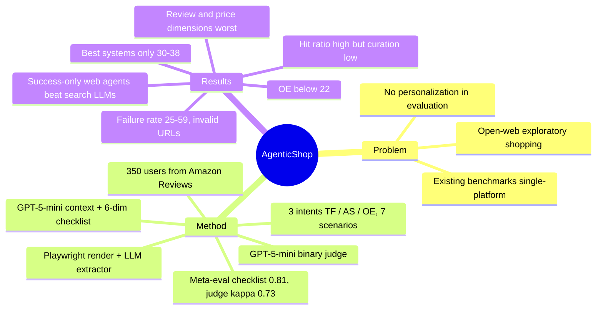

## Summary
AgenticShop 把 open web 上的"按个人偏好 curate 产品"做成 benchmark：350 个由真实 Amazon 评论史派生的用户 profile，覆盖 Target Finding / Alternative Selection / Open Exploration 三类购物意图共 7 个场景，每个用户配一份约 19–20 条、分六维度的可验证 checklist；评分由 Playwright 渲染产品页 → LLM 抽取信息 → GPT-5-mini 逐条二元判定得到（与人工 Cohen's κ 0.73，inter-human 0.77）。8 个系统里最好的 ChatGPT Search / Claude Sonnet 4 Search 也只有约 30–38%，Open Exploration 全部低于 22%；25–59% 的 curated 产品链接无效或无关，而只统计链接有效的样本时，autonomous web agent 在 Target Finding 上反超 search-augmented LLM（其余场景互有高低）。

## Problem & Motivation
网购本质上是跨平台的探索式搜索：用户在博客、社区和多个电商站之间比较备选，再按价格与服务做决定。现有 e-commerce agent benchmark（WebShop、ShoppingBench、WebMall、DeepShop、Amazon-Bench）把任务简化为单平台、预定目标的查找或功能执行，既不覆盖"没有明确目标的探索"，也不在评测阶段纳入个性化——PersonalWAB 引入了个性化，但只用在 agent 侧而非评测侧。与此同时两类系统在并行发展：search-augmented LLM（ChatGPT Search、Perplexity 等，靠检索工具拿结果再生成）与 autonomous web agent（SeeAct、WebVoyager、Browser Use 等，直接操作 live 网页）。缺少一个能把两者放到同一尺度、并按单个用户的偏好打分的 benchmark。

## Method
**Task formulation（§3.1）**：输入是用户 context（由购买史与评论推断出的叙事式偏好/约束描述）和一条带意图的 query；agent 在 open web 上探索后返回一组产品（含链接）；目标是 curated 产品尽量贴合该用户的 context。接口不限：search-augmented LLM 走搜索工具，web agent 走浏览器，评测只看最终返回的产品列表。

**意图与场景（§3.2–3.3.1）**

| Intent | 场景 | 域 | 说明 |
|:--|:--|:--|:--|
| Target Finding (TF) | Explicit Title / Attribute-Specific / Brand-Categorical | Grocery & Gourmet Food | 用户心中有确定目标；三档 query 具体度 |
| Alternative Selection (AS) | Low-Involvement / High-Involvement / Aesthetic-Driven | Home & Kitchen / Electronics / Clothing, Shoes & Jewelry | 只有品类意图，需要多个备选 |
| Open Exploration (OE) | Casual Browsing | 全域 | 无显式 query，agent 主动推荐 |

每场景 50 个用户 profile，共 350 个任务。

**用户 profile 构造（§3.3.2–3.3.5）**：数据源是 Amazon Reviews（Hou et al., 2024）。筛 ≥100 条评论的用户 → 取其最常购买的子品类为 target product type → 只保留相关购买史。GPT-5-mini 读产品元数据与该用户评论，生成叙事式 user context；再生成六维 checklist：brand preferences、price sensitivity、review sensitivity、functional requirements、aesthetic preferences、purchase preferences（卖家 / 配送 / 服务），平均每用户 19.3–20.0 条。TF 的 query 从用户购买史随机取 seed item 生成三档具体度；AS 的 query 只给品类不给品牌；OE 不给 query。

**评测（§3.4）**：对 agent 返回的每个产品 URL，用 Playwright 完整渲染页面并按 viewport 切成截图集合（目的是拿到动态加载内容、压掉广告与 cross-sell 噪声）；URL + 截图交给带 web-search 的 LLM extractor 抽结构化信息（品牌、价格、描述、配送、评论）；GPT-5-mini 作为 judge 对每个 (product, criterion) 对给 0/1；最终分数是所有用户、产品、条目上满足比例的平均。

**Meta-evaluation（§4.1）**：(1) checklist 可靠性——给 GPT-5-mini 一份 checklist 和同一用户的一个高分 + 一个低分商品，看能否判出偏好（250 样本）：checklist 0.81 > context 0.78 > 购买史 0.70 > query 0.54。(2) judge 可靠性——50 个实例 × 2 名人工，κ 0.732 / Spearman 0.743（inter-human 0.774）；去掉抽取信息只给 URL + 截图降到 0.44，只给 URL 降到 0.38；六个维度上 κ 在 0.674（review）到 0.792（brand）之间。

**Baselines（§4）**：search-augmented LLM 四个——ChatGPT Search、Claude Sonnet 4 Search、Gemini-2.5 flash-grounding、Perplexity-pro；autonomous web agent 四个——Agent-E、SeeAct、WebVoyager、Browser Use。正文未给出后四者的 backbone 模型、步数预算、运行次数与评测日期。

## Key Results
- **主结果（Table 4，curation score %）**：ChatGPT Search 在 TF 三档 37.81 / 35.35 / 34.79，AS 三场景 30.13 / 29.47 / 27.55，OE 14.51；Claude Sonnet 4 Search 37.93 / 36.44 / 34.96，29.66 / 29.08 / 20.58，OE 21.20。Gemini-2.5 flash-grounding 与 Perplexity-pro 整体只有 14–24。Web agent 中 SeeAct 最强（37.13 / 36.32 / 34.92，25.50 / 27.47 / 20.80，OE 20.79），与两家最强 search LLM 相当；Agent-E 最弱（19.75 / 20.65 / 14.85，16.15 / 21.76 / 19.98，OE 13.56）。作者把 Agent-E 的落后归因于 DOM distillation 带来的过长文本上下文。
- **Query 具体度影响很小**：TF 三档 query 之间差异只有 1–3 分；作者解释是 search LLM 会反复改写 query 产生过于复杂或不一致的搜索，web agent 则一开始就发一条长 query。
- **域差异**：作者称两类系统在 Fashion（Aesthetic-Driven）上都明显下降，Claude Sonnet 4 Search 降幅最大（20.58，其他 AS 场景约 29）；按 Table 4 逐项看，Agent-E 是例外（Aesthetic 19.98 高于其 High-Involvement 16.15）。作者称 Electronics（High-Involvement）普遍比 Home & Kitchen（Low-Involvement）难、而强模型差距缩小；按 Table 4 逐项核对，Low > High 只在 5/8 个系统成立，ChatGPT 与 Claude 反而 High 略高。
- **搜索能力 ≠ 个性化（Table 5）**：按"品牌 + 品类匹配即算找到"的 hit ratio，Claude Sonnet 4 Search 在 Explicit Title 达 0.86、SeeAct 0.88，但同设置下 curation score 只有 38%；Agent-E 的 hit ratio 只有 0.24 / 0.10 / 0.14。
- **链接失效是最大失败源（Table 6）**：failure rate（无效或无关链接）ChatGPT Search 24.76%、Claude 30.00%、Gemini 51.14%、Perplexity 56.10%、Agent-E 59.10%、SeeAct 32.66%、WebVoyager 41.47%、Browser Use 39.14%；失败里 invalid page（如编造的 Amazon ASIN 导致 404）占多数（64–93%）。作者据此称 ChatGPT Search 约 20% 的产品引用是幻觉。Table 6 的 Gemini 行 Irrelevant 87.64 + Invalid 92.36 > 100%，应为排版错误。
- **维度分析（Figure 4 / Table 6）**：brand 维度普遍做得好，review sensitivity 与 price sensitivity 最差。review 失败主要因为 curated 产品页本身没有评论（而非读不懂评论）；price 失败约 70% 是超预算推荐，原因包括网页价格动态变化、以及无法把基础价、运费、税、折扣聚合成最终成本。
- **只看有效页面时排名反转（Table 7 / Appendix C）**：把链接全部有效的样本单独算分，作者称 web agent 反超 search LLM——如 Agent-E 在 TF Explicit Title 的 "Success" 列 54.02 vs ChatGPT Search 43.08。逐列核对，这一反转在 TF 三档上一致成立（四个 web agent 的 Success 列 42.3–54.0 vs search LLM 35.0–44.5），AS / OE 上互有高低（如 Perplexity-pro High-Involvement Success 42.90 高于 SeeAct / WebVoyager / Browser Use）。作者把反转归因于 web agent 能多步探索、自我评估并回退，属推测，未做消融。
- **行为分析（Figure 5）**：让系统自标注每条 attribution 的意图，Claude（0.80）与 GPT（0.74）把最多精力放在 alternative evaluation 上，与其高分相关；web agent 的 information-seeking 行为明显更多。
- **错误模式（Appendix D）**：search LLM——URL 幻觉（有时源于检索工具本身返回无效 URL）、链接无效仍编造详细说明、query 改写偏向品牌而忽略功能属性；web agent——URL 幻觉、把多个属性拼成过长 query、在列表页提前终止、被页面促销/替代品价格干扰、只探索单一平台不换站。

## Evidence Ledger
| Claim ID | Claim | Type | Source locator | Evidence excerpt | Status |
|:--|:--|:--|:--|:--|:--|
| C1 | 350 个任务 = 7 场景 × 50 用户；平均每用户 19.3–20.0 条 checklist | benchmark-setting | Appendix A, Table 8 | "50 user profiles for each shopping scenario, resulting in a total of 350 personalized tasks"; Table 8 Avg. 19.3–20.0 | source-verified |
| C2 | 三类 intent 与七个场景及其对应域的划分 | benchmark-setting | §3.2, §3.3.1 | "Alternative Selection is modeled using Home & Kitchen, Electronics, and Clothing, Shoes & Jewelry, corresponding to Low-Involvement, High-Involvement, and Aesthetic-Driven" | source-verified |
| C3 | 用户来自 Amazon Reviews、≥100 条评论；context 与 checklist 均由 GPT-5-mini 生成 | benchmark-setting | §3.3.2–3.3.5 | "we select users with at least 100 reviews"; "We prompt GPT-5-mini to generate this checklist" | source-verified |
| C4 | Playwright 渲染截图 → 带 web-search 的 LLM extractor → GPT-5-mini 逐条二元判定 → 平均满足比例 | causal-mechanism | §3.4.1–3.4.2 | "LLM-based extractor equipped with web-searching capabilities"; "binary verification for each checklist criterion"; "average proportion of satisfied criteria" | source-verified |
| C5 | checklist 偏好对齐 0.81（250 样本），高于 Query 0.54 / Histories 0.70 / Context 0.78 | number | §4.1.1, Table 2 | "performed on 250 samples"; "highest alignment accuracy (0.81 on average)"; Avg. 0.54 / 0.70 / 0.78 / 0.81 | source-verified |
| C6 | judge vs human κ 0.7320 / ρ 0.7425；w/o product info 0.4395；URL only 0.3792；inter-human 0.7736；50 实例 × 2 人 | number | §4.1.2, Table 3 | "Ours 0.7320 0.7425"; "w/o product info. 0.4395 0.4405"; "URL Only 0.3792 0.3885"; "Inter-Human 0.7736" | source-verified |
| C7 | ChatGPT Search TF Explicit Title 37.81、Claude Sonnet 4 Search 37.93；两者各场景约 30–35% | number | §5.1, Table 4 | "ChatGPT Search 37.81"; "Claude Sonnet 4 Search 37.93"; "achieve only around 30-35% across scenarios" | source-verified |
| C8 | OE 上最高 Claude 21.20、SeeAct 20.79；ChatGPT Search 仅 14.51 | number | Table 4 | "all models show significantly lower performance in Open Exploration"; Cas. Brow. 21.20 / 20.79 / 14.51 | source-verified |
| C9 | Agent-E 是最弱 web agent（19.75 / 14.85），作者归因于 DOM distillation 的长文本上下文 | comparison | §5.1, Table 4 | "Agent-E 19.75 … 14.85"; "emphasis on DOM distillation over multimodal understanding, where lengthy textual contexts potentially lead to higher error rates" | source-verified |
| C10 | 三档 query 具体度之间差异 marginal | comparison | §5.1, Table 4 | "marginal performance differences across the three query variations in Target Finding scenarios" | source-verified |
| C11 | hit ratio：Claude 0.86、SeeAct 0.88（Explicit Title）；Agent-E 0.24 / 0.10 / 0.14 | number | §5.2, Table 5 | "successfully located if it matches the target's brand and type"; "Claude Sonnet 4 Search 0.86"; "SeeAct 0.88"; "Agent-E 0.24 0.10 0.14" | source-verified |
| C12 | 八个系统的 failure rate 24.76–59.10%；invalid page 占失败多数 | number | §5.2, Table 6 | Failure Rate 24.76 / 30.00 / 51.14 / 56.10 / 59.10 / 32.66 / 41.47 / 39.14; "invalid pages dominate the error cases" | source-verified |
| C13 | 作者称 ChatGPT Search 约 20% 的产品引用是幻觉 | number | §5.2 | "hallucinating approximately 20% of product references" | source-verified |
| C14 | price sensitivity 失败约 70% 来自超预算推荐 | number | §5.2, Table 6 | "approximately 70% of failures stem from out-of-budget recommendations" | source-verified |
| C15 | 只看链接全部有效的样本时 web agent 反超 search LLM（Agent-E 54.02 vs ChatGPT 43.08）——原文为组级陈述，Success 列仅在 TF 三档一致成立，AS / OE 互有高低 | comparison | §5.2, Appendix C, Table 7 | "autonomous web agents outperform search-augmented LLMs (Table 7)"; "Agent-E 19.75 54.02"; "ChatGPT Search 37.81 43.08" | source-verified |
| C16 | 意图自标注：Claude 0.80、GPT 0.74 在 alternative evaluation；web agent 的 information seeking 更多 | number | §5.3, Figure 5（数字见正文） | "Claude (0.80) and GPT (0.74) investing the most effort in comparing options"; "substantially more information-seeking behaviors" | source-verified |
| C17 | 维度级 κ 0.674（review）–0.792（brand），Overall 0.732，inter-human 0.774 | number | Appendix B, Table 9 | "Brand Pref. 0.792"; "Review Sens. 0.674"; "Overall 0.732 0.743 0.774" | source-verified |
| C18 | 作者称是首个 open-web 个性化产品 curation benchmark；Table 1 对比六个既有 benchmark | sota-novelty | Abstract, §1, Table 1 | "the first benchmark for evaluating agentic systems on personalized product curation in open-web environment"; Table 1: WebShop / ShoppingBench / PersonalWab / WebMall / DeepShop / AmazonBench | source-verified |
| C19 | 代码与数据集在 GitHub 公开；arXiv 版 CC BY 4.0 | license-code | 页眉, 脚注 1 | "License: CC BY 4.0"; "Code and dataset available at https://github.com/happysnail06/AgenticShop" | source-verified |
| C20 | 4 个 search-augmented LLM + 4 个 autonomous web agent 共 8 个 baseline | benchmark-setting | §4 Baselines | "ChatGPT Search … Claude Sonnet 4 Search … Gemini-2.5 flash-grounding … Perplexity-pro"; "Agent-E … SeeAct … Web Voyager … Browser Use" | source-verified |
| C21 | search LLM 受限于静态检索结果；web agent 瓶颈是落到次优页面后无法恢复、提前终止——原文用 "may stem" / "appears to arise"，属作者推测 | causal-mechanism | §5.2 | "reliance on static retrieval results"; "inability to recover after landing on a suboptimal product page—they tend to terminate early" | source-verified |
| C22 | 两类系统在 Fashion 上整体下降，Claude 降幅最大（20.58）——组级陈述；Agent-E 的 Aesthetic 19.98 高于其 High-Involvement 16.15 | comparison | §5.1, Figure 3, Table 4 | "for both search-augmented LLMs and web agents, performance drops significantly in Fashion ... sharpest decline observed in Claude Sonnet 4 Search"; "20.58" | source-verified |
| C23 | review 维度失败主因是 curated 产品页无评论 | causal-mechanism | §5.2, Table 6 | "most systems curate products that lack customer reviews"; "core limitation lies not in interpreting reviews, but in locating review-rich products" | source-verified |
| C24 | Electronics 普遍比 Home & Kitchen 难、强模型差距缩小——Low > High 仅 5/8 系统成立；ChatGPT / Claude / WebVoyager 反向但差距 <0.7 分 | comparison | §5.1, Figure 3, Table 4 | "with most baselines performing better on the latter scenarios"; "ChatGPT Search and Claude Sonnet 4 Search show comparable performance across both domains" | source-verified |
| C25 | Appendix D 的错误类型清单（search LLM 三类、web agent 五类）——正文称 search LLM 有 "four" 类但只列了三条 | causal-mechanism | Appendix D | "URL hallucination"; "Response hallucination"; "Biased query rewriting"; "Premature termination"; "Distraction by promotional content"; "Insufficient exploration" | source-verified |

## Strengths & Weaknesses
**优点**
- 把"找得到"和"挑得对"拆开是本文最有信息量的设计：Table 5 的 hit ratio（Claude 0.86、SeeAct 0.88）与 Table 4 的 curation score（约 38%）放在一起，直接说明瓶颈不在检索而在按用户约束筛选与核实。
- Table 7 的 success-only 重算揭示了 Table 4 排名的来源：search LLM 的领先很大程度来自链接有效率更高，而不是 curation 更好；一旦只比有效页面，web agent 在 Target Finding 上反超（AS / OE 互有高低）。这是对"Operator 类 agent 是否值得比 search LLM 多花十倍成本"的一个有用数据点，但反转主要由 Agent-E 驱动，而它的失败率最高（59%）、留下的有效样本最少。
- 评测框架有自己的 meta-evaluation（checklist 对齐真实评分、judge 对齐人工、extractor 输入消融），而不是只声称"LLM-as-a-judge 可靠"。Appendix D 的错误类型具体到可以直接变成 agent 设计 checklist（主产品区域识别、跨站重试、价格聚合）。
- 用真实用户（≥100 条评论）的购买史派生 persona，比单一手写 persona（如 MyPCBench）多样性高得多；六维 checklist 把"个性化"落到可核验的原子条目。

**缺点与边界**
- **生成器 = 裁判的循环**：user context、checklist、judge、以及 checklist 可靠性实验里的判别器全是 GPT-5-mini。checklist 条目倾向于 GPT-5-mini 认为显著的属性，judge 再用同一模型判定，0.81 的"对齐"有共享偏置；checklist 内容本身没有人工校验，只用高/低评分商品对做了 250 样本的代理检验。
- judge–human 一致性只测了 50 个实例，两位标注者按与 LLM 相同的 guideline 打分；κ 0.73 vs inter-human 0.77 看起来够用，但样本太小，且 review / price 两个最难维度恰好 κ 最低（0.67、0.69）。
- **不可复现且无方差**：live web、无快照、无评测日期，价格与库存随时变化（作者自己把价格波动列为失败原因）。8 个系统单次运行、无重复、无置信区间，Table 4 里 37.81 vs 37.93 这种差距没有意义；"Claude 最强"之类的排序结论应当看成当时一次采样。
- **baseline 不等价**：ChatGPT Search / Claude Search / Perplexity 是封闭产品，四个 web agent 是开源框架，但正文没写它们的 backbone、步数上限、超时与成本。web agent 59% 的 failure rate 可能部分来自预算截断而非能力——Table 6 有 "Out of Budget" 列，但那指用户预算，不是 token/step 预算。
- 分数定义把"链接无效"与"个性化不符"混在同一个均值里（Table 4 的 All 列），作者靠 Table 7 补救，但主表与摘要里的结论仍是混合量。更合理的报告应是 (有效率, 有效页面上的 curation score) 二元组。
- "Electronics 比 Home 难"的叙述与 Table 4 不完全一致（5/8 系统成立，两家最强模型方向相反）；"Fashion 上都下降"对 Agent-E 不成立；Table 6 的 Gemini 行两列相加 180%；Appendix D 说 search LLM 有四类错误却只列三类。都是小错，但说明表格与正文没有对账。
- 意图分布（Figure 5）靠系统自标注，这是一个弱测量：模型说自己在 "alternative evaluation" 不等于真的在比较。
- "首个 open-web 个性化 curation benchmark" 的新颖性成立范围较窄：Mind2Web 2 已做 open-web agentic search + agent-as-judge，PersonalWAB 已有个性化 web agent，本文的增量是"个性化进入评测侧 + 购物意图分层"，不是新的任务形态。
- 隐含假设：用户偏好可以从历史评论完整外推成 checklist，且在 TF 里 seed item 来自用户已买过的东西——agent 其实在"重新找到用户买过的商品"，与真实的新购物决策有差距。

## Mind Map

## Notes
- **Tag 判断依据**：benchmark 的任务是检索 + 聚合 + 生成产品列表，不要求也不评测任何网页状态改变（无加购、下单、表单），search-augmented LLM 是一等 baseline 且得分最高，所以主 tag 为 `deep-research`；但 8 个 baseline 中 4 个（Agent-E / SeeAct / WebVoyager / Browser Use）确实通过浏览器观察并改变页面状态，§5.2 与 Appendix D 的失败分析（列表页提前终止、促销干扰、单站不换）是导航层面的发现，按 hybrid 规则补 `web-agent` + `gui-agent` umbrella。若 Supervisor 认为应按任务性质而非 baseline 性质归类，可改为 `[deep-research, LLM]`。
- 与 [[2504-OnlineMind2Web]]：同为 live-web + LLM-judge 对人工校准的评测（WebJudge 约 85% 一致 vs 本文 κ 0.73），都发现 SeeAct 在真实网站上仍有竞争力；本文把任务收窄到购物 curation，并把个性化 checklist 作为评测单元，但没有 Online-Mind2Web 那种按步数分难度与 trajectory 证据的设计。
- 与 [[2508-AmazonBench]]：同为 e-commerce live-web benchmark，但 Amazon-Bench 测单平台上的功能执行（下单、账户操作），本文测跨平台的 curation；本文 Table 1 把 Amazon-Bench 列为"Function Execution"对照。两者合起来覆盖了购物 agent 的"做事"与"选品"两面。
- 与 [[2606-MyPCBench]] 和 [[2601-PersonalAlign]]：三者都把个性化引入 agent 评测。MyPCBench 用单一 canonical persona + 预登录桌面状态，PersonalAlign 从 20k 长期记录标注 preference/routine，本文用 350 个真实 Amazon 用户的评论史生成 persona——persona 多样性最高，但个人状态只以文本 context 给出，不进入环境。
- 与 [[2401-SeeAct]]：SeeAct 是本文最强的 web agent baseline（TF Explicit Title 37.13，几乎追平 ChatGPT Search），与 Online-Mind2Web 的结论一致，说明 2024 年初的 grounding-first 设计在 live 购物站上没有被后来者明显超越。
- 与 [[2504-BrowseComp]]：两种 deep-research benchmark 设计哲学的对照——BrowseComp 用短的唯一可验证答案换取客观性，本文用开放式 curation + checklist judge 换取真实性；代价是本文的分数依赖 judge 与 live 页面，不可复现。
- **与 `Topics/CUA-Survey.md` 的关系**：可作为 §8.8 Personalization 的一个 source-checked 数据点（真实用户派生的 350 persona、checklist judge 与人工 κ 0.73），并为 §8 live-web 评测补充 web agent 在 open-web 购物上的失败模式（URL 幻觉、列表页提前终止、促销干扰、单站不换）与"有效页面上 web agent 反超 search LLM"的张力。但 benchmark 本身是 IR 取向、接口无关，不测 GUI 状态转移；是否进入 CUA-Survey 取决于 Supervisor 对 tag 的裁决。
- 疑问：Table 7 的反转有多少来自样本选择偏差（web agent 失败率更高，剩下的"成功样本"是更容易的任务）？论文没有做 task-level 配对比较。
