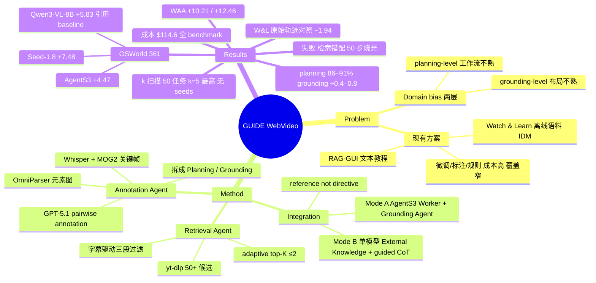

## Summary
GUIDE（GUI Unbiasing via Instructional-Video Driven Expertise）是一个 training-free 的知识注入框架：对每个任务在测试时用 yt-dlp 搜 YouTube 教程视频，经字幕驱动的三段过滤选出至多 2 条，用 GPT-5.1 + OmniParser 对相邻关键帧做 pairwise annotation，再由 LLM 拆成 Planning 知识（coordinate-free 工作流）和 Grounding 知识（至多 k 个 UI 元素的外观/位置/功能描述），分别注入冻结 agent 的 planning prompt 与 grounding prompt。OSWorld 361 任务、50 步上限下，Seed-1.8 37.14→44.62（+7.48）、Qwen3-VL-8B 33.90→39.73（+5.83，baseline 取自 Qwen3-VL 技术报告而非同 harness 复跑）、AgentS3（GPT-5.2 Worker + Seed-1.8 Grounding）50.18→54.65（+4.47）；planning 通道贡献约 86–91%，grounding 在全集上只再加 +0.41～+0.80 且跨 domain 符号不定。同一批检索视频但以原始轨迹文本注入的 Watch & Learn 式对照反而降到 31.96（−1.94），全文没有 budget-matched 或"baseline 多给步数"的对照；检索约 $0.019/任务、标注约 $0.252/视频，全 benchmark 约 $114.6。

## Problem & Motivation
作者把 GUI agent 在特定软件上的失败归结为 **domain bias**，并拆成两层：**planning-level**——不知道某应用的工作流（例如 GIMP 里调亮度走 Colors → Brightness-Contrast，而不是 Photoshop 习惯的 Image → Adjustments）；**grounding-level**——不熟悉该应用的布局与控件样式，找不到 Colors 菜单项或对话框里的那根 slider。论点是"模型不缺能力，缺的是领域知识"，所以手工标注、专家规则、领域微调这三条路成本高、覆盖窄、追不上软件界面更新。

与已有工作的定位差异（§2）：RAG-GUI 检索 web 文本教程、KG-RAG 从 UI transition 建知识图、OS-Symphony 按需合成教程，都不处理原始视频；Mobile-Agent-V / ShowUI-Aloha 把人工预先指定的演示视频喂给 agent，不可扩展；TongUI / VideoAgentTrek / Video2GUI 这一支从 YouTube 挖轨迹是为了**训练**。最接近的 Watch & Learn 用轻量 inverse dynamics model 逐帧标注离线语料并作 in-context 示例；GUIDE 的三点差异是实时检索、字幕驱动过滤、以及 VLM 联合关键帧对 + 元素图 + 字幕产出结构化知识而非逐帧标签。

## Method
**(1) Retrieval Agent（§3.2，Fig. 2）**。GPT-4.1 由任务指令和应用名生成搜索查询，GPT-4.1-mini 再出一个去掉 "how to / tutorial" 的简化版，两条查询经 yt-dlp 搜 YouTube 得 50+ 候选；metadata 预过滤（时长 < 3000 s、标题字符合法）后约剩 15 条。Stage 1 下载字幕（含自动字幕），去掉 VTT/SRT 标记、时间戳、重复行后截到 10,000 字符，连同标题交给 GPT-4.1-mini 判断是否包含实际 GUI 操作演示（约剩 8 条）；Stage 2 从标题 + 字幕提炼 12–30 词的 topic（例如标题写 "Excel Tutorial 2024" 但字幕实际演示 LibreOffice Calc 时以字幕为准）；Stage 3 用 "TOPIC … TITLE … TOPIC" 双锚 prompt 对所有候选批量打 0–1 相关分。adaptive top-K：排名第一无条件保留，第二条需相关分 ≥ 0.5，K ≤ 2。

**(2) Annotation Agent（§3.3，Fig. 3）**。Whisper base（词级时间戳）重新转写音频；按字幕区间切段，段内用 MOG2 背景差分（前景像素 > 10,000）找显著视觉变化的起止帧，得到离散界面状态序列 {s_t}；OmniParser 给每帧元素图 E_t（bbox、类型、文本）。核心是 pairwise annotation 函数 a_t = f_VPA(s_t, E_t, s_{t+1}, E_{t+1}, T_topic, C_sub)，由 GPT-5.1 以滑窗处理相邻帧对，输出 JSON：`Meaningful` 布尔（过滤鼠标移动、窗口闪烁、非 GUI 片段）+ `Thought & Action NLP`（第一人称执行者叙述：环境观察、元素猜测、动作规划、自然语言 grounded action），**不输出坐标**。把 meaningful 条目串成每视频一条轨迹，再由 GPT-5.1 拆成两类知识：**Planning**（Execution Flow & Planning、Key Considerations、coordinate-free abstraction）与 **Grounding**（至多 15 个关键元素，每个含 Icon/Control 名称、Appearance & Position、Predicted Function；注入时默认最多 k = 7 个）。

**(3) Plug-and-Play Integration（§3.4，App. A）**。知识全是自然语言，prompt 明确写成 "reference, not directive"，与截图冲突时信截图。Mode A（AgentS3）：Planning 以 "Reference Plan from a Similar Task" 块插入 Worker 的 system prompt；Grounding 作为每次 grounding 查询的补充上下文发给 Grounding Agent。Mode B（Seed-1.8 / Qwen3-VL-8B 单模型）：两块合并进 system prompt 的 "External Knowledge" 节，并用强制 Thought 模板做 guided CoT：先判任务相似度 → 定位当前处于工作流哪一阶段 → 从 Planning 推下一子目标 → 用 Grounding 描述对照当前截图 → 出动作；只有一个通道时模板退化。K = 2 时两段知识分别编号拼接；任务没有检索到视频则整块省略，agent 按 baseline 运行。

**成本核算（App. E）**。检索每任务约 18 次 API 调用、$0.0188；标注每视频 15 次帧对调用（30 关键帧，约 11 个 meaningful）+ 2 次拆解，133.56K/8.55K tokens，GPT-5.1 下 $0.252；复杂界面 regime 下 GPT-5.1 $0.301 / GPT-4.1-mini $0.048 / Seed-1.8 $0.029 / Qwen3-VL-8B $0.014。全 benchmark 361 任务、约 427 条视频，$114.6（标注占 94.1%）。Whisper 与 OmniParser 本地运行不计。

## Key Results
**设置（§4.1，App. B）**：OSWorld 369 任务去掉 8 个 Google Drive 任务后 361 个、10 个 domain、每任务最多 50 步、1920×1080；Seed-1.8 与 Qwen3-VL-8B 均 temperature 1.0 + thinking mode；AgentS3 = GPT-5.2 Worker + Seed-1.8 Grounding，用 k = 5；单模型 agent 默认 k = 7。361 任务中 299（82.8%）检索到至少 1 条视频，其中 42.7% 得到 2 条；其余 62 个任务没有注入、按 baseline 运行。Practical Notes 承认 Seed-1.8 API 的反蒸馏措施会间歇产生畸形输出（做了轻量解析修复），Chrome 任务有网络问题压低所有配置的分数。

**主结果（Table 1，OSWorld 361，average score %）**

| Agent | No Annotation | + Planning | + Plan. & Gnd. | 总增益 |
|:--|--:|--:|--:|--:|
| Seed-1.8（Mode B，k=7） | 37.14 | 43.93（+6.79） | 44.62 | +7.48 |
| Qwen3-VL-8B-thinking（Mode B，k=7） | 33.90（取自 Qwen3-VL 报告） | 38.93（+5.03） | 39.73 | +5.83 |
| AgentS3 GPT-5.2 + Seed-1.8（Mode A，k=5） | 50.18 | 未测 | 54.65 | +4.47 |

- **通道归因**：planning-only 占总增益 6.79/7.48 = 90.8%（Seed-1.8）与 5.03/5.83 = 86.3%（Qwen3-VL-8B）；grounding 在 planning 之上只再加 +0.69 / +0.80。Table 3（Qwen3-VL-8B-thinking，同 361 任务）补了 grounding-only（k=7）= 34.31，仅 +0.41。AgentS3 没有 planning-only 行，"planning 主导"只在两个单模型 agent 上有证据。
- **Per-domain**（Table 1）：Seed-1.8 Writer 34.77→56.51（+21.74）、Calc 29.79→48.94（+19.15）、GIMP 26.92→42.31（+15.39）；AgentS3 GIMP +15.39、Calc +14.90、Writer +13.05。负例同样存在：Seed-1.8 Multi-apps 26.88→27.89（planning）→25.74（full，低于 baseline）；Qwen3-VL-8B 加上 grounding 后 Chrome 41.22→36.87、Impress 47.59→38.48、VSCode 52.17→43.48（但 Calc +7.12、VLC +11.21、ThBrd +6.67）；AgentS3 VLC 73.91→56.25（−17.66）、Multi 40.32→37.10。另一观察：Seed-1.8 的 + Planning 与 + Plan. & Gnd. 两行在 Chrome/OS/ThBrd/VLC/VSCode 五个 domain 数值完全相同，Qwen3-VL-8B 的 Writer 也相同，论文没有说明是 grounding 在这些 domain 恰好零影响还是复用了 planning-only 的运行。
- **格式对照（Table 3）**：Watch & Learn 式原始轨迹 ICL——同样的 299 个检索到视频的任务、同样的 GPT-5.1 拆解前轨迹、K=2 条 demo、每条 12 步、24K 字符上限——得 31.96，比 no annotation 低 1.94，比 full 低 7.77。作者据此主张有用的是"拆成 Planning/Grounding 的结构化转换"而非教程轨迹本身。
- **跨 benchmark（Table 2，WindowsAgentArena 154 任务）**：AgentS3+GPT-5.2 49.00→59.21（+10.21），Qwen3-VL-32B-Instruct 31.70→44.16（+12.46，相对 39%），六个 domain 全部上升；知识格式未针对 WAA 调整。两行 baseline 均为一位小数、GUIDE 行为两位小数，baseline 是否同 harness 复跑论文未说明。
- **标注管线消融（Table 4，120 任务均衡子集，每 domain 12 个，Qwen3-VL-8B-thinking，3 seeds 平均）**：None 40.00 → 仅字幕 42.32（+2.32）→ 视觉 pairwise 标注但无 OmniParser 47.52（+7.52）→ Full 49.11（+9.11）；OmniParser 只多 +1.59。正文此处写"strong GPT-5.2 annotator"，而 §4.1 与 App. B 写标注器是 GPT-5.1。
- **检索视频数（Table 5，50 任务子集，Qwen3-VL-8B-thinking）**：K=1 41.81、K=2 44.04（+2.23）、K=3 44.10（+0.06）；per-domain 非单调（Chrome 71.43/85.71/57.14，VLC 58.13/20.00/40.00）。
- **Grounding 元素数 k（App. C Table 7a，50 任务子集，Seed-1.8，无 seeds）**：k=0（planning-only）41.82、k=1 45.00、k=3 49.69、**k=5 53.81**、k=7 47.88、k=10 48.66、k=15 48.66。k=5 在该子集最高，k>5 全部回落但并非单调递减（k=10/15 高于 k=7）。与全集设置的张力：主实验单模型用的是 k=7，而 Table 7(b) 的 No Annotation 在同一子集只有 32.0——即子集上 planning-only 给 +9.82、k=5 grounding 再加 +11.99，远大于全集上 grounding 的 +0.69～+0.80。
- **标注模型（Table 7b，k=5，同子集）**：No Annotation 32.0、GPT-4.1 Mini 47.7、Qwen3-VL-8B 51.8、GPT-5.1 53.8、Seed-1.8 57.8——8B 开源标注器已拿到大部分增益，Seed-1.8 作标注器反而高于 GPT-5.1。
- **效率（§4.2，未写明是哪个 agent；134/361 = 37.1%、161/361 = 44.6% 与 Seed-1.8 两端分数吻合）**：每步延迟 9.5→11.6 s（+2.1 s）；成功任务平均步数 16.6→15.7，VLC −5.0、Calc −3.7 步；成功任务数 134→161（+20.1%）。
- **检索与标注质量（§4.5，Fig. 5，Table 6；300 视频、3 名标注者）**：Stage 1 GUI 分类 precision 100%、recall 90.96%、F1 95.27%（TP 171 / FN 17 / TN 112 / FP 0，准确率 94.3%）；topic extraction 均分 0.867、96% 可接受（77.3 / 18.7 / 4.0）。Table 6 的 retrieval 对照：Full 0.867 / 96.00% / 直接命中 77.33，title-only 0.782 / 88.67% / 67.67，random 0.628 / 80.33% / 45.33——注意 Full 行与 Fig. 5b 的 topic-extraction 数字完全一致，两处是否同一测量论文没说清；且这些对照衡量的是人工相关性评分，不是下游任务成功率。
- **Meaningful 过滤（App. D，4,500 帧）**：1,227 无效帧中正确过滤 1,124，误滤 47 个有效帧；P 96.0 / R 91.6 / F1 93.7；非 GUI 帧 recall 98.8%（1,019/1,031），idle no-action 帧只有 53.6%（105/196）。
- **失败案例（App. F，Fig. 7–8，全部 GIMP）**：planning mismatch——检索到打印 ppi 教程而任务要锐化，浪费 8 步；检索到 darktable 插件安装教程而任务只需 Export As，浪费 13 步在终端命令上。grounding mismatch——教程在浏览器里下载 CMYK profile，grounding 描述的是浏览器元素，agent 主动打开 Chrome 烧光 50 步；教程是动画幻灯片而非录屏，13 个描述元素 0 个可用。
- **没有的对照**：Table 1/2/3/5/7 均无 seeds 与方差（只有 Table 4 报 3 seeds）；没有 budget-matched（同 token / 同延迟）对照，也没有"baseline 多给步数"对照；Qwen3-VL-8B 的 OSWorld baseline 是引用值；未报告 covered 299 任务子集上的增益（62 个未覆盖任务按 baseline 跑，把 per-task 效应稀释了约 17%）；未报告检索 + 标注的端到端 wall-clock；Table 5 与 Table 7 的两个"50 任务子集"domain 构成不同（Chrome 7 vs 6、Calc 6 vs 8、Impress 6 vs 5）。

## Evidence Ledger
%% 只列高风险 claim：数字、SOTA/novelty、benchmark 可比性、license/code、因果或机制断言。Source locator 用 page/section/table/figure；Evidence excerpt 为原文短摘录（≤25 words）。Status 允许 source-verified / unsupported / contradicted / not-checkable / abstract-only。source-verified 仅表示 primary source 确实包含该信息，不表示结果已被独立复现。 %%

| Claim ID | Claim | Type | Source locator | Evidence excerpt | Status |
|:--|:--|:--|:--|:--|:--|
| C1 | Seed-1.8 OSWorld 361：37.14 → 43.93（+Planning，+6.79）→ 44.62（+Plan.&Gnd.，+7.48） | number | Table 1 | "Seed-1.8 / No Annotation 37.14 / + Planning 43.93 +6.79 / + Plan. & Gnd. 44.62 +7.48" | source-verified |
| C2 | Qwen3-VL-8B：33.90（baseline 取自 [4]）→ 38.93（+5.03）→ 39.73（+5.83） | number | Table 1; Table 3 | "No Annotation† 33.90 … + Planning 38.93 +5.03 … + Plan. & Gnd. 39.73 +5.83; †Baseline from [4]" | source-verified |
| C3 | AgentS3（GPT-5.2 Worker + Seed-1.8 Grounding，k=5）：50.18 → 54.65（+4.47），无 planning-only 行 | number | Table 1 + footnote ‡ | "AgentS3‡ No Annotation 50.18 … + Plan. & Gnd. 54.65 +4.47; ‡GPT-5.2 Worker + Seed-1.8 Grounding (Mode A); k=5" | source-verified |
| C4 | planning-only 占总增益约 86–91%（6.79/7.48、5.03/5.83）；grounding 再加 +0.69–0.80 | comparison | §4.2 Dual-Channel Analysis | "accounting for ∼86–91% of the total gain … Adding Grounding yields further complementary gains (+0.69–0.80%)" | source-verified |
| C5 | Qwen3-VL-8B grounding-only（k=7）= 34.31，仅 +0.41 | number | Table 3 | "Grounding-only (k=7) 34.31 … +0.41" | source-verified |
| C6 | Watch & Learn 式原始轨迹 ICL 对照得 31.96（−1.94）；同 299 任务、同 GPT-5.1 轨迹源、K=2、每 demo 12 步、24K 字符上限 | comparison | Table 3; §4.3 Attribution and Raw-Context Controls | "W&L raw traj. ICL 31.96 … -1.94 … same 299 retrieved-video tasks … K=2 demos, 12 steps per demo, and a 24K-character cap" | source-verified |
| C7 | OSWorld 设置：369 去 8 个 Google Drive 任务 = 361，10 domain，每任务最多 50 步，1920×1080 | benchmark-setting | §4.1 Benchmark; App. B | "exclude 8 Google-Drive-dependent tasks … remaining 361 tasks spanning 10 application domains … maximum number of interaction steps per task is set to 50" | source-verified |
| C8 | 299/361（82.8%）任务检索到 ≥1 条视频，其中 42.7% 得到 2 条；62 个任务按 baseline 运行 | number | §4.5 Retrieval Coverage | "299 (82.8%) retrieve at least one relevant tutorial video, and 42.7% of covered tasks retrieve two videos … remaining 62 tasks fall back to baseline" | source-verified |
| C9 | 单模型 agent 默认 k=7 个 grounding 元素；AgentS3 用 k=5 | benchmark-setting | §4.1 Evaluation Protocol; Table 1 ‡; App. B | "full dual-channel, default k=7 grounding elements … ‡ … k=5 … the default maximum number of UI elements is k=7" | source-verified |
| C10 | Table 7(a) k 扫描（50 任务子集，Seed-1.8）：k=0 41.82、1 45.00、3 49.69、5 53.81、7 47.88、10 48.66、15 48.66 | number | App. C Table 7(a) | "0 41.82 … 1 45.00 … 3 49.69 … 5 53.81 … 7 47.88 … 10 48.66 … 15 48.66" | source-verified |
| C11 | Table 7(b) 标注模型（k=5，同子集）：No Annotation 32.0、GPT-4.1 Mini 47.7、Qwen3-VL-8B 51.8、GPT-5.1 53.8、Seed-1.8 57.8 | number | App. C Table 7(b) | "No Annotation 32.0 … GPT-4.1 Mini 47.7 … Qwen3-VL-8B 51.8 … GPT-5.1 53.8 … Seed-1.8 57.8" | source-verified |
| C12 | WAA 154 任务：AgentS3+GPT-5.2 49.00→59.21（+10.21）；Qwen3-VL-32B 31.70→44.16（+12.46） | number | Table 2 | "Agents3+GPT-5.2 … 49.00 +0.00 … 59.21 +10.21; Qwen3-VL-32B … 31.70 … 44.16 +12.46" | source-verified |
| C13 | Table 4（120 任务、每 domain 12、Qwen3-VL-8B-thinking、3 seeds）：None 40.00、Sub. 42.32、w/o OP 47.52、Full 49.11 | number | Table 4 | "Average 120 40.00 42.32 47.52 49.11 … +2.32 +7.52 +9.11" | source-verified |
| C14 | Table 5（50 任务，Qwen3-VL-8B-thinking）：K=1 41.81、K=2 44.04、K=3 44.10 | number | Table 5 | "Overall 50 41.81 44.04 44.10" | source-verified |
| C15 | 每步延迟 9.5→11.6 s；成功任务步数 16.6→15.7（VLC −5.0、Calc −3.7）；成功任务数 134→161（+20.1%） | number | §4.2 Per-Domain Analysis and Execution Efficiency | "per-step latency (9.5→11.6 s, +2.1 s) … (15.7 vs. 16.6 on successful tasks) … success count grows from 134 to 161 (+20.1%)" | source-verified |
| C16 | Seed-1.8 per-domain：Writer 34.77→56.51（+21.74）、Calc 29.79→48.94（+19.15）；Multi 26.88→25.74（full 低于 baseline） | number | Table 1; §4.2 | "Writer +21.74pp, Calc +19.15pp on Seed-1.8"; Table 1 Multi 26.88 / 27.89 / 25.74 | source-verified |
| C17 | 加 grounding 后的 per-domain 负例：Qwen3-VL-8B Chrome 41.22→36.87、Impress 47.59→38.48、VSCode 52.17→43.48；AgentS3 VLC 73.91→56.25 | number | Table 1 | Qwen3-VL-8B rows "41.22 … 36.87", "47.59 … 38.48", "52.17 … 43.48"; AgentS3 "73.91 … 56.25" | source-verified |
| C18 | 检索流程：yt-dlp 搜 YouTube 50+ 候选；时长 < 3000 s 预过滤；字幕截 10,000 字符；相关分 0–1；top-1 无条件保留、第二条需 ≥ 0.5；K ≤ 2 | causal-mechanism | §3.2 | "duration <3000 s … truncated to 10 000 characters … retains the top-ranked video unconditionally; subsequent videos require relevance ≥0.5, up to K=2" | source-verified |
| C19 | 管线模型：GPT-4.1 生成查询；GPT-4.1-mini 简化/分类/打分；Whisper base；OmniParser；GPT-5.1 做 pairwise annotation 与拆解；MOG2 前景 > 10,000 px | license-code | §4.1 Implementation Details; App. B | "GPT-5.1 for both frame-pair VLM pairwise annotation (Eq. 1) and planning-grounding decomposition … GPT-4.1 for query generation and GPT-4.1-mini for classification and scoring" | source-verified |
| C20 | Stage 1 GUI 分类（300 视频、3 标注者）precision 100%、recall 90.96%、F1 95.27%；topic extraction 均分 0.867、96% 可接受 | number | §4.5; Fig. 5 | "reaches 100% precision and 90.96% recall (F1 = 95.27%) … mean score is 0.867 with 96.00% acceptable topics" | source-verified |
| C21 | Table 6 检索对照：Full 0.867/96.00%/77.33，Title-only 0.782/88.67%/67.67，Random 0.628/80.33%/45.33 | number | Table 6 | "Full GUIDE 300 0.867 96.00% 77.33 / 18.67 / 4.00; Title-only … 0.782 88.67% 67.67 …; Random … 0.628 80.33% 45.33" | source-verified |
| C22 | Meaningful 过滤（4,500 帧）：1,227 无效帧中正确过滤 1,124、误滤 47 个有效帧；P 96.0 / R 91.6 / F1 93.7；非 GUI recall 98.8%、idle 53.6% | number | App. D; Table 8 | "correctly filters 1,124 invalid frames and mistakenly filters 47 valid GUI frames … 96.0% precision, 91.6% recall, and 93.7% F1 … 98.8% … 53.6%" | source-verified |
| C23 | 成本：检索 $0.0188/任务；标注 $0.252/视频（133.56K in / 8.55K out，GPT-5.1）；全 benchmark ~427 视频、$114.6（标注 94.1%） | number | App. E Tables 9–11 | "retrieval stage costs about $0.0188 per task … one selected video costs about $0.252 … Total – $114.6 100%" | source-verified |
| C24 | 失败案例：planning mismatch 浪费 8 步（ppi）与 13 步（darktable）；grounding mismatch 烧光 50 步（浏览器 detour）；幻灯片视频 13 个描述元素 0 个可用 | number | App. F Fig. 7–8 | "wasting 8 steps … exhausts all 50 steps in a fruitless detour … 13 steps are wasted on terminal commands … NONE of the 13 described grounding elements match" | source-verified |
| C25 | 论文被 ECCV 2026 接收；arXiv v1 2026-03-27、v3 2026-06-30；代码/数据集在 github.com/sharryXR/GUIDE 与 HF sharryXR/GUIDE-dataset | license-code | arXiv abs page Comments; project page | "Accepted to ECCV 2026. 30 pages … Project page: https://sharryXR.github.io/GUIDE/" | source-verified |
| C26 | novelty 主张：此前没有工作在测试时从开放网络检索并处理原始教程视频 | sota-novelty | §2 Retrieval-Augmented Generation for GUI Agents | "None of these retrieves and processes raw tutorial videos from the open web at test time—the core capability of Guide." | source-verified |
| C27 | Seed-1.8 / Qwen3-VL-8B 以 temperature 1.0 + thinking mode 运行；Seed-1.8 API 反蒸馏导致间歇畸形输出；Chrome 任务有网络问题 | benchmark-setting | §4.1 Practical Notes; App. B | "anti-distillation measures that intermittently produce malformed outputs … intermittent network issues prevent a subset of Chrome tasks" | source-verified |
| C28 | Table 1/2/3/5/7 均未报告 seeds 或方差；只有 Table 4 为 3 个随机 seed 的平均 | benchmark-setting | Table 1–7 captions | Table 4 caption: "average over three random seeds"; 其余表格 caption 无 seed 说明 | source-verified |
## Strengths & Weaknesses
**已知的亮点。** (1) 这是目前 vault 里"开放网络实时检索 → 冻结 agent"这条线证据最完整的一篇：三个 backbone（含一个多 agent 系统）、planning / grounding 双通道归因、同检索源不同注入格式的对照（原始轨迹 −1.94）、跨 benchmark（WAA）、人工评估的检索质量、逐项 API 成本、以及四个具体失败案例。(2) 注入设计与 vault 内已有 pattern 一致：知识 coordinate-free、prompt 写明 "reference not directive"、按通道路由到架构上对应的模块；与 [[Papers/2601-AppCards]]（整卡入 system prompt，Grok-4-fast 负例）和 [[Papers/2605-MMSkills]]（全量直插因 context pollution 反伤）放在一起看，GUIDE 是"任务级一次性注入但拆通道"的中间粒度。(3) 失败案例写得诚实：四个案例全是检索错配（语义相邻但流程不同；非录屏视频），并给出 50 步被烧光的例子，作者把两条缓解（流程一致性过滤、视频格式分类器）留作 future work 而没有假装已解决。(4) Table 7(b) 显示 8B 开源标注器（51.8）已拿到相对 GPT-5.1（53.8）的大部分增益，管线对闭源模型的依赖至少在标注侧不是硬约束。

**已知的局限。** (1) 除 Table 4 外没有任何 seeds 或方差；50 任务子集上一个任务 = 2pp，Table 7(a) 的 k=5 53.81 与 k=7 47.88 之差约等于 3 个任务，"k=5 最优"在统计上站不住。(2) Qwen3-VL-8B 的 OSWorld baseline 是引用 Qwen3-VL 报告的数字，不是同 harness 复跑，+5.83 不是受控比较；WAA 两个 baseline 也疑似引用值（一位小数）。(3) 没有 budget-matched 对照：每步延迟 +2.1 s、system prompt 多出几千 token，论文没有给 baseline 同等 token 或更多步数的对照；唯一的同预算对照（W&L 式原始轨迹）是格式对照，不是预算对照。(4) 默认 k=7 与子集最优 k=5 不一致，AgentS3 用 5、单模型用 7，没有解释；App. B 说"主文报告了对应消融"但主文里没有。(5) 子集增益远大于全集：120 任务 +9.11、50 任务 planning-only 到 k=5 再加 +11.99，而全集 grounding 只 +0.69～0.80——Multi-apps（93 任务，增益最小甚至为负）在全集里权重最大，子集均衡采样把它压到 1/10；子集结论不能外推。(6) 62 个未覆盖任务按 baseline 跑，全集增益被稀释约 17%，但论文没报 covered 子集的增益，也没报检索 + 标注的端到端 wall-clock。(7) Table 6 的 Full GUIDE 行与 Fig. 5b 的 topic-extraction 分数完全相同，检索对照衡量的是人工相关性而非下游成功率。

**推测。** planning 通道主导可能部分是 OSWorld 任务分布的产物——多数失败是"不知道流程"而非"找不到元素"；grounding 知识是任务级静态描述，不随当前屏幕变化，这与 [[Papers/2609-ExpActivator]] 的发现（任务级经验只帮首步，按屏对齐的步级经验才在轨迹内有效）同向，可能解释 grounding 增益小且跨 domain 符号不定。Seed-1.8 两行在五个 domain 数值完全一致，更像是这些 domain 复用了 planning-only 的运行而非 grounding 恰好零影响。

**不知道。** 增益在 covered 299 任务上的真实大小；多次运行的方差；全集上换开源检索 / 标注模型的结果（Table 7b 只在 50 任务子集）；更高 step budget 或 OSWorld-Verified 上是否保持；retrieval 对非英语教程或 YouTube 不可用环境的鲁棒性。

## Mind Map

## Notes
- **同名消歧**：vault 里另有两个 GUIDE——[[Papers/2606-GUIDE]]（CVPR 2026，open-ended GUI 任务中理解用户行为与帮助需求的 benchmark）和 [[Papers/2604-GUIDE- Interpretable GUI Agent Evaluation via Hierarchical Diagnosis]]（轨迹分段诊断评估框架）。三者作者、问题、方法均无关；本文件名用 GUIDEWebVideo 区分。
- **知识注入谱系（对应 [[Topics/NonInvasive-GUI-Scheduling]] 的"知识注入"线）**：[[Papers/2500-RetrievalAugmentedGuiAgents]]（RAG-GUI：web 文本教程 → 需训练的轻量 VLM 生成 guideline）、[[Papers/2601-AppCards]]（每 app 一张卡、任务前整卡注入）、[[Papers/2609-ExpActivator]]（按屏对齐的步级经验选择）、[[Papers/2605-MMSkills]]（多模态 skill package + branch loading）。GUIDE 的位置：任务级一次性注入、知识来源是开放网络视频、注入拆成两个通道；planning 通道稳定为正，grounding 通道与 AppCards/MMSkills 一样出现"多注入反伤"的 domain。
- **该专题笔记此前三条待核 claim 的核验结果**：(a) "+4.47～+7.48" 与 Table 1 一致，但要补 Qwen3-VL-8B baseline 为引用值、AgentS3 无 planning-only；(b) "planning 通道为主" 成立（86–91%），证据限于两个单模型 agent；(c) "k=5 最优，更多反而稀释" 只对 App. C Table 7(a) 的 50 任务 Seed-1.8 子集成立（53.81 vs k=7 47.88、k=10/15 48.66），非单调、无 seeds，且全集主实验单模型用的是 k=7 而非 5——应改写为"50 任务子集上 k=5 最高、k>5 回落但非单调；全集默认 k=7"。
- **视频数据源的另一支（训练用而非推理用）**：[[Papers/2605-Video2GUI]]、[[Papers/2500-TonguiInternetScaleTrajectories]]、[[Papers/2600-ShowUI-Aloha- Human-Taught GUI Agent]]；Watch & Learn（Song et al., 2025）与 VideoAgentTrek 尚未入库。推理时用视频的同类工作见 [[Papers/2511-OnlineVideoLearning]]（arXiv 2511.04137，曾被误记为 Watch & Learn）。AgentS3 基座可参考 [[Papers/2504-AgentS2]]。
- **rating 4 的理由**：直接服务当前"非侵入式调度 / 知识注入"方向，证据面（通道归因 + 格式对照 + 失败模式 + 成本）在同类工作里最全；扣分在于无方差、引用 baseline、无预算配平，这些使它只能作为"注入粒度与通道"的定性证据，不能作为效应量的定量基准。
- **论文内部不一致（verifier 补充）**：Table 1 表头 Impress (45) 与 App. B 的 Impress 47 不符，Table 1 各 domain 任务数相加为 359 而非 361；标注器在 §4.1/App. B/App. E 写 GPT-5.1、Fig. 3 标 "Qwen3-VL / Seed-1.8"、§4.3 写 "GPT-5.2"；App. B 称 k 消融在主文，实际在 App. C Table 7(a)。
- **数据集**：项目页列出 HF `sharryXR/GUIDE-dataset`（299 视频、453 MP4、10 domain），可作为复现检索覆盖与标注质量的起点；本笔记未下载核对。
