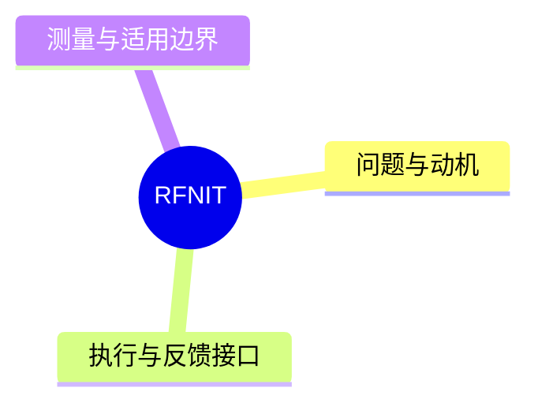

## Summary

RFNIT 是一项物理 GUI 测试研究计划，结合外部视觉、LLM 推理与真实触屏执行，并报告组件原型结果。 [原文与版本](https://arxiv.org/html/2611.06939v1)

## Problem & Motivation

侧重从相机观察手机界面并复现触屏操作，降低对底层系统访问的依赖。作者希望将这种接口用于探索和检测应用故障。

## Method

视觉模块识别界面元素，推理模块规划动作，执行模块完成物理触碰。论文把端到端完整评估与组件原型验证安排在不同阶段。

## Key Results

§4 在五个 Android App 上报告视觉发现和真实机械臂点击的原型结果，包括 2.0 mm 平均定位精度、91% mAP@0.5 和 OCR 大于 95%。§5 列出长程覆盖、缺陷检出和系统对照的后续评测。

## Evidence Ledger

| Claim ID | Claim | Type | Source locator | Evidence excerpt | Status |
|:--|:--|:--|:--|:--|:--|
| C1 | 初步验证覆盖五个 Android App，报告 2.0 mm、91% mAP@0.5 和 OCR 大于 95% | number | §4 Preliminary Results | Preliminary Results | source-verified |
| C2 | 完整端到端长程比较属于评测计划 | benchmark-setting | §5 Evaluation Plan | Evaluation Plan | source-verified |

## Strengths & Weaknesses

外部视觉和真实物理触点构成有用的组件证据。当前论文的性质是博士研究方案，暂以局部精度和识别度为主要证据，缺覆盖完整目标的闭环运行对照。

## Mind Map

## Notes

- [[Topics/AgenticRobotArm-Survey]]
