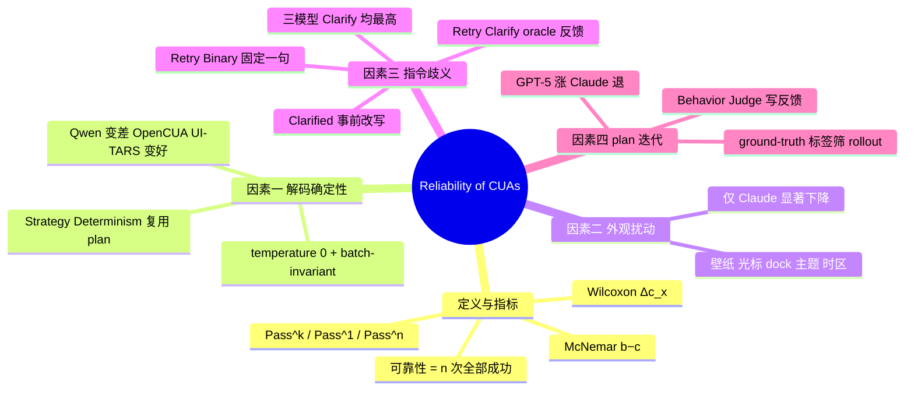

## Summary
把 CUA 的"可靠性"定义为同一任务 n 次执行全部成功的概率，用 Pass^k 加两个配对检验（McNemar 的 b−c、Wilcoxon 的 Δc_x）在 OSWorld 361 任务、n=3 下系统考察四个因素：解码确定性、环境外观扰动、指令歧义、plan 迭代。最有信息量的数字是 Agent S3+GPT-5 的 Pass@10 约 78% 对 Pass^10 约 36%，以及 Table 3 的四臂对照：只给"没成功，再试"的二值重试（最多 5 次）在 GPT-5 上把 Pass^1/Pass^3 从 .576/.454 抬到 .645/.557，而把评测器知识喂给 user simulator 产出的针对性反馈再重试抬到 .730/.632；三个模型上后者都高于前者。确定性解码对三个开源模型方向不一，外观扰动只在 Claude 上显著伤害可靠性，带 ground-truth 标签的 plan 迭代在 Claude 上反而倒退。

## Problem & Motivation
Pass@k 把"能力"与"可靠"混在一起：多次尝试里成功一次就算，掩盖了同一任务反复执行时的成败翻转。作者的出发点是部署场景要的是可重复的成功，而现有 benchmark 报告几乎都是单次运行或 Pass@k。论文的问题形式化很直接：把单次成功率 \(\Pr(r_{x,1}=1)\) 与可靠性 \(\Pr(r_{x,1}=\dots=r_{x,n}=1)\) 分开，然后追问哪些因素推动了后者。四个候选因素各对应一节：采样随机性（§3.1）、环境外观（§3.2）、指令歧义（§4）、agent 自身的行为方差（§5）。

## Method
**指标**。每任务跑 n 次得成功计数 \(c_x\)。Pass^k \(=\mathbb E_x[\binom{c_x}{k}/\binom{n}{k}]\)（沿用 Yao et al. 2024 的 τ-bench 定义）；Pass^1 是边际成功率，Pass^n 是全部 n 次都成功的任务占比。两个配对检验比较两种 setting：McNemar 作用于"是否被一致解决"指示量 \(z_x=\mathbf 1[c_x=n]\)，报告 b−c（由不一致变为一致的任务数减去反向的任务数）；Wilcoxon 符号秩作用于每任务成功计数之差，报告 Δc_x 的均值。星号表示任一检验 p<0.05。n=3。

**模型与执行设置**。前沿模型 GPT-5、Claude Sonnet 4.6、Kimi 2.5；开源模型 Qwen-3VL-8B-Instruct、OpenCUA、UI-TARS-1.5-7B。有官方运行脚本的用 OSWorld 默认脚本；没有的（标 "(S3)"）沿用 Agent S3 的动作空间与 grounding 设置。temperature 取 API 强制值（GPT-5 为 1），否则 0.7。

**四项干预**。
1. *确定性*（Table 1，仅开源模型）：Deterministic = temperature 0 加 batch-invariant 推理；Strategy Determinism 在此基础上先从指令和初始截图采样一份 plan，重复运行时复用同一份。
2. *环境扰动*（Table 2、Table 5）：baseline 的第一次运行配上两个外观扰动环境各一次运行，扰动项为壁纸、光标尺寸 24→48/16 px、dock 位置左→下/右、图标主题 Yaru→Adwaita/Humanity、时区 Los Angeles→Tokyo/London，作者称均不影响任务功能。
3. *指令歧义*（Table 3）：Clarified 用 GPT-5 读原指令、截图、评测 JSON 与评测器实现，把成功判据改写进指令，361 条里 25 条人工修正（20 条判据不可能满足、5 条改写后过于琐碎），改写质量由 GPT-5 与 Claude 各三次运行加改版 Behavior Judge 验证；Retry (Binary) 在评测失败后注入一句"Your previous attempt did not succeed. The task is not complete. Please try again."；Retry (Clarify) 在评测失败后注入 user simulator 的反馈。两种重试都最多 5 次。
4. *plan 迭代*（Table 4，起点为 Clarified）：每任务多次 rollout，用 ground-truth 成功标签分成功/失败，改版 Behavior Judge 从 behavior narrative 里抽成功行为与反复失败模式写成反馈，并入下一轮 plan；全成功不给反馈，全失败按部分成功给反馈。

**user simulator 的信息面**。它拿到完整任务 JSON（含评测器规格）、评测器函数源码（按 AST 抽取）、输入与期望文件、agent 轨迹的最后 40 张截图；规则是指出错在哪个值/文件/格式、不给分步操作、不泄露评测器函数名或代码、2–4 句。也就是说 Retry (Clarify) 的反馈方知道正确答案长什么样。

## Key Results
**Figure 1**。Agent S3+GPT-5 重复 10 次：Pass@10 约 78%，Pass^10 约 36%。

**Table 1 确定性**（Pass^1 / Pass^3；b−c / Δc 相对 Baseline）：

| 模型 | Baseline | Deterministic | Strategy Determinism |
|:--|:--|:--|:--|
| Qwen-3VL-8B (S3) | .329 / .222 | .293 / .166（−20\*, −0.108\*） | .313 / .219（−1, −0.047） |
| OpenCUA | .226 / .125 | .259 / .180（20\*, 0.097\*） | .262 / .188（23\*, 0.108\*） |
| UI-TARS-1.5-7B | .253 / .152 | .290 / .205（19\*, 0.111\*） | .264 / .169（14\*, 0） |

Qwen 变差、OpenCUA 与 UI-TARS 变好；作者结论是去掉采样随机性不足以提升可靠性，plan 固定也不稳定地优于随机基线。

**Table 2 外观扰动**（Baseline 3 次原环境 vs 1 次原环境 + 2 次扰动环境）：

| 模型 | Baseline | Perturbed |
|:--|:--|:--|
| GPT-5 (S3) | .576 / .454 | .561 / .416（−10, −0.033） |
| Claude Sonnet 4.6 | .702 / .612 | .675 / .557（−20\*, −0.080\*） |
| Kimi 2.5 | .508 / .357 | .516 / .355（−1, 0.025） |

**Table 3 指令歧义**（b−c / Δc 相对 Original）：

| 模型 | Original | Clarified（单次） | Retry (Binary) | Retry (Clarify) |
|:--|:--|:--|:--|:--|
| GPT-5 (S3) | .576 / .454 | .681 / .576（48\*, 0.327\*） | .645 / .557（41\*, 0.216\*） | .730 / .632（68\*, 0.474\*） |
| Claude Sonnet 4.6 | .702 / .612 | .731 / .673（22\*, 0.089） | .732 / .668（20\*, 0.091） | .774 / .706（34\*, 0.216\*） |
| Kimi 2.5 | .508 / .357 | .555 / .382（9, 0.141\*） | .623 / .496（50\*, 0.346\*） | .727 / .634（100\*, 0.657\*） |

两组差值值得单独看。二值重试相对 Original 的 Pass^3 增益：GPT-5 +10.3、Claude +5.6、Kimi +13.9 pp。针对性反馈相对二值重试的 Pass^3 增益：GPT-5 +7.5、Claude +3.8、Kimi +13.8 pp。作者说"单次 Clarified 可以追平或超过 Retry (Binary)"，这在 GPT-5 上成立、Claude 上持平、Kimi 上不成立（.555/.382 对 .623/.496）。

**Table 4 plan 迭代**（Iteration 0 = Clarified）：

| 模型 | It. 0 | It. 1 | It. 2 |
|:--|:--|:--|:--|
| GPT-5 (S3) | .681 / .576 | .710 / .618（15, 0.086\*） | .725 / .651（27\*, 0.130\*） |
| Claude Sonnet 4.6 | .731 / .673 | .713 / .632（−15\*, −0.055\*） | .730 / .662（−4, −0.006） |
| Kimi 2.5 | .555 / .382 | .567 / .435（19\*, 0.036） | .563 / .424（15, 0.025） |

作者对 Claude 倒退的解释是假设性的：Claude 偏好写代码解题，由此造成的环境变化 Behavior Judge 看不出来，反馈因而不完整。

## Evidence Ledger

| Claim ID | Claim | Type | Source locator | Evidence excerpt | Status |
|:--|:--|:--|:--|:--|:--|
| C1 | arXiv 2604.17849v1，cs.AI，2026-04-20；五位作者；通讯邮箱在 simular.ai；正文未印机构 | metadata | 页眉 L9–18 | "arXiv:2604.17849v1 [cs.AI] 20 Apr 2026" | source-verified |
| C2 | Agent S3+GPT-5 十次重复：Pass@10 约 78%，Pass^10 约 36% | result | Fig. 1 caption L29 | "Pass@10 ... 78% ... Pass^10 ... 36%" | source-verified |
| C3 | 可靠性定义为 n 次全部成功的概率；Pass^k 沿用 Yao et al. 2024；McNemar 作用于 z_x=1[c_x=n] 报 b−c；Wilcoxon 作用于每任务成功计数差报 Δc_x；p<0.05 | method | §2.1–2.2 L38–66 | "we define reliability as the probability that all executions of the same task succeed" | source-verified |
| C4 | 六个模型；"(S3)" 表示无官方脚本时用 Agent S3 的动作空间与 grounding；temperature 取 API 强制值（GPT-5 为 1）否则 0.7 | setup | §2.3 L69 | "we adopt the Agent S3 ... settings for the action space and grounding" | source-verified |
| C5 | Table 1 全部九行数字（见 Key Results） | result | Table 1 L73–85 | 表格原文 | source-verified |
| C6 | Deterministic = temperature 0 + batch-invariant 推理；Strategy Determinism 复用一份采样 plan；结论为去随机不足、plan 固定不稳定优于基线 | method/claim | §3.1 L86–87；App. C.1 | "removing sampling randomness alone is insufficient" | source-verified |
| C7 | Table 2 三行数字；协议为 baseline 第一次运行配两个扰动环境各一次 | result | Table 2 L89–98；§3.2 L99 | 表格原文 | source-verified |
| C8 | 扰动集合：壁纸、光标 24→48/16 px、dock 左→下/右、图标 Yaru→Adwaita/Humanity、时区 LA→Tokyo/London；称为纯外观 | setup | App. F Table 5 L895–905 | "All modifications are purely cosmetic" | source-verified（集 1 壁纸未变，见 Notes） |
| C9 | Clarified 由 GPT-5 读原指令、截图、评测 JSON 与评测器实现改写；GPT-5 与 Claude 各三次运行 + 改版 Behavior Judge 验证；25/361 人工修正（20 不可能 + 5 过于琐碎） | method | §4.1 L104–105；App. E L893–894 | "25 out of 361 tasks" | source-verified |
| C10 | Table 3 GPT-5 行 | result | Table 3 L108–122 | 表格原文 | source-verified |
| C11 | Table 3 Claude 行 | result | Table 3 | 表格原文 | source-verified |
| C12 | Table 3 Kimi 行 | result | Table 3 | 表格原文 | source-verified |
| C13 | 两种重试均最多 5 次；Binary 只注入一句固定提示；Clarify 在评测失败后注入 simulator 反馈 | setup | §4.2 L126；App. C.3.3–C.3.4 L559–567 | "Both retry baselines are allowed up to 5 retries" | source-verified |
| C14 | simulator 上下文含完整任务 JSON（评测器规格）、评测器源码、输入/期望文件、最后 40 张截图；规则为指出具体错处、不给分步、不泄露评测器名与代码、2–4 句 | setup | App. C.3.1–C.3.2 L527–558 | "last 40" | source-verified |
| C15 | 作者称单次 Clarified 可追平或超过 Retry (Binary)；Retry (Clarify) 在所有指标与模型上优于 Retry (Binary) | claim | §4.2 L126 | "can match or exceed the performance of Retry (Binary)" | source-verified（作者原话；Kimi 行与前半句不符，§6 的概括更强，见 Notes） |
| C16 | Table 4 全部数字 | result | Table 4 L129–141 | 表格原文 | source-verified |
| C17 | plan extraction：多次 rollout；改版 Behavior Judge 从 behavior narrative 产出反馈；全成功不给反馈；全失败按部分成功；假定 ground-truth 成功标签 | method | §5.1 L143–145 | "ground-truth success signals" | source-verified |
| C18 | Claude 倒退的解释：偏好代码解法造成 Behavior Judge 难以察觉的环境变化，反馈不完整 | hypothesis | §5.1 L146 | "bias toward code solutions" | source-verified |
| C19 | §5.2 文字写 Claude It. 2 的 Δc_x 为 0.006，Table 4 为 −0.006；GPT-5 与 Kimi 的文字增益与表格一致 | inconsistency | §5.2 L149；Table 4 | 见两处 | source-verified |
| C20 | Discussion 六条结论（确定性不稳定、固定策略不解决可靠性、外观扰动有害、事前澄清有效、执行中反馈优于两种重试与静态澄清、plan 迭代因模型而异） | claim | §6 L151–157 | 原文 | source-verified |
| C21 | 无代码/数据发布声明；App. A.1 声明 GPT-5 辅助写作、GPT-5/Claude 生成图表与 LaTeX 表代码 | metadata | App. A.1 L376–377；全文 grep | 无 github/release 字样 | source-verified |
| C22 | OSWorld 361 任务；n=3；全文未给每次运行的步数上限 | setup | §3.2 L99；App. E L894；全文 grep | "three repeated runs"；"25 out of 361 tasks" | source-verified（361 仅出现一次，与 OSWorld 369 的差异未解释） |

## Strengths & Weaknesses
**Strengths**
- 把可靠性从 Pass@k 里拆出来并配上配对检验，是目前 CUA 评测里少见的任务级统计口径；b−c 与 Δc_x 两列比单看 Pass^3 更能分辨"少数任务大翻转"与"多数任务小波动"。
- Table 3 的四臂设计把"多试几次"与"反馈内容"分离，给出了二值失败信号与针对性反馈各自的量级，而且三个前沿模型同协议。
- 确定性实验的反向结果（Qwen 变差）是有价值的负结果：采样随机性不是 CUA 方差的主来源。
- 承认并写明了 plan extraction 依赖 ground-truth 标签这一假设。

**Weaknesses**
- 三个干预里有两个依赖评测器特权信息：Retry 的触发信号来自 benchmark 评测器，Retry (Clarify) 的反馈方读得到评测器源码与期望文件，plan 迭代用 ground-truth 标签筛 rollout。它们测的是"若有 oracle 反馈能涨多少"的上界，不是可部署方法。
- 重试是否重置环境到初始状态、Pass^3 在重试设置下如何计数（每次运行各带 5 次重试？）、每次运行的步数上限、token 与时间开销，全文均未说明。重试臂与 Clarified 单次运行之间因此不是等预算比较。
- n=3 下 Pass^3 对单个任务的翻转很敏感；361 任务的 b−c 在 ±10 以内的差异基本不显著，Table 2 的 GPT-5 与 Kimi 行就是如此。
- 确定性实验只在开源模型上做（API 模型无法 batch-invariant），所以"确定性不帮忙"的结论不能外推到 Table 2–4 的前沿模型。
- 外观扰动协议把一次原环境运行与两次扰动运行混成一组 Pass^3，与三次原环境运行比；扰动环境内部的重复方差没有单独测。
- 没有代码、没有逐任务结果，Figure 1 的 10 次重复只给了一个模型。
- GPT-5 在 Table 2–3 的 Δc_x 与 Pass^1 之差不满足论文自己的恒等式（偏差约 0.012），配对检验所用基线与表中数字可能不是同一组运行；GPT-5 行的 b−c / Δc_x 应打折看。
- 任务集 361 对 OSWorld 的 369 无剔除说明，跨论文比较时需要注明。

## Mind Map

## Notes
**对 [[Ideas/FailureConditionedRetry-GUI]] 的直接读数**。Retry (Binary) 就是 idea 里的 A1 臂，但触发信号来自 benchmark 评测器而非 agent 自判，重试上限 5 次；它相对 Original 的 Pass^3 增益为 +5.6 到 +13.9 pp，比 CUA-Recovery 的约 3 pp 与 [[Papers/2608-CUADebug]] 自诊重放的 +1.4 pp 大得多，差别在于这里的失败信号是 oracle 的且允许最多 5 次完整重试。Retry (Clarify) 比 idea 里的 A5（oracle 定位）更强：反馈方不只知道哪一步错，还知道正确输出长什么样。于是本文给出的是"oracle 内容反馈 − oracle 二值信号"的量级（Pass^3 +3.8 到 +13.8 pp），可以作为 A5−A1 的上界先验；idea 要测的 A6（机器定位）与 A7（扰动定位）落在这个区间的哪里，本文没有数据。

**与 CUADebug 的协议差异**。CUADebug 从致错步前一步重放并注入诊断，单次运行；本文从评测失败后重试（是否重置未写明），最多 5 次，n=3。两者都在 OSWorld 上，但一个控制重启点、一个控制反馈内容，数字不能直接相减。

**Clarified 单次 vs 二值重试**。作者的"追平或超过"在 Kimi 上不成立（Clarified .555/.382 低于 Retry (Binary) .623/.496）；更稳妥的表述是"对较强的模型，一次把判据写清楚的收益与最多 5 次盲重试相当"。

**与 vault 中方差证据的关系**。[[Papers/2610-GUIHARVEST]] 在冻结 backbone 下测得 OSWorld 11.8–20.4% 的任务三次执行成败翻转；本文 Table 3 Original 行的 Pass^1 − Pass^3 为 12.2 / 9.0 / 15.1 pp，量级一致。[[Papers/2606-SkillMemoryBudget]] 的 any-of-3 与 all-of-3 差距（web 域 10–19 pp）是第三个独立数据点。[[Papers/2604-ClawEval]] 与 [[Papers/2606-SkillNb]] 用 Pass^k 但不配检验。[[Topics/CUA-Survey]] §8.11 的 Reliability 行与 §8.13.1 的 run nondeterminism 行是本文的落点。

**与 AnchorGUI 的对照**。[[Papers/2609-AnchorGUI]] 的 Memoryless Retry 在 AndroidWorld 上三次尝试从 57.3 到 62.9（+5.6），与本文 Claude 的二值重试增益同量级，但 AnchorGUI 的重试重置到初始状态并由 benchmark 判成功，本文未写重置方式。

**内部不一致与核验补记**（独立核验代理对照全文逐条核对，22 条 claim 全部 source-verified；以下为核验中发现的问题）。(1) §5.2 文字 Claude It. 2 Δc_x 为 0.006，Table 4 为 −0.006；按定义 Δc_x = 3·ΔPass^1 = 3×(0.730−0.731) 应为负，文字有误。(2) 同一恒等式在两处不成立：Table 1 UI-TARS Strategy Determinism 报 Δc_x = 0，而 3×(0.264−0.253) = 0.033；Table 2–3 中 GPT-5 相对 Baseline/Original 的四个 Δc_x 都比恒等式算出的值高约 0.012（如报 0.327、算得 0.315），说明配对检验用的 GPT-5 基线与表中 Pass^1 对应的那组运行相差约 4 个成功，或任务集不一致；Table 4 的 GPT-5 行（基线为 Clarified）则一致。(3) 361 这个任务数只在 App. E 出现一次，OSWorld 全集为 369，未说明剔除标准，也未说明 Table 1 的开源模型是否跑同一子集。(4) Table 5 的扰动集 1 壁纸项前后相同（Jammy Jellyfish），实际只改 4 项；"时区改动纯属外观"是作者断言，对依赖时间的任务未验证。(5) App. D.2 的反馈样例泄露了评测器内部信息（具体 gsettings 键与期望值 "uint32 0"、LibreOffice 的 registrymodifications.xcu 路径），与 simulator 规则 3"不泄露评测器名与代码"相悖，Retry (Clarify) 的反馈因此接近 oracle 答案。(6) Figure 1 用 n=10，各表用 n=3，Figure 1 的任务子集与配置只在 caption 里提及。(7) 正文交叉引用未解析（"Appendix 1/2/3/4/5" 应为 C.1.1、C.1.2、C.2.x）；"Kimi 2.5" 与 "Kimi K2.5" 混用。(8) Table 2 的 baseline 与 Table 3 的 Original 数字相同，两表共用同一组运行但 §3.2 未明说。

**未解决**。重试是否重置环境；Pass^3 在重试臂下的计数方式；步数上限；token 开销；25 条人工修正的任务清单；机构署名。
