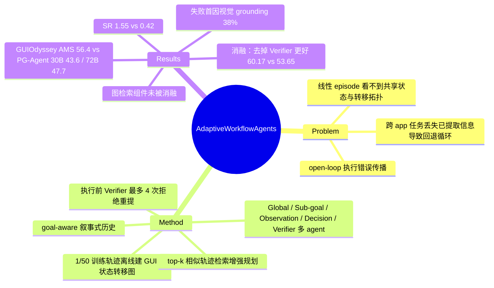

## Summary
在 PG-Agent 的 page graph 思路上，用 1/50 训练轨迹离线建出 GUI 状态转移图做检索增强，再加一个"goal-aware 叙事式历史"和一个执行前 Verifier（每步最多 4 次拒绝重提）组成多 agent 流水线，在 GUIOdyssey 全测试集上 overall AMS 56.4（PG-Agent 同 30B backbone 43.6，72B 版 47.7），SR 1.55%（PG-Agent 30B 0.42%）。100 episodes 消融里去掉 Verifier 反而更好（Context-only 60.17 vs Full 53.65），图检索组件本身从未被消融，因此"图结构带来提升"这一核心主张没有直接证据。

## Problem & Motivation
作者认为现有 MLLM GUI agent 把每个任务当作孤立的线性 episode，看不到不同任务共享的界面状态与转移拓扑，遇到新工作流或界面变化时既不能复用见过的"捷径"转移，也难以从错误中恢复。PG-Agent 已经把历史轨迹重组为 page graph 并用 RAG 喂给 agent；这篇工作的定位是在相同图结构的基础上补两件事：PG-Agent 规则化的历史描述换成面向目标的语义叙事，以及在动作执行前加一层多 agent 验证，把"open-loop"执行改为"closed-loop"自我纠正。论文以 EAIS（演化与自适应智能系统）会议论文的形式发表，问题表述更偏工作流/信息系统视角，实验则完全落在移动端跨 app GUI 导航上。

## Method
**离线图构建**（§IV-A）。从 GUIOdyssey 训练集随机抽 1/50 的 episode，分三步建有向图 \(\mathcal G=(\mathcal V,\mathcal E)\)，节点是 GUI 状态、边是引起跳页的动作：(1) MLLM 看 \((I_{before},a,I_{after})\) 判断是页内修改还是真正跳页，只有跳页动作建边；(2) BGE-M3 语义嵌入 + 视觉比对做节点去重，FAISS 召回 top-4 候选节点再细比；(3) 写入新节点和边，连续页内操作压成一条边。推理时图固定不再更新。1/50 的采样比例直接沿用 PG-Agent 的经验结论，未在本文重新验证。

**检索**。任务 query 经编码后按 cosine 相似度取 top-k 相似轨迹（Eq. 1），Context Builder 拼成 augmented context 供规划使用。摘要里的"Adaptive RAG"在正文中没有超出 top-k 相似检索的具体机制说明，k 的取值也未给出。

**多 agent 执行**（Algorithm 1，§IV-B）。
- Planning Layer：Global Planning Agent 生成全局计划；Sub-goal Planning Agent 结合历史 \(h\) 给出当前子目标，并接受 Verifier 反馈修订。
- Execution Layer：Observation Agent 把当前页面编码成语义表示；Decision Agent 提出原子动作，但先不执行。
- Verification Layer：Verifier Agent 按一致性谓词 \(\mathcal C(s_t,a_t,g_t)\) 判 Approve / Reject(f)，拒绝时把反馈（如"搜索框未激活、键盘不可见，不能输入"）回传给 Sub-goal Planner，最多 M=4 次；达到上限后动作照样执行。
- 历史：每步执行后 Narrate\((s_t,a_t,s_{t+1})\) 生成相对全局目标的"差分状态叙事"（如"下滑显示完整歌词，内容为……"），用来避免跨 app 任务里反复回退找已看过的信息。

Verifier 只在执行前审查动作提案，不看执行后的结果状态；所谓 closed-loop 指的是提案级的拒绝-重提循环。GUIOdyssey 是离线静态数据集，论文没有说明 Execute action 与 \(s_{t+1}\) 在离线评测中如何实现（推测沿用 ground-truth 下一帧，正文未写）。

## Key Results
**主结果**（Table I，GUIOdyssey 全测试集 1,666 episodes，指标 AMS / SR；SR 指整条 episode 每步都匹配）：

| 方法 | Tool | Info | Shop | Media | Social | Multi-Apps | Overall AMS | Overall SR |
|:--|:--|:--|:--|:--|:--|:--|:--|:--|
| Qwen2.5-VL-72B | 46.6 | 60.0 | 44.0 | 32.4 | 46.1 | 54.6 | 42.4 | – |
| PG-Agent (w/ 72B) | 48.6 | 61.5 | 47.2 | 35.5 | 46.9 | 52.6 | 47.7 | – |
| PG-Agent (w/ 30B) | 53.5 | 38.8 | 35.6 | 39.0 | 47.9 | 43.7 | 43.6 | 0.42 |
| Proposed (w/ 30B) | 68.2 | 52.8 | 49.5 | 50.8 | 58.9 | 55.2 | 56.4 | 1.55 |

- Information 域 Proposed 52.8 低于 PG-Agent 72B（61.5）和裸 Qwen2.5-VL-72B（60.0），其余五个域最高。§VI-A 正文只说 PG-Agent 72B 在 Information 上更好，漏了 Qwen2.5-VL-72B；§V-C 列出的功能域只有 5 个（缺 Tool），表格却有 6 个。
- Proposed 分域 SR：Tool 3.90、Information 0.0、Shopping 1.16、Media 0.48、Social 1.32、Multi-Apps 1.54。1.55% 约合 1,666 中的 26 条，0.42% 约 7 条；"SR 三倍"的绝对差约 1.1 个点。表中只有 PG-Agent 30B 报了 SR，所以"三倍"只能相对它成立；§I 写的 "triples the SR of the best alternative approach" 同样只有这一个可比对象。
- 只有 PG-Agent (w/ 30B) 和 Proposed 报了 SR，其他 baseline 行无 SR；GeminiProVision / CogAgent / GPT-4V / Qwen2.5-VL-72B / PG-Agent 72B 的数字未注明是自跑还是引自前人表格（推测为引用）。
- 主实验的 30B backbone 在全文只写作 "Qwen/30B"，没有具体型号；72B 因约 144GB 权重放不下 BGE 嵌入模型与 KV cache 而未在本框架中跑。

**消融**（Table II，随机 100 episodes）：Full（history + Verifier）AMS 53.65 / SR 1.0；Context-only（只有 history）60.17 / 1.0；Verifier-only（Verifier + 非叙事历史）53.72 / 1.0。三臂 overall SR 都是 1.0、Tool 域 SR 都是 4.76（各只成功 1 个 episode），SR 在这一样本量下没有区分度。正文以 Full 53.65 为基线，把 53.65→60.17（+6.52）算作叙事 history 的贡献，但 Full 与 Context-only 的差别是有没有 Verifier，这 6.52 是去掉 Verifier 的效果。history 的增量应比较 Full 与 Verifier-only（两者都有 Verifier，只差叙事 history）：53.65 vs 53.72，history 约 −0.07。正文"Verifier 单独 +0.07"的方向也读反了。表中没有两个组件都去掉的臂。按表直接读，结论不是"history 贡献最大"，而是"Verifier 让 AMS 降 6.52 pp、history 在有 Verifier 时几乎无作用"。作者在 §VI-B 与 §VII 承认 Verifier 的拒绝循环可能干扰原本正确的动作序列。

**换 backbone**（Table III，16 episodes 子集）：Proposed 30B AMS 54.05 / SR 6.25；Qwen3-VL-32B-Thinking 61.67 / 6.67；GLM-4.6V-Flash 46.38 / 0.0。Thinking 臂的分域值波动极大（Shopping AMS 100.0、Media SR 100、Information AMS 29.41），说明每个域只有几条 episode，"Thinking overall 最高"没有统计意义。

**失败分析**（50 个失败 episode 人工标注）：视觉 grounding 错误 38%、跨 app 状态丢失 26%、异步加载/位置变化等动态内容 22%、Verifier 误拒正确动作 14%。

**成本**：4×A100 40GB + vLLM，全测试集约 80 小时（约 173 s/episode），每步上下文 4,000–8,300 tokens，平均 6,200。

## Evidence Ledger

| Claim ID | Claim | Type | Source locator | Evidence excerpt | Status |
|:--|:--|:--|:--|:--|:--|
| C1 | GUIOdyssey 全测试集：Proposed (w/ 30B) AMS 56.4 / SR 1.55；PG-Agent 30B 43.6 / 0.42；PG-Agent 72B AMS 47.7 | number | Table I | "Proposed (w/ 30B) … 56.4 \| 1.55"; "PG-Agent (w/ 30B) … 43.6 \| 0.42" | source-verified |
| C2 | AMS 绝对 +12.85（对 PG-Agent 30B），并比 PG-Agent 72B 高 8.7 点 | comparison | §VI-A | "overall AMS of 56.41%, marking an absolute improvement of +12.85%"; "outperforms the PG-Agent framework with a 72B model by 8.7 percentage points" | source-verified |
| C3 | Conclusion 称 +12.8 AMS 是对"最强 baseline"，但最强 baseline 是 PG-Agent 72B（47.7） | comparison | §VII vs Table I | "+12.8 percentage points in AMS and more than triple the SR compared to the strongest baseline" | source-verified |
| C4 | 除 Information 外各域 AMS 最高；Information 52.8 < PG-Agent 72B 61.5、Qwen2.5-VL-72B 60.0 | comparison | Table I；§VI-A | "improved score … for all the functional domains with the exception of the Information" | source-verified |
| C5 | Proposed 分域 SR 3.90/0.0/1.16/0.48/1.32/1.54；PG-Agent 30B Multi-Apps SR 0.0 | number | Table I；§VI-A | "the PG-Agent fails to complete a single episode (0.0% SR), whereas our proposed architecture achieves a 1.54% SR" | source-verified |
| C6 | GeminiProVision overall AMS 4.9 高于其全部分域值（最大 4.3） | number | Table I | "GeminiProVision \| 3.3 \| - \| 4.0 \| - \| 2.3 \| - \| 4.3 \| - \| 1.5 \| - \| 3.2 \| - \| 4.9" | source-verified |
| C7 | 100-episode 消融：Full 53.65、Context-only 60.17、Verifier-only 53.72，SR 均 1.0 | number | Table II；§VI-B | "Temporal Context \| 66.42 … 60.17 \| 1.0"; "randomly sampled episodes N=100" | source-verified |
| C8 | 正文把 Full 当基线计算组件增益，无"两者都不加"臂 | benchmark-setting | §VI-B | "increasing overall AMS from 53.65% to 60.17% (+6.52 pp)"; "yields marginal improvements (+0.07 pp overall AMS)" | source-verified |
| C9 | 加入 Verifier 后 AMS 低于 Context-only，作者归因于拒绝循环干扰 | causal-mechanism | §VI-B | "the Verifier's rejection cycles may disrupt otherwise correct action sequences" | source-verified |
| C10 | 消融未移除 graph-based RAG 组件 | benchmark-setting | §VI-B 配置列表 | "Full … Context-only … Verifier-only : Verifier Agent with non-informative history" | source-verified |
| C11 | 16-episode 换 backbone：30B 54.05/6.25；Qwen3-VL-32B-Thinking 61.67/6.67；GLM-4.6V-Flash 46.38/0.0 | number | Table III；§VI-A | "performed on a representative subset of 16 episodes"; "reaching an AMS of 61.67% and a SR of 6.67%" | source-verified |
| C12 | SR 6.67 与 16 episodes 不一致（1/16=6.25） | number | Table III vs §VI-A | "Proposed (w/ Qwen3-VL-32B-Thinking) … 61.67 \| 6.67" | source-verified |
| C13 | 图由 1/50 训练 episodes 构建；MLLM 判跳页；BGE-M3 + 视觉比对去重，FAISS top-4 | benchmark-setting | §IV-A | "processing a randomized subset (1/50th) of the total training episodes"; "retrieving the top-4 candidate nodes" | source-verified |
| C14 | Verifier 每步最多 M=4 次；达到上限动作仍执行 | benchmark-setting | §IV-B3；Algorithm 1 | "This recursive refinement cycle permits up to M=4 attempts per step"; "Upon approval (or exhaustion of retry attempts), the action executes" | source-verified |
| C15 | 4×A100 40GB；约 80 小时、约 173 s/episode；每步 4,000–8,300 tokens，均值 6,200 | number | §V-D | "Processing all 1,666 GUIOdyssey episodes took ∼80 hours (∼173s/episode)" | source-verified |
| C16 | 50 个失败 episode：grounding 38%、跨 app 状态丢失 26%、动态内容 22%、Verifier 误拒 14% | number | §VI-B | "Visual grounding errors (38%) … Cross-app state loss (26%) … Dynamic content handling (22%) … Verifier false positives (14%)" | source-verified |
| C17 | 主实验 backbone 只写 "Qwen/30B"；72B 因显存未跑 | benchmark-setting | §VI-A | "we adopt in our proposed approach a Qwen/30B model"; "its weights (∼144GB) leave insufficient VRAM" | source-verified |
| C18 | AMS 的 ground-truth 动作被描述为来自知识图谱 | benchmark-setting | §V-B Eq. 3 | "the ground-truth optimal action derived from the knowledge graph for episode i" | source-verified |
| C19 | 作者承认 SR 1.55% 对部署过低、仅单一 benchmark | benchmark-setting | §VII | "the overall SR (1.55%), while substantially improved, remains low for practical deployment" | source-verified |
| C20 | 无代码仓库链接 | license-code | 全文 | 全文无 GitHub / code release 表述 | source-verified |
| C21 | EAIS 2026 录用；3 位作者分属 Sapienza、Sannio、Unitelma Sapienza | benchmark-setting | arXiv Comments；文头 | "Accepted for publication at the 2026 IEEE International Conference on Evolving and Adaptive Intelligent Systems (EAIS 2026)" | source-verified |

## Strengths & Weaknesses

**亮点**
- 消融结果诚实地报了负面发现：执行前 Verifier 在 100 episodes 上让 AMS 降 6.5 点，失败分析里 14% 是 Verifier 误拒正确动作。这和"更多自检必然更好"的直觉相反，可作为"执行前 critic 无结果反馈时容易过度保守"的又一个数据点。
- 失败分类（grounding 38% 居首）给出了明确的瓶颈判断：规划/记忆层的改进被视觉定位卡住。
- 叙事式历史（记录提取到的内容而不只是动作名）的思路与跨 app 信息携带问题对得上，但论文自己的表格没有支持它有效：在有 Verifier 的条件下，加 history 的 AMS 变化约 −0.07（Full 53.65 vs Verifier-only 53.72）。

**局限**
- **核心贡献缺乏直接证据**。题目和摘要的主角是图结构 RAG，但消融只动了 history 和 Verifier；与 PG-Agent 30B 的 +12.8 AMS 差距中有多少来自图、多少来自叙事历史和 prompt 工程，无法拆开。图本身又是沿用 PG-Agent 的做法，本文对图构建的改动（若有）也没有单独评估。
- **报告的主系统不是最好的配置**。Table I 的 Proposed 含 Verifier，而 Table II 显示去掉 Verifier 更好；论文仍在结论里把提升部分归功于"closed-loop verification"，与自身消融矛盾。
- **消融的归因与表格不对应**。正文把 Full 当基线，把 +6.52 记给 history、+0.07 记给 Verifier。实际上 +6.52 是去掉 Verifier 的效果（Full vs Context-only），history 的增量是约 −0.07（Full vs Verifier-only），表里也没有两个组件都去掉的臂。自家表格不支持"history 贡献最大"；表格显示的是 Verifier 使 AMS 降 6.52 pp。
- **SR 极低且样本极小**。"SR 三倍"只能对 PG-Agent 30B（表中唯一报 SR 的 baseline）成立。全测试集 SR 1.55% 对 0.42%，绝对差约 18 条 episode，没有置信区间；消融三臂 SR 全是 1/100（Tool SR 也都是 4.76）；换 backbone 只有 16 条（SR 6.67 与 16 条不一致，推测有一条未跑完）。在这个量级上"SR 三倍""Thinking 模型更强"都不具有统计意义。
- **baseline 对比不完整**。GUIOdyssey 上微调过的 OdysseyAgent 等强基线未列入（[[Papers/2609-AnchorGUI]] 记录 OdysseyAgent 在 GUI-Odyssey 上 TM 90.8 / EM 73.7，虽指标口径不同）；Table I 多数 baseline 数字来源未注明，GeminiProVision 一行 overall 高于所有分域值，表格本身有错。§VI-A 称 Information 域只有 PG-Agent 72B 超过本方法，表中 Qwen2.5-VL-72B（60.0）也超过 Proposed（52.8）；§V-C 只列 5 个功能域（缺 Tool），与 6 域表格不一致。
- **评测设置不透明**。离线数据集上"执行动作""Verifier 重试"如何进行没有说明；AMS 的 ground-truth 被写成"derived from the knowledge graph"，而 GUIOdyssey 本身带人工标注动作；若 GT 真由 KG 推导，评测与方法共用同一图，与 baseline 的比较也不成立，原文没有澄清；backbone 型号未给出；摘要的"real-world context"实为离线 benchmark。
- 结论把 +12.8 写成"相对最强 baseline"，实际是相对 PG-Agent 30B；相对最强的 PG-Agent 72B 为 +8.7。

## Mind Map

## Notes
- **是 GUI 论文**：任务、数据、动作空间全部是移动端跨 app GUI 导航（GUIOdyssey），按 umbrella 规则标 `gui-agent`。
- [[Papers/2400-GuiodysseyComprehensiveDatasetCross]]：本文唯一的评测 benchmark；该数据集论文的 OdysseyAgent 未被列为 baseline。
- [[Papers/2500-AgentGuidingUiAgents]]（Agent+P）：同样把 UI Transition Graph 外置做规划，但 Agent+P 用 classical planner 在图上求路径并在 AndroidWorld 在线评测；本文只把图当检索上下文塞进 prompt，且只做离线评测。两者对照可以看出"图 + 符号规划"与"图 + RAG prompt"的差别。
- [[Papers/2605-MementoGUI]]：同 benchmark 可比——冻结骨干加记忆模块在 GUI-Odyssey 上 AMS 54.58→68.32（UI-Venus-1.5-8B），说明本文 56.4 AMS 在同类 training-free 记忆/上下文方法中并不突出（backbone 不同，仅作量级参照）。
- [[Papers/2409-AgentWorkflowMemory]]：从历史轨迹归纳可复用经验再注入 prompt 的同类思路，AWM 归纳自然语言 workflow，本文保留图结构的状态转移。
- [[Papers/2607-SEE]]：也构建 screen–element transition graph，但用于合成训练轨迹；SEE 报告了图中错误边比例（经 reflection 后约 9–11%），本文完全没有评估图的正确率。
- 待核：PG-Agent 原文（Chen et al. 2025）的 Table 是否即本文 Table I 前五行的来源；"Qwen/30B" 具体是哪个 checkpoint。
