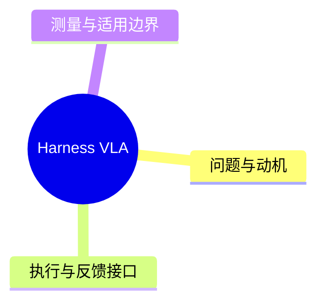

## Summary

Harness VLA 让通用 Agent 经由几何原语、记忆与执行反馈调用冻结 VLA 完成局部接触动作。 [原文与版本](https://arxiv.org/html/2607.08448v5)

## Problem & Motivation

固定 VLA 的抓取等局部能力有时仍可用，但任务与场景一变，位置寻找、技能调度和阶段恢复常出现错误。外部编排尝试保留局部能力并改变调用条件。

## Method

任务级 Agent 检索相关成功经验和失效模式。解析原语承担定位、预接触准备、运输等动作，vla_act 交给冻结的连续策略处理接触。在原语边界返回观测，Agent 可重新选择姿态和操作。

## Key Results

LIBERO-Pro Table 3 上直接 πRLinf 为 50.0%，few-shot Codex 与 Claude Code 分别为 72.1% 和 82.4%。标准 LIBERO 增幅较小，部分子集退化。真机展示目标重绑定与抓取恢复，人负责初态重置和验收。

## Evidence Ledger

| Claim ID | Claim | Type | Source locator | Evidence excerpt | Status |
|:--|:--|:--|:--|:--|:--|
| C1 | 解析原语与冻结 VLA 分工，阶段结束再利用反馈判断后续动作 | causal-mechanism | §§2.1–2.3, Figure 1 | vla_act | source-verified |
| C2 | LIBERO-Pro 同表同 checkpoint，直接 50.0%，Codex 72.1%，Claude Code 82.4% | comparison | §3.2 Table 3 | Table 3 | source-verified |
| C3 | 标准 LIBERO 总体 95.3%→96.0%，Spatial 99→97、Goal 97→94 | comparison | §3.2 Table 2 | Table 2 | source-verified |
| C4 | 真机评估由人重置场景和判定任务成功 | benchmark-setting | §4, Figures 8–9 | Reset and reward | source-verified |

## Strengths & Weaknesses

底层权重固定便于评估系统级调度收益，但解析原语与记忆都同时进入处理，需进一步消融。原语层反馈和低层连续控制的回路保持各自更新频率。真机部分以演示为主。

## Mind Map

## Notes

- [[Topics/AgenticRobotArm-Survey]]
