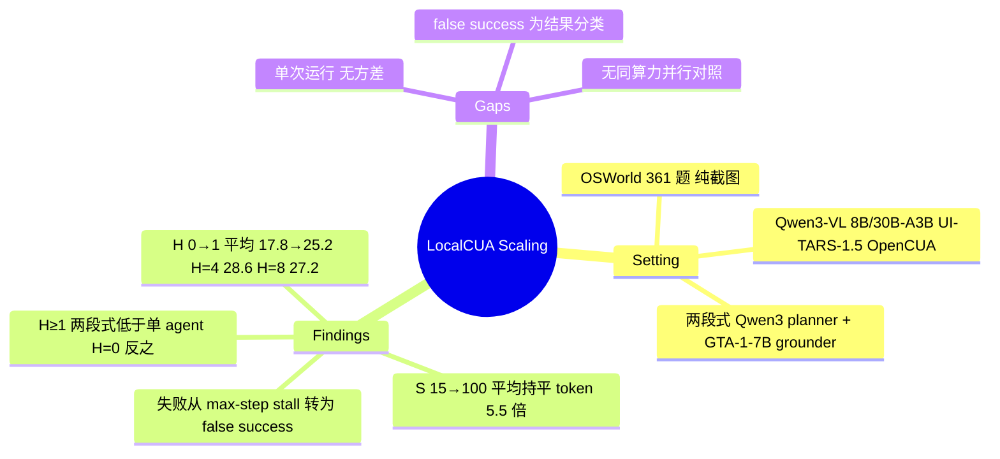

## Summary

本文在 OSWorld（361 题、纯截图）上对四个本地开源模型（Qwen3-VL-8B / 30B-A3B、UI-TARS-1.5-7B、OpenCUA-7B）扫了三个推理期算力维度：截图历史长度 H∈{0,1,4,8}、最大步数 S∈{15,50,100}、两段式 planner+grounder 的候选计划数 P∈{1,2,4}。主要观察是：H 从 0 到 1 的四模型平均成功率由约 17.8% 升到 25.18%，H=4 为 28.56%，H=8 回落到 27.16% 而 prompt token 涨到 3.57 倍；S 从 15 到 100 平均成功率基本不变（24.44 / 25.17 / 24.91），步数与 token 分别涨到 4.08 / 5.50 倍；用 Qwen3 作 planner、GTA-1-7B 作 grounder 的两段式在 H≥1 时低于对应单 agent、token 多 3–5 倍，增加 P 只部分挽回；但图上 H=0 时两段式持平或略高，与正文"各历史长度下一致劣于"的表述不符。全部结果为单次运行、只以图呈现，同一模型同一配置在不同图中读数相差数个点；失败分类按结果定义，"false success 增加"更接近"不再卡到步数上限、但停在错误状态"的计数转移。

## Problem & Motivation

本地部署 CUA 出于隐私与成本有实际需要，但本地小模型能力有限。已有推理期扩展工作（Agent S3 的多 rollout 选择、GTA-1 的多计划并行）都建立在闭源大模型上，作者要问：这些额外算力对本地模型是否划算，增益被什么失败模式限制。

## Method

纯经验研究，无新方法。两种 agent 结构：

- **单 agent**：模型读指令、当前截图与 H 张历史截图，逐步输出动作，直到完成或达到 S 步。
- **两段式**：planner（Qwen3-VL-8B 或 30B-A3B）读截图与历史生成 P 个候选计划，同一模型充当 judge 选一个，GTA-1-7B 作为固定 grounder 输出坐标动作。

成本指标为每题平均步数与累计 prompt token（vLLM 统计，单张 A100-80GB）。失败分为 Success / Max Step Stall / False Success / Other Failures，两段式另计 Format Error 与 Declared Fail。

## Key Results

- **历史长度（Fig. 2）**：四模型平均 H=0/1/4/8 约 17.8 / 25.18 / 28.56 / 27.16；相对步数 1.00 / 0.87 / 0.79 / 0.77，相对 prompt token 1.00 / 1.35 / 2.28 / 3.57。Qwen3-VL-30B-A3B（S=15）的失败构成（图读数，361 题）：成功约 67 / 95 / 113 / 106，max-step stall 约 270 / 228 / 153 / 150，false success 约 0 / 0 / 68 / 92。
- **步数上限（Fig. 4）**：四模型平均 S=15/50/100 为 24.44 / 25.17 / 24.91；相对步数 1.00 / 2.47 / 4.08，相对 token 1.00 / 2.75 / 5.50。Qwen3 两个模型在 15→50 有小幅提升，其余基本持平或下降。
- **两段式与并行计划（Fig. 5，图读数）**：S=15 下 Qwen3-30B-A3B 单 agent H=4 约 32.3%（约 110k token/题），两段式最好的点约 22.7%（P=4、H=1，约 305k），同 H 下两段式 token 为单 agent 的 3–5 倍。H≥1 时两段式低于单 agent；H=0 时 8B 两段式在各 P 下都高于单 agent（约 22–25 对 20.3），30B 在 P=4 时也略高。P 从 1 增到 4 时格式错误约 55 → 40 → 30 题，准确率部分回升。
- **格式依赖（Fig. 6）**：planner 漏掉 observation 段或不把动作写进代码块，grounder 无法解析。

## Evidence Ledger

| Claim ID | Claim | Type | Source locator | Evidence excerpt | Status |
|:--|:--|:--|:--|:--|:--|
| C1 | 作者 Woongkyu Lee、Jungwook Choi（Hanyang University）；无代码链接 | license-code | 首页 | "Woongkyu Lee, Jungwook Choi, Hanyang University"；全文无代码 URL | source-verified |
| C2 | OSWorld 361 题（排除 8 个 Google Drive 任务），纯截图，单张 A100-80GB + vLLM | benchmark-setting | §3.4 | "361 real-world Ubuntu tasks, excluding eight Google Drive tasks" | source-verified |
| C3 | 单 agent 四模型；两段式 grounder 固定 GTA-1-7B，planner/judge 为 Qwen3-VL 8B / 30B-A3B | benchmark-setting | §3.4 Models | "the grounding agent was fixed as GTA-1-7B … planning and judging roles were performed by the two Qwen3 models" | source-verified |
| C4 | H∈{0,1,4,8}，S∈{15,50,100}，P∈{1,2,4} | benchmark-setting | §3.2；Fig. 5 | "H∈{0,1,4,8}"；"maximum steps to 15, 50, and 100" | source-verified |
| C5 | 四模型平均 H=0/1/4/8：17.82 / 25.18 / 28.56 / 27.16 | number | Fig. 2(a)；§4.1 | "H=4 (28.56%) offers the best observed tradeoff, while increasing history to H=8 (27.16%)" | source-verified |
| C6 | 相对步数 1.00/0.87/0.79/0.77，相对 token 1.00/1.35/2.28/3.57 | number | Fig. 2(c)(d) | 图读数 | source-verified |
| C7 | 30B-A3B S=15 失败构成：成功约 67/95/113/106，stall 约 270/228/153/150，false success 约 0/0/68/92 | number | Fig. 2(b) | 图读数（verifier） | source-verified |
| C8 | 四模型平均 S=15/50/100：24.44/25.17/24.91；步数 1.00/2.47/4.08，token 1.00/2.75/5.50 | number | Fig. 4 | 图读数；图注子图字母与面板错位 | source-verified |
| C9 | Fig. 2(a) 的 S 与 Fig. 4(a) 的 H 未写明 | benchmark-setting | Fig. 2/4 图注；§4.1 | 只有失败构成面板标注 "S15" / "H4"（缺失性断言） | source-verified |
| C10 | S=15：30B 单 agent H=4 约 32.3%；两段式最好约 22.7%（P=4、H=1）；同 H token 3–5 倍；H=0 时两段式持平或略高 | comparison | Fig. 5(a–c) | 图读数；初稿"各 H 下都低于""2–4 倍"被 verifier 判 contradicted，已改 | source-verified |
| C11 | P 1→4 格式错误约 55→40→30 题，准确率部分回升但 H≥1 时未追平单 agent | comparison | §4.2 Finding 5；Fig. 5(d) | "although it does not fully close the gap with single-agent baselines" | source-verified |
| C12 | false success 按结果定义（未完成却终止） | benchmark-setting | §4.1 | "premature false successes, where the agent terminates despite not completing the task" | source-verified |
| C13 | 无 seed、方差或重复运行，无数值表 | benchmark-setting | 全文 | 缺失性断言，全文检索 | source-verified |
| C14 | 只评测 OSWorld | benchmark-setting | §3.4 | "We utilize OSWorld … a representative benchmark" | source-verified |
| C15 | 并行扩展无单 agent best-of-N / 投票等同算力对照 | comparison | §3.2.3；§4.2 | P 仅在两段式内变化（缺失性断言） | source-verified |

## Strengths & Weaknesses

**Strengths**

- 把成本（步数、token）与成功率放在同一张图上，并给出失败构成随算力的迁移，而不只报一条准确率曲线。"S 增大时 token 涨到 5.5 倍、平均成功率不变"是一个对本地部署直接有用的负结果。
- H=0→1 的大跳（约 +7 点）与 Fig. 3 的循环点击例子一致，支持"最小历史是本地 agent 稳定性的前提"。

**Weaknesses**

- **统计分辨率不足以支持"饱和/回落"的措辞**：全部单次运行、无方差，361 题中一题约 0.28 点。H=4 对 H=8 的 28.56 对 27.16 是四模型平均差 1.4 点，S 维度三档相差不到 1 点，都在单次运行噪声可达的范围内；"H=4 是最佳折中"缺少重复实验支撑。
- **"false success" 是结果分类而非诊断**：只要 agent 在步数上限前停止且任务未完成即计入。H 或 S 增大让原本卡到上限的轨迹提前停下，false success 计数自然增加，这本身不说明历史"损害了完成判断"；论文的"对完成判断的作用有限"属于解读，没有独立测量 agent 的终止判断准确率。
- **两段式的负结果混杂了多个因素**：planner 是未针对规划训练的通用 VLM，judge 由同一模型担任，grounder 固定为 GTA-1-7B，格式错误占相当比例。这个结果说明的是"弱本地 planner + 严格输出格式依赖"会拖累，而不是"结构分解"本身对本地模型有害；没有格式约束放宽或更强 planner 的对照来拆分。
- **并行扩展缺少同算力对照**：P 的收益只与 P=1 的两段式比，没有与单 agent 的 best-of-N、多数投票等同 token 方案比较，"次线性"无法与其他花法对照。
- **跨图数字对不上**：Qwen3-30B-A3B 单 agent H=4、S=15 在 Fig. 2(a) 约 35.4%、Fig. 2(b) 约 31.3%（113/361）、Fig. 4(a) S=15 处约 27.8%、Fig. 5(c) 约 32.3%；Fig. 2(a) 固定的 S 与 Fig. 4(a) 固定的 H 都未写明，Fig. 4 图注的子图字母也与实际面板错位。因此不同图的数字不能混合引用。
- **正文与图不一致**：§4.2 称两段式"在各历史长度下一致劣于"单 agent，Fig. 5(a,b) 在 H=0 处并不支持；"分解本身有害"至少不适用于无历史的设置。
- 实验面窄：只有 OSWorld、只有纯截图输入、模型最大 30B-A3B（3B 激活）。
- 结果全部以图给出，无数值表、无代码，数字需从图上读取。

**定位**：属于推理期扩展的经验分析，与 Agent S3 / Behavior Best-of-N（[[Papers/2510-ScalingAgents]]）、GTA-1 的多计划并行、[[Papers/2602-CATTS]] 的 per-step 投票饱和结论同向——额外推理算力在弱模型上回报很快递减。对 [[Topics/NonInvasive-GUI-Scheduling]] 的意义是：本地模型上加一个 prompted planner 的负面证据来自"弱 planner"而非"弱 executor"。

## Mind Map

## Notes

- 相关：[[Topics/NonInvasive-GUI-Scheduling]]（本文在该 topic 中被引为两段式负例）、[[Papers/2602-CATTS]]（web agent per-step 投票饱和）、[[Papers/2606-NaiveVisualMemory]]（历史截图直接 prepend 改变失败构成）、[[Ideas/FailureConditionedRetry-GUI]]。
