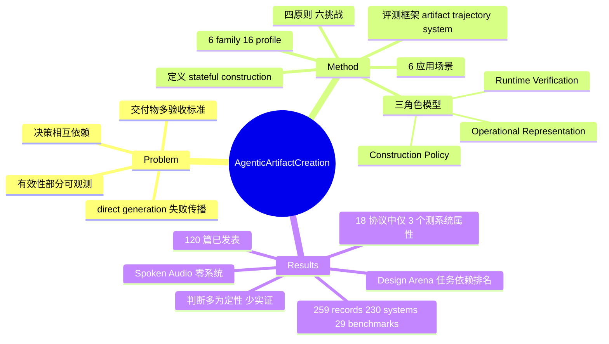

## Summary

这是一篇以"交付物（Delivered Artifact）"为分析单位的 survey，把 agentic artifact creation 定义为"AI 实质性构建/修改交付物、跨步骤携带状态、且至少一次中间观测改变后续工作"的有状态构建过程，并用 Operational Representation / Construction Policy / Runtime Verification 三角色模型统一分析 230 个系统与 29 个 benchmark（截至 2026-08-20）。核心论断是：构建难度不只由模态决定，而由决策耦合度、失败可观测性与可修复性决定；作者据此提出四条原则（外化承诺、定义控制边界、让反馈可执行、变更后重验证）和六个开放问题。全文基本是定性综合，唯一自有的定量分析是 Table 4 的 18 个代表性评测协议编码和一份 Design Arena 排行榜快照分析，其中"只有 3 个协议评测了超出任务能力的系统属性"是最硬的数据点。

## Problem & Motivation

生成模型能低成本产出草稿和组件，但海报、幻灯片、代码库、3D 场景这类交付物受多条验收标准约束，决策相互依赖（改内容会牵动布局/行为），而且有效性只能部分观测（检查覆盖不同标准、可能迟到、修订后失效）。直接生成（direct generation）在这种场景下会出现失败传播、定位弱、只能整体重生成的问题。作者认为已有 survey 以模型家族、agent 架构、领域或流程为组织轴（Table 1 对比了 7 篇邻近 survey），没有把"交付物及其验收标准"作为分析单位，因此无法跨模态比较"可编辑状态、观测与修复范围"。四个 RQ 分别对应定义与组织（§3）、需求与应用如何塑造构建（§§4–5）、评测（§6）和原则（§7）。

## Method

**文献方法**：检索 arXiv、Google Scholar、Semantic Scholar、ACM DL、IEEE Xplore（2023-01 至 2026-08-20），用 agentic-process 词 × 六类 artifact family 词组合，加引文追溯和定向 venue 审计；按 stateful-construction 定义筛选，排除 direct generator、观测不影响后续动作的固定 workflow、只消费/评测 artifact 的系统。作者明确承认：各数据库的查询导出、分源产出量和 reconciliation 前的标签都没有保留（§1.3）。

**定义与三角色模型**（§3）：
- 判定条件：AI 实质性构建或修改交付物 + 跨决策携带 artifact/process state + 至少一次中间观测改变后续动作、修订目标、分支或停止决策。与模型家族、模型调用次数无关。
- Operational Representation：Intermediate Form 分 Artifact Instance（直接存草稿/图像/mesh）、Structured Model（outline、SVG 树、scene graph、CAD、DOM）、Executable Program（可视化代码、动画脚本、repo）；Edit Interface 分 Unit Edit / Relation Edit / Whole-Artifact Edit。形式化为 $R_{t+1}=U(R_t,a_t)$。
- Construction Policy：$a_t=\pi(T,R_t,f_t)$；Decision Control 分 Workflow 与 Autonomous（可嵌套）；Agent Topology 分 Single-Agent、Centralized MAS、Decentralized MAS。人类审批不构成单独的控制类别。
- Runtime Verification：$f_{t+1}=V(T,R_{t+1},o_{t+1})$；Observation Source 分 Artifact State / Runtime Behavior / Evaluation Signal / External Response；Feedback Function 分 Criterion Status / Failure Diagnosis / Revision Guidance。
- 关键的"对齐"论点：表示、编辑接口、观测和反馈必须作用在同一构建单元上；精细诊断配上只能整体重生成的接口，等于没有局部修复能力。

**六类 artifact family、16 个 analytical profile**（§4，Fig. 6）：Textual（创意写作/专业文档/学术稿件）、2D Visual（数据可视化/插图与图表/海报与幻灯片）、Audio（音乐/口语音频/声景）、Video（说明类/叙事类/宣传类）、Spatial（3D 资产/场景）、Behavioral（软件系统/仿真模型）。归类依据是"哪条需求失败会让交付物不可接受、修复需要哪部分状态"。Table 2 给出各 family 的主导依赖类型（Semantic/Perceptual/Spatial/Temporal/Dynamic）和观测方式（Reading/Rendering/Playback/Interaction）；Table 3 用三角色维度编码 30 个代表系统（每 family 5 个），其中 ATVG 全部维度为 NR。

**应用维度**（§5）：六个应用场景（创意生产、品牌传播、教育、专业工作、科研、工程设计），与 artifact family 正交，按"决定最终验收的下游目标"归类。

**评测框架**（§6）：评测目标分 delivered artifact / construction trajectory / agentic system 三层；系统层属性（Run reliability、Condition robustness、Resource efficiency、Goal controllability、Update stability）每个都要求特定对照（重复固定条件、受控扰动、匹配成功率下的资源、干预测试、版本重跑）。证据 = evidence channel（6 种）× evaluator（Rule-based / Specialist model / LM judge / Human，4 种）；协议 = task set + metrics + run configuration + analysis plan。

**四条原则**（§7）与**六个挑战**（§8）：Externalize Commitments、Define Control Boundaries、Make Feedback Actionable、Revalidate Affected State；挑战包括 global coherence、self-diagnosis 下的定点修复、system self-evolution、creator intent 个性化、human authority、open-ended artifact 的可靠评测。

## Key Results

survey 没有新实验，以下是它自己报告的定量与半定量发现：

- **语料规模**：259 条 strict record = 230 个系统 + 29 个构建 benchmark；其中 251 条分配到 family（另 8 个 application-workflow 系统不在 family 视图中），13 条视频记录留在 Cross-profile；259 条中只有 120 条是已发表/已接收（其余为 preprint）（Fig. 2）。
- **覆盖空白**：Spoken Audio 在 strict 语料中没有任何专门系统（Fig. 2b、§4.3.2）。
- **评测成熟度不均**（Table 4，每 family 选 3 个协议，共 18 个）：只有 3 个协议评测了超出任务能力的系统属性，且每个只覆盖一个属性：Mr. Dre（Controllability）、AgenticVBench（Reliability）、AuthorBench（Controllability）。Robustness、Efficiency、Update Stability 在代表集里无人覆盖。按我对 Table 4 的计数（作者没有直接给出）：trajectory 显式覆盖 5/18，有限覆盖 5/18；使用 LM judge 9/18，使用 human reviewer 8/18。
- **benchmark 分布**：专门 benchmark 主要集中在 2D visual 和 behavioral；audio、video、spatial 更多依赖系统论文随附的协议。注意 Table 4 按"影响力和发表记录"选取，作者自己说明它"支持比较、不支持频率估计"。
- **Design Arena 快照**（Fig. 9，2026-08-19，仅统计 ≥100 场对战的条目，按 Elo 排名百分位归一化）：Models Arena 中 Kimi K3 在五项任务上都处于最高百分位；Agents Arena 任务依赖更强，Kimi K3 在 native Android 上跌到第 54.3 百分位（Claude Fable 5 在该项最高），GPT-5.6 Sol 从 slides 的 87.5 百分位到 mobile apps 的 34.2 百分位。作者由此主张 agentic 评测必须分任务报告，并写明 harness 与环境配置。
- **引用的唯一 trajectory 保留度量**：作者把 Mr. Dre 报告的后续修订中 16–27% 的已覆盖内容/引用质量回退，作为"状态保留"指标的直接示例（这是被引数字，不是本文测得）。
- **原则的证据等级自评**：第 1 条原则由定义推出，第 2、3 条是对反复出现的定性设计关系的综合，第 4 条（Revalidate）只有"新兴且相对稀疏"的证据（§7）；§8 的方向被明确标为 hypotheses。

## Evidence Ledger

| Claim ID | Claim | Type | Source locator | Evidence excerpt | Status |
|:--|:--|:--|:--|:--|:--|
| C1 | 本 survey 审阅了截至 2026-08-20 的 259 项工作，其中 230 个系统、29 个 benchmark。 | number | Abstract; §1.3 | "We reviewed 259 works available through August 20, 2026: 230 systems meeting this definition and 29 benchmarks" | source-verified |
| C2 | 检索覆盖 arXiv、Google Scholar、Semantic Scholar、ACM DL、IEEE Xplore 五个来源，时间窗为 2023-01 至 2026-08-20。 | benchmark-setting | §1.3 | "We searched arXiv, Google Scholar, Semantic Scholar, ACM DL, and IEEE Xplore from January 2023 through August 20, 2026" | source-verified |
| C3 | 作者未保留各数据库查询导出、分源产出量和 reconciliation 前的标签。 | benchmark-setting | §1.3 | "Database-specific query exports, per-source yields, and pre-reconciliation labels were not retained" | source-verified |
| C4 | Fig. 2b 的 family 视图覆盖 251 条记录；13 条视频记录为 Cross-profile；8 个 application-workflow 系统不在该视图中。 | number | Fig. 2 caption | "251 family-assigned records. Thirteen video records remain Cross-profile ... eight application-workflow systems are omitted" | source-verified |
| C5 | 259 条 strict record 中只有 120 条是已发表或已接收的工作。 | number | Fig. 2c caption | "Community and normalized-venue composition of the 120 published or accepted strict records" | source-verified |
| C6 | Spoken Audio profile 在 strict 语料中没有任何记录/专门构建系统。 | number | Fig. 2 caption; §4.3.2 | "Spoken Audio has no strict record" | source-verified |
| C7 | 六类 artifact family 被组织为 16 个 analytical profile。 | number | §4; Fig. 6 caption | "The six artifact families are organized into 16 analytical profiles" | source-verified |
| C8 | Table 3 编码了 30 个代表系统（每个 family 5 个），其中 ATVG 所有功能维度均为 NR。 | number | Table 3 | "ATVG [97] Video NR NR NR NR NR NR" | source-verified |
| C9 | 定义要求：AI 实质性构建/修改交付物、跨决策携带状态、且至少一次中间观测改变后续 artifact 相关工作。 | sota-novelty | §3.1 Definition | "uses at least one intermediate observation to redirect subsequent artifact-related work" | source-verified |
| C10 | Table 1 中本文是唯一以 Delivered Artifact 为主视角（primary lens）的 survey；construction state 与 feedback control 作为核心轴并非独有，Xu et al. [287] 同样把两者标为 central axis，原文也未用"唯一"表述。 | sota-novelty | Table 1; §2.4 | "Our organizing unit is the Delivered Artifact." | contradicted |
| C11 | Table 4 为每个 artifact family 选取 3 个代表性评测协议（共 18 个），按影响力与发表记录优先选取。 | benchmark-setting | §6.4; Table 4 | "Selection prioritizes influence and publication record, then complementary target and evidence coverage." | source-verified |
| C12 | 作者声明 Table 4 的均衡展示只支持比较，不支持频率估计。 | benchmark-setting | §6.4 | "The balanced display supports comparison rather than frequency estimates" | source-verified |
| C13 | 代表集中只有 3 个协议评测了超出任务能力的系统属性，每个只覆盖一个属性。 | number | §6.4 end; Table 4 | "Only three protocols evaluate a system property beyond task capability under these definitions, each covering one property." | source-verified |
| C14 | 这三个协议是 Mr. Dre（Controllability）、AgenticVBench（Reliability）、AuthorBench（Controllability）。 | number | Table 4 rows | Mr. Dre row: "Controllability"; AgenticVBench row: "Reliability"; AuthorBench row: "Controllability" | source-verified |
| C15 | （笔记作者对 Table 4 的计数，非论文原句）18 个协议中 trajectory 显式覆盖 5 个、有限覆盖 5 个；使用 LM judge 9 个、使用 human reviewer 8 个。 | number | Table 4（派生计数） | "For Artifact and Trajectory, ✓ denotes explicit coverage, △ limited or indirect coverage" | source-verified |
| C16 | 专门 benchmark 在 2D visual 与 behavioral 最成熟，audio/video/spatial 更多依赖系统论文自带的协议。 | comparison | §6.4 after Table 4 | "dedicated benchmarks are most developed for 2D visual and behavioral artifacts, while audio, video, and spatial rows more often rely on protocols" | source-verified |
| C17 | Design Arena 分析基于 2026-08-19 快照，只统计 ≥100 场对战的条目，并把 Elo 排名映射为 0–100 百分位。 | benchmark-setting | Fig. 9 caption | "Elo rank percentile is computed across leaderboard entries with at least 100 battles, mapping the lowest and highest eligible ranks to 0 and 100" | source-verified |
| C18 | Agents Arena 中 Kimi K3 在 native Android 上跌至第 54.3 百分位，Claude Fable 5 在该项处于最高百分位。 | number | §6.4; Fig. 9 | "falls to the 54.3rd percentile on native Android, where Claude Fable 5 reaches the top percentile" | source-verified |
| C19 | GPT-5.6 Sol 在 Agents Arena 的百分位从 slides 的 87.5 到 mobile apps 的 34.2。 | number | §6.4; Fig. 9 | "GPT-5.6 Sol similarly ranges from the 87.5th percentile on slides to the 34.2nd percentile on mobile apps." | source-verified |
| C20 | Models Arena 中 Kimi K3 在全部五项任务上处于最高百分位。 | number | §6.4; Fig. 9 | "Kimi K3 [111] occupies the top percentile on all five tasks" | source-verified |
| C21 | 本文引用 Mr. Dre 报告的 16–27% 修订回退，作为状态保留的直接度量。 | number | §6.1 Construction trajectories | "Mr. Dre reports 16–27% regression in previously covered content or citation quality during later revisions" | source-verified |
| C22 | "learned judge 与生成器共享偏好/盲点时增益有限"这一论断以引用文献（自偏好、LLM-as-a-judge 偏差）为依据，本文未做实测。 | causal-mechanism | Abstract; §8.2 | "Learned judges can likewise exhibit correlated preferences and self-preference [344, 186]." | source-verified |
| C23 | 第 4 条原则（Revalidate Affected State）被作者自评为只有新兴、相对稀疏的证据支持。 | causal-mechanism | §7 intro | "the fourth is a lifecycle implication supported by emerging and comparatively sparse evidence" | source-verified |
| C24 | 作者把难度三要素（决策耦合、失败可观测性、可修复性）定位为定性条件，而非独立因果因素或 family 排名。 | causal-mechanism | §7 intro | "These are recurring qualitative conditions rather than independent causal factors or a universal ranking of artifact families." | source-verified |
| C25 | 论文附带的 GitHub 仓库是 curated paper list，不是系统代码。 | license-code | Abstract | "We maintain a curated list of papers on agentic artifact creation ... at https://github.com/GeminiLight/awesome-agentic-artifact-creation" | source-verified |

## Strengths & Weaknesses

**Strengths**
- 分析单位选得好。以"交付物 + 验收标准"为轴，把海报、CAD、代码库、视频放进同一套"表示—编辑接口—观测—反馈"语言里比较，这是同类 agent survey 少有的跨模态可比框架。"诊断粒度必须与编辑接口粒度对齐"（§3.2.3、§7.3）是可操作的设计检查项：精确诊断配整体重生成接口没有用，粗粒度全局分数也定位不了局部修复。
- 评测部分区分清楚。artifact / trajectory / system 三层目标，每个系统属性对应特定对照设计（reliability 要固定条件重复，update stability 要版本化重跑），并指出"单一平均成功率只支持任务能力声明"。这比多数 benchmark 论文的评测自觉更强，可直接拿来审视 GUI/CUA benchmark 的 claim 范围。
- 对自己的证据等级比较诚实：原则 4 自评证据稀疏，§8 全部标为 hypotheses，Table 4 声明不做频率估计，并承认检索导出未保留。

**Weaknesses**
- **几乎没有自有实证**。"learned judge 增益有限""分解会增加协调与重组成本"这些摘要里的强论断，都是引用加定性综合，作者没有在 230 个系统上统计（例如多少系统用同源模型做 verifier、有没有报告分解前后的重组失败率）。手里有编码好的语料却不做跨语料统计，是最大的浪费。
- **"只有 3 个协议"的外推边界窄**。这个数字来自按影响力挑选的 18 行代表集，不是 29 个 benchmark 的全量统计；作者自己也说不做频率估计，但摘要和 §6.4 结尾的措辞容易被读成领域整体状况。
- **语料可复现性弱**。查询导出与分源产出未保留，259 条中只有 120 条已发表；"截至 08-20"与 Fig. 2 的"08-28 accounting update"并存，筛选口径在后期仍有调整。
- **Design Arena 分析信息量有限**。排名百分位放大了名次差异（Elo 分差可能很小），而且只是一天的快照、只看 5 个模型。用它说明"aggregate rank 会掩盖任务差异"可以，但这本来就是常识，算不上发现。
- **taxonomy 层数多、边界靠判例**。6 family × 16 profile × 6 应用场景 × 三角色下各 3–4 个子类，归类依赖"哪条需求失败会让交付物不可接受"这一判断，13 条视频记录无法归入 profile 就是信号。框架的价值在于它是一套检查维度，不能当作可证伪的分类。
- **对 GUI agent 的直接相关性有限**：Behavioral family 讨论的是生成 UI/网页/游戏（DuetUI、UI2CodeN、FullStack-Agent），不是操作 GUI；但 §6 的评测三层框架和 §8.2 的同源 verifier 盲点问题可以迁移到 CUA verifier 讨论。

## Mind Map

## Notes

- [[2605-Crafter]]：本文在 §7.1、§8.1、§8.6 反复把 Crafter 的"evolving figure specification + typed revision"当作"外化承诺、可定点修复"的正例；读 Crafter 时可以用本文的 Unit/Relation Edit 维度检查它的编辑接口粒度。
- [[2604-AgenticWorldModel]]：本文 [28] 引用了它，并把 world model 划入"policy-side 状态"，只有当模型本身是被构建的交付物时才算 Simulation Models artifact。两篇的边界划分可以对照着读。
- [[2508-SelfEvolvingAIAgentsSurvey]]：§8.3 讨论 system self-evolution，要求把跨 episode 的改动当作版本化 patch（带 provenance、回滚、held-out 门控），并把 retrieval、任务顺序、额外推理带来的增益剥离出去。这比 self-evolving survey 的口径更严，可以拿来审视那类论文的"持久改进"声明。
- [[2411-RewardHacking]]：§8.3 的"系统不能靠降低自身标准来证明改进"、§8.2 的同源 judge 盲点，和 reward hacking 是同一类问题（优化方同时控制评价信号），可以结合起来看。
