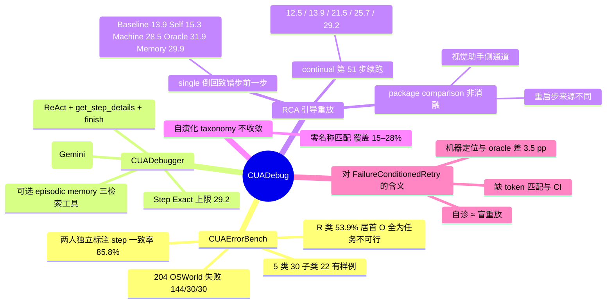

## Summary
CUADebug 把 CUA 失败的"诊断"和"修复"接成一条可测量的链：CUAErrorBench 给 204 条真实 OSWorld 失败轨迹（144 Claude 4.5 Sonnet / 30 Gemini 2.5 Pro / 30 Qwen 3.5）标了 root-cause step、5 类 30 子类标签与一句纠正（两人独立标注，step 一致率 85.8%）；CUADebugger 用 ReAct 循环按步调取前后截图做 root-cause analysis（RCA），Claude 轨迹上 Tag+Step 联合准确率从一次性 prompt 的 11.1% 提到 19.4%（Gemini 2.5 Pro 作 debugger）；再把 RCA 结果注入重放，从 root-cause step 前一步重跑，144 条失败的修复率 Baseline 13.9 / Self-debug 15.3 / Machine RCA 28.5 / Human oracle 31.9 / RCA+memory 29.9。最有价值的读法是三点：自我诊断几乎无用（+1.4 pp），机器定位（step exact 29.2%）与人工 oracle 只差 3.5 pp，以及作者自己承认五臂差在重启步来源、prompt 格式与视觉助手侧通道上，是 package comparison 而非干净消融。

## Problem & Motivation
CUA 的终端失败信号（超步数、错误结果）往往离真正致错的那一步很远：动作在错误的窗口上执行、文件在错误的格式下保存、或者任务本身不可行而 agent 不断重试。现有 agent debugging 工作（AgentErrorBench / AgentDebug）在 ALFWorld、GAIA、WebShop 这类文本或半文本环境里做 root-cause 定位，GUI 场景缺三样东西：(1) 带人工 root-cause step 标注的真实失败集；(2) 一个能在几十张相似截图里找到致错步的 debugger；(3) 诊断能否转化为修复的直接测量。作者的切入是把"诊断"做成一个能被人工标注打分的结构化输出（step + L1/L2 标签 + 证据 + 纠正 + 置信度），再用同一份输出去引导重放，这样 RCA 的质量和它对修复的贡献可以分开报告。

## Method
- **Taxonomy**：五个 L1 类——Perception (P)、Grounding / interaction (G)、Task reasoning and control (R)、External / system (S)、Others (O)——下设 30 个 L2 子类。L1/L2 名称与定义见 App. A.5 Table 6。
- **CUAErrorBench**：204 条 OSWorld 失败轨迹，来源 144 Claude 4.5 Sonnet（50 步预算）/ 30 Gemini 2.5 Pro / 30 Qwen 3.5。六名团队内研究者、每条两人独立做首轮标注（可见 debugger 的机器提案），不一致处讨论裁决；标注字段为 root-cause step、taxonomy 标签、证据、纠正、置信度与备注。裁决前一致率：step 85.8%、L1 94.6%、L2 85.8%。204 条覆盖全部 10 个应用组、30 子类中的 22 个（G2、G4、R6、R12、R13、S1、S2、S5 无样例）。
- **CUADebugger**：ReAct 循环配两个工具。`get_step_details(n)` 返回第 n 步的前后截图、动作、推理、错误与 reward，较旧的截图会从上下文里丢弃；`finish` 提交结构化 RCA（root-cause step、L1/L2 标签、证据、纠正、[0,1] 置信度、逐步摘要）。可选 episodic memory：记忆条目含标题、触发条件、失败/纠正动作、taxonomy 标签、区分特征、证据与来源 episode 引用，按应用、标签、触发条件、失败动作与正文索引，三个检索工具 `lookup_lessons_by_taxonomy` / `search_lessons_by_app` / `follow_episodic_ref`；冷启动为空，从成功的 RCA 与失败/成功对照对里生长。
- **RCA 评测**：Naive baseline 一次调用、无工具无记忆，拿到任务、完整文字轨迹、taxonomy 表和最近 N 步结果截图（§5 说是 OSWorld 三步视觉历史设置）；CUADebugger 拿同样的任务元数据与 taxonomy 表但必须用工具按步查看。指标 L1 / L2 / Step Exact / Step ±2 / Tag+Step（标签与步同时正确）。
- **Single re-rollout**：重放 agent 固定为 Claude 4.5 Sonnet，从 root-cause step 前一步重启，固定步数与 token 预算。五臂：Baseline（history-only）、Self-debug（同一重放状态，先让 acting model 自诊再选动作）、Machine RCA（Gemini 2.5 Pro 的预测步与诊断，无记忆）、Human oracle（人工标注做引导）、Our method（RCA + memory）。Machine RCA 用机器预测的重启步，其余四臂用人工标注的 root-cause step 作重启点。RCA 引导臂的 runner 在每个动作后调用五个视觉助手（grid caption、local visual search、text bbox grounding、region OCR、GUI grounding）并把输出以 `[SCREEN UPDATE step t]` 追加进上下文；acting model 不直接调用它们。
- **Continual re-rollout**：取 Claude 4.5 Sonnet 的 50 步失败，从第 51 步继续，同五臂。
- **Acc 口径**：Re-rollout Acc 在送去重放的失败轨迹上计算；Overall Acc = (203 条初始成功 + 恢复数) / 361 任务。New+Fixed 由事后 judge 对照人工标注判定，论文定义第一个数为"原错误修好但出现新关键错误"，第二个数为"修好且无新错误"。

## Key Results
**失败分布（人工标注，N=204）。** R（task reasoning and control）110/204 = 53.9%，P 36、G 25、S 13、O 20；按来源 Claude 76/144、Gemini 15/30、Qwen 19/30。最大子类 R3 23、G1 21、R4 21、O1（任务不可行）20、R10 18。O 类 20 条全是 O1，即"Others"实际上是 task infeasibility。

**RCA 准确率（Table 2，Claude 轨迹 N=144）。**

| Debugger | 方法 | L1 | L2 | Step Exact | Step ±2 | Tag+Step |
|:--|:--|--:|--:|--:|--:|--:|
| Gemini 2.5 Pro | Naive | 50.7 | 29.9 | 20.8 | 38.2 | 11.1 |
| Gemini 2.5 Pro | CUADebug | 53.5 | 36.8 | 29.2 | 47.9 | 19.4 |
| Qwen 3.5 | Naive | 44.4 | 19.4 | 23.6 | 34.7 | 7.6 |
| Qwen 3.5 | CUADebug | 57.6 | 33.3 | 25.0 | 46.5 | 14.6 |
| Claude 4.5 | Naive | 49.3 | 14.6 | 22.2 | 38.2 | 4.9 |
| Claude 4.5 | CUADebug | 61.1 | 31.3 | 29.2 | 45.1 | 15.3 |

三个 backbone 上 L2 与 Tag+Step 一致提升，Step Exact 最高只到 29.2%，Step ±2 不到一半。跨 agent 的 N=30 切片结果混杂（如 Qwen 3.5 debugger 在 Gemini 轨迹上 Tag+Step 6.7 → 3.3，Claude 4.5 debugger 在 Gemini 轨迹上 L1 53.3 → 43.3），作者把它们当 stress test 而非排名，并归因于 debugger backbone 能否把查到的证据转成修正后的因果假设。作者明确说这个对照不能把"主动选步"与"成对截图"两个因素分开。

**Single re-rollout（Table 3，Claude 4.5 Sonnet 轨迹与重放，N=144）。**

| 臂 | 诊断来源 | 平均轮数 | 输入 token | Acc | Overall Acc | New+Fixed |
|:--|:--|--:|--:|--:|--:|:--|
| Baseline | 无 | 28.01 | 272.7K | 13.89 | 61.77 | 20+11 |
| Self-debug | 自身 | 31.53 | 324.4K | 15.28 | 62.33 | 22+14 |
| Machine RCA | Gemini 2.5 Pro | 23.03 | 290.8K | 28.47 | 67.59 | 40+25 |
| Human oracle | 人工标注 | 22.37 | 296.9K | 31.94 | 68.98 | 46+29 |
| Our method | RCA + memory | 28.28 | 319.1K | 29.86 | 68.14 | 43+24 |

自诊只带来 +1.4 pp；外部 RCA 带来 +14.6 pp，且轮数更少（23.03 vs 28.01）、输入 token 只多 6.6%，是 GUI 上最接近"预算可比"的定位加重试对照。机器定位（Step Exact 29.2%）与人工 oracle 的修复率只差 3.5 pp。记忆在 single 设置下相对 Machine RCA +1.4 pp、token 多 9.7%。

**Continual re-rollout（Table 4，从第 51 步继续）。** Baseline 12.50 / Self-debug 13.89 / Machine RCA 21.53 / Our method 25.69 / Human oracle 29.17；Overall 61.22 / 61.77 / 64.82 / 66.48 / 67.87；New+Fixed 18+15 / 20+12 / 31+19 / 37+23 / 42+25。与 Table 3 对读：不倒回只续跑时，Machine RCA 从 28.47 降到 21.53，Human oracle 只从 31.94 降到 29.17，记忆的增益从 +1.4 变成 +4.2 pp。倒回到致错步前一步这个动作本身对机器诊断更重要，但两表的步数预算与上下文长度不同，不能直接做差。

**自演化 taxonomy 的反面实验。** 让模型从空白自行生长子类：四种随机顺序，seed 3 跑完 144 条后仍有 40 个子类且曲线未收敛，六对 seed 之间名称严格匹配的子类为零，投影到人工 taxonomy 只覆盖 15%–28%（四 seed 并集约 40%）；125 条非 Others 子集上 L1 16.0 / L2 4.8 / Step Exact 25.6，对比人工 taxonomy 下 CUADebugger 的 53.5 / 36.8 / 29.2（后者是 144 条全集，作者自认不是干净的同子集对照）。

## Evidence Ledger

| Claim ID | Claim | Type | Source locator | Evidence excerpt | Status |
|:--|:--|:--|:--|:--|:--|
| C1 | CUAErrorBench 204 条失败轨迹：144 Claude 4.5 Sonnet（50 步）、30 Gemini 2.5 Pro、30 Qwen 3.5 | dataset | §2 L108 | "204 annotated trajectories: 144 generated by Claude 4.5 Sonnet with a 50-step budget, 30 by Gemini 2.5 Pro, and 30 by Qwen 3.5" | source-verified |
| C2 | 5 类 30 子类；R 110/204 = 53.9%，P 36 / G 25 / S 13 / O 20；Claude 76/144、Gemini 15/30、Qwen 19/30 | result | §5 L288；Table 7 列和 | "task reasoning and control accounts for the largest share … (110/204, 53.9%) … perception (36), grounding/interaction (25), external/system (13), and Others (20)" | source-verified |
| C3 | 两人独立首轮标注、六名团队内研究者、可见机器提案；裁决前一致率 step 85.8% / L1 94.6% / L2 85.8% | protocol | App. A.3 L1256 | "two researchers separately recorded first-pass annotations … Annotators could view and verify the machine proposal … 85.8% for the root-cause step, 94.6% for the L1 category, and 85.8% for the L2 subtype … All annotators were members of the research team" | source-verified |
| C4 | Table 2 Claude 切片、Gemini 2.5 Pro debugger：Naive 50.7/29.9/20.8/38.2/11.1 → CUADebug 53.5/36.8/29.2/47.9/19.4 | result | Table 2 L231–232 | "Naive / Gemini 2.5 Pro / 50.7 / 29.9 / 20.8 / 38.2 / 11.1" ; "CUADebug / Gemini 2.5 Pro / 53.5 / 36.8 / 29.2 / 47.9 / 19.4" | source-verified |
| C5 | Table 2 Claude 切片、Qwen 3.5 与 Claude 4.5 debugger 两组行（见上表） | result | Table 2 L233–236 | "Naive / Qwen 3.5 / 44.4 / 19.4 / 23.6 / 34.7 / 7.6" ; "CUADebug / Claude 4.5 / 61.1 / 31.3 / 29.2 / 45.1 / 15.3" | source-verified |
| C6 | 跨 agent N=30 切片混杂（Qwen debugger 在 Gemini 轨迹 Tag+Step 6.7 vs 3.3；Claude debugger L1 53.3 vs 43.3）；作者视为 stress test | result | Table 2 L237–240；§5 L299 | "we treat these rows as a stress test rather than as a final model ranking" | source-verified |
| C7 | Naive 为一次调用无工具无记忆，含完整文字轨迹与最近 N 步结果截图（§5：三步视觉历史）；对照不能分离主动选步与成对截图 | protocol | App. A.1 L620, L666；§5 L292 | "In one call with no tool access or memory, it receives the task, full textual trajectory, taxonomy table, and result screenshots" ; "this comparison does not isolate active step selection or paired screenshots" | source-verified |
| C8 | Table 3 五臂 Acc 13.89 / 15.28 / 28.47 / 31.94 / 29.86，Overall 61.77 / 62.33 / 67.59 / 68.98 / 68.14，New+Fixed 20+11 / 22+14 / 40+25 / 46+29 / 43+24，轮数与 token 如正文表 | result | Table 3 L260–264；§4.4 L255 | "Machine RCA / machine RCA / 23.03 / 290.8K / 2.9K / 28.47 / 67.59 / 40+25" | source-verified |
| C9 | 从 root-cause step 前一步重启、固定预算；Machine RCA 用机器预测步，其余四臂用人工标注步；作者称 Table 3 为 package comparison | protocol | §4.4 L255 | "The Machine RCA condition uses the machine-predicted root-cause step … while the baseline, self-debug, human-oracle, and our method conditions use the human-labeled root-cause step … a re-execution-package comparison rather than a clean ablation" | source-verified |
| C10 | Table 4 continual（第 51 步起）Acc 12.50 / 13.89 / 21.53 / 25.69 / 29.17，Overall 61.22 / 61.77 / 64.82 / 66.48 / 67.87，New+Fixed 18+15 / 20+12 / 31+19 / 37+23 / 42+25 | result | Table 4 L275–279；§4.5 L271 | "restart Claude 4.5 Sonnet from step 51" ; "Our method / 50 / 47.44 / 426.2K / 5.4K / 25.69 / 66.48 / 37+23" | source-verified |
| C11 | Acc 在送去重放的失败上计算；Overall = 恢复数 + 203 初始成功，除以 361 | metric | §4.1 L219；Table 3/4 caption | "Overall Acc adds recovered failures to 203 initial successes over 361 tasks" | source-verified |
| C12 | RCA 引导重放中 runner 每步调用五个视觉助手并以 [SCREEN UPDATE] 注入；baseline 与 self-debug 的 prompt 模板无此块 | protocol | App. A.2 L1198, L1202–1230, L1044–1126 | "In RCA-guided runs, the runner invokes visual helpers after each action and appends their outputs as [SCREEN UPDATE step t] context … the acting model does not call the helpers directly" | source-verified（代码块标题写 "Base acting interface (all methods)"，与散文存在歧义） |
| C13 | Our method = RCA + episodic memory；冷启动为空；记忆贡献用 Machine RCA（无检索）与记忆版的分阶段对照评估 | method | §3.4 L163；Table 3 L264 | "At cold start, the memory is empty; it then grows from successful RCA outputs and contrastive failure/success trajectory pairs" | source-verified |
| C14 | 自演化 taxonomy：四种顺序、seed 3 覆盖 144 条（136 成功 / 8 超轮）、零名称匹配、40 子类未收敛、投影 15%–28% / 并集约 40%、125 条非 Others 子集 16.0 / 4.8 / 25.6 vs 53.5 / 36.8 / 29.2 | result | §5 L311 | "Seed 3 ends with 40 subtypes after 144 cases with the curve still rising … 16.0% L1, 4.8% L2, and 25.6% Step Exact" | source-verified（对照组为 144 条全集，作者自认非干净同子集重跑） |
| C15 | 覆盖 10 应用组、22/30 子类；缺 G2、G4、R6、R12、R13、S1、S2、S5；Multi-app 55、Chrome 28、Impress 28、Calc 20；R3 23、G1 21、R4 21、O1 20、R10 18 | dataset | App. A.6 L1318；Table 7 L1323–1353 | "22 of the 30 P/G/R/S/O subtypes. The benchmark contains no examples for G2, G4, R6, R12, R13, S1, S2, or S5" | source-verified |
| C16 | 跨 agent 混杂结果归因于 debugger backbone 把证据转成修正假设的能力 | interpretation | §5 L299 | "tool inspection can surface the relevant evidence, but the model must still interpret that evidence and revise its causal hypothesis" | source-verified |
| C17 | 最近先例为 AgentErrorBench / AgentDebug（ALFWorld、GAIA、WebShop）；只在 OSWorld 标注与评测 | positioning | §6 L321；Limitations L337 | "AgentErrorBench and AgentDebug are the closest to our setting … We annotate and evaluate only on OSWorld" | source-verified |
| C18 | 记忆条目字段与索引键；三个检索工具 lookup_lessons_by_taxonomy / search_lessons_by_app / follow_episodic_ref | method | §3.4 L163；App. A.1 L1000–1030 | "a memory record containing a title, trigger condition, failed and corrected actions, taxonomy label, distinguishing feature, supporting evidence, and source-episode references" | source-verified |
| C19 | round(Acc×144) 等于 New+Fixed 第一个数：Table 4 五行全中，Table 3 四行中（Machine RCA 算得 41，表写 40）；而论文定义第一个数为"修好但出新错" | arithmetic | Table 3–4；§4.4 L255 | verifier 重算：Table 4 → 18, 20, 31, 37, 42；Table 3 → 20, 22, 41, 46, 43；(203 + Acc×144/100)/361 还原全部 Overall 值 | source-verified（重算） |
| C20 | 项目页 cuadebug.github.io；正文提到 debugger/rca.py 等实现文件；无显式代码发布声明 | availability | Abstract L78；App. A.1 L618；A.3 L1244 | "Project page: cuadebug.github.io." ; "The implementation sources are debugger/profiling/run_plain.py, debugger/rca.py, and debugger/tools/__init__.py." | source-verified |
| C21 | arXiv 2608.02643v2，cs.SE，2026-09-06；12 位作者；UIUC 为主，Pan Lu Stanford、Xiangru Tang Yale；Heng Ji、Jiaxuan You 末位 | metadata | Header L15–73 | "arXiv:2608.02643v2 [cs.SE] 06 Sep 2026" | source-verified |
| C22 | Limitations：证据集中于 Claude 失败；跨 agent 切片不足以排名；single re-rollout 各臂差在重启步来源、prompt 格式与诊断来源；匹配消融留待未来；只有 OSWorld | limitation | Limitations L337 | "The single re-rollout conditions differ in restart-step source, diagnostic prompt format, and diagnosis source" | source-verified |

## Strengths & Weaknesses

**Strengths**
- 诊断与修复首次在真实 GUI 失败上被接成同一条链并分别计分：RCA 准确率（Table 2）和 RCA 引导的修复率（Table 3/4）用同一份人工标注做参照，Human oracle 臂给出"定位完美时能修多少"的上界（31.9% single / 29.2% continual）。
- 人工标注协议可复用：两人独立首轮加裁决、报告裁决前一致率、字段固定（step、标签、证据、纠正、置信度），这是 [[Ideas/FailureConditionedRetry-GUI]] 里 A5 臂与失败库标注的现成模板。
- Table 3 的 Baseline 与 Machine RCA 在输入 token 上只差 6.6%、轮数反而更少，是 GUI 上最接近预算可比的"定位后重试 vs 盲重放"数字。
- 自演化 taxonomy 的反面实验是少见的诚实对照：说明"让模型自己长出错误分类"在当前规模下不收敛、不可复现，也呼应 [[Topics/CUA-Survey]] 把分类降为实验输出而非先验的立场。
- Limitations 节把包比较、切片不足、单一 benchmark 三个问题都写明了。

**Weaknesses**
- 五臂重放不是消融：Machine RCA 用机器预测步重启、其余四臂用人工步；RCA 引导臂另有 runner 注入的五路视觉助手输出，Baseline 与 Self-debug 的 prompt 模板里没有这一块（App. A.2 的代码块却标着 "all methods"，正文与附录自相矛盾）。Table 3 的 +14.6 pp 里有多少来自诊断、多少来自视觉助手与重启点，无法从本文分开。
- 全部数字单次运行、无方差无 CI；144 条上 1 pp 约等于 1.4 条，Self-debug 与 Baseline 的 +1.4 pp、Our method 与 Machine RCA 的 +1.4 pp 都在噪声量级。
- 标注者是作者团队且在标注时能看到机器提案，一致率 85.8% 与 debugger 的 Step Exact 都可能被锚定效应抬高；没有独立盲标子集来估计这个偏差。
- Table 2 的 Naive 只看最近三步截图而 CUADebugger 可按需取任一步的前后截图，提升可能主要来自截图访问而非 ReAct 推理，作者承认未分离。
- New+Fixed 的语义与表格数字对不上：第一个数在 10 行里有 9 行等于 round(Acc×144)，Machine RCA 行 Acc 28.47% 对应 41 却写 40；要么定义写反、要么列标错，不能把它当"修好但出新错"的计数来引用。
- Benchmark 偏 Claude（144/204），8 个子类无样例，Others 20 条全是 O1 任务不可行；"错误分布"结论实际上是"Claude 4.5 Sonnet 在 OSWorld 上的失败分布"。
- 代码发布状态论文未说；项目页链到 AgentDebugX 仓库（GitHub 描述为 EMNLP 2026 Demo 的通用 agent debugging 框架），与本文方法的对应关系未在论文中说明。

## Mind Map

## Notes
- **与 [[Ideas/FailureConditionedRetry-GUI]] 的关系**：本文是该 idea 的 A4（自由反思 / self-debug）、A5（oracle 定位）、A6（机器定位）三臂在 ρ = k−1 重置下的先例，idea 文件 11-12 评估已据此下调 Novelty。两条对 P2"定位主导"不利的读数都出自本文：机器定位 Step Exact 29.2% 时修复率只比人工 oracle 低 3.5 pp；continual 设置下不倒回也能拿到 21.5%。但 Table 3 的视觉助手侧通道意味着"Machine RCA 臂的增益"不能全归给定位，idea 的 A7 剂量实验仍有空间。
- **与 [[Topics/CUA-Survey]] 的关系**：§10.5 的四项 recovery 工作（CUA-Recovery、[[Papers/2610-ReTrace]]、[[Papers/2610-AndroidFlux]]、ReInBench）都是"错误发生后能否恢复"；本文补的是"离线诊断能否指导恢复"，且 Baseline 13.9% 与 CUA-Recovery 的"察觉后通过率 15.6%"量级一致。§10.11 D2 需要的 mismatch alert 质量数字可直接取 Table 2。
- **与 [[Papers/2609-AnchorGUI]] 对读**：AnchorGUI 在 AndroidWorld 上证明"定位过的反思 > 自由反思"（69.2 vs 64.4），本文在 OSWorld 上给出同向但更大的差距（Machine RCA 28.5 vs Self-debug 15.3）。两者都没有 token 匹配的盲重试臂。
- **可复用资产**：144 条 Claude 4.5 Sonnet 失败的人工 root-cause 标注 + 固定预算的重放装置，是在 OSWorld 上做定位剂量曲线（A7 ±1 / ±3 / 随机步）的最省事起点，前提是 AgentDebugX 仓库确实包含 CUAErrorBench 数据，待核。
- **内部不一致记录**：(1) New+Fixed 第一个数与 Acc×144 在 9/10 行重合、Machine RCA 行 40 vs 41；(2) App. A.2 视觉助手代码块标题 "all methods" 与正文 "RCA-guided runs" 冲突；(3) §5 的自演化对照用 125 条子集对 144 条全集；(4) §5 称 Claude 池为 "pre-filter 144-case pool"、A.3 称 "204 paper-usable examples"，过滤了什么未说明；(5) HTML 版作者邮箱错位（Zeyi Liu 挂 hengji@、Yinting Chen 挂 jiaxuan@），leading / co-senior 标记未附在作者名上；(6) arXiv 元数据只列 11 位作者（缺 Pan Lu），HTML 正文列 12 位，BibTeX 缓存沿用 arXiv 的 11 位。
- **相关笔记**：[[Papers/2505-BacktrackAgent]]（训练期回溯）、[[Papers/2605-GUIRobustEval]]（error depth 作恢复难度变量）。
