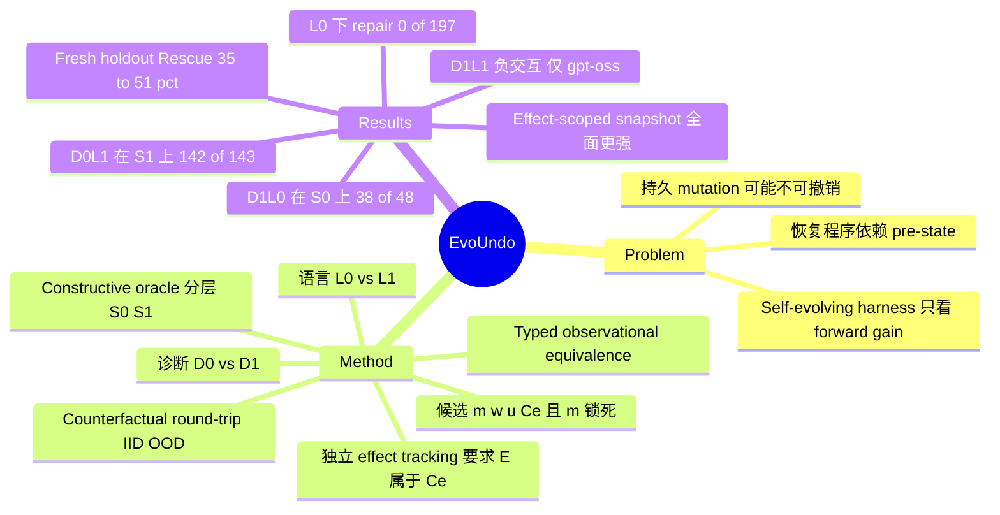

## Summary

EvoUndo 给 LLM 对自身 harness 的修改（config / tool / middleware / listener / file / socket）加了一道准入条件：在 forward mutation 固定的前提下，只有当 LLM 合成的 witness 捕获程序和 recovery 程序能在 counterfactual 状态上把 harness 恢复到与 pre-state typed observationally equivalent 时，该修改才被持久接纳。600 个 zero-shot self-evolution 任务里有 197 个 capability-positive 却无法恢复的 mutation，常规 verifier-guided repair 在原语言 $L_0$ 下修好 0/197。2×2 factorial 把失败拆成两个瓶颈：state-grounded 诊断在 $S_0$ 上做到 38/48，扩展 recovery 语言 $L_1$ 在 $S_1$ 上做到 142/143。不过 $L_1$ 是根据同一批失败审计设计出来的，而且在 300 个 fresh 任务上 Rescue@4 只有 35%–51%；在作者自己的 selective-undo 对比里，EvoUndo 还全面输给 effect-scoped snapshot。

## Problem & Motivation

Self-evolving harness 方面的工作（Darwin Gödel Machine、Self-Harness、Agentic Harness Engineering、Harness-R1 等）只按 forward 收益 $J(m(H))>J(H)$ 决定是否接纳一次修改。可一次修改可能覆盖配置值、重排 middleware、遮蔽已有工具或泄漏资源；等它过时或与后续更新冲突时，静态 inverse 往往恢复不了原状态，因为正确的恢复过程依赖 pre-mutation 状态里的信息。作者因此把 "robust recoverability" 当作 self-evolution 搜索空间的显式约束：恢复不能只在构造 mutation 时那一个状态上成立，还必须在 counterfactual 状态分布 $Q$ 上成立。

隐含假设：harness 状态可完全建模为有限几类 typed persistent surface，并且可以在 sandbox 里任意构造 counterfactual pre-state。分布式状态、外部 API、不可逆副作用都不在模型内，作者在 Limitations 里明确承认了这一点。

## Method

- **候选表示**：$\xi=(m,w,u,\mathcal{C}_e)$，分别是 forward mutation、pre-state witness 捕获程序、recovery 程序和声明的 effect contract。repair 期间 $m$ 锁死在 Turn 0（$m_{\text{repaired}}\equiv m_0$），只有 $(w,u,\mathcal{C}_e)$ 可以改，这样模型无法把 forward mutation 弱化成 no-op 来规避约束。runtime 另行计算 $E(m,s)=\text{SnapshotDiff}\cup\text{ExecutionTraceEffects}$，并要求 $E\subseteq\mathcal{C}_e$，防止模型通过缩小 contract 逃避检查。
- **Witness 与 receipt**：$w(s)$ 记录先前取值和 `{key}_existed` 标志；forward 执行另外产生 resource allocation receipt，因为 pre-state witness 里不可能有未来才分配的 socket handle。recovery 按条件执行：若 key 原本存在就还原，原本不存在就删除或注销。
- **Typed observational equivalence**：在 $\mathcal{C}_e$ 内按类型做规范化比较（dict key 排序、volatile id 换成占位符、文件内容比 SHA-256；middleware 的成员和顺序都要一致），$\mathcal{C}_e$ 外要求 strict canonical equality。只检查最终状态，recovery 过程中产生又消失的瞬时副作用不受约束。
- **Counterfactual round-trip 验证**：$Q_{dev}$（10 个状态）给出 state-level 诊断；$Q_{hid}$ 分为 IID 20 个和 OOD 20 个，每个 split 各自要求 Wald 下界 ≥ 0.85，等价于每个 split 至少 19/20。dev gate 要求 10/10 全部通过。v2 指出初版把该规则写成 Wilson 是 "reporting error"。
- **诊断粒度**：$D_0$ 只告诉模型受影响的子系统、缺陷类别和 dev / hidden LCB 汇总；$D_1$ 额外提供 canonical state address、forward effect 顺序、residual 及其计数、verifier observation。这些字段是打包给的，没有单独 ablate address。
- **Recovery 语言**：$L_0$ 覆盖 config / prompt / tool registry / routing；$L_1$ 增加 indexed middleware 序列、listener、file pre-state、socket descriptor，以及跨 surface 的 LIFO 有序恢复。$L_1$ 的五类能力是"由 natural-failure solvability audit 识别出来"的（App. C.2）。runtime 有 language gate，越界 primitive 会被拒并消耗一次尝试。
- **Oracle 分层**：用一个确定性的 constructive oracle（不调 LLM、不搜索，按 forward AST 逐 op 构造 witness、inverse 并 LIFO 展开）把 197 个失败划成 $S_0$（$L_0$ 可解，48 个）、$S_1$（只有 $L_1$ 可解，143 个）和 6 个残余。
- **2×2 factorial**：$\{D_0,D_1\}\times\{L_0,L_1\}$，预先锁定三个 paired contrast C1/C2/C3，用 exact McNemar 检验并做 Holm 校正，budget $B=4$。主 backbone 是 gpt-oss-120b（MXFP4，temp 0.2，medium reasoning effort）。

## Key Results

**Controlled benchmark（120 个人为注入缺陷、确知可恢复的 mutation，B=4）**：independent regeneration 4/120（3.3%），generic feedback 104/120，raw trace 101/120，typed diagnosis 114/120（95.0%），prescriptive hints 117/120（97.5%）。

**Natural failure bank（600 任务，single-sample zero-shot）**：281 个直接 admissible，122 个 capability 不足，197 个 capability-positive 但恢复失败。四种 verifier-guided repair 在 $L_0$ 下全部 0/197，regeneration 反而有 6/197。按 family 看，Middleware 只有 1/100 直接 admissible，75 个 defective；Config 的 defective 为 0（Table 6）。

**Oracle 审计**：$L_0$ 可解 48/197，$L_1$ 可解 191/197；在 10 个 resample seed 上分层成员完全不变（Jaccard 1.0）。

**Factorial（Table 2，B=4）**：

| 条件 | 全 cohort (197) | $S_0$ (48) | $S_1$ (143) |
|:--|:--|:--|:--|
| $D_0L_0$ | 0 (0.0%) | 0 | 0 |
| $D_1L_0$ | 38 (19.3%) | 38 (79.2%) | 0 |
| $D_0L_1$ | 180 (91.4%) | 38 (79.2%) | 142 (99.3%) |
| $D_1L_1$ | 167 (84.8%) | 34 (70.8%) | 133 (93.0%) |

- C1：Δ=+79.17pp，$p_{Holm}=1.46\times10^{-11}$。C2：Δ=+99.30pp。C3：Δ=−6.29pp，95% CI [−11.19, −2.10]，$p_{Holm}=0.0117$。全 cohort 的 interaction 为 −25.89pp。
- 端到端：$D_0L_1$ 下 admissible capability-positive mutation 达到 461/478（96.44%），总 yield 从 281/600 提到 461/600，即 +30.00pp。
- **Qwen3.8-27B 复现**（96 任务子集，constrained decoding）：C1 +47.92pp，C2 +37.50pp，C3 +6.25pp（p=0.375，负交互没有复现）。该模型在 $S_1$ 上 $D_0L_1$ 只有 18/48（37.5%），远低于 gpt-oss-120b 的 47/48。

**Fresh holdout（300 个新任务，100 个 hidden state，$L_1$ + $D_0$）**：dev 集从 $Q_2$ 扩到 $Q_{20}$，false positive 从 16.8% 降到 0.0%，Rescue@4 从 49.7% 降到 35.0%，conservatism gap 从 6.6% 升到 24.1%。$Q_{20}$ 下 Listeners 的 dev pass 为 0/50，hidden criterion pass 却有 32/50；Middleware 只有 6/50，Multi-Surface 8/50。

**Snapshot 对比（Table 5，selective undo：撤销 $m_1$，同时保留之后 $m_2$ 的效果）**：Full Snapshot 两种协议都是 0/300。Effect-Scoped Snapshot 在 different-surface 协议下 300/300，same-surface 下 159/300；EvoUndo 分别为 243/300 和 131/300。EvoUndo 没有任何一个任务是自己独赢的。

**成本**：fresh holdout 每任务 2.39–3.09 次调用、3.37k–4.30k 生成 token。

## Evidence Ledger

| Claim ID | Claim | Type | Source locator | Evidence excerpt | Status |
|:--|:--|:--|:--|:--|:--|
| C1 | 600 个 zero-shot 任务中 281 个 admissible、122 个 capability-inadequate、197 个 capability-positive 但恢复失败 | number | §4.3; App. F; Table 6 | "Of these, 281 are admissible, 122 are capability-inadequate, and 197 are capability-positive but fail recovery verification" | source-verified |
| C2 | $L_0$ 下四种 verifier-guided repair 全部 0/197，独立 regeneration 6/197 | number | §5.2; App. F | "all four verifier-guided repair modes achieve 0/197 (0.0%) recovery at B=4, while independent regeneration recovers 6/197 (3.0%)" | source-verified |
| C3 | Controlled benchmark 上 typed diagnosis 修复 114/120，独立 regeneration 4/120 | number | §5.1; App. E | "typed diagnosis recovers 114/120 (95.0%), and prescriptive hints reach 117/120 (97.5%)" | source-verified |
| C4 | Deterministic oracle 在 $L_0$ 下可恢复 48/197，在 $L_1$ 下 191/197 | number | §4.4 | "Under base language L0, only 48/197 mutations are oracle-recoverable. Under extended language L1, 191/197 are oracle-recoverable." | source-verified |
| C5 | $D_1L_0$ 在 $S_0$ 上恢复 38/48（79.2%），$D_0L_0$ 为 0/48 | comparison | §6.1; Table 2 | "increases successful recovery to 38/48 (79.2%)" | source-verified |
| C6 | C1 contrast 的 paired Δ=+79.17pp，Holm p=1.46e-11 | number | §6.1; App. J.2 | "Δ=+79.17 pp (95% bootstrap CI [+66.67,+89.58])" | source-verified |
| C7 | $D_0L_1$ 在 $S_1$ 上恢复 142/143（99.3%），$D_0L_0$ 为 0/143 | comparison | §6.2; Table 2 | "D0L0 yields 0/143 recoveries, whereas D0L1 recovers 142/143 (99.3%)" | source-verified |
| C8 | gpt-oss-120b 上 $D_1L_1$ 在 $S_1$ 上降到 133/143（93.0%），Δ=−6.29pp，Holm p=0.0117 | comparison | §6.3; Table 2 | "recovery drops from 142/143 (99.3%) under D0L1 to 133/143 (93.0%) under D1L1" | source-verified |
| C9 | 全 cohort 交互项 I=−25.89pp | number | §6.4; App. K.1 | "I=...=−25.89 pp (95% CI [−34.01,−18.27])" | source-verified |
| C10 | Qwen3.8-27B 复现中 C3 为 +6.25pp，p_adj=0.375，负交互未复现 | comparison | §6.4 Table 3; App. H.5 | "did not reproduce under the Qwen3.8-27B constrained-decoding replication configuration ( +6.25 pp" | source-verified |
| C11 | Qwen3.8-27B 复现中 C1=+47.92pp、C2=+37.50pp（96 任务子集） | number | Table 3; Table 9 | "C1 ... Diagnostic grounding +47.92 ... C2 ... Language expressivity +37.50" | source-verified |
| C12 | Qwen3.8-27B 在 $S_1$ 上 $D_0L_1$ 只有 18/48（37.5%） | number | App. H.5 Table 9 | "D0L1 35/48 (72.9%) 18/48 (37.5%) 38/48 (79.2%) 47/48 (97.9%)" | source-verified |
| C13 | $D_0L_1$ 端到端得到 461/478 admissible capability-positive mutation，总 yield +30.00pp | number | §5.2 End-to-end accounting | "yielding 461/478 (96.44%) admissible capability-positive mutations and 461/600 (76.83%) total benchmark yield" | source-verified |
| C14 | $L_1$ 的五类扩展能力由对 natural failure 的 solvability audit 识别而来 | causal-mechanism | App. C.2 | "L1 strictly extends L0 with five implemented capability classes identified by the natural-failure solvability audit" | source-verified |
| C15 | 10 个独立 resample seed 下 $S_0/S_1$ 分层成员不变 | number | §4.4; App. G.6 | "stratum membership was unchanged ( |S0|=48 , |S1|=143 , unrecovered =6 , Jaccard =1.0000" | source-verified |
| C16 | Fresh holdout 中 $Q_2\to Q_{20}$ 使 false positive 16.8%→0.0%，Rescue@4 从 49.7% 降到 35.0% | comparison | §7; Table 10 | "reduced observed false positives from 16.8% to 0.0%, but lowered Rescue@4_100 from 49.7% to 35.0%" | source-verified |
| C17 | $Q_{20}$ 下 Listeners 的 dev pass 0/50，hidden criterion pass 32/50 | number | §7; Table 14 | "Under Q20 , Listeners had 0/50 development passes but 32/50 hidden-criterion passes" | source-verified |
| C18 | Effect-scoped snapshot 在 selective undo 上 300/300 和 159/300，均高于 EvoUndo 的 243/300 和 131/300，EvoUndo 无独赢 | comparison | §8; App. D.4 Table 5 | "they recover 300/300 tasks versus 243/300 for EvoUndo ... There are no EvoUndo-only wins." | source-verified |
| C19 | Full snapshot 在两种 selective undo 协议下都是 0/300 | number | App. D.4 Table 5 | "restoring a full snapshot clobbers all subsequent state changes (0/300 success)" | source-verified |
| C20 | 动态 effect tracking 检出 300/300 注入的未声明 effect，在 300 个完整 contract 上 0 误报 | number | §4.2; App. D.3 | "detected every injected undeclared semantic effect (300/300, 100.0%), with zero false positives" | source-verified |
| C21 | Hidden 准入规则：IID/OOD 各 20 个状态，每个 split 至少 19/20；初版写成 Wilson 属 reporting error | benchmark-setting | §3.5; App. J.1 | "The earlier Wilson description was a reporting error." | source-verified |
| C22 | Middleware family 100 个任务中只有 1 个直接 admissible，75 个 recovery-defective | number | App. F Table 6 | "Middleware 1 24 75 0 72 3" | source-verified |
| C23 | 代码、任务定义、protocol lock 尚未发布，只声明将会开源 | license-code | Reproducibility Statement | "All code, task definitions, counterfactual generators, protocol locks, and evaluation traces will be released openly." | source-verified |
| C24 | 主实验用 gpt-oss-120b（MXFP4、temp 0.2、medium reasoning），没有比较不同 reasoning effort | benchmark-setting | §4.2; §8 | "No low-, medium-, or high-effort comparison was performed" | source-verified |

## Strengths & Weaknesses

**Strengths**
- 问题定得准。现有 self-evolving harness 工作只按 forward 收益接纳修改，"这次修改以后能不能撤掉"一直是缺位的准入维度。本文把它形式化为与状态分布、witness 语义、contract、语言表达力都相关的 relational property（Eq. 2），这一提法比 ad-hoc 的 rollback 更干净。
- 防作弊设计扎实：$m$ 锁死，模型不能把 mutation 弱化成 no-op；runtime 独立计算 effect，模型不能靠缩小 contract 逃避；language gate fail-closed。这几条让 recovery 指标难以被 game。
- 对自身负面结果相当诚实。正文就承认 snapshot baseline 更强且 EvoUndo 无独赢、fresh holdout 存在 precision–coverage trade-off、负交互依赖模型、oracle 残余不是不可能性证明，并在 v2 自曝 Wilson/Wald 写错。
- 用 constructive oracle 先把"语言表达不了"和"模型没合成出来"分开，再做 factorial，这一分析框架可以迁移到其他 LLM 程序合成场景。

**Weaknesses**
- **C2 近乎同义反复**。$S_1$ 的定义就是"$L_1$ oracle 能解、$L_0$ oracle 不能解"，而 $L_1$ 的五类 primitive 又是看着这批失败设计出来的（App. C.2）。于是"$L_1$ 在 $S_1$ 上 99.3%"更多说明 gpt-oss-120b 能用好给定的 primitive，并不说明扩展语言具有普适价值。要检验这一点得看 fresh holdout，而那里 Rescue@4 只有 35%–51%，Middleware 12%、Multi-Surface 16%。
- **最有说服力的应用场景没有测**。作者声称 EvoUndo 的价值在于"effect-scoped restoration 不可用的场景"（不可序列化、结构化、依赖状态的 inverse），但实验 harness 全部可序列化，并且在其中被 effect-scoped snapshot 完全支配。也就是说，目前没有任何证据表明需要 LLM 来合成 recovery，而不是由 runtime 做 effect 记录加 snapshot。
- **0/197 这一戏剧性数字有构造成分**。$D_0$ 只给子系统名，$S_1$ 在 $L_0$ 下本来就不可解，所以 0/143 是必然结果；真正有信息量的只是 $S_0$ 上 0/48 到 38/48 这一项。另外，verifier-guided repair 为 0、regeneration 却有 6/197，这一反常现象没有解释。
- **Benchmark 完全自建、合成**：六个 family 每个 100 个任务，harness 是作者自己定义的玩具式 typed state，规模与真实 agent harness（Claude Code / Codex 式的文件系统、进程、外部 API）相差很远。Turn-0 直接 admissible 率在各 family 间差异极大（Config 96 vs Middleware 1），说明结果在很大程度上由任务生成器决定。
- 只修 recovery，不碰 $m$，作者自己也承认"joint optimization 未评估"。因此"recoverability 与 capability 之间的 trade-off"这一核心问题并没有被回答。
- $D_1$ 是打包诊断，负交互（C3）的原因不能归到 address 上；Qwen 复现同时换了模型、decoding 方式和样本量，作者也说无法隔离原因。
- 代码尚未发布；作者为四位 independent researcher，没有外部复现。

**对领域的影响（推测）**：最可能留下来的是"admission = forward gain ∧ counterfactual recoverability"这一准入原则和 $m$-lock / 独立 effect tracking 这一防作弊模板，可以直接接到 Harness²、DGM 一类系统的接纳步骤上。至于"LLM 合成 recovery 程序"这部分，在可做 snapshot 的场景下目前没有优势。

## Mind Map

## Notes

- [[2505-DarwinGodelMachine]]：DGM 是本文批评的典型，即只用下游 benchmark 做 forward 验证就把 self-modification 收进 archive。EvoUndo 的 recoverability gate 可以作为 DGM 接纳步骤的附加条件，两者能组合。
- [[2603-SEVerA]]：两篇都是给 self-evolving agent 加准入约束。SEVerA 用 Dafny 形式验证行为 contract，给的是 deductive 保证；EvoUndo 只做经验性 counterfactual round-trip，保证更弱，但覆盖的是"可撤销性"这一不同性质，二者互补。
- [[2610-Harness2]]：Harness² 现场改写 harness，并依赖可重置的沙箱反复 probe。EvoUndo 处理的恰好是沙箱不可重置、修改需要持久化时的风险，可以补上 Harness² 默认成立的前提。
- [[2504-WebRollback]]：WebRollback 在 web 环境里靠 URL 重定向回退 agent 的动作轨迹，属于 action 级 rollback；EvoUndo 回退的是 agent 对自身 harness 的修改，层级不同，但都面对"状态是否可恢复"的同一类问题。
- 待验证的疑问：在不可序列化状态（live process、外部 API）上，LLM 合成 recovery 是否真能胜过 runtime 记录 effect 加 compensation？本文没有给出证据，这是该方向最关键的实验缺口。
