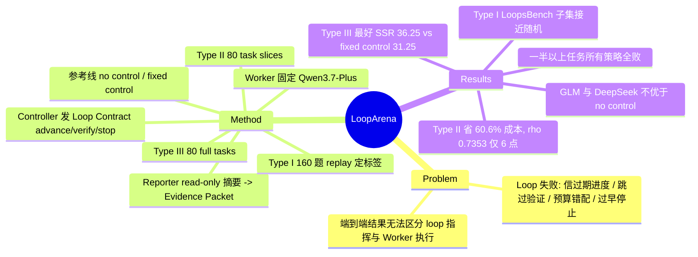

## Summary

LoopArena 把"谁来指挥 coding agent"单独拿出来评测：固定 Worker（Qwen3.7-Plus）、工具、预算与 evaluator，只替换读结构化 Evidence Packet、发 Loop Contract（advance / verify / stop）的 Controller 模型，并给出三档成本的设置：Type I 是 160 道离线四选一题，Type II 是 80 个 task slice，Type III 是对应的 80 个完整任务。在 Type III 上最好的 Controller（GPT-5.5）Strict Success Rate 只有 36.25%，固定复述目标的 fixed control 是 31.25%，6 个 Controller 里有 2 个甚至低于不加控制的 27.50%。Type II 平均省 60.6% 推理成本，与 Type III 的排序 Spearman ρ=0.7353，但只有 6 个 Controller，而且没有报任何置信区间。

## Problem & Motivation

Loop Engineering 的意思是不再手写每一轮 prompt，而是设计一个外层 loop 去监控进度、派活、要求验证、决定何时停。外层 loop 常见的失败有几种：轻信过期的进度说明、该验证时跳过验证、预算花错方向、任务还不安全就提前停。问题在于端到端只看最终结果，分不清成败该算在 loop 的指挥上还是 coding agent 的执行上。已有 coding benchmark（SWE-bench、SCBench、BeyondSWE）评的是整个 agent 系统，Harness-Bench / LoopsBench 比的是 model–harness 组合，process-oriented benchmark 则只评单步行为。LoopArena 换了评测对象：Worker 和执行环境固定，只比较"指挥 Worker 的那个模型"。

## Method

**Harness 结构（§2.2, App. 11.1）**
- **Worker**：唯一有 coding tools 的角色，在每个 segment 内跑原生 ReAct loop，对话在整个 run 中持久保留。
- **Reporter**：每次 handoff 时从 Worker 对话的副本临时创建，模型与 Worker 相同，只能 read-only 查看 workspace。它输出四个字段（task_context_and_constraints / work_history_and_current_state / verification_and_evidence / open_issues_and_uncertainty），并引用对应的 Worker turn；它不做决策，交互也不写回 Worker 对话。
- **Evidence Packet**：harness 把 Reporter 输出和被引用的 Worker turn 确定性地打包，再附上剩余 turn 预算。
- **Controller**（被评测对象）：$c_{i,k}=\pi(x_{i,k},h_{i,k})$，看最新 Packet 和此前的 Packet/Contract 历史，输出 Loop Contract：action ∈ {advance, verify, stop} 加 rationale；advance/verify 时还要给出 goal / context / required_outcomes / prohibited_actions / completion_condition、protected_invariants 和 verification_acceptance_condition。Controller 没有任何 repo 访问权。
- **预算**：每个 Worker episode 上限 600 ReAct turns 或 7,200 s（超时算失败），最多 128 个 control cycle，Controller 单次输出上限 20,480 tokens。

**三档设置（§2.1, §3）**
- **Type III**：80 个完整任务，来源为 SCBench 21 / BeyondSWE 29 / LoopsBench 30，从原始状态开始跑。
- **Type II**：每个完整任务取一个 stage，从准备好的中间 workspace 开始。保留条件是起始 workspace 至少有一项该 stage 的检查不通过，而官方完成态全部通过。evaluator 累计检查到该 stage 为止的所有要求。
- **Type I**：160 题（40/53/67）。在 Controller-guided 轨迹中可恢复的 control point 上，保留历史 Contract，由一个 candidate author 再写 3 个备选，冻结选项与顺序；然后在两套预先声明的 replay schedule（seed S+1e6、S+2e6）下把 4 个候选都执行一遍。winner 的排序规则：先看任务是否成功，再看下游 Controller cycle 数，再看 Worker turn 数。只有两套 schedule 给出同一个唯一 winner 的题才保留。replay 时后续轮次的 continuation Controller 在构建阶段随机抽取。

**参考策略（§4.2, App. 11.4）**
- **No control**：Worker 拿到任务后一路自主跑完。
- **Fixed control**：仿 Codex `/goal`，每个非终止 handoff 一律 proceed 并复述原目标，不调 Reporter 也不调 Controller；Worker 声明完成即结束。

**指标**：Type I 用 Contract Accuracy（无效回答算错，另报 Invalid Rate）；Type II/III 用 SSR，即每个任务跑 K=3 次、在 80×3=240 个 run 上取均值的严格成功率（SCBench 要求所有 Core 检查通过）。成本按冻结的公开价目、无 cache 估算，覆盖 Worker+Reporter+Controller 的全部调用。

## Key Results

**主表（Table 2/3/11，Worker = Qwen3.7-Plus）**

| Policy | Type I Acc | Type II SSR | Type II $/run | Type III SSR | Type III $/run | Type III Worker turns |
|:--|--:|--:|--:|--:|--:|--:|
| No control | — | 49.17 | 1.62 | 27.50 | 2.61 | 136.17 |
| Fixed control | — | 55.00 | 5.62 | 31.25 | 9.47 | 211.14 |
| Qwen3.6-35B-A3B | 43.125 | 55.83 | 4.21 | 33.75 | 11.58 | 224.36 |
| Qwen3.7-Plus | 60.625 | 56.67 | 6.04 | 34.17 | 12.69 | 243.33 |
| DeepSeek-V4-Flash-0731 | 45.625 | 50.83 | 9.88 | 28.33 | 32.66 | 330.58 |
| GLM 5.2 | 54.375 | 40.42 | 3.54 | 24.17 | 11.97 | 189.41 |
| GPT-5.5 | 61.875 | 56.67 | 13.80 | 36.25 | 34.68 | 355.94 |
| Claude Opus 4.8 | 56.250 | 58.75 | 10.88 | 33.75 | 20.63 | 324.09 |

- **完整任务仍然难**：Type III SSR 区间 24.17%–36.25%。最好的 Controller 比 fixed control 高 5 个点（36.25 vs 31.25，折算为 240 个 run 里 87 vs 75 次成功）；GLM 5.2（24.17）和 DeepSeek（28.33）只比 no control（27.50）高不到 1 个点或更低。
- **Controller 自身便宜不代表总成本低**：DeepSeek 作为 Controller 每 run 只花 \$0.15，但总成本 \$32.66，其中 Worker 占 93.53%；Qwen3.7-Plus Controller 花 \$0.23，总成本 \$12.69，SSR 还更高（34.17 vs 28.33）。
- **同样的 SSR 可以对应很不同的执行量**：Qwen3.6-35B-A3B 和 Claude Opus 4.8 都是 81/240，但成本分别为 \$11.58 和 \$20.63，Worker turns 分别为 224.36 和 324.09。
- **Type II 作为廉价代理**：配对成本平均降 60.6%，与 Type III 的 ρ=0.7353；两个设置里都严格有序的 13 对 Controller 中有 2 对顺序反转，另有 2 对出现并列。
- **Type I**：Contract Accuracy 区间 43.125%–61.875%，Invalid Rate 0%–1.875%。最强的 shortcut（多数位置）是 30.625%，随机为 25%，lexical overlap 为 24.375%。
- **分来源看（Table 9/15）**：Type I 在 LoopsBench 子集上所有 Controller 都只有 26.87%–34.33%，接近 25% 的随机水平，GPT-5.5 在这里反而最低（18/67）。Type III 在 BeyondSWE 上所有策略都落在 17–22/87，Controller 之间基本拉不开。GPT-5.5 在 Type III 的领先主要来自 SCBench（16/63，fixed control 是 3/63，no control 是 5/63）。
- **地板效应（Table 14）**：Type III 中 3 次全败的任务，no control / fixed control 各 51 个，Controller 为 44–53 个，即 80 个任务里一半以上对所有策略都是全败。
- **GLM 5.2 的低分有一部分是协议问题**：GLM 在 Type III 有 271/1,849 次响应耗尽 20,480 output tokens；它 361 次耗尽中有 339 次只有 reasoning、没有可见答案，这些都按 protocol failure 计为失败。
- **换 Worker 的检查（Table 12）**：只用 4 个 Controller、20 个任务，把 Worker 换成 DeepSeek-V4-Flash-0731 后排序的 Spearman 为 0.8000（Type II）和 0.7379（Type III）。

## Evidence Ledger

| Claim ID | Claim | Type | Source locator | Evidence excerpt | Status |
|:--|:--|:--|:--|:--|:--|
| C1 | Type I 共 160 题，来源分布为 SCBench 40 / BeyondSWE 53 / LoopsBench 67 | number | Table 1 | "Type I \| 160 \| 40 / 53 / 67" | source-verified |
| C2 | Type II 与 Type III 共用 80 个源任务，来源分布 21/29/30 | number | Table 1; App. 9.1 | "The Type III panel contains 80 unique official tasks: 21 from SCBench, 29 from BeyondSWE, and 30 from LoopsBench." | source-verified |
| C3 | 主实验中所有 Type II/III run 的共享 Worker 为 Qwen3.7-Plus，Reporter 用同一模型配置 | benchmark-setting | §5.1 | "All Type II and Type III runs in the main experiment use Qwen3.7-Plus as the shared Worker; the Reporter uses the same model configuration." | source-verified |
| C4 | 每个策略每个任务独立跑 K=3 次 | benchmark-setting | §4.2; Table 7 | "Every policy is evaluated in K=3 separate runs per task." | source-verified |
| C5 | Type III 上最好的 Strict Success Rate 为 36.25%（GPT-5.5） | number | Abstract; Table 2; §5.2 | "On full tasks, the best observed Strict Success Rate is 36.25%" | source-verified |
| C6 | Type III 上 fixed control SSR 为 31.25%，no control 为 27.50% | number | Table 2 | "Fixed control \| — \| 55.00 \| 5.62 \| 31.25 \| 9.47"；"No control \| — \| 49.17 \| 1.62 \| 27.50 \| 2.61" | source-verified |
| C7 | Type III Controller SSR 区间为 24.17%–36.25%，GLM 5.2 最低 | number | §5.2 | "Type III Strict Success Rate ranges from 24.17% to 36.25%" | source-verified |
| C8 | Type II 上 Claude Opus 4.8 SSR 58.75%，fixed control 55.00% | comparison | §5.2; Table 2 | "Claude Opus 4.8 achieves 58.75% on Type II, compared with 55.00% for fixed control" | source-verified |
| C9 | Type II 相对 Type III 的配对推理成本降幅在各 Controller 上平均为 60.6% | number | Abstract; §5.2 | "the paired Type II reduction in estimated inference cost averages 60.6% relative to Type III" | source-verified |
| C10 | Type II 与 Type III 的 Controller 排序 Spearman ρ=0.7353（Core 标准） | number | Abstract; §5.2 | "its observed Controller ordering is positively correlated with Type III, with ρ=0.7353" | source-verified |
| C11 | 两个设置都严格有序的 13 对 Controller 中有 2 对顺序反转，15 对中有 2 对含并列 | number | §5.2 | "two of the thirteen Controller pairs strictly ordered in both settings reverse order, while two of the fifteen pairs contain a tie" | source-verified |
| C12 | Type III 中 DeepSeek-V4-Flash-0731 的 Controller 调用成本 \$0.15/run，总成本 \$32.66，其中 Worker 占 93.53% | number | §5.2; Table 3 | "lowest estimated Controller-call cost, \$0.15 per run, but a total cost of \$32.66; the Worker accounts for 93.53%" | source-verified |
| C13 | Type III 中 Qwen3.6-35B-A3B 与 Claude Opus 4.8 都是 81/240 成功（33.75%），成本分别为 \$11.58 和 \$20.63 | comparison | §5.2; Table 3 | "both complete 81 of 240 full-task runs, yielding an SSR of 33.75%. Their mean execution costs are \$11.58 and \$20.63" | source-verified |
| C14 | Type III 中 GPT-5.5 的平均 Worker turns 最高（355.94）、SSR 也最高，GLM 5.2 两项都最低 | comparison | §5.2; Table 3 | "GPT-5.5 has both the highest mean Worker-turn count and the highest SSR, while GLM 5.2 has the lowest values" | source-verified |
| C15 | Type I Contract Accuracy 区间 43.125%–61.875%，Invalid Rate 区间 0%–1.875% | number | §5.2; Table 8 | "Contract Accuracy ranges from 43.125% to 61.875%, and Invalid Rate ranges from 0% to 1.875%" | source-verified |
| C16 | Type I 最强的确定性 shortcut（多数位置）准确率 30.625% | number | §5.2; Table 13 | "The strongest deterministic shortcut reaches 30.625%" | source-verified |
| C17 | Type I 在 LoopsBench 子集（67 题）上各 Controller 准确率为 26.87%–34.33%，GPT-5.5 为 18/67 | number | Table 9 | "GPT-5.5 \| 35/40 (87.50) \| 46/53 (86.79) \| 18/67 (26.87)" | source-verified |
| C18 | Type I 正确选项要求两套预声明 replay schedule 给出同一个唯一 winner，排序为成功 > 更少 Controller cycle > 更少 Worker turn | benchmark-setting | §3.3; App. 10.1 | "A candidate becomes the correct option only when it is the same unique winner under both schedules" | source-verified |
| C19 | Type I replay 中后续轮次的 continuation Controller 在构建时随机抽取 | benchmark-setting | App. 10.1 | "For each question, the continuation Controller is randomly selected during benchmark construction." | source-verified |
| C20 | Fixed control 每个非终止 handoff 一律 proceed，不调用 Reporter 和模型 Controller | benchmark-setting | App. 11.4 | "every nonterminal control decision is fixed to proceed; the policy does not inspect the Packet and invokes neither a Reporter nor a model Controller" | source-verified |
| C21 | GLM 5.2 在 Type III 有 271/1,849 次 Controller 响应耗尽 20,480 output tokens；361 次耗尽中 339 次只有 reasoning 无可见答案 | number | App. 14.4 | "GLM 5.2 exhausts this budget in 90/769 Type II responses and 271/1,849 Type III responses" | source-verified |
| C22 | Type III 中 GPT-5.5 在 SCBench 上成功 16/63，fixed control 为 3/63，no control 为 5/63 | comparison | Table 15 | "GPT-5.5 \| 42/63 \| 38/87 \| 56/90 \| 16/63 \| 19/87 \| 52/90" | source-verified |
| C23 | Type III 中 no control 与 fixed control 各有 51/80 个任务三次全败 | number | Table 14 | "No control \| 29, 10, 15, 26 \| 51, 6, 9, 14" | source-verified |
| C24 | 把 Worker 换成 DeepSeek-V4-Flash-0731（4 个 Controller、20 个任务）后，排序 Spearman 为 0.8000（Type II）和 0.7379（Type III） | number | App. 14.3; Table 12 | "Controller rankings have Spearman correlations of 0.8000 in Type II and 0.7379 in Type III" | source-verified |
| C25 | Benchmark 数据与评测代码在 github.com/AMAP-ML/LoopArena 公开 | license-code | Abstract; App. 16 | "We release the benchmark data and evaluation code at https://github.com/AMAP-ML/LoopArena." | source-verified |

## Strengths & Weaknesses

**Strengths**
- **评测对象切得干净**：固定 Worker、工具、预算和 evaluator，只换 Controller，把"指挥能力"从"执行能力"里拆了出来，这是端到端 benchmark 做不到的。Controller 没有任何 repo 访问权，只能通过指令影响结果，归因链条清楚。
- **Type I 的标签由执行结果定，而不是人工判断**：四个候选都实际 replay，并要求两套 seed schedule 得到同一个唯一 winner；候选和顺序在看到结果前就冻结，被拒的题不回头改写。比起 LLM-judge 打分的 process benchmark，这种标签更硬。
- **报告了容易被藏起来的负面数据**：fixed control 和 no control 两条参考线、分来源结果（Table 15）、运行稳定性（Table 14）、GLM 输出预算耗尽、shortcut 分析都在附录里如实给出。很多关键批评其实就是从这些表里读出来的。
- **成本按角色拆开记账**（Table 11），直接说明 Controller 的主要影响在于它让 Worker 多干还是少干，而不在 Controller 自己的调用费用。

**Weaknesses**
- **Controller 带来的收益很小，且没有统计检验**：Type III 最好的 Controller 只比 fixed control 多 12 次成功（87 vs 75 / 240），而 fixed control 每 run \$9.47，GPT-5.5 Controller 是 \$34.68。全文没有 CI、bootstrap 或显著性检验。每个任务只跑 3 次，又有一半以上的任务对所有策略都全败（Table 14），实际起区分作用的任务可能只有二三十个。"Controller 能力决定成败"这个隐含前提，证据其实很薄。
- **Type III 的 Controller 排名主要由 SCBench 一个子集决定**：BeyondSWE 上所有策略都在 17–22/87，LoopsBench 上 fixed control（53/90）高于 GPT-5.5（52/90）和 Claude（49/90）。GPT-5.5 排第一几乎完全靠 SCBench 的 16/63。这说明 benchmark 的区分度集中在少数任务上，跨来源并不一致。
- **Type I 的 LoopsBench 子集接近随机**：67 题（占 42%）上各 Controller 都只有 26.87%–34.33%，最强的 GPT-5.5 在这里排最后。可能的原因有：标签本身噪声大；winner 的排序规则（cycle 少、turn 少）奖励的是"省"而不是"对"；或者标签只反映了随机抽到的那个 continuation Controller 的后续行为（App. 10.1）。论文对此没有分析。整体 Type I 准确率因此混入了大量接近噪声的题。
- **Type II 作为代理的证据不足**：ρ=0.7353 只基于 6 个点（6 个 Controller），在 n=6 时，这个量级的 Spearman 统计上很不稳定。"positively correlated" 的措辞本身没错，但不足以支持"可以用 Type II 代替 Type III 来排模型"。Type I 与 Type III 的排序相关性正文没有报告。
- **GLM 5.2 的低分混进了协议失败**：Type III 中有 271 次响应因 20,480 token 上限只输出 reasoning、没有答案，这测的是"在 token 预算内交出答案"的能力，不是 control 判断本身。GLM 排名垫底的结论需要打折扣。
- **Worker 与 Reporter 同为 Qwen3.7-Plus，存在同族偏置风险**：Qwen3.7-Plus 当 Controller 时与 Worker 同模型，Reporter 的摘要风格也来自同一模型。换 Worker 的检查只用了 4 个 Controller、20 个任务，没有包含 GPT-5.5 和 Claude，不足以排除这个偏置。
- **设定边界**：只覆盖 repository-level coding、单 Worker、结构化 handoff。Controller 只看 Reporter 的摘要，所以 Reporter 的质量是一个没有被消融的混杂变量：Controller 失败可能是因为 Reporter 漏报了信息。

**对领域的意义**：最有信息量的结论其实是负面的。在当前模型上，"自适应外层 loop"相对"每轮复述目标"只有约 5 个点的边际收益，成本却是 2–4 倍。这和 TeamBench 发现的"角色分离/Verifier 收益很小"互相印证。

## Mind Map

## Notes

- [[2608-LongHorizonHarness]]：同属 DreamX Team（Alibaba），共同作者有 Xiangxiang Chu，本文把它引为 LongHorizon-Harness，用 manager–executor–auditor 循环、同样以 Qwen3.7-Plus 为 base 报出大幅提升。LoopArena 在固定 Worker 时只测到 Controller 约 5 个点的边际收益，两者合起来看，提升可能更多来自"audited state / fresh-context executor"这类结构设计，而不是 manager 模型本身的强弱。这是推测，两文没有做同一设置下的对照。
- [[2605-TeamBench]]：结论方向一致。TeamBench 中删掉 Verifier 反而涨分，团队相对 Solo 的全局均值增益不显著；LoopArena 中 fixed control 与最强 Controller 只差 5 个点。两者都指向"多角色/外层控制的价值高度条件化"。
- [[2608-StrongToWeakHarness]]：同样是强模型指导弱执行者，但它让强模型离线构建 harness，而不是在线逐轮发指令。可以组合成一个问题：Controller 的价值应该花在在线决策上，还是花在一次性设计 loop 上？
- 待查问题：Type I 的 LoopsBench 子集为什么接近随机？需要看 release 中 replay 的 continuation Controller 分布，以及 winner tie-break 的触发比例。
