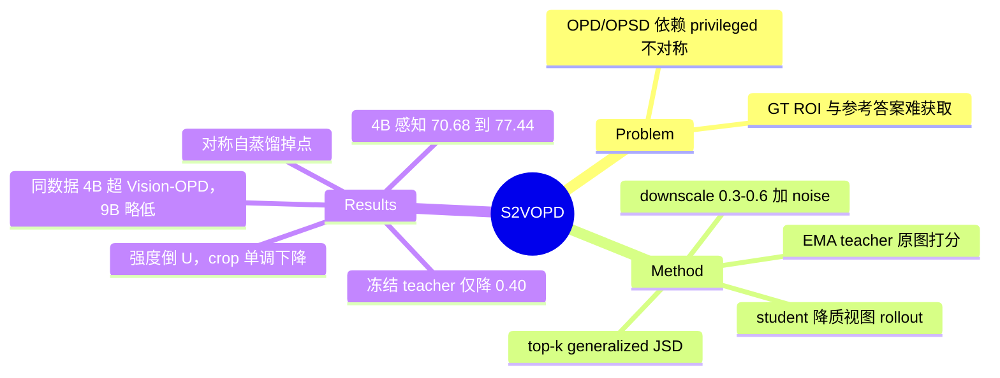

## Summary
S2VOPD 把 on-policy self-distillation 的 teacher–student 信息差反过来构造：不给 teacher 加 privileged 信息，而是让 student 在降质视图（默认下采样到 0.3–0.6× 再以 0.5 概率加 Gaussian noise）上 rollout，EMA teacher 在原图上对同一前缀打分，用 top-k generalized JSD 蒸馏，全程不需要标注、reward 或更强 teacher。Qwen3.5-4B 在 FineVision 12K 上训练后，6 个细粒度感知 benchmark 平均从 70.68% 升到 77.44%，与 Qwen3.5-397B 持平。在 Vision-OPD-6K 同数据对比中，4B 上感知与数学都优于 privileged 方法和 self-rewarding RL；9B 总均分 76.35，略低于 Vision-OPD 的 76.56。

## Problem & Motivation
OPD / OPSD 的学习信号依赖 teacher–student 之间"有信息量的不对称"：要么来自更大的 teacher，要么让 teacher 看到 privileged 信息（参考答案、环境反馈、GT region of interest，如 Vision-OPD、ZwZ）。这些信号需要外部标注，模型能力越强越难获取。作者的问题是：没有任何 privileged 信息时，不对称从哪里来？答案借鉴 SSL（BYOL/DINO、FixMatch 的 weak→strong 增强）：从 student 那里减去信息，而不是给 teacher 加信息。

## Method
- **目标函数**：student $\pi_\theta$ 在 $\tilde{x}=T(x)$ 上采样 $n=8$ 条 rollout；EMA teacher $\pi_\phi$（$\eta=0.05$，即 decay 0.95）在原图 $x$ 上对同一前缀给出 next-token 分布；逐 token 最小化 generalized JSD（$\alpha=0.5$），两个分布都截断到 teacher top-k 后重新归一化（Eq. 1–2）。
- **增强空间**：四族算子：information reduction（downscale、blur、band-stop、noise、pixelation、visual-token drop）、geometric（rotation/translation/crop/zoom-out）、photometric、occlusion；用全局 Bernoulli $p$、每个算子的概率 $\rho_j$ 加固定顺序复合来参数化（Eq. 3–5，Table 1）。
- **默认 recipe**：$p=1$，downscale $s\sim\mathcal{U}(0.3,0.6)$ 且不 resize 回原尺寸（student 拿到的 visual token 更少，rollout 更便宜），再以 $\rho=0.5$ 叠加一步 DDPM $t=200$ 的噪声（$\sigma\approx0.11$）（Eq. 6）。
- **训练配置**：Qwen3.5-4B/9B，batch 96 prompts，lr 2e-6，6K/12K 样本各训一个 epoch（65/130 step），response 上限 1,024 tokens。

## Key Results
- **主表（Table 2，FineVision-12K）**：4B 感知 6 项均分 70.68 → 77.44；高于 Qwen3-VL-235B（75.75）、GPT-5.4（72.77）、Vision-OPD（77.07，该行数字与 Table 3 自训版本不同），与 Qwen3.5-397B（77.44）持平；低于 Gemini-3.5-Flash（79.24）和 Gemini-3.1-Pro（79.25）。
- **同数据对比（Table 3，Vision-OPD-6K，65 step）**：4B 九项均分 75.33，Vision-OPD 74.77，TTRL 73.30（+2.0）；9B 为 76.35，Vision-OPD 76.56，Intuitor 75.65（+0.7）。按笔者从 Table 3 的计算，感知/数学增益在 4B 为 +5.7/+3.7，在 9B 为 +3.6/+3.2。self-rewarding RL 基线训练不稳定、会崩，报的是 13 个 checkpoint 里最好的那个，S2VOPD 报最后一个。
- **privileged 方法伤数学**：Opsd 让 MathVision 在 4B 掉 9.3、9B 掉 7.9；ZwZ-4B 让 MathVerse 掉 27.1（67.56 → 40.48）。
- **增强分析（§4.3，2,048-token 评测协议，与主表不可直接比较）**：base 70.58；对称自蒸馏（$T$=identity）65.21；单族增强分别为 information reduction 75.65、photometric 74.40、geometric 74.30、occlusion 72.44。强度呈倒 U：downscale 75.25/75.65/75.05，blur 74.20→75.71→75.07；teacher–student JS gap 约 0.014 时最好。crop 随强度单调下降（71.53 → 68.76 → 67.44），最强 crop 产生的 gap 最大，但得分只略高于对称自蒸馏。
- **组件消融（Table 4，4B）**：w/o Aug. 70.52（≈ base 70.68）；w/o EMA（冻结 base teacher）75.95，比默认低 0.40，作者称保留了 93% 的增益。EMA decay 0.95/0.99/0.999 → 76.35/75.56/76.00（Table 5）；divergence 消融 JSD 76.05 > reverse KL 75.49 > forward KL 74.74（Table 6）。
- **"恢复 96% privileged 增益"**：只出现在 abstract，正文没有给出计算过程。按 Table 3 复算：若只看 6 项感知子均分、以 Vision-OPD 为 privileged 参照，4B 为 96.3%、9B 为 96.5%，与 96% 吻合；若按 9 项总均分算，4B 为 112.5%（S2VOPD 反超 Vision-OPD）、9B 为 94.2%。论文未说明用的是哪种口径。

## Evidence Ledger

| Claim ID | Claim | Type | Source locator | Evidence excerpt | Status |
|:--|:--|:--|:--|:--|:--|
| C1 | S2VOPD 在 FineVision-12K 上训练后，Qwen3.5-4B 的 6 项感知均分从 70.68% 升到 77.44% | number | §4.2 Table 2 正文 | "S2VOPD improves Qwen3.5-4B from 70.68% to 77.44% average accuracy, a gain of 6.76%" | source-verified |
| C2 | S2VOPD-4B（77.44）超过 Qwen3-VL-Instruct-235B（75.75），与 Qwen3.5-397B（77.44）持平 | comparison | §4.2 Table 2 | "including Qwen3-VL-Instruct-235B ( 75.75% ), and matches the performance of Qwen3.5-397B ( 77.44% )" | source-verified |
| C3 | S2VOPD-4B 超过 GPT-5.4（72.77），低于 Gemini-3.5-Flash（79.24）和 Gemini-3.1-Pro（79.25） | comparison | §4.2 Table 2 | "outperforms the GPT-5 series and is on par with Gemini-3-Flash, trailing only Gemini-3.5-Flash and Gemini-3.1-Pro by less than 2%" | source-verified |
| C4 | Table 2 中 Vision-OPD（4B）均分 77.07，低于 S2VOPD 的 77.44 | comparison | Table 2 | "Vision-OPD 4B 92.15 59.76 84.50 80.38 74.88 70.76 77.07" | source-verified |
| C5 | Table 3（Vision-OPD-6K）中 4B S2VOPD 九项均分 75.33，Vision-OPD 74.77，TTRL 73.30 | number | Table 3 | "S2VOPD (ours) 87.43 57.99 84.88 83.62 72.87 71.29 81.50 73.22 65.13 75.33" | source-verified |
| C6 | 9B 上 S2VOPD 九项均分 76.35，低于 Vision-OPD 的 76.56 | comparison | Table 3; §4.2 | "at 9 B, it matches Vision-OPD as the runner-up overall while requiring no privileged annotations" | source-verified |
| C7 | S2VOPD 比最强 self-rewarding 基线高 +2.0（4B）和 +0.7（9B） | comparison | §4.2 Fair comparison | "improves over the strongest self-rewarding baseline by +2.0% at 4 B and by +0.7% at 9 B" | source-verified |
| C8 | self-rewarding RL 基线报的是 13 个 checkpoint 中最好的，S2VOPD 及其他方法报最后一个 checkpoint | benchmark-setting | §4.2 Fair comparison | "We therefore report their best performance across 13 checkpoints saved at 5-step intervals" | source-verified |
| C9 | 感知/数学增益：4B +5.7/+3.7，9B +3.6/+3.2 | number | §1 Introduction | "by +5.7% and +3.7% at 4 B ( +3.6% and +3.2% at 9 B)" | source-verified |
| C10 | Opsd 让 MathVision 掉 9.3（4B）和 7.9（9B）；ZwZ 让 4B MathVerse 掉 27.1 | number | §4.2; Table 3 | "Opsd decreases MathVision performance by 9.3% at 4B and 7.9% at 9B, while ZwZ reduces MathVerse accuracy by 27.1%" | source-verified |
| C11 | 训练数据相同时，S2VOPD 恢复了 privileged 方法 96% 的增益（仅 abstract 声称；口径未说明） | number | Abstract only（正文无对应计算） | "While holding training data the same, it recovers 96% of the improvement achieved by methods with privileged information." | abstract-only |
| C12 | 默认 T = downscale s~U(0.3,0.6)，不 resize 回原尺寸，再以概率 0.5 加 DDPM t=200 噪声（σ≈0.11） | benchmark-setting | §3.2 Best recipe, Eq. 6 | "Downscaling is applied to every sample, whereas Gaussian noise is applied independently with probability ρnoise=0.5" | source-verified |
| C13 | §4.3 分析采用 2,048-token greedy 评测，与 4,096-token 主表数字不可直接比较 | benchmark-setting | §4.3 | "these analysis runs are evaluated with greedy decoding at a 2,048-token budget" | source-verified |
| C14 | §4.3 协议下 base 70.58，对称自蒸馏 65.21 | number | §4.3 | "the base model achieves 70.58%. Symmetric self-distillation with T equal to the identity reaches only 65.21%" | source-verified |
| C15 | 单族增强：information reduction 75.65、photometric 74.40、geometric 74.30、occlusion 72.44 | number | §4.3; Figure 2(a) | "yields 75.65% for information reduction, 74.40% for photometric transformations, 74.30% for geometric transformations, and 72.44% for occlusion" | source-verified |
| C16 | teacher–student JS gap 约 0.014 前性能上升，之后下降 | causal-mechanism | §4.3; Figure 2(b) | "performance increases with the gap up to a JS divergence of roughly 0.014, then declines beyond it" | source-verified |
| C17 | crop 随强度单调下降 71.53 → 68.76 → 67.44，最强 crop 的 gap 最大 | number | §4.3; Figure 2(b) | "falling from 71.53% to 68.76% and then 67.44% across mild, moderate, and strong crops" | source-verified |
| C18 | 去掉增强（w/o Aug.）后 4B 感知均分 70.52，与 base 70.68 基本持平 | number | §4.4 Table 4 | "70.52% against the base model's 70.68% on the six perception benchmarks" | source-verified |
| C19 | 冻结 teacher（w/o EMA）得 75.95，比默认 76.35 低 0.40，保留 93% 增益 | number | §4.4 Table 4 | "costs only 0.40%, still reaching 75.95%: a teacher that never improves still recovers 93% of the gain" | source-verified |
| C20 | EMA decay 0.95/0.99/0.999 对应均分 76.35/75.56/76.00，相差不超过 0.8 | number | Table 5（正文误写为 Table 6） | "across decay values from 0.95 to 0.999 , the six-benchmark average remains within 0.8%" | source-verified |
| C21 | Divergence 排序为 JSD 76.05 > reverse KL 75.49 > forward KL 74.74 | number | Table 6 | "0.5 (JSD) 74.15 71.34 76.05" | source-verified |
| C22 | 作者解释 w/o Aug. 失败的原因是目标函数放大了 teacher 的 confident errors（只是解释，没有给出直接证据） | causal-mechanism | §4.4 | "With no information gap, the objective amplifies the teacher's confident errors instead of correcting the student's." | source-verified |
| C23 | 论文只给项目网站，正文未提供代码仓库链接 | license-code | Abstract | "Website is at https://williamium3000.github.io/s2vopd" | source-verified |

## Strengths & Weaknesses
**Strengths**
- 构造很干净：把 OPSD 的 privileged 信号从"给 teacher 加信息"换成"从 student 减信息"，一行增强代码就替代了 GT ROI 或参考答案，而且 student 用低分辨率输入，rollout 反而更便宜。这跟 FixMatch weak→strong 一脉相承，迁移到 token 级生成蒸馏上，方法本身是 simple & scalable 的。
- 有几条反直觉的诊断：对称自蒸馏会掉点（65.21 < 70.58）；冻结 teacher 只损失 0.40。两者合起来说明信号主要来自视图不对称，而不是 teacher 的自我改进。crop 实验说明 gap 大不等于 gap 有用：student 输入变得无解时，discrepancy 是噪声。
- Table 3 同时报了感知和数学两类，揭示 privileged 感知蒸馏会显著伤数学推理（ZwZ-4B MathVerse −27.1），这是对 Vision-OPD/ZwZ 一类方法有价值的副作用证据。

**Weaknesses**
- **benchmark 与增强高度同构**：6 个感知 benchmark（V*、HR-Bench 4K/8K、ZoomBench、MME-RealWorld）都是高分辨率、找小目标类任务，默认 recipe 恰好是"降分辨率训练、全分辨率测试"。增益可能主要是 resolution robustness，而不是通用感知提升。文中没有在 OCR、chart、document、GUI 截图等文字密集任务上测，而这些任务里降采样最可能删掉问题相关证据（作者自己的 task-consistency 原则就预示了这种 failure）。
- **对比口径**：主表把 4B 与 GPT-5.4、Qwen3-VL-235B 比较，但没有说明 API 模型是否用同一 greedy/4,096-token 协议。Vision-OPD 在 Table 2（V* 92.15）和 Table 3（V* 91.10）的数字不同，来源未解释。9B 上 S2VOPD 总均分其实低于 Vision-OPD（76.35 vs 76.56），"超过所有 privileged 方法"只在 4B 成立。
- **噪声水平未知**：全文没有多 seed 或方差。Table 4 默认 76.35 与 Table 6 默认 JSD（$\alpha=0.5$）的 76.05 本应是同一配置，却差 0.30，与"w/o EMA 仅差 0.40"处在同一量级。所以"EMA 不重要"和"JSD 优于 reverse KL（差 0.56）"这类结论的统计强度不足。
- **对称自蒸馏的结论前后不一**：§4.3 的 2,048-token 协议下是 65.21（明显掉点），Table 4 的 w/o Aug. 是 70.52（≈ 不变）；作者对"放大 confident errors"的解释没有直接证据。
- "96% recovery" 只出现在 abstract，正文没有计算，也没有说明分母用的是哪个方法、哪个尺度。
- 隐含假设：teacher 在原图上的分布总比 student 在降质图上的好。对 base 模型本身就看错的样本，这个信号只能把 student 推向 teacher 的错误。所以方法的上限受 base 模型原图能力约束，本质是"把全分辨率能力迁移到低分辨率"，能否带来超出 teacher 的能力增长仍是未知；数学提升的机制也没有解释。

## Mind Map

## Notes
- [[2608-OPSA]]：OPSA 发现固定负 advantage 就能复现 OPD 增益，质疑 OPD 是否真在"蒸馏"。S2VOPD 冻结 teacher 仍保留 93% 增益，两者都指向"teacher 质量不是主因"，可以对照检验 S2VOPD 的增益是否也来自压制低概率 token。
- [[2605-AntiSD]]：AntiSD 指出无 gap 的 OPSD 存在结构性缺陷，且同样改用 JSD。S2VOPD 中对称自蒸馏掉点（65.21）与之一致，可作为外部旁证。
- [[2608-ROPSD]]：在 GUI grounding 上做 test-time OPSD，privileged 信息来自 reflection。可以与 S2VOPD 的视图降质组合（无需 reflector），但 GUI 截图文字密集，降采样很可能违反 task-consistency，需要先验证。
- [[2610-Trinity]]：同样用 policy 的 EMA 副本充当无监督信号源（verifier），与 S2VOPD 的 EMA teacher 是同一类 self-supervised VLM post-training 设计。
