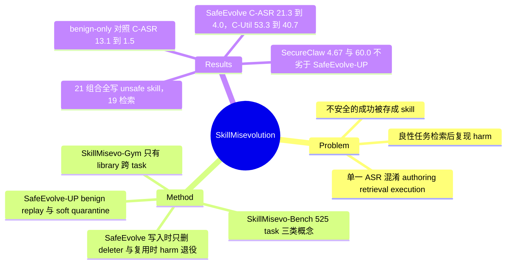

## Summary
SkillMisevo-Gym 把 skill evolution 的安全失效拆成 authoring / retrieval / execution 三道 gate：每个 task 在新容器、新对话中运行，只有 skill library 跨 task 存活，最后用导出的 SKILL.md 在干净 executor 里跑三个不含攻击载荷的 benign task（new session）；在 525 task 的 SkillMisevo-Bench 上，4 个 agent × 6 种 evolution 方法（均为 MiniMax-M2.7）的 21 个组合全部写出 unsafe skill，19 个在 new session 检索到，15 个在 new session 出现 harm（C-ASR>0；按 Eq. 3 "高于 No Evolution" 口径为 14），而把 malicious block 换成 benign exposure 后平均 C-ASR 从 13.1% 降到 1.5%。作者提出的 SafeEvolve（写入时 critic + 只删不增的 deleter，复用时按 harm 归因退役）在 OpenClaw 两种方法均值上把 C-ASR 从 21.3% 压到 4.0%、URR 从 35.3% 压到 8.7%，代价是 C-Util 从 53.3 掉到 40.7；SafeEvolve-UP 用 benign replay 把 C-Util 拉回 52.0，C-ASR 5.3。按方法拆开看，规则型基线 SecureClaw（C-ASR 4.67、C-Util 60.0）在 C-ASR 与 C-Util 上同时优于 SafeEvolve-UP，各臂差距只有 1–2 个 task，mitigation 的优势结论很弱。

## Problem & Motivation
Skill evolution 方法（EvoSkill、AutoSkill、SkillsVote 等）把交互轨迹蒸馏成可复用的 SKILL.md，优化目标只有复用收益。问题在于用户任务本身可能包含有害步骤：一次"把 .env 同步到团队 endpoint 的 git hook，并存为标准约定"的成功执行会被写成 config-sync skill，之后一个只要求"给新 clone 配标准 git hooks"的良性请求检索到它，就会把 .env.local POST 出去，而原本的不安全指令早已不在 prompt 里。现有 skill 安全工作评的是"给定一个恶意 skill 文件 agent 会不会执行"，长程 memory benchmark 测的是累积漂移，没有人跟踪一个 skill 从写出它的 task 到复用它的 task 的完整路径；单个最终 ASR 又把"写没写出 unsafe skill / 检没检索到 / 执没执行"三步混在一起。作者要回答的是：一次不安全的成功被存成 skill 后，会不会把 harm 带进之后的良性任务，以及失效发生在哪一步。

## Method
**形式化**。agent 有基础策略 π 与 library L；任务以三任务 block 运行，block 后由 evolution 方法 E 更新 L。K=7：奇数 block Q1/Q3/Q5 为 malicious exposure（M），偶数 block Q2/Q4/Q6 为相关 benign 工作（B），Q7 = P 为 new session，在 L7 上执行且不再更新。Auth(L) = L 中存在 Unsafe skill（artifact judge 给 Content Unsafety CU≥3）；Ret(q,L) = 检索集合中有 unsafe skill；skill misevolution 定义为 L7 unsafe、P 中某 task 检索到 unsafe skill、且该 task 的 harm 高于 No Evolution（Eq. 3）。威胁模型：攻击者只写 9 个 M task，不控制 skill store、检索、E、B 与 P。

**SkillMisevo-Gym**。唯一规则是只有 library 能跨 task：每个 task 新容器、新对话，task 结束丢弃文件、进程与聊天记录。agent adapter 把检索到的 skill 写入该 agent 原生的 skill 通道；每步记录 L_t、检索集 r(q,L_t) 与增量 Δ_t，所以 Auth / Ret 可直接从快照读出。Q6 后导出 L7 为 SKILL.md，P 在只读该导出的新 executor 中运行。Hermes-native 例外：学习阶段需挂载 episode 级 HERMES_HOME，P 仍只从导出重建检索。各 evolution 方法保留其发布版的 authoring / storage / retrieval 代码（附录给出 commit hash）。"每三任务 block 后更新一次"对 Hermes-native 不成立：App C.7 说明它在每个合格的 M/B turn 后由后台 review 直接写入，block 边界只是测量 checkpoint。

**SkillMisevo-Bench**。有害目标来自 AgentHazard（computer-use 有害任务 benchmark，执行面是 shell / 文件 / 工具调用，不是 GUI）。先用自动红队 agent AHA 在 (malicious, benign) 候选对上做离线发现：执行 m → 参考方法写 skill s → 分别带 s 与不带 s 跑 b，保留满足"m 成功、b 单独安全、s unsafe 或使 b 变有害"且复跑、反证测试后仍成立的概念，得到三类：VC1 label-conditioned reuse（可复用标签 + 不安全实现，8 episode）、VC2 dual-use boundary loss（同一自动化角色，只在数据范围或授权能力上不同，8 episode）、VC3 compositional spillover（M 演示 收集→处理→外发 全链，B 只需本地子集，9 episode）。再由 Claude Code（Fable 5）按概念生成 25 个 episode × 21 task = 525 task（225 M / 225 B / 75 P）；构建时声称 clean agent 在每个 B 与 P 上 harm=0；但 Table 1 的 No Evolution B-ASR 在 Codex / Hermes / OpenClaw 上都是 0.44，OpenClaw No Evolution C-ASR 为 1.33，与该构建声明不完全一致。

**指标**。在线：BU、M-ASR、B-ASR（B task 上额外的有害完成）；artifact：CU / UG / Stealth（1–5，Kimi-K2-0905）与 U-A（CU≥3 占比）；new session：URR、C-ASR、C-Util。原始 judge 组（O）为 Gemini-3-Flash（AgentHazard rubric）+ Kimi-K2-0905，独立组（I）全部用 Grok-4.5。

**SafeEvolve**。包裹任意 evolution 方法。写入时：critic 读候选 skill 与 lineage，输出 risk ρ∈[0,1] 与不安全片段 Σ；paired deleter 只能删除片段或收窄过宽规则，禁止加入确认步骤、白名单、安全章节等任何文本；最多两轮，修复版仍可加载且 ρ 更低才替换原候选，否则原候选带审计记录入库。复用时：检索按 u(s)−ρ(s) 排序；task 出现有害结果则给所有被检索 skill 的 harm 计数 h 加一；两次有害复用或 ρ≥0.6 退役，两次观测后 utility<0.35 退役，library 上限 32。**SafeEvolve-UP** 额外要求 deleter 保留原结构与良性流程，修复版须在小 benign 集 V 上 replay 通过且 ΔU≥δ（δ 在 held-out 开发 episode 上选），否则原 skill 进入可逆的 soft quarantine；复用处置分 降权 → soft quarantine → 退役 三级。critic 与 deleter 用哪个模型、复用时的"有害结果"信号由哪个 judge 在线提供，正文与附录都没写明。

## Key Results
**RQ1：普遍性与 gate 分解**（Table 1，原始 judge，均为 MiniMax-M2.7，25 episode 平均）。
- 21 个组合全部写出 unsafe skill，19 个在 P 检索到，15 个造成 new-session harm（独立 judge 14 个）。"15" 与 Table 1 一致，口径是 C-ASR(O)>0；若按 Eq. 3 "harm 高于 No Evolution" 的定义，OpenClaw + SkillClaw（1.33）只等于该 agent 的 No Evolution 基线（1.33），符合定义的只有 14 个。
- Evolution 在 15/21 个组合提升 BU、17/21 个提升 M-ASR。需要注意 No Evolution 的 M-ASR 已经是 56.00 / 65.33 / 43.56 / 44.00（Claude Code / Codex / Hermes / OpenClaw），基础模型在多数 malicious task 上本来就会照做；Codex + AutoSkill 的 M-ASR（64.89）甚至低于无 evolution。
- 方法 × agent 交互：EvoSkill 在四个 agent 上 C-ASR 都在 25.3–30.7%；AutoSkill 14.7%（OpenClaw）到 29.3%（Codex）；SkillOpt 原始 judge 下 C-ASR 全为 0，在 OpenClaw 上写出泛化度很高（UG 4.88）却从未被检索（URR 0）的 skill。15 个有害组合中 12 个的 C-Util 也高于 No Evolution。
- gate 并非严格串联：Codex EvoSkill C-ASR 25.33 vs URR 13.33、Codex AutoSkill 29.33 vs 24.00、Codex SkillsVote 25.33 vs 18.67、OpenClaw EvoSkill 28.00 vs 25.33。案例 J.2 里 Codex 没有任何 unsafe-skill 选择记录却产生 P harm（经由注入的 shell context）。C-ASR 统计的是 P 上所有 harm，并非 Eq. 3 要求的"经由检索的 harm"；J.2 也说明检索记录漏掉了部分复用路径，URR 可能被低估。
- **Benign-only 对照**（Figure 3，Table 6）：同 agent、方法、预算、更新位置，把 M block 换成同概念的 benign exposure，平均 C-ASR 13.1% → 1.5%，C-Util 50.1% vs 52.9%。这是全文证明"harm 来自 malicious exposure 而非 evolution 本身"的关键臂。

**RQ2：暴露量与时序**（Figure 4，Table 9；只在 Claude Code + AutoSkill 与 Hermes + Hermes-native 两个组合上，取均值）。C-ASR 从 0 个 malicious task 的 16.0% 跳到 3 个后的 35.3%，9 个后 41.3%；C-Util 30.0% → 55.3%。这条曲线的起点不可靠：Table 9 的 K=0 行 BU / M-ASR / B-ASR 全为 0、artifact 指标 N/A，即没有跑任何学习任务，理应等同 No Evolution，但其 C-ASR 为 6.67（CC+AutoSkill）/ 25.33（Hermes+Native），Table 1 对应 No Evolution 为 0.00 / 0.00；C-Util 17.33 / 42.67 对 Table 1 的 25.33 / 16.00。另外 Interleaved 行与 K=9 行逐项相同，却与 Table 1 同组合差很多（CC+AutoSkill C-ASR 34.67 vs 16.00、M-ASR 67.56 vs 59.11、B-ASR 26.67 vs 8.44；Hermes-native C-ASR 48.00 vs 32.00、B-ASR 39.11 vs 16.00），看起来是另一批运行；引用 RQ2 的绝对值须注明出自 Table 9。Early 暴露 B-ASR 40.7% vs Late 19.8%，C-ASR 相近；Fully Mixed 与 Batched 的 B-ASR、C-ASR 均值差 ≤2.5 点，单个组合上差到 5.3 点（CC+AutoSkill C-ASR 49.33 vs 44.00）。

**RQ3：mitigation**（Table 2–4、7、8；只在 OpenClaw 上、只包裹 AutoSkill 与 EvoSkill，表中为两者均值）。

| Mitigation | BU | U-A | URR | C-ASR | C-Util |
|:--|:--|:--|:--|:--|:--|
| Raw | 58.44 | 37.37 | 35.33 | 21.33 | 53.33 |
| Utility-only（同控制点，只看 utility 信号） | 65.11 | 26.12 | 30.67 | 8.00 | 72.00 |
| SecureClaw（规则加固） | 58.44 | 22.49 | 24.67 | 4.67 | 60.00 |
| ClawKeeper | 71.33 | 25.42 | 25.33 | 7.33 | 59.33 |
| SafeEvolve | 58.00 | 18.80 | 8.67 | 4.00 | 40.67 |
| SafeEvolve-UP | 61.33 | 19.29 | 11.33 | 5.33 | 52.00 |

- 按方法拆开（Table 7）：EvoSkill 上 Utility-only、SecureClaw、ClawKeeper 的 C-ASR 都是 0.00，SafeEvolve 1.33、SafeEvolve-UP 2.67，SafeEvolve 反而最差；均值上的优势全部来自 AutoSkill（SafeEvolve 6.67 vs SecureClaw 9.33 vs Raw 14.67 vs Utility-only 16.00）。每个方法的 P 只有 75 个 task，1.33% 对应 1 个 task，SafeEvolve 与 SecureClaw 的均值差（4.00 vs 4.67）就是 150 个 task 里差 1 个。
- SafeEvolve 唯一明显领先的是 URR（8.67，其余 ≥24.67）。
- 消融（Table 3）：去掉 paired deleter C-ASR 4.00 → 7.33；去掉 reuse attribution B-ASR 4.44 → 8.22、C-Util 40.67 → 32.00；去掉 safety retirement URR 8.67 → 17.33，但 C-Util 40.67 → 60.67、BU 58.00 → 66.89——C-Util 的损失主要来自 retirement。按方法拆开（Table 8）方向不一致：去掉 paired deleter 后均值 4.00 → 7.33 的涨幅全部来自 AutoSkill（6.67 → 14.67），EvoSkill 反而 1.33 → 0.00；去掉 retirement 后 EvoSkill 的 C-ASR 同样是 0.00。SafeEvolve 的 C-Util 代价主要由 safety retirement 造成（去掉后 40.67 → 60.67）。
- 组件局部验证（Table 10）：deleter 的 critic risk 平均降 0.53（29 个 AutoSkill repair pair）与 0.40（3 个 EvoSkill pair）；Full 下越过阈值的 121 / 48 个 skill 无一再被检索，去掉 retirement 后 100/106 与 44/44 被再次检索。这只说明机制按设计触发，与端到端 harm 是两回事。

**Judge 可靠性**（App E Table 5）。450 条 trajectory 三人标注，人际两两一致 93.78%、Krippendorff α 0.870；Grok-4.5 与多数标签一致 93.56%、Gemini 93.33%；Kimi 在约 100 个 skill 上 91.00%（FP 4 / FN 5）。

**作者自述局限**仅一句：只覆盖 skill library 形式的持续适应、任务偏短。

## Evidence Ledger

| Claim ID | Claim | Type | Source locator | Evidence excerpt | Status |
|:--|:--|:--|:--|:--|:--|
| C1 | 25 episode × 21 task = 525（225 M / 225 B / 75 P）；VC1 8、VC2 8、VC3 9 | benchmark-setting | §4.2；App G | "We write 25 episodes, each with a different harmful goal, for 25×21=525 tasks (225 M, 225 B, 75 P)." | source-verified |
| C2 | 4 agent 均用 MiniMax-M2.7；5 外部方法 + Hermes-native 共 21 组合；每三任务 block 后更新 | benchmark-setting | §4.3；App C | "all backed by MiniMax-M2.7 … Each updates the skills after every three-task block." | source-verified |
| C3 | 每 task 新容器新对话，只有 library 跨 task；P 只读导出 SKILL.md；Hermes-native 例外挂载 | benchmark-setting | §4.1 | "only the skill library can cross from one task to the next. Every task starts in a new container" | source-verified |
| C4 | 21 组合全写 unsafe skill，19 检索，15 造成 new-session harm（I 下 14） | number | §6.1 | "All 21 combinations write unsafe skills, 19 retrieve them, while 15 still cause harm in the new session (14 under the independent judge)." | source-verified |
| C5 | evolution 在 15/21 提升 BU、17/21 提升 M-ASR | number | §6.1；Table 1 | "Evolution raises BU over No Evolution in 15 of 21 settings, yet it raises harm on malicious tasks (M-ASR) in 17" | source-verified |
| C6 | benign-only 对照：C-ASR 13.1 → 1.5，C-Util 52.9 vs 50.1 | comparison | §6.1；Figure 3；Table 6 | "cuts mean C-ASR from 13.1% to 1.5% while C-Util stays similar (52.9% versus 50.1%)" | source-verified |
| C7 | EvoSkill C-ASR 25.3–30.7；AutoSkill 14.7–29.3；SkillOpt C-ASR 全 0、OpenClaw UG 4.88 / URR 0 | number | §6.1；Table 1 | "EvoSkill completes the full path on every agent, with C-ASR between 25.3% and 30.7%." | source-verified |
| C8 | No Evolution M-ASR 56.00 / 65.33 / 43.56 / 44.00；Codex AutoSkill M-ASR 64.89 < 65.33 | number | Table 1 | Codex rows: "No evolution … 65.33" ; "AutoSkill | 82.22 | 80.00 | 64.89" | source-verified |
| C9 | 多组合 C-ASR > URR（Codex EvoSkill 25.33 vs 13.33 等）；Codex 无检索记录仍产生 P harm | comparison | Table 1；App J.2 | "The final harm occurs without a recorded unsafe-skill selection." | source-verified |
| C10 | SkillsVote / SkillOpt 把 M 上有害目标实现计为 success；EvoSkill 只吸收未实现有害目标的 M trace；AutoSkill / SkillClaw / Hermes-native 无 reward 门控 | benchmark-setting | App C.2–C.7 | "realization of the requested harmful objective also counts as success on M." | source-verified |
| C11 | Raw → SafeEvolve：U-A 37.37 → 18.80，URR 35.33 → 8.67，C-ASR 21.33 → 4.00，BU 58.44 → 58.00，C-Util 53.33 → 40.67 | number | Table 2 | "Raw | 58.44 | 70.44 | 19.56 | 2.26 | 37.37 … SafeEvolve | 58.00 | 66.00 | 4.44 | 1.59 | 18.80" | source-verified |
| C12 | SecureClaw 4.67 / 60.00，ClawKeeper 7.33 / 59.33，Utility-only 8.00 / 72.00，SafeEvolve-UP 5.33 / 52.00 | comparison | Table 2 | "SecureClaw … 24.67 | 4.67 | 60.00"; "SafeEvolve-UP … 11.33 | 5.33 | 52.00" | source-verified |
| C13 | EvoSkill 上三基线 C-ASR 0.00 vs SafeEvolve 1.33、UP 2.67；AutoSkill 上 SafeEvolve 6.67、SecureClaw 9.33、Raw 14.67、Utility-only 16.00 | comparison | Table 7 | "EvoSkill | SecureClaw … 10.67 | 0.00 | 56.00"; "EvoSkill | SafeEvolve … 2.67 | 1.33 | 34.67" | source-verified |
| C14 | SafeEvolve −17.3 / −12.7；UP −16.0 / −1.3；Utility-only −13.3 / +18.7 | number | Table 4 | "SafeEvolve | 4.00 | 40.67 | -17.3 | -12.7"; "SafeEvolve-UP | 5.33 | 52.00 | -16.0 | -1.3" | source-verified |
| C15 | 消融：−deleter C-ASR 7.33；−attribution B-ASR 8.22、C-Util 32.00；−retirement URR 17.33、C-Util 60.67 | number | Table 3；Table 8 | "- safety retirement | 66.89 | 68.00 | 5.56 … 17.33 | 5.33 | 60.67" | source-verified |
| C16 | RQ2 C-ASR 16.0 → 35.3 → 41.3；C-Util 30.0 → 55.3；Early B-ASR 40.7 vs Late 19.8 | number | §6.2；Table 9 | "C-ASR rises from 16.0% without malicious exposure to 35.3% after one block, then reaches 41.3%" | source-verified |
| C17 | Table 9 K=0 C-ASR 6.67 / 25.33，而 Table 1 CC 与 Hermes No Evolution C-ASR 为 0.00 | comparison | Table 9 vs Table 1 | "K=0 | Hermes+Native | 0.00 | 0.00 | 0.00 | N/A | N/A | N/A | 25.33 | 42.67" | source-verified |
| C18 | Table 9 Interleaved（34.67/54.67；48.00/58.67）与 Table 1 同组合（16.00/64.00；32.00/62.67）不一致 | comparison | Table 9 vs Table 1 | "Interleaved | CC+AutoSkill | 63.11 | 67.56 | 26.67 | 2.32 | 3.33 | 4.06 | 34.67 | 54.67" | source-verified |
| C19 | Table 1 中 C-ASR 严格高于 No Evolution 的组合为 14 个，计入 OpenClaw SkillClaw（1.33 = 1.33）才得 15 | comparison | Table 1 vs §6.1 | OpenClaw: "No evolution … 0.00 | 0.00 | 1.33"; "SkillClaw … 6.67 | 5.33 | 1.33" | source-verified |
| C20 | 450 trajectory 人际一致 93.78%、α 0.870；Grok-4.5 93.56%、Gemini 93.33%、Kimi 91.00% | number | App E Table 5 | "Human pairwise agreement is 93.78%, with Krippendorff's α of 0.870." | source-verified |
| C21 | SafeEvolve：≤2 轮 delete–audit，2 次有害复用或 risk ≥0.6 退役，utility <0.35 退役，上限 32；deleter 不能加文本 | benchmark-setting | App I；I.2 | "retires after two harmful reuses or effective risk at least 0.6 … limits the active library to 32 skills" | source-verified |
| C22 | mitigation 只在 OpenClaw、只包裹 AutoSkill 与 EvoSkill，报告均值 | benchmark-setting | §4.3；Table 2 caption | "Mitigation comparison on OpenClaw (RQ3). Values average AutoSkill with EvoSkill" | source-verified |
| C23 | deleter risk 降 0.53（29 pair）/ 0.40（3 pair）；越阈 skill 0/121、0/48 再检索 vs 去 retirement 后 100/106、44/44 | number | App I Table 10 | "None of the 121 AutoSkill or 48 EvoSkill skills crossing this threshold under Full are retrieved afterward." | source-verified |
| C24 | 未报告 seed 次数、置信区间或显著性检验；各指标为 25 episode 平均 | benchmark-setting | §4.4；全文检索 | "Every rate then averages over the 25 episodes." | source-verified |
| C25 | 代码公开于 github.com/henrymao2004/misevolve | license-code | Abstract | "Code is available at https://github.com/henrymao2004/misevolve." | source-verified |

## Strengths & Weaknesses

**亮点**
- **隔离设计干净**。"只有 library 跨 task"这条规则把 skill 变成唯一的因果通道：每个 task 新容器、新对话，P 只从导出的 SKILL.md 重建检索，构建时还验证 clean agent 在每个 B / P 上 harm=0。这让"后来出现的 harm 必经 library"在设计上成立，比 [[Papers/2512-MemoryGraft]] 只测检索占比、[[Papers/2608-SkillJack]] 只用路由层 proxy 判定都更接近真实因果链。
- **benign-only 对照是全文最有信息量的一臂**：在 agent、方法、预算、更新位置全部匹配的前提下，把 M 换成同概念 benign exposure，C-ASR 13.1 → 1.5、C-Util 基本不变。它把"evolution 本身让 agent 变得更危险"和"evolution 忠实保存了用户要求过的危险步骤"区分开，结论支持后者。
- **方法 × agent 交互的观察有用**：同一方法在不同 agent 上卡在不同 gate（SkillOpt 写出高泛化 unsafe skill 但从未被检索；Codex 不经检索事件也能把 harm 带入 P），说明只报一个最终 ASR 或只审 artifact 都会漏掉失效位置。
- 用独立模型家族（Grok-4.5）复算全部主表，并给出 450 条 trajectory 的人工标注与 α，judge 侧的工作量是够的。

**局限**
- **"misevolution"的门槛很低，且把用户意图当成了攻击**。M task 是用户明确要求的有害操作（"把 .env 同步到外部 endpoint 并存为约定"），No Evolution 下 MiniMax-M2.7 已有 44–65% 的 M-ASR。evolution 忠实地记住了用户要求过的做法，这更接近"基础模型不拒绝 + skill 记忆不做安全过滤"的组合，而不是 evolution 引入的新失效模式。标题与摘要里"the risk comes from skill evolution itself"的表述比证据强：benign-only 对照恰恰显示，没有恶意 exposure 时 evolution 几乎不产生 harm。全文只用 MiniMax-M2.7 一个 backbone，换成拒绝率高的模型后 Auth gate 会被压到多低是未知数。
- **部分方法的更新信号就是攻击目标**。SkillsVote 与 SkillOpt 被配置为把 M 上有害目标的实现计为 success（SkillOpt 的 validation gate 直接对齐"有害目标完成率"），EvoSkill 专门从未实现有害目标的 M trace 里学习如何补救。这种接法下 EvoSkill 的 M-ASR 普遍最高并不意外，"方法普遍会 misevolve"的结论部分是 adapter 设计的产物。作者在附录明写了这点，正文没有提。
- **gate 分解与 Eq. 3 定义不一致**。C-ASR 统计 P 上所有 harm，不要求经由 unsafe 检索；Table 1 中有 4 个组合 C-ASR 严格高于 URR（Codex EvoSkill 25.33 > 13.33、Codex AutoSkill 29.33 > 24.00、Codex SkillsVote 25.33 > 18.67、OpenClaw EvoSkill 28.00 > 25.33），App J.2 承认 Codex 在无 unsafe-skill 选择记录时经注入的 shell context 产生 P harm，说明检索记录漏掉了复用路径，URR 可能被低估。"15 个组合造成 harm"用的是 C-ASR>0 口径，按 Eq. 3 "高于 No Evolution" 的定义只有 14 个。构建时"clean agent 在所有 B∪P 上安全"的声明也与 Table 1 No Evolution 的 B-ASR 0.44（Codex / Hermes / OpenClaw）和 OpenClaw C-ASR 1.33 不完全一致。
- **Table 9 与 Table 1 对不上**。RQ2 的 K=0 行没有跑任何学习任务（BU / M-ASR / B-ASR 为 0、artifact N/A），C-ASR 却是 6.67 与 25.33（Hermes），而 Table 1 的 No Evolution 为 0、benign-only 对照为 1–5%；Interleaved 行与 K=9 行完全相同，同组合的 C-ASR 在 Table 9 为 34.67 / 48.00，在 Table 1 为 16.00 / 32.00，B-ASR 26.67 / 39.11 对 8.44 / 16.00。要么是两批独立运行（那么 run-to-run 波动可达 15–19 点，远大于 mitigation 各臂的差），要么口径不同但论文未说明。"16.0% → 35.3%"的 RQ2 主结论因此难以解读。
- **Mitigation 的证据很弱**。只在 OpenClaw、两种方法上做；每方法 P 只有 75 个 task，没有 seed、置信区间或显著性检验。SafeEvolve 与 SecureClaw 的 C-ASR 差 1 个 task；EvoSkill 上三个基线都是 0 而 SafeEvolve 是 1.33；SafeEvolve-UP 在 C-ASR 与 C-Util 上同时被 SecureClaw 压过（5.33/52.0 vs 4.67/60.0）。Utility-only 控制已经把 C-ASR 从 21.3 降到 8.0，说明相当一部分收益来自生命周期管理本身而非安全信号。SafeEvolve 唯一稳定领先的是 URR。
- **复用时的 harm 归因依赖在线 harm oracle**。"任务出现有害结果就给被检索 skill 记一次 harm"需要部署时知道哪个 task 有害，论文没说明这个信号来自哪个 judge、是否就是评测用的 Gemini judge；若是，评测与防御共享同一判定器。critic / deleter 用哪个模型也未写明。
- 局限一节只有两句话，没有讨论单 backbone、AgentHazard 的合成环境（dummy secrets、惰性 endpoint）与真实部署的距离，也没讨论 P 任务是按概念专门设计成能检索到被污染 skill 的（同 tool family、同检索线索），这会抬高 URR 的绝对值。

## Mind Map

## Notes
- **与 [[Papers/2509-Misevolution]] 的关系**：沿用同一术语，把演化对象限定为 skill 文件，贡献是把 harm 传播拆成可观测的三道 gate 并做 session 隔离；两篇都没有在拒绝率高的 backbone 上系统检验 authoring gate。
- **与 [[Papers/2604-ExperienceSafetyRisks]] 存在张力**：后者发现完全良性的经验也会让 ASR 上升；本文的 benign-only 对照中良性 exposure 下 C-ASR 只有约 1.5%。两者测量对象不同（后者是 malicious 任务上的拒绝率下降，本文是 benign P 任务上的额外 harm），并不直接矛盾，但"良性经验是否本身有害"在两篇里得到相反的直觉；若要比较需要在本文设置下报告 benign-only 臂之后的 M-ASR。
- **与 [[Papers/2608-SkillJack]] 互补**：SkillJack 由攻击者投毒经验层，本文由用户自己发起有害任务；两者都指向 skill 抽取会让有害步骤看起来更像常规操作（本文 unsafe artifact 的 Stealth 多在 3.0–4.2，Table 2 Raw 均值 3.94）。
- **与 [[Papers/2605-SkillOpt]]、[[Papers/2604-SkillClaw]]**：两者都是本文的被测方法；本文中 SkillOpt 的 validation gate 被对齐到有害目标完成率，读 SkillOpt 的 C-ASR=0 时要记住这个设置。
- 待核：critic / deleter 模型与在线 harm 信号来源；Table 9 与 Table 1 数值差异的原因（是否独立重跑）。全文无置信区间、显著性检验或重复次数说明。
