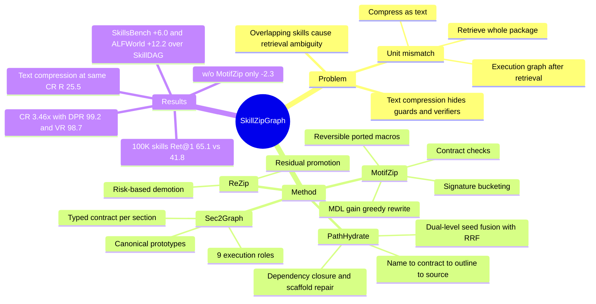

## Summary

SkillZip 把 skill library 的表示单元从整个 skill package 换成带 procedural contract 的 section 节点（9 种 execution role），在 section 图上挖掘跨 skill 复现的 motif，只有当 boundary signature、dependency closure、verifier reachability 与 source expansion 都能保住时才改写成可逆的 ported macro；推理时 PathHydrate 按预算取一个 dependency-closed 子图并按需展开 macro，ReZip 用新 skill 与执行 trace 增量维护 macro 字典。在 SkillsBench（87 tasks，1K-skill library）与 ALFWorld（140 episodes）上，相对最强 baseline SkillDAG 提升 2.8–12.2 点，active representation 压缩 3.46×，DPR 99.2 / VR 98.7，交付 context 平均 1,941 tokens。核心论点"retrieval / compression / execution 三个决策应作用于同一个单元"有说服力，但 compression 本身对 reward 的边际贡献只有约 2.3 点，且未见代码链接、部分 baseline 设置可疑。

## Problem & Motivation

作者认为现有 skill provider 走 "retrieve-compress-execute" 流水线，三个阶段用的是三种不同单元：检索以整个 package 为单位（progressive disclosure、Graph-of-Skills、SkillDAG），压缩以文本为单位（SkillReducer、LLMLingua 类），执行图则在检索之后才临时构建。由此产生四个具体问题：(1) 复用粒度错配——"normalize headers + verify row counts" 这类查询同时命中 Clean CSV 与 Pivot Table 两个 package，skill 级检索只能两个都整包加载；(2) 文本压缩不保 contract——字面接近的两段 loading routine 可能接不同 verifier，压成相似文本会混淆不兼容的检查；(3) 执行图不持久——共享 routine 每个任务都被重新发现与验证；(4) 一次性压缩无法随 library 演化，也不能利用执行证据修订有风险的抽象。作者把它们归结为 unit mismatch，主张用 contract-bearing section subgraph 作为统一单元。

隐含假设：skill 内部存在可被稳定切分、可被 LLM 正确标注 role 与 contract 的 section 结构，且跨 skill 存在足量 contract-compatible 的重复（Table 7 显示低重叠时 CR 只有 1.18×）。

## Method

**数据结构**。Section node $v=\langle\tau_v,c_v,X_v,Y_v,R_v,G_v,\mathrm{src}_v\rangle$：execution role、内容、输入/输出 signature、资源/工具、guard/verifier 条件、source 指针。9 种 role：Intent、Trigger、Input、Precondition、Operation、Resource、Failure、Verifier、Output。图上有四类边：typed dependency（Requires / Binds / UsesResource / Verifies / Repairs）、skill membership、resource、以及连接到 canonical prototype 的 equivalence 边。每个 source occurrence 保持独立节点，prototype 只做分组索引，不计入 motif support。procedural contract 分 interface / execution / verification 三个方面分别校验。

**Sec2Graph**。用 heading、列表、代码块、warning、参数描述、工具引用、测试等边界线索切 section，线索不足时由 model-assisted parser 细化；逐 section 推断 role、抽取局部 contract，连 weak-order / dependency / verifier / repair 边，标出 intent/trigger root 与 verified output terminal。跨 skill 只有 role、boundary signature、resources、verifier 行为都一致时才链接到同一 prototype。contract 抽取是 LLM 完成的，结果缓存。

**MotifZip**。不做全库无约束 frequent subgraph mining，而是先按 role signature、resource family、I/O shape 分桶，再沿 dependency 与 weak-order 边生长候选 motif，结构兼容后才用语义相似度。support 只数不冲突的 occurrence（共享内部节点或端口重连不兼容即冲突）。接受条件三条硬约束：interface 稳定、execution 闭合（依赖要么在 motif 内要么通过端口暴露）、每个 state-changing operation 的 verifier 仍在 macro 内或可从 macro 输出到达。通过者成为 typed attributed graph grammar 的产生式 $M_g[I_g,O_g]\Rightarrow(V_g,E_g,\pi_g,\chi_g)$。按局部 description-length gain $\Delta(g)=\mathrm{freq}(g)L(g)-L(M_g)-L(\mathrm{rule}_g)+\alpha\mathrm{Reuse}-\lambda\mathrm{Cut}-\mu\mathrm{Risk}$ 贪心改写（$\alpha=0.5,\lambda=0.3,\mu=0.2$），不声称全局最优。Proposition（compositional structural lifting）：对互不冲突的 occurrence 集合，先改写再展开与原子图同构，保留 typed 外部依赖与 operation→verifier 可达性。作者明确说这是结构保证而非语义保证：不保证未记录行为等价，也不保证 verifier 本身正确。

**PathHydrate**。用 backbone LLM 把 query 解析成结构化 task object（goal、expected outputs、capabilities、visible inputs、domain profile、有序 subgoals）；每个 section 取 subgoal 视图与 raw-query 视图的 cosine 最大值（BGE-M3）；同时对 skill description 排名与 skill 内最佳 section 排名做 RRF 融合，以免 section 种子散到无关 skill。目标 Eq. 7 在 anchor coverage、dependency closure、verifier reachability、token 预算约束下最小化 token 成本 / 节点数 / 未来展开成本、最大化 match（$\eta=0.4$，其余 0.2），运行时用贪心加低成本 connector 近似。随后做 scaffold repair：向后补 Input/Precondition/Resource，向前补 Failure/Verifier/Output；无法在预算内满足时退回最小 skill 级 bundle。每个 macro 渲染到最低充分层级：name → contract → outline → full source。填充是 sufficiency-gated，满足条件即停，不填满预算。

**ReZip**。新 skill 先过 Sec2Graph，兼容区域复用已有 macro，其余进 residual buffer；residual 只在跨 skill support ≥ m、$\Delta>0$、contract 校验通过时提升为新 macro。执行侧对每个 macro 记录展开率、verifier 失败率、下游修复成本，加权得 risk $\rho_t(M)$；超阈值先提高该任务族的默认 hydration 层级，持续高风险则拆分或退役回 source section。

## Key Results

设置：SkillsBench 87 tasks（1K-skill library，OpenHands + BenchFlow Docker，两次尝试）、ALFWorld valid_seen 140 episodes（37-skill library）；主实验 backbone 为 MiniMax-M2.7 与 gpt-5.2-codex，预算 3,000 / 1,200 tokens。

- **端到端（Table 1）**：MiniMax-M2.7 上 SkillsBench reward 33.3 vs SkillDAG 27.3（+6.0），ALFWorld 79.3 vs 67.1（+12.2）；gpt-5.2-codex 上 43.0 vs 36.8（+6.2），96.4 vs 93.6（+2.8）。Vector Skills 在 MiniMax-M2.7 SkillsBench 上只有 10.4，低于直接暴露全部 skill 的 Vanilla Skills（17.2）。
- **检索（Table 1）**：MiniMax-M2.7 SkillsBench 上 Ret@1 73.6 vs 66.7、Ret@5 92.0 vs 78.2；ALFWorld Ret@1 提升 27.8（MiniMax）/ 30.3（gpt-5.2-codex）。
- **压缩与结构保真（Table 2）**：SkillZip CR 3.46×、Tok 1,941、DPR 99.2、VR 98.7、Recover. 14.8%、R 33.3；同 CR 的 LLMLingua-2 式文本压缩 DPR 65.0、VR 60.0、Recover. 45.0%、R 25.5；去掉 contract 检查 CR 升到 3.78× 但 R 降到 27.8；raw section graph R 31.0。
- **消融（Table 3）**：把 section 节点换回 skill 节点 R 27.9、Ret@1 66.7、Tok 3,103（最大降幅）；去掉 MotifZip R 31.0、Tok 2,967；去 dependency closure DPR 82.3；去 verifier constraint VR 76.4。
- **Active storage（Table 4）**：18.6 MB → 5.4 MB（−71.0%），source 112.4 MB 原样保留；去 contract 检查只多省 0.5 MB 但 fallback 7.2% → 24.7%、DI 2.7% → 23.4%。
- **Contract 抽取鲁棒性（Figure 3, Table 5）**：对人工标注子集 macro-F1 91.6、exact match 84.6，precondition/guard 最难（88.7/79.6）；10% 字段污染 R 33.3 → 31.6，40% 污染 R 24.1、VR 77.2。
- **Library 规模（Table 6）**：200 → 100K skills，SkillDAG Ret@1 72.1 → 41.8，SkillZip 78.3 → 65.1；相似 skill 混淆率 SkillDAG 8.5% → 48.2%、SkillZip 4.2% → 12.4%；100K 时在线检索+hydration 248.3 ms；离线本地构图+MotifZip 在 4.77M section 节点上 178 s（不含 LLM 抽取）。
- **端到端成本（Table 11）**：对比 SkillDAG，total prompt tokens −47.0%（2.78M → 1.47M）、tool calls 36.9 → 28.9、任务耗时 429.7 → 339.0 s；uncached prompt 只降 18.7%。
- **流式维护（Table 12）**：ReZip CR 3.64×、R 33.2、VR 98.6，成本为周期全量重压缩的 0.22×；静态图在注入 contract drift 后 R 28.7、VR 91.2。
- **重复运行与跨 backbone（Table 13, 14）**：5 次配对运行，四个设置 95% CI 均不含零（gpt-5.2-codex ALFWorld +2.8 [0.4, 5.2], p=.031）；6 个 backbone 上 SkillsBench 对 Vector Skills 提升 19.9–26.2 点。
- **失败归因（Figure 7）**：剩余失败中 58% 来自 SkillZip 可控阶段（检索 26%、contract 抽取 18%、hydration 14%），33% 为 agent 执行、9% 为基础设施。

## Evidence Ledger

| Claim ID | Claim | Type | Source locator | Evidence excerpt | Status |
|:--|:--|:--|:--|:--|:--|
| C1 | MiniMax-M2.7 下 SkillZip 在 SkillsBench reward 33.3、ALFWorld 79.3，分别比 SkillDAG 高 6.0 与 12.2 点 | comparison | §5.1 RQ1; Table 1 | "SkillZip obtains a task reward of 33.3 on SkillsBench and an episode success rate of 79.3 on ALFWorld, improving by 6.0 points and 12.2 points over SkillDAG" | source-verified |
| C2 | gpt-5.2-codex 下 SkillZip SkillsBench 43.0、ALFWorld 96.4，分别比 SkillDAG 高 6.2 与 2.8 点 | comparison | §5.1 RQ1; Table 1 | "SkillZip further reaches 43.0 on SkillsBench and 96.4 on ALFWorld, improving by 6.2 points and 2.8 points over SkillDAG" | source-verified |
| C3 | MiniMax-M2.7 SkillsBench 上 Vector Skills reward 10.4，低于 Vanilla Skills 的 17.2 | number | Table 1 | "Vanilla Skills 17.2 ↑ 6.8 … Vector Skills 10.4" | source-verified |
| C4 | MiniMax-M2.7 SkillsBench 上 SkillZip Ret@1 从 66.7 升到 73.6，Ret@5 从 78.2 升到 92.0 | comparison | §5.1 RQ2; Table 1 | "SkillZip increases Ret@1 from 66.7 to 73.6 and Ret@5 from 78.2 to 92.0 with MiniMax-M2.7" | source-verified |
| C5 | ALFWorld 上 Ret@1 相对 SkillDAG 提升 27.8（MiniMax-M2.7）与 30.3（gpt-5.2-codex） | comparison | §5.1 RQ2 | "Ret@1 increases by 27.8 with MiniMax-M2.7 and by 30.3 with gpt-5.2-codex" | source-verified |
| C6 | SkillZip 在 SkillsBench 上 CR 3.46×、DPR 99.2、VR 98.7、平均渲染 1,941 tokens | number | §5.2; Table 2 | "SkillZip achieves a 3.46× compression ratio while keeping DPR and VR close to the raw graph, at 99.2 and 98.7" | source-verified |
| C7 | 同 CR 的文本压缩 baseline DPR 65.0、VR 60.0、45.0% 查询需恢复、reward 25.5 | comparison | §5.2; Table 2 | "DPR drops to 65.0, VR drops to 60.0, and 45.0% of queries require recovery … reward also falls to 25.5" | source-verified |
| C8 | 文本压缩 baseline 的阈值在 development queries 上调到与 SkillZip 的 active-representation ratio 相匹配 | benchmark-setting | Appendix D, Compression baselines | "We tune its compression threshold on development queries to match SkillZip's active-representation ratio" | source-verified |
| C9 | 去掉 contract 检查后 CR 3.78×、reward 27.8；raw section graph reward 31.0 | number | Table 2 | "SkillZip w/o checks 3.78× 1,777 88.9 84.6 31.5 27.8" | source-verified |
| C10 | 把 section 节点换成 skill 节点：reward 降 5.4、Ret@1 降 6.9、渲染 context 增 59.9% | causal-mechanism | §5.3 RQ4; Table 3 | "Ret@1 decreases by 6.9 points, task reward drops by 5.4 points, and rendered context increases by 59.9%" | source-verified |
| C11 | 去掉 MotifZip 后 DPR/VR 保持 100，但 context 增 52.9%、reward 降到 31.0 | causal-mechanism | §5.3 RQ4; Table 3 | "Without MotifZip, DPR and VR remain perfect, but context increases by 52.9% and reward falls to 31.0" | source-verified |
| C12 | 去 dependency closure 时 DPR 降到 82.3，去 verifier constraint 时 VR 降到 76.4 | number | §5.3; Table 3 | "DPR falls to 82.3 without closure, while VR falls to 76.4 without verifier constraints" | source-verified |
| C13 | Active storage 从 18.6 MB 降到 5.4 MB（−71.0%），112.4 MB source 保留不变 | number | Appendix B.1 RQ5; Table 4 | "SkillZip reduces active storage from 18.6 MB to 5.4 MB, corresponding to a 71.0% reduction, while the 112.4 MB source library remains unchanged" | source-verified |
| C14 | 去掉 contract 检查使 fallback 从 7.2% 升到 24.7%、DI 从 2.7% 升到 23.4% | causal-mechanism | Appendix B.1; Table 4 | "increases fallback from 7.2% to 24.7% and DI from 2.7% to 23.4%" | source-verified |
| C15 | Contract 抽取对人工标注的 macro-F1 91.6、exact match 84.6；precondition/guard 最难，88.7/79.6 | number | Appendix B.1 RQ6; Figure 3 | "a macro-average F1 of 91.6 and exact match of 84.6 … preconditions and guards are most difficult at 88.7/79.6" | source-verified |
| C16 | 40% contract 字段污染时 reward 降到 24.1、VR 降到 77.2 | number | Appendix B.1; Table 5 | "At 40%, expansion and fallback reach 41.3% and 34.7%, while reward falls to 24.1 and VR to 77.2" | source-verified |
| C17 | Library 从 200 扩到 100K skills，SkillDAG Ret@1 72.1→41.8，SkillZip 78.3→65.1 | comparison | Appendix B.2 RQ7; Table 6 | "SkillDAG Ret@1 drops from 72.1 to 41.8 … SkillZip Ret@1 drops from 78.3 to 65.1" | source-verified |
| C18 | 10K 与 100K 规模的 library 是作者自行扩展的嵌套池，新增 package 只作 distractor、不配评测 query | benchmark-setting | Appendix D, Retrieval and library scaling | "We use the released Graph-of-Skills pools at 200, 500, 1K, and 2K skills, and extend the same nested-pool construction to 10K and 100K" | source-verified |
| C19 | 100K skills（4.77M section 节点）下本地构图+MotifZip 耗时 178 s，不含 LLM 抽取 | number | Appendix B.5 RQ12; Table 9 | "corresponding to 4.77M cached section nodes, graph construction and MotifZip finish in 178 s" | source-verified |
| C20 | 相对 SkillDAG，total prompt 处理降 47.0%，uncached prompt 只降 18.7% | comparison | Appendix B.5 RQ14; Table 11 | "Total prompt processing decreases from 2.78M to 1.47M tokens, a 47.0% reduction" | source-verified |
| C21 | ReZip 达到 3.64× CR、33.2 reward、98.6 VR，成本为周期全量重压缩的 0.22× | comparison | Appendix B.6 RQ15; Table 12 | "It achieves 3.64× CR, 33.2 reward, and 98.6 VR, with only 0.22× the cost of periodic full recompression" | source-verified |
| C22 | 五次配对运行下 gpt-5.2-codex ALFWorld 增益 +2.8，95% CI [0.4, 5.2]，p=.031 | number | Appendix B.7 RQ16; Table 13 | "+2.8 [0.4, 5.2] .031" | source-verified |
| C23 | 剩余失败中 58% 来自 SkillZip 可控阶段，其中检索 26%、contract 抽取 18%、hydration 14% | number | Appendix B.8 RQ18; Figure 7 | "stages controlled by SkillZip account for 58% of the remaining failures. Retrieval is the largest source within this group, contributing 26%" | source-verified |
| C24 | SkillsBench 评测使用 87 个 task，ALFWorld 使用 valid_seen 的 140 个 episode | benchmark-setting | Appendix D | "we evaluate all 87 tasks under the 1,000-skill setting" | source-verified |
| C25 | 论文正文与 arXiv HTML 中未给出代码或数据仓库链接 | license-code | unknown（全文检索无 repo 链接；abstract 的 "experiments1" 脚注内容未被 HTML 转文本保留） | "Comprehensive experiments1 on technical and embodied agent benchmarks" | source-verified |

## Strengths & Weaknesses

**Strengths**
- 问题刻画准确。"检索、压缩、执行用三种不同单元"这个 unit mismatch 诊断干净，Clean CSV / Pivot Table / Formula-Safe Workbook 的例子（Table 16）把"文本相似 ≠ contract 等价"讲得很具体：字面几乎一样的 ingest routine，因为接了 formula-integrity verifier 就被拒绝合并。
- 压缩被约束在可逆、可审计的结构改写内，而非有损摘要。Proposition 写明只是结构保证、不覆盖语义等价与 verifier 正确性，没有 overclaim。
- 消融与对照比主结果更有信息量。同 CR 下文本压缩 DPR/VR 跌到 65/60、reward 25.5，"w/o checks" 只多省 0.5 MB 却让 DI 从 2.7% 涨到 23.4%（Table 4），这组数据直接支持"压缩必须保 contract"。Table 7 的受控重叠实验说明 CR 主要由库内可复用结构决定，低重叠时方法不会强行压缩。
- 评测口径做了几处值得肯定的区分：CR 测 active representation、Tok 测最终渲染、trajectory token 单独报告；uncached prompt 降幅（18.7%）与 total prompt 降幅（47.0%）分开说明。另有 5 次配对运行加 bootstrap CI。

**Weaknesses**
- **压缩本身的贡献偏小，主收益来自 section 级检索**。Table 3 中把单元换回 skill 级掉 5.4 点，去掉 MotifZip 只掉 2.3 点（31.0 vs 33.3），且该消融没有 CI；87 个 task 上 2.3 点大约相当于两个 task 的全部测试。标题主打 "Graph Compression"，实际的 end-task 提升主要靠 Sec2Graph + PathHydrate。
- **文本压缩 baseline 的数字有疑点**。按 Appendix D，该 baseline 在 45% 查询上恢复原 section 后才执行，Tok 是恢复后测的，却与 SkillZip 完全相同（1,941）；按说恢复会抬高 token。CR 也是调阈值对齐出来的。这组对比要么另有未交代的处理，要么存在报告问题。（推测，需原作者澄清）
- **Baseline 强度可疑**。Vector Skills 在 MiniMax-M2.7 SkillsBench 上 10.4，比整包暴露的 Vanilla Skills（17.2）还低；Vector 与 GoS 的检索指标在两个 backbone 下完全相同（embedding 检索不依赖 backbone），而 SkillZip 的检索由 backbone 做 task anchoring，等于多了一个 LLM 的 query 解析步骤。GoS / SkillDAG 沿用各自公开设置，没有统一 token 预算。
- **规模结论主要建立在合成 distractor 上**。10K/100K 库由作者从 "SkillsBench-compatible source collection" 自行扩展，来源与质量未说明，且新增 package 只作干扰项。ALFWorld 库只有 37 个 skill，CR 1.62×，"scalable" 的论证几乎全部来自 SkillsBench。
- **LLM 抽取成本被单列后没有报告**。所有构建耗时都从缓存的 contract 开始；对 100K skills 做 LLM role/contract 抽取的成本恰恰是部署瓶颈。人工标注子集的规模也未说明。
- **评测规模小、未见代码链接**。87 tasks + 140 episodes；arXiv HTML 全文未检索到 repo 链接（abstract 脚注内容未被 HTML 保留，不能完全排除），Sec2Graph 的切分启发式与 model-assisted parser 的 prompt 只在附录有描述，复现门槛高。
- **适用边界**：方法依赖 skill 内部有可识别的 Verifier / Precondition 等 role。对没有显式验证步骤、或以自由散文写成的 skill，verifier reachability 约束可能退化为空约束，或迫使 PathHydrate 退回 skill 级 bundle。论文没有报告 fallback 到 skill 级 bundle 的频率分布与 skill 写法之间的关系。

## Mind Map

## Notes

- 与 vault 中两篇同名笔记是**不同团队、不同问题设定**的工作，仅名字撞车：
  - [[2608-SkillZip]]（arXiv 2608.11079，Alibaba/浙大）压缩的是**单个**自进化 skill 文档内部的冗余，用 typed MDL + hard coverage，全程 evaluation-free；本文（arXiv 2608.05604，UNSW/CSIRO）压缩的是**整个 skill library 的跨 skill 重复结构**，目标是检索与 context 交付，且 ReZip 显式使用执行 trace 修订 macro，并非 evaluation-free。两者都主张"压缩要保 contract 而非保文本"，可以对照：前者靠 coverage 约束保 rare rule，后者靠 verifier reachability 约束保验证路径。
  - [[2608-SkillZipPro]]（arXiv 2608.30785）是前者的续作，把对象扩到渐进加载的 skill bundle 目录并分层计成本；本文的 PathHydrate（name / contract / outline / full source 四级渲染）与它的 progressive disclosure 分层记账关注同一个问题，即 always-loaded 与按需加载内容的放置。不过 SkillZipPro 在单 bundle 内部做，本文在跨 skill 图上做。
- [[2607-ProgressiveDisclosure]] 发现 progressive disclosure 的收益依赖 harness 的原生导航能力、二级路由有时有害；本文把 disclosure 推到 section 图级并报告强 backbone 上仍有大幅提升（Claude Sonnet 4.5 SkillsBench 26.2 → 52.4，对照的是 Vector Skills）。两者结论有张力，值得用同一 harness 对照检验。
- [[2609-DiverseSkillRouting]] 同样针对重叠 skill 造成的检索冗余，但只换 top-k 截断为 DPP、只报检索指标；本文的 section 级拆分是更激进的解法，可以组合（在 section 候选上做 diversity-aware 选择）。
- 开放问题：去掉 MotifZip 只掉 2.3 点，那么在 section 级检索已经到位时，跨 skill 的 macro 压缩是否主要是存储/延迟收益而非任务收益？一个干净的检验是固定 Tok 预算，对比"section 检索 + 无压缩"与完整 SkillZip。
