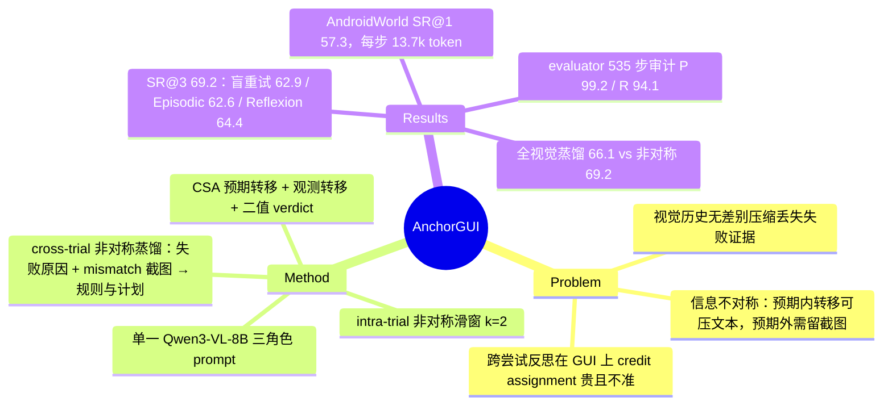

## Summary
AnchorGUI 让同一个 Qwen3-VL-8B 以 policy / evaluator / distiller 三个 prompt 角色工作：policy 每步先写出"预期转移"，执行后 evaluator 对比前后截图给出二值 verdict（Cognitive State Anchor，CSA），mismatch 步保留原截图、match 步只留文本，构成 asymmetric memory，既供 episode 内滑窗纠错，也在失败后交给 distiller 产出规则与修正计划喂给下一次尝试。AndroidWorld 单次 57.3%（同 backbone ReAct 43.7%），三次尝试 69.2%；Table 3 的配对对照是本文最有用的数据：同一 intra-trial agent 下 Memoryless Retry 62.9、Episodic Memory 62.6、Reflexion 64.4、Asymmetric Distillation 69.2。

## Problem & Motivation
GUI agent 的视觉历史又密又长，现有做法要么截断、要么压成文本摘要，把成功步和失败步一视同仁地压缩，于是 (a) episode 内识别不出"卡在 Welcome to Chrome 弹窗上"这类异常状态而反复 Back 与重开 app；(b) 跨尝试反思（Reflexion 式）在文本环境有效，搬到 GUI 后要在几十张相似截图里找出致错动作，credit assignment 既贵又不准。作者的核心主张是一条"信息不对称"经验规律：符合预期的转移可以安全压成一行文本，不符合预期的转移才需要保留截图作为因果证据。把"是否符合预期"显式算出来，就同时得到了 episode 内保留什么、跨尝试反思看什么两个问题的答案。

## Method
**Cognitive State Anchor（CSA）**。每步 \(CSA_t=\langle\hat\Delta_t,\Delta_t,V_t\rangle\)：policy 在输出动作时同时输出预期转移 \(\hat\Delta_t\)（一句话，如"Login 按钮消失、首页加载"）；执行后 evaluator 接收 \(o_t,o_{t+1}\) 与 \(\hat\Delta_t\)，输出观测转移 \(\Delta_t\) 和 \(V_t\in\{0,1\}\)。evaluator prompt 只允许输出两行（Verdict + Summary），判据是"意图是否被实现"。三个角色共用一个 8B 模型，只换 system prompt。

**Intra-trial：非对称滑窗**。窗口 \(k=2\)；窗内 \(V_i=0\) 的步保留 \(\langle o_i,a_i,CSA_i\rangle\)，\(V_i=1\) 的步只保留 \(\langle a_i,CSA_i\rangle\)；窗外步压成文本长程历史。verdict 直接写进 prompt，policy 据此改变行为。

**Cross-trial：非对称蒸馏**。失败后把整条 episode 按同一规则聚合成 \(\mathcal H^{(k)}_{asym}\)，交给 distiller。distiller prompt 明确注入失败原因（两种模板：错误宣告完成 / 步数耗尽），要求输出 root cause、是否有无效循环、与任务意图的偏离点、一份覆盖全程的改进计划以及"IF 情境 THEN DO NOT … INSTEAD …"格式的 avoid rules；输出作为 experience bank \(\mathcal X^{(k)}\) 前置到下一次尝试的 policy prompt。作者把这称为把 credit assignment 搜索空间从 \(O(T)\) 缩到 \(O(|\{i:V_i=0\}|)\)。

**多次尝试协议**。\(K=3\)，每次尝试经 AndroidWorld 官方 init/tear-down 重置到同一任务初始状态（随机性只在任务之间、不在同一任务的重试之间）；\(T=30\) 步；temperature 0.7；3 seeds 取均值。

## Key Results
**单次尝试**（Table 1、2）。离线三个 benchmark 上对同 backbone 的 ReAct / ReSum / Truncation / Self-Reflection 有 1–3 点的 TM/EM 提升（AITZ EM 59.1 vs ReAct 57.5；GUI-Odyssey EM 60.6 与 Self-Reflection 60.7 持平，远低于微调过的 OdysseyAgent 73.7）。AndroidWorld SR@1 57.3%，高于 Mobile-Agent-v3（55.2）与 Chain-of-Memory（46.8），同 backbone ReAct 43.7；每步 token 13.7k 对 ReAct 91.4k。

**多次尝试**（Table 3，AnchorGUI intra-trial 固定，只换 cross-trial 策略；SR@1/SR@2/SR@3）：

| cross-trial 策略 | SR@1 | SR@2 | SR@3 | Δ(T3−T1) | intra tokens/步 | cross tokens/trial |
|:--|:--|:--|:--|:--|:--|:--|
| Memoryless Retry（盲重试） | 57.3 | 61.2 | 62.9 | +5.51 | 13.5k | – |
| Episodic Memory（整条失败轨迹前置） | 57.3 | 60.5 | 62.6 | +5.29 | 78.9k | – |
| Reflexion（整轨迹自由反思） | 57.3 | 63.1 | 64.4 | +7.02 | 13.6k | 66.5k |
| Asymmetric Distillation | 57.3 | 65.4 | 69.2 | +11.9 | 13.7k | 24.4k |

ReAct 做 intra-trial 时同样的排序再现一次：ReAct 盲重试 53.7（Table 4 行 1）、+ Episodic Memory 53.4、+ Reflexion 55.2。

**消融**（Table 4）。CSA 双粒度记忆把 SR@1 从 43.7 拉到 55.3，非对称窗口再到 57.3；跨尝试用整条视觉轨迹蒸馏 66.1（cross 65.3k），只留 mismatch 截图蒸馏 69.2（24.4k）。保留策略三选一（Figure 3）：纯文本 62.1、全截图 64.9、非对称 69.2。窗口 \(k=1\) 54.0、\(k=2\) 57.3、\(k=8\) 49.6。

**evaluator 可靠性**。535 步人工审计：precision 99.2%、recall 94.1%、F1 96.6%（FP 3、FN 24；正例 406 / 负例 129）。

**规模**。token 随步数亚线性：ReAct 到第 30 步 105.3k，AnchorGUI policy 4.5k→8.7k，加 evaluator 固定约 7k 共 15.7k。GPT-5.4 Mini（planner）+ Qwen3-VL-8B grounding、Qwen3-VL-32B 两个强 backbone 的结果只在 Figure 7 中以柱状图给出，正文无数字，且是 AndroidWorld 固定一半子集。

## Evidence Ledger

| Claim ID | Claim | Type | Source locator | Evidence excerpt | Status |
|:--|:--|:--|:--|:--|:--|
| C1 | AndroidWorld SR@1：AnchorGUI 57.3、ReAct 43.7、Mobile-Agent-v3 55.2、Chain-of-Memory 46.8（均 Qwen3-VL-8B） | number | Table 2 | "AnchorGUI (Ours) Qwen3-VL-8B 57.3 … ReAct Qwen3-VL-8B 43.7 … Mobile-Agent-v3 Qwen3-VL-8B 55.2" | source-verified |
| C2 | Asymmetric Distillation SR@1/2/3 = 57.3/65.4/69.2，Δ +11.9，intra 13.7k，cross 24.4k | number | Table 3 | "Asymmetric Distillation (Ours) 57.3 65.4 69.2 +11.9 13.7k 24.4k" | source-verified |
| C3 | 同一 intra-trial 下 Memoryless Retry 57.3/61.2/62.9（+5.51，13.5k）、Episodic 57.3/60.5/62.6（+5.29，78.9k）、Reflexion 57.3/63.1/64.4（+7.02，13.6k/66.5k） | comparison | Table 3 | "Memoryless Retry 57.3 61.2 62.9 +5.51 13.5k … Episodic Memory … 62.6 +5.29 78.9k … Reflexion … 64.4 +7.02 13.6k 66.5k" | source-verified |
| C4 | ReAct + Episodic 43.7/49.1/53.4（+9.74，91.4k）；ReAct + Reflexion 43.7/53.0/55.2（+11.5，32.7k/59.2k）；Self-Reflection + Episodic 47.7/51.6/54.2；+ Reflexion 47.7/52.5/56.8 | comparison | Table 3 | "ReAct + Episodic Memory 43.7 49.1 53.4 +9.74 91.4k … ReAct + Reflexion 43.7 53.0 55.2 +11.5 32.7k 59.2k" | source-verified |
| C5 | Table 4 递进消融：ReAct 盲重试 43.7/50.9/53.7；+CSA 55.3/60.5/63.0；+非对称窗 57.3/61.2/62.9；+全视觉蒸馏 57.3/63.8/66.1（65.3k）；+非对称蒸馏 69.2；行 1–3 的 SR@2/3 为盲重试 | number | Table 4 + caption | "(4) + Cross-Trial Distillation 57.3 63.8 66.1 +8.74 13.9k 65.3k"; "†: memoryless retry without cross-trial distillation" | source-verified |
| C6 | 单一 Qwen3-VL-8B 共用三角色；k=2；K=3；T=30；temp 0.7 / top-p 0.8 / top-k 20；3 seeds 均值 | benchmark-setting | §4.1；App 0.B.1 Table A1 | "asymmetric sliding window of size k=2 … up to K=3 attempts … cap each AndroidWorld trial at T=30 steps … temperature =0.7" | source-verified |
| C7 | AndroidWorld 116 任务 / 20 app；同一任务的每次重试经官方 init/tear-down 重置到同一初始状态；SR@K = 前 K 次内解出 | benchmark-setting | App 0.D AndroidWorld | "each retry of the same evaluation item is reset through the benchmark's official initialization and tear-down procedures" | source-verified |
| C8 | evaluator 审计 535 步：precision 99.2 / recall 94.1 / F1 96.6；TP 382、TN 126、FP 3、FN 24；正 406 / 负 129 | number | §4.5；App 0.F Table A2/A3 | "The zero-shot evaluator achieves 99.2% precision and 94.1% recall"; "True Positive (TP) 382 … False Negative (FN) 24" | source-verified |
| C9 | 保留策略 SR@3：纯文本 62.1、全截图 64.9、非对称 69.2 | number | §4.3（Figure 3） | "pure text retention … 62.1% … full visual retention … 64.9% … asymmetric … 69.2%" | source-verified |
| C10 | 窗口 k=1 54.0、k=2 57.3、k=8 49.6；k>3 退化 | number | §4.3 | "k=1 drops performance to 54.0% … bottoming out at 49.6% for k=8" | source-verified |
| C11 | Table 1：AITZ 75.2/59.1 vs ReAct 71.4/57.5；Android-Control 74.6/73.0 vs ReSum 72.3/70.5；GUI-Odyssey 80.6/60.6，OdysseyAgent 90.8/73.7 | number | Table 1 | "AnchorGUI (Ours) Qwen3-VL-8B 75.2 59.1 74.6 73.0 80.6 60.6" | source-verified |
| C12 | token 随步数：ReAct 第 30 步 105.3k；AnchorGUI policy 4.5k→8.7k；含 evaluator 约 7k 共 15.7k | number | §4.4 | "ReAct explodes linearly, reaching 105.3k tokens by step 30 … from 4.5k tokens at step 1 to just 8.7k tokens at step 30" | source-verified |
| C13 | 作者把行 3 盲重试增益（+5.51）小于行 1（+10.0）归因于起点更高的"压缩空间"，并据此断言 +11.9 是真实学习而非随机性 | causal-mechanism | §4.3 Component Ablation | "reflects the compressed room for stochastic improvement given Row 3's higher initial success rate" | source-verified |
| C14 | 无代码链接，"将在发表后释出" | license-code | §4.1 | "The source code will be released upon publication." | source-verified |
| C15 | Episodic Memory = 上一次失败的完整轨迹序列化前置；Memoryless Retry = 重置后从零开始、无任何携带；Reflexion = 看完整轨迹写简短反思注入 | benchmark-setting | App 0.E.2 | "the full sequence of observed screens, actions, and outcomes is serialized and prepended"; "without carrying over any trajectory, summary, reflection, or memory" | source-verified |
| C16 | distiller 只在失败后调用，注入失败原因（错误宣告完成 / 步数耗尽两种），要求输出 root cause、改进计划与 avoid rules | benchmark-setting | App 0.B.2 Distiller Prompt | "The distiller prompt is only invoked after an unsuccessful trial"; "the previous attempt incorrectly concluded task completion" | source-verified |
| C17 | 全文无置信区间或显著性检验，无 token/预算匹配的重试对照 | benchmark-setting | 全文检索（§4.1 L227；Table 3 Memoryless 行 cross 列为 "-"） | "All experiments are conducted with 3 different random seeds; we report the mean performance across runs."；全文无 confidence / p-value / std / ± / budget-matched 命中 | source-verified |
| C18 | 强 backbone（GPT-5.4 Mini planner + Qwen3-VL-8B grounding；Qwen3-VL-32B）结果只在 Figure 7，固定一半子集、三次均值，正文无数字 | benchmark-setting | §4.5；Figure 7 caption 与脚注 | "All results are three-run averages on a fixed half subset" | source-verified |
| C19 | Pareto：AnchorGUI 57.3% @ 13.7k；ReAct 43.7% @ 91.4k；Mobile-Agent-v3 55.2% @ 15.1k；evaluator 约 7k | number | §4.4 | "AnchorGUI occupies the optimal top-left quadrant with a 57.3% success rate at an average cost of only 13.7k tokens" | source-verified |
| C20 | 对 ReAct + Reflexion 的 SR@3 领先 +14.0（69.2 vs 55.2）；SR@1 比 ReAct +13.6 | sota-novelty | §4.2 | "establishing a final performance margin of +14.0% over ReAct + Reflexion (55.2% SR@3)" | source-verified |
| C21 | 正文三处图号引用错位：§4.3 保留策略写 Figure 4（实为 Figure 3）、§4.4 Pareto 写 Figure 6（实为 Figure 5）、§4.5 强 backbone 写 Figure 2（实为 Figure 7） | benchmark-setting | §4.3 / §4.4 / §4.5 vs 图注 | "we compare three unified retention strategies in Figure 4"; "Figure 2 further evaluates GPT-5.4 Mini" | source-verified |
| C22 | 作者五人均属中国人民大学高瓴人工智能学院，Zhiwu Lu 通讯；arXiv v1 2026-09-14，cs.CV；ECCV 2026 | benchmark-setting | 文头；arXiv comment | "Published in ECCV 2026. 41 pages including supplementary material" | source-verified |

## Strengths & Weaknesses

**亮点**
- **Table 3 是 GUI 上少见的配对多次尝试对照**：同一 intra-trial agent、同一任务初始状态、3 seeds，把盲重试、整轨迹前置、自由反思、自家蒸馏放在一起。两个 backbone 上排序一致：整轨迹前置 ≈ 盲重试（62.6 vs 62.9；53.4 vs 53.7），自由反思只比盲重试高约 1.5 点（64.4 vs 62.9；55.2 vs 53.7），有定位的蒸馏高 6.3 点。这与 [[Papers/2606-NaiveVisualMemory]]（整屏记忆加重 action-level 失败）相互印证，并给 [[Ideas/FailureConditionedRetry-GUI]] 的 P1 排序提供了 GUI 直接证据。
- **Table 4 行 4 与行 5 把"定位"的贡献拆出来了**：整条视觉轨迹蒸馏 66.1、只留 mismatch 截图 69.2——在失败原因与修正计划都相同的前提下，筛掉成功步截图值 +3.1 点并把 cross token 从 65.3k 降到 24.4k。于 +6.3 的总增益（相对盲重试）里，定位约占一半，另一半来自"失败原因 + 完整修正计划"的内容形式本身。
- 重试协议把随机性限制在任务之间（同任务重试固定初始状态），比多数 pass@k 报告干净；evaluator 审计 535 步并给出混淆矩阵。
- 单个 8B 模型三角色、零训练，每步 token 比 ReAct 少 6.7 倍。

**局限**
- **"mismatch" 不等于"错误"**。verdict 的参照是 policy 自己写的预期；预期本身错了但被实现（App 0.G.2 的案例：金额输成 100 而非 307.01、类别选了 Social、备注写错，每步 verdict 全为 POSITIVE 却任务失败），asymmetric memory 里没有任何锚点，distiller 只能靠失败原因字符串从头重规划。这正是 CUA-Recovery（arXiv 2610.27645，vault 无笔记）所说"60% 的错误只在最后一步才出现证据"的那一类失败；论文没有报告这类"零 mismatch 失败"占失败的比例，CSA 的作用边界因此未知。
- **没有预算匹配对照，也没有置信区间**。Asymmetric Distillation 每次 trial 多花 24.4k cross token，Memoryless Retry 为零；K 固定为 3，没有"把 token 换成更多次盲重试"的臂。116 题、3 seeds 下 1.5 点的 Reflexion 增益在噪声内，论文对此未作任何统计说明。
- **离线 benchmark 的增益很小**（EM 普遍 +1–3 点，GUI-Odyssey 持平），intra-trial 的主要收益集中在 AndroidWorld 这一个在线环境；强 backbone 结果只有图没有数。
- 行 3 盲重试增益小于行 1 的解释（"起点高所以余地小"）是作者推断，没有用同起点的对照检验；+11.9 "不是随机性"的论证只建立在这一推断上。
- 代码未释出；正文三处图号引用错位（见 C21）。另两处内部不一致：ReAct 的每步 intra token 在 Table 3 与 §4.4 为 91.4k，在 Table 4 行 1 却是 32.4k（引用 token 对比时需注明取自哪张表）；§4.1 把 Episodic Memory 与 Reflexion 标成同一文献 [20]。

## Mind Map

## Notes
- **对 [[Ideas/FailureConditionedRetry-GUI]] 的直接意义**：该 idea 2026-11-03 版把本文记为"无盲重试对照"，是错记；本文的 Memoryless Retry / Episodic / Reflexion 正是 idea 的 A0 / A2（近似）/ A4 三臂，已在 AndroidWorld 上配对比较。idea 仍可守的部分是总预算匹配（A0'）、Rescue/Harm 配对分解、定位准确度剂量（扰动 mismatch 步）与训练入口；本文 Table 4 行 4→5 的 +3.1 可作为"定位贡献"的先验量级。
- **与 [[Ideas/MismatchTriage-LongHorizonRecovery-GUI]] 的关系**：CSA 就是一个每步 mismatch alert；AnchorGUI 对 alert 的 episode 内处置只有一种（把那一步截图留在窗口里让 policy 自己看），没有比较继续 / 倒回 / 注入纠正三种处置——这正是 MismatchTriage 与 [[Topics/CUA-Survey]] §10.11 D2 要测的东西。本文的 evaluator（两行输出、仅比对前后截图与意图）可直接作为 D2 实验的廉价 alert 源。
- **与 [[Papers/2609-ExpActivator]] 对照**：ExpActivator 发现按 goal 检索的记忆收益几乎全在首步；本文的 experience bank 是一份覆盖全程的改进计划，Figure A9 的第二次尝试从第 2 步起路径就不同，说明"计划式"经验可能比"检索式"经验更能影响轨迹内动作，但本文没有按步位分解增益。
- **与 [[Papers/2609-EvoSkillGUI]] 对照**：两者都是零训练、最多 3 次尝试、反思后重试；EvoSkill-GUI 的 critic 与 executor 信息隔离，AnchorGUI 的 evaluator 只看前后截图与意图（也是一种隔离），但 distiller 看完整 asymmetric memory。EvoSkill-GUI 报了 pass@3 的 token 对齐对照，AnchorGUI 没有。
- 待核：Figure 7 的强 backbone 数字；evaluator 审计样本是否来自 AndroidWorld 还是混合离线数据（App 0.F 只说"full pool of evaluator invocations"）。
- 相关：[[Papers/2602-MemGUIBench]]（pass@k 与 FRR 口径）、[[Papers/2610-AndroidFlux]]（从 checkpoint 恢复的受控评测，是本文"重开到初始状态"之外的另一种重置方式）、[[Papers/2500-MobileAgentV3Fundamental]]、[[Papers/2500-MobileuseGuiAgentHierarchical]]（本文的 reflector / hierarchical reflection 基线）。
