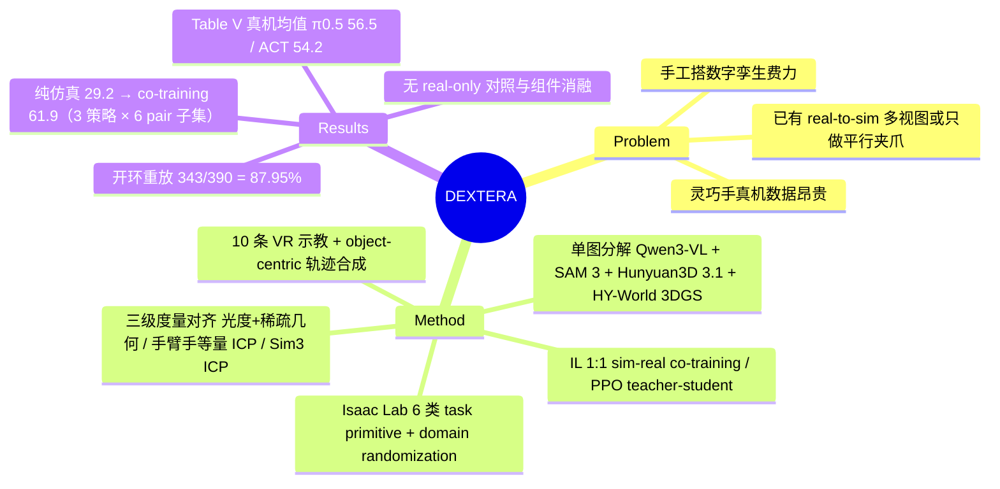

## Summary
DEXTERA 把一张工作台 RGB 图拼接现成模型（Qwen3-VL 解析、Grounding DINO + SAM 3 分割、FLUX.2 补全、Hunyuan3D 3.1 生成网格、HY-World 2.0 生成 3DGS 背景），再用一次 RGB-D 标定采集做度量对齐与"手臂/手等量采样"的 ICP 外参修正，导入 Isaac Lab，用 6 类 task primitive + 每任务 10 条 VR 示教的 object-centric 轨迹合成扩成 300 条/任务的仿真数据。两台灵巧手平台（OpenArm + BrainCo Revo1 双臂、KUKA iiwa 7 + LEAP Hand）13 个 task–embodiment pair 上，仿真成功轨迹开环重放到真机成功 343/390（87.95%，Table IV）；在 ACT / DP / π0.5 三种策略 × 6 个 pair 的子集上（不是 Table V 的 6 种架构 × 13 个 pair），纯仿真训练真机均值 29.2%，1:1 掺入真机数据后 61.9%（Figure 8；摘要称 "across diverse policy architectures"，范围比实际宽）。论文没有"只用真机数据"的对照臂，也没有管线各组件的消融，所以 co-training 增益中有多少来自重建出的仿真数据、有多少来自那 30 条真机轨迹，目前无法分离。

## Problem & Motivation
灵巧手数据采集贵：高维动作、接触密集，需要硬件、操作员和反复复位。仿真可以扩数据，但要把具体部署工作台搬进仿真，仍需手工建网格、指定物理参数、做相机–机器人对齐；domain randomization 补不上未建模的外观、传感噪声与接触动力学。已有 real-to-sim 系统要么依赖多视角扫描（SimFoundry 需要多视角视频），要么只做平行夹爪的桌面场景（TabletopGen、RoboSnap），作者认为"单图 → 度量对齐、可交互、能部署灵巧手策略的仿真环境"这条链路尚未打通。核心问题因此是：一张图能否变成视觉逼真、物理可信、与机器人对齐、支持多模态策略学习并能迁回真机的灵巧操作环境。

## Method
输入：一张场景 RGB 图 \(I_0\)、机器人模型、一次标定采集（相机内参、同步机器人位姿与深度）。只有 \(I_0\) 用于生成资产，其余测量只用于恢复度量尺度与对齐（§III 开头）。

**(1) 单图资产分解（§III-A，Fig. 1）**
- Qwen3-VL 把场景解析为元素，给出名称、类别、grounding phrase、body type（刚体/铰接）、物理默认值（质量、摩擦、恢复系数、刚度）与是否可交互。
- 可交互物体：Grounding DINO 定位 → SAM 3 出 mask → 严重遮挡时 FLUX.2 补全 → Hunyuan3D 3.1 生成带纹理网格；铰接体再经一个前馈模型推断 link 分割、关节类型、轴与限位，导出 URDF。
- 静态背景：FLUX.2 抹去可交互物体与机器人 → HY-World 2.0 扩成 360° 全景、规划虚拟相机轨迹、生成多视图 → 优化 3DGS；配套点云与网格用于碰撞。

**(2) 三级度量对齐（§III-B，Fig. 2）**
- 场景：对一张实测 RGB-D 优化背景尺度 \(s_G\) 与相机位姿，损失 = 光度项（RGB + SSIM）+ 稀疏几何项（RANSAC 过滤的 SuperPoint 对应点的重投影误差与深度误差，后者约束尺度）。
- 机器人–相机外参：从 marker 标定初值出发，用 Isaac Lab 渲染的机器人 mask 与 SAM 3 真实 mask 反投影成点云做 ICP；arm 与 hand 各采样 N 个点、两项损失取平均（"morphology-balanced"），防止大块手臂几何主导而手部对不准。
- 物体：用 RGB-D 反投影与网格的包围尺寸比恢复尺度，再做 Sim(3) ICP；Qwen3-VL 比对候选包围盒轴与参考图块，确定语义朝向（如功能性"向上"轴对齐 +Z）；部署时 FoundationPose 跟踪物体，DeAOT 抑制漂移。

**(3) 仿真任务构建（§III-C，Fig. 3）**。资产以 USD 导入 Isaac Lab，VLM 预测的物理参数在初始化时赋值。任务 = embodiment + 重建资产 + 6 类 primitive 之一（Lift / Push / Pick-and-reorient / Pick-and-place / Handover / Articulation），primitive 规定复位分布、奖励与成功判据；对物体与目标位姿、动力学、机器人配置、相机外参、光照和噪声做 domain randomization。观测接口（Table I）把可部署传感量（RGB、深度、点云、本体感觉、指尖接触力）与 privileged 状态分开。

**(4) 数据与策略（§III-D）**。Meta Quest 3 VR 遥操作，腕部走 IK、手指走 retargeting；每任务 10 条示教用 object-centric 轨迹合成扩增：保持末端相对任务坐标系的位姿，按新任务帧变换，位置线性插值、姿态 SLERP，加零均值高斯动作噪声，再用碰撞检查与成功判据过滤。RL 分支为 PPO teacher（privileged 状态 + 接触力）蒸馏到只用可部署观测的 student。真机端 ROS 2 同步相机、状态与控制。

## Key Results
**物体重建（Table II，18 张 RGB-D 快照、10 个桌面场景、86 个有效物体实例，统一标定相机视角，mean ± std）**。DEXTERA 在 8 项指标上均值全部最优：Mask IoU .731（Hunyuan3D-2.1 .661，TRELLIS.2 .559，SAM3D+FP .604，SAM3D-only .488）；Chamfer-L1 6.9 mm（Hunyuan3D-2.1 10.3 mm，SAM3D+FP 11.8 mm）；F-score@1cm .906（Hunyuan3D-2.1 .750，TRELLIS.2 .346）；ΔE76 27.90 vs 34.74（Hunyuan3D-2.1）。标准差普遍与均值差同量级（如 Mask IoU .731±.136 vs .661±.180），未做显著性检验。Boundary F1 所有方法都低（最好 .260）。

**背景（Table III，标定的顶部相机视角）**。PSNR 20.74 dB、SSIM 0.761、Depth MAE 5.16 mm、AbsRel 0.010、δ1 1.000、Chamfer-L1 6.33 mm、F-score@1cm 0.900。

**跨域开环重放（Table IV）**。每任务取 30 条仿真成功 rollout，在真机复位时用物体跟踪把真实摆放同步进仿真，再用轨迹合成适配后执行：总计 343/390（87.95%）；LiftBlueMug、BimanualLiftBox、两平台 CloseLaptop 均 30/30；最低是 ReorientThermometer 与 BimanualPlaceBoxInBasket（22/30，73.33%），作者推测与接触打滑和硬件柔顺性有关。

**策略基准（Table V，13 pair，sim/real 各 100/20 次试验；模仿学习策略用仿真 + 真机数据 1:1 co-training，T–S 为 PPO teacher–student）**。真机均值：π0.5 56.5、ACT 54.2、DP 37.3、T–S 17.3、OpenVLA 13.8、BC-RNN 11.2；仿真均值 π0.5 64.8、ACT 58.3。数据量为 3,900 条仿真 + 390 条真机轨迹（即每 pair 300 + 30）。多步放置普遍失败：PlaceToyBusInBasket 真机最高 15%（ACT），BimanualPlaceBoxInBasket 最高 20%（π0.5），KUKA PlaceCoconutWaterInBasket 最高 25%（ACT），且后者在仿真里也低（π0.5 10%、DP 3%）。ACT 在 HandoverGrayBowl 上真机 65% 高于 π0.5 的 40%。仿真成功率不能预测真机：T–S 在 OpenArm CloseLaptop 仿真 96% / 真机 30%，而同任务开环重放 30/30；反方向也有，ACT 在 ReorientThermometer 仿真 30 / 真机 55、CloseLaptop 46 / 80。

**纯仿真 vs co-training（Figure 8，子集：ACT / DP / π0.5 三种策略 × 6 个 pair，非 Table V 全部 6 架构 × 13 pair；仿真 100 次、真机 20 次；逐柱数字只在图中）**。纯仿真训练真机均值 ACT 35.0、DP 15.8、π0.5 36.7（合计 29.2）；π0.5 纯仿真在 CloseLaptop 上真机 OpenArm 75%、KUKA 80%。co-training 后 ACT 62.5、DP 55.8、π0.5 67.5（合计 61.9）；18 组比较中 17 组真机提升、1 组持平；仿真均值也从 62.4 升到 67.3。反例：ACT 在 OpenArm CloseLaptop 上仿真 80→46、真机 65→80。

**作者自述局限（§V）**。只支持刚体与铰接体（无可变形物、流体）；只测了基础 primitive，长程任务未验证；动力学差距与 VLM 推断物理参数不准拖累多步任务；物理实验仅限固定基座；机器人运动学作为已知先验输入。

## Evidence Ledger

| Claim ID | Claim | Type | Source locator | Evidence excerpt | Status |
|:--|:--|:--|:--|:--|:--|
| C1 | 跨域开环重放总成功 343/390（87.95%），每任务 30 条仿真成功 rollout | number | Table IV；§IV-B | "Table IV reports an overall physical replay success rate of 87.95% (343/390 trials)" | source-verified |
| C2 | 重放最低为 ReorientThermometer 与 BimanualPlaceBoxInBasket，各 22/30（73.33%）；四个任务配置 30/30 | number | Table IV；§IV-B | "Reorientation and bimanual box placement achieve lower success rates of 73.33% each" | source-verified |
| C3 | 纯仿真训练 → co-training，ACT/DP/π0.5 在 6 个 pair 上真机均值 29.2% → 61.9% | number | §IV-C；Figure 8；Abstract | "raising the overall physical mean from 29.2% to 61.9%" | source-verified |
| C4 | 纯仿真真机均值 ACT 35.0、DP 15.8、π0.5 36.7；co-training 后 62.5、55.8、67.5 | number | §IV-C Simulation-only training and co-training | "mean physical success rates of 35.0% (ACT), 15.8% (DP), and 36.7% (π0.5)" | source-verified |
| C5 | 18 组比较中 co-training 17 组提升真机成功、1 组持平；仿真均值 62.4 → 67.3 | comparison | §IV-C；Figure 8 caption | "co-training improves physical success in 17 cases (with one tie)" | source-verified |
| C6 | ACT 在 OpenArm CloseLaptop 上 co-training 使仿真 80→46、真机 65→80 | comparison | §IV-C | "simulation success shifts from 80% to 46% as physical success rises from 65% to 80%" | source-verified |
| C7 | Table V 真机均值：π0.5 56.5、ACT 54.2、DP 37.3、OpenVLA 13.8、BC-RNN 11.2、T–S 17.3；仿真均值 π0.5 64.8、ACT 58.3 | number | Table V Mean 行 | "Mean | 58.3/54.2 | 45.8/37.3 | 22.0/11.2 | 28.4/13.8 | 64.8/56.5 | 44.5/17.3" | source-verified |
| C8 | Table V 的模仿学习策略用仿真 + 真机数据（1:1 domain-balanced co-training + 视觉增强），T–S 为 PPO teacher–student 蒸馏 | benchmark-setting | Table V caption；§IV-C Setup | "Imitation policies use simulation and real data; T–S is PPO teacher–student distillation." | source-verified |
| C9 | 每 pair 10 条 VR 示教，扩成合计 3,900 条仿真 + 390 条真机轨迹（13 pair）；评测为 100 次仿真 + 20 次真机 | benchmark-setting | §IV-C Setup | "Ten VR demonstrations per task-embodiment pair are expanded to yield a total of 3,900 simulated and 390 physical trajectories" | source-verified |
| C10 | T–S 在 OpenArm CloseLaptop 仿真 96%、真机 30%，同任务开环重放 30/30 | comparison | §IV-C Benchmark results；Table V；Table IV | "achieves 96% simulation success on OpenArm laptop closing, but drops to 30% on hardware" | source-verified |
| C11 | 多步放置：PlaceToyBusInBasket 真机最高 15%，OpenArm BimanualPlaceBoxInBasket 不超过 20%，KUKA PlaceCoconutWaterInBasket 不超过 25% | number | §IV-C；Table V | "no method exceeds 20% on OpenArm bimanual box placement or 25% on KUKA coconut-water placement" | source-verified |
| C12 | ACT 在 OpenArm HandoverGrayBowl 真机 65% 高于 π0.5 的 40% | comparison | §IV-C；Table V | "ACT outperforms π0.5 (65% vs. 40% physical success)" | source-verified |
| C13 | 物体重建评测：18 张 RGB-D 快照、86 个有效实例、10 个桌面场景；对比 SAM3D、SAM3D+FP、TRELLIS.2、Hunyuan3D-2.1 | benchmark-setting | §IV-A；Table II caption | "18 RGB-D snapshots containing 86 valid object instances across 10 tabletop scenes" | source-verified |
| C14 | Table II：DEXTERA Mask IoU .731、Chamfer-L1 .0069 m、F-score@1cm .906；Hunyuan3D-2.1 对应 .661 / .0103 / .750 | number | Table II | "Ours | .731±.136 | … | .0069±.0076 | .906±.132" | source-verified |
| C15 | DEXTERA 在 Table II 所有物体指标上均值最优 | sota-novelty | §IV-A；Table II | "DEXTERA achieves the best mean performance across all reported object metrics" | source-verified |
| C16 | 背景 3DGS：PSNR 20.74 dB、Chamfer-L1 6.33 mm，评测视角为标定的顶部相机 | number | Table III；§IV-A | "PSNR 20.74 dB, Chamfer-L1 6.33 mm" | source-verified |
| C17 | 物体网格由 Hunyuan3D 3.1 生成，而对比基线是 Hunyuan3D-2.1 | benchmark-setting | §III-A；Table II | "the image-to-3D model, Hunyuan3D 3.1, converts each object mask into an independent textured mesh" | source-verified |
| C18 | 机器人外参用 arm 与 hand 等量采样点的 morphology-balanced ICP 从 marker 初值修正 | causal-mechanism | §III-B Robot-Camera Calibration；Eq. 2 | "we sample an equal number of points N from the arm and hand to perform morphology-balanced ICP" | source-verified |
| C19 | 物理参数（质量、摩擦、恢复系数、刚度）由 VLM 预测后直接赋给仿真资产；作者承认其不准影响多步任务 | causal-mechanism | §III-C；§V | "imprecise VLM-inferred physical parameters affect success rates on multi-step tasks" | source-verified |
| C20 | 两个平台：OpenArm + BrainCo Revo1 双臂（OB）、KUKA LBR iiwa 7 + LEAP Hand（KL）；13 个 task–embodiment pair、6 种策略 | benchmark-setting | §IV；Fig. 4；Abstract | "a single-arm KUKA LBR iiwa 7 with a LEAP Hand (KL) and a bimanual OpenArm with BrainCo Revo1 hands (OB)" | source-verified |
| C21 | π0.5 纯仿真训练在 CloseLaptop 上真机 OpenArm 75%、KUKA 80% | number | §IV-C；Figure 8 | "π0.5 achieves 75% physical success on OpenArm and 80% on KUKA" | source-verified |
| C22 | 论文只给项目主页，未给代码仓库链接 | license-code | Abstract | "Project website: https://dextera-project.github.io/" | source-verified |

## Strengths & Weaknesses

**亮点**
- 工程链路完整：单图生成 → 度量对齐 → 任务 primitive → 轨迹合成 → IL/RL → 真机，跑在两台不同灵巧手平台、13 个 pair、6 类策略上，规模在 real-to-sim 灵巧操作工作中少见。
- 开环重放协议是一个有用的"物理一致性"量尺：在真机复位时用物体跟踪把真实摆放写回仿真，再执行适配后的仿真成功轨迹，87.95% 给出了"仿真里成功的动作在真机上有多大概率仍成功"的上界估计。
- 对"仿真成功率 ≠ 真机成功率"如实报告了两个方向的偏差（T–S 96→30；ACT 在若干任务上真机反而高于仿真），没有把仿真分数当作替代指标。
- morphology-balanced ICP 是一个简单且有明确动机的设计：手部点数远少于手臂，等量采样避免外参被手臂几何主导。

**局限**
- **co-training 结论缺 real-only 对照**。29.2 → 61.9（ACT / DP / π0.5 × 6 pair 子集）比较的是"纯仿真"与"仿真 + 每 pair 30 条真机轨迹"，没有"只用这 30 条真机轨迹"的一臂，也没有按真机数据量做剂量曲线。增益可能主要来自真机数据本身，DEXTERA 仿真数据的边际贡献未被测量。摘要把它写成框架的成效，证据只支持"加真机数据有帮助"。
- **管线组件零消融**。度量对齐、morphology-balanced ICP、VLM 物理参数、轨迹合成、domain randomization 都没有去掉单项后的重放或策略对照，"单图"相对多视图扫描的代价也没有量化。哪一步决定了 87.95% 无从判断。
- **重放是条件化的开环量**：只取仿真成功 rollout，且每次复位都用真实物体位姿重新适配轨迹，测的是"跟踪 + 轨迹适配 + 资产几何"在开环下的综合一致性，不等于闭环策略迁移（作者自己用 T–S 例子说明了这一点）。没有对照（例如未对齐的资产或默认物理参数）来说明 87.95% 是高还是低。
- **重建对比的公平性**。管线用 Hunyuan3D 3.1，对比基线是 Hunyuan3D-2.1，生成器版本差异与 Sim(3) 对齐的贡献混在一起；标准差与均值差同量级，86 个实例无显著性检验。背景评测取自"标定的顶部相机视角"，而场景对齐本身就在一张实测 RGB-D 上优化尺度与位姿；若两者是同一视角，δ1 = 1.000、AbsRel 0.010 部分属于拟合内指标（推测，论文未说明评测视角是否与对齐视角分离）。
- **统计功效**。真机每格 20 次试验，在 50% 附近的二项标准误约 ±11 点；Table V 中许多方法间差距（π0.5 56.5 vs ACT 54.2）在噪声内，全文无置信区间与 seed 数。
- **Table V 内部不同质**：模仿学习四列都用了真机数据 co-training，T–S 一列按描述只在仿真训练（PPO teacher + student 蒸馏），把 T–S 的 17.3 与 IL 的 50+ 并列会高估 IL 相对 RL 的优势。
- **390 条真机轨迹的来源未说明**。数值上恰好等于 Table IV 的 390 次重放试验（13 × 30），可能是同一批数据、可能含 47 条失败重放，论文未交代（推测）。
- 物理参数由 VLM 直接给出，从未与实测值对比；铰接任务只评了 CloseLaptop，primitive 列举的 OpenScissors / OpenSunglasses / PushT / StackBowls 等没出现在实验中。
- 数字自洽性：Table V 各列真机均值按 13 个 pair 等权重算，与正文一致（逐列复核 ACT 705/13 = 54.2、π0.5 735/13 = 56.5）；Figure 8 合计均值 (35.0+15.8+36.7)/3 = 29.2、(62.5+55.8+67.5)/3 = 61.9 也一致。

## Mind Map

## Notes
- [[Papers/2510-EmbodiedSplat]]：同为 real-to-sim-to-real，EmbodiedSplat 用手机多视角扫描重建 3DGS 做 ImageNav 微调，并报告了仿真–真机成功率相关性；DEXTERA 换成单图生成 + 灵巧操作，但没有报告 sim/real 相关性，Table V 反而显示两者常不一致。
- [[Papers/2504-Pi05]]：π0.5 是 DEXTERA 基准中真机均值最高的策略（56.5），也是纯仿真迁移最好的（36.7）；π0.5 自身的主张是异构 co-training，DEXTERA 的 1:1 sim-real 混合可以看作这一思路在单一部署场景上的小规模版本。
- [[Papers/2406-OpenVLA]]：OpenVLA 在 DEXTERA 的灵巧手设置下真机均值仅 13.8%，低于 ACT/DP 等从零训练的小策略，与 OpenVLA 面向平行夹爪单臂预训练的分布一致（推测原因，论文未分析）。
- [[Papers/2609-ZETA]]：ZETA 在对齐预算的条件下测 auxiliary co-training 的边际增益（约 +7 点），做法正好是 DEXTERA 缺少的那种受控对照；两者合读可见 co-training 收益的量级高度依赖对照臂怎么设。
- [[Papers/2403-Behavior1K]]：DEXTERA 引用的仿真 benchmark 代表，假设资产已存在；DEXTERA 的定位是替这类 benchmark 补"从具体工作台生成资产"的上游环节。
- 计数口径：贡献列表写 "12 manipulation tasks"，其余各处写 13 个 task–embodiment pair；差值来自 CloseLaptop 在 OB 与 KL 两个平台都用，不是矛盾。
- 引用正文 "OpenVLA … 65% on laptop closing" 时须补平台：对照 Table V，65% 是 KL CloseLaptop，OB CloseLaptop 为 45%。
- 待核：Figure 8 选了哪 6 个 pair、逐柱数字；390 条真机轨迹是否即重放数据；背景评测视角是否独立于对齐视角。
