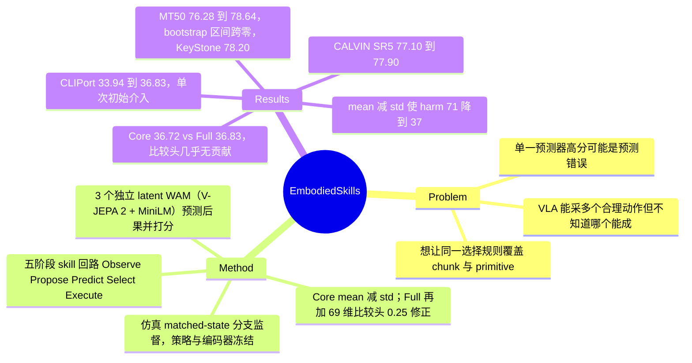

## Summary
EmbodiedSkills 在冻结的 VLA / 操作策略外加一层"提 5 个候选 → 3 个独立训练的 latent world action model（WAM，V-JEPA 2 特征上的轻量 transition + 打分头）预测后果并打分 → mean−std 聚合 + 一个 69 维输入的小 MLP 比较头修正 → 执行所选候选"的推理期重排序回路，WAM 由同一仿真状态恢复后执行各候选得到的 matched-state 分支监督。MetaWorld MT50（π0.5，每个 chunk 都重选）76.28→78.64%，CLIPort（只在第一个 primitive 介入）33.94→36.83%，CALVIN（FLOWER，每条链一次介入）SR5 77.10→77.90%。增益几乎全部来自 ensemble 的 mean−std 打分（CLIPort Core 36.72%），比较头只多 2 次成功；MT50 的 task-cluster bootstrap 95% 区间 [−1.32, 6.16] 跨零，对最强外部基线 KeyStone 只领先 0.44 点。

## Problem & Motivation
生成式 VLA 在同一观测下能采出多个合理动作，但"合理"不等于"能完成任务"：放置位置或接近角度的微小差别决定成败，而策略本身不告诉你哪个候选更好。已有两条路线：直接 evaluator（V-GPS 的 value、RoboMonkey 的 VLM verifier、TACO、linear value probe）和预测式 steering（GPC、FOREWARN、DREAMSTEER、WEAVER）。作者的切入点有两个：一是单个预测器给高分可能只是预测错了，所以要用多个独立 WAM 的分歧来折扣；二是想把"观测 / 提案 / 预测 / 选择 / 执行"做成接口固定、实现可换的 skill，以便同一选择规则覆盖连续 action chunk（π0.5、FLOWER）和 pick-and-place primitive（CLIPort）。第二点在论文里主要是工程封装，算法贡献集中在第一点。

## Method
**五阶段 skill 回路**（Table 1）。Observe（图像 + 状态 + 进度，冻结 V-JEPA 2 视觉编码、冻结 MiniLM 语言编码）→ Propose（冻结策略给 K=5 个候选，candidate 0 固定为 Direct 提案作参照）→ Predict（3 个 WAM 各自对 5 个候选预测 latent 后果与打分）→ Select（返回原候选集的下标）→ Execute（执行该 chunk 或 primitive，新观测进入下一轮）。所选动作永远是策略原提案之一，不做动作修正。

**WAM**（§3.2，Eq. 3–4）。三个成员同数据、同观测表示、独立初始化。CLIPort 版本在 64 个 spatial token 上工作，用固定随机正交投影 1024→32 维，候选上下文经 FiLM 式调制（γ, β）后预测 latent 变化 \(\hat\Delta\)；MetaWorld 版本用 pooled V-JEPA 2 特征 + 循环动作编码器，hidden 192。打分头读预测未来、相对当前的变化、相对 candidate 0 预测的差异与语言目标，输出有界相对分 \(s^{m,k}=0.1\tanh(v^{m,k}-v^{m,0})\)。

**选择规则**（§3.3，Eq. 5–9）。Core：\(b^k=\text{mean}_m s^{m,k}-\text{std}_m s^{m,k}\)，减去 candidate 0 后按候选集内 RMS 归一化。Full：再把三成员的归一化分数、32 维预测效果的均值 / 标准差、成员间方向一致性 \(a^k\)、平均幅度 \(\ell^k\) 拼成 69 维描述子，喂给 hidden 32/16 的共享 MLP，预测 (Direct 成败, 候选 k 成败) 的四类联合概率，修正项 \(u^k=p_{01}-p_{10}\)，最终 \(S^k=\tilde b^k+0.25u^k\) 取 argmax；系数 0.25 声称"评测前固定"。

**分支监督**（§3.4）。在仿真 anchor 状态存档，恢复后逐一执行每个候选，得到执行 horizon 后的观测（transition 目标）与结果标签（可以是更长 continuation 的成败）。WAM 损失 = Smooth-L1 dynamics + 0.25 BCE + 0.5 pairwise 排序 + Huber 相对结果；先 dynamics warm-up，再联合训练且打分梯度回传进 transition。之后冻结 WAM、单独训练比较头（按 \(c^k=2y^0+y^k\) 的加权交叉熵，task-balanced 采样）。数据量：CLIPort 1,290 anchor（1,032 训练 / 258 选 checkpoint），MetaWorld 12,519 训练 anchor（750 episode）+ 4,284 验证 anchor（250 episode），CALVIN 194 训练 / 69 验证 anchor。MetaWorld 训练额外用了短 horizon 成功与 expert-action alignment 作为仅训练期监督。

## Key Results
**评测协议差异很大，三个数字不能横比**（§5.1）。MT50：V3 环境，50 任务 × 50 episode = 2,500，每次决策重新采 5 个 chunk、执行最多 8 步，300 步预算，Direct 用同一 π0.5 与相同 task/seed。CLIPort：18 设定 × 100 = 1,800，每个候选从同一初始状态执行后由同一冻结 CLIPort 策略接管到终止，选择器只挑第一个 primitive，结果取该候选的录制 continuation——这是对已录制分支的离线重排序。CALVIN：1,000 条五任务链，每条在预定的一个任务、一个控制点介入一次。

**主结果**（Table 2）。MT50 1,907→1,966（+59，+2.36 pp）；CLIPort 611→663（+52，+2.89 pp）；CALVIN SR5 771→779（+0.80 pp），平均链长 4.509→4.522，SR1/SR3 与 Direct 持平（Table 6）。精确 McNemar：MT50 p=0.0024，CLIPort p<10⁻⁵；但作者在 §6 给出的 task-cluster bootstrap（100,000 次）95% 区间为 MT50 [−1.32, 6.16]、CLIPort [0.78, 5.11]，MT50 跨零。作者解释两者衡量的对象不同：McNemar 看固定评测实例上 rescue 与 harm 的不平衡，bootstrap 看对任务组成的敏感性，因此 MT50 的增益对任务重采样不稳健。

**rescue / harm**。MT50 213 rescue / 154 harm；CLIPort 92 / 40，且 1,800 个实例中改选了 978 个，大多数改选不改变终局。MT50 逐任务（Table 3）15 升 / 27 平 / 8 降：stick push +40、hammer +34、sweep +34、basketball +28；dial turn −30、coffee pull −22、stick pull −20、peg unplug (side) −18。

**外部方法对比**（Table 5，全部改编到本地冻结策略）。MT50：KeyStone（几何自一致 cluster-medoid，无学习 evaluator）78.20%，RTC / GAF 76.76，TACO 76.44，SPIRAL critic 76.36，ASRR-C 76.24，VLA-Corrector 76.00，AutoHorizon 75.52，VLA-RAIL 74.64，A³ 73.40；Full 78.64，对 KeyStone 仅多 11 个 episode。CLIPort：KeyStone 34.61、UF-OPS verifier 34.06、SPIRAL 33.78，Full 36.83。CALVIN（Table 6）：UF-OPS 77.40、SPIRAL 76.60、Full 77.90。注意 RTC 用 4 步执行 + 2 步模拟延迟，而 Direct/Full 执行 8 步且无延迟，调度不同。

**消融（全部只在 CLIPort 上做）**。候选数（Table 4，对已打分的 5 候选屏蔽前缀）：K=1/2/3/5 → 33.94 / 35.50 / 35.83 / 36.83。Ensemble（Table 9）：单成员 34.94 / 35.94 / 34.44；两两 36.50 / 35.39 / 35.83；三成员算术平均 35.72；Core（减 std）36.72，相对算术平均 harm 71→37、rescue 103→87。训练信号（Table 7，参照 Core）：NoPred（去掉后果监督）33.83，低于 Direct；Frozen（打分时冻结 transition）35.39；NoLang 33.94，与 Direct 打平但 59 rescue / 59 harm。比较头：Core 661 → Full 663，+0.11 pp（+5 rescue / +3 harm）。表示（Table 8）：DINOv2 34.28、SigLIP 35.61、V-JEPA2/DINO 固定融合 36.17、学习融合 36.50、V-JEPA2/SigLIP spatial 融合 36.61。投影与容量（Table 10）：随机正交 36.72、PCA 34.50、whitened PCA 33.83；width 64/128/256 → 34.94 / 36.72 / 34.61。优化（Table 11）：lr 1e-4 / 2e-4 / 4e-4 → 35.17 / 36.72 / 34.28；后果损失权重 0.5 / 1 / 2 → 35.61 / 36.72 / 35.06。

**开销**。CLIPort 三个 WAM + 比较头共 9.37M 参数；5 候选、batch 1、A100-80GB 上前向 11.33 ms（p95 13.28 ms），不含观测特征提取和策略采样。

**作者自述局限**（§6）：改进上限受候选覆盖限制；共享编码器与训练数据使 WAM 成员误差相关，导致 harm；全部是仿真；训练依赖仿真状态恢复来收集 matched 分支，真机复现成本高；CLIPort 与 CALVIN 只评一次介入。

## Evidence Ledger

| Claim ID | Claim | Type | Source locator | Evidence excerpt | Status |
|:--|:--|:--|:--|:--|:--|
| C1 | Table 2：MT50（π0.5，2,500 ep）Direct 76.28 → Full 78.64（+2.36）；CLIPort（1,800）33.94 → 36.83（+2.89）；CALVIN SR5（FLOWER，1,000 链）77.10 → 77.90（+0.80） | number | Table 2 | "MetaWorld MT50 \| \pi_{0.5} \| 2,500 \| 76.28 \| 78.64 \| +2.36" | source-verified |
| C2 | MT50 成功数 1,907 → 1,966（+59）；CLIPort 611 → 663（+52） | number | §5.2；Table 3/4 | "adding 59 completed tasks across 2,500 episodes … adding 52 completed tasks across 1,800 instances" | source-verified |
| C3 | MT50 逐任务 15 升 / 27 平 / 8 降；最大升 stick push +40、hammer 与 sweep +34、basketball +28；dial turn −30、coffee pull −22 | number | §5.2；Table 3 | "Full improves 15 tasks, ties Direct on 27, and declines on eight." | source-verified |
| C4 | Rescue/harm：MT50 213/154，CLIPort 92/40；CLIPort 改选 978/1,800 | number | §5.2；Table 12 | "Full produces 213 rescues and 154 harms on MT50, and 92 rescues and 40 harms on CLIPort" | source-verified |
| C5 | 精确双侧 McNemar：MT50 p=0.0024，CLIPort p<10⁻⁵ | number | §5.2 | "exact two-sided McNemar test … gives p=0.0024 for MT50 and p<10^{-5} for CLIPort" | source-verified |
| C6 | task-cluster bootstrap（100,000 次）增益 95% 区间：MT50 [−1.32, 6.16]（跨零），CLIPort [0.78, 5.11] | number | §6 Limitations | "the 95% intervals for the success-rate gains are [-1.32,6.16] percentage points on MT50 and [0.78,5.11] on CLIPort" | source-verified |
| C7 | MT50 外部对比：KeyStone 1,955（78.20%），Full 领先 0.44 点；RTC/GAF 1,919，TACO 1,911，VLA-Corrector 1,900，A³ 1,835 | comparison | Table 5；§5.3 | "on the strongest external comparator, KeyStone, by 0.44 points" | source-verified |
| C8 | CLIPort 外部对比：KeyStone 623（34.61）、UF-OPS 613（34.06）、SPIRAL 608（33.78），Full 663（36.83） | comparison | Table 5；§5.3 | "623 for KeyStone (34.61%), 613 for the UF-OPS verifier (34.06%), and 608 for the SPIRAL critic" | source-verified |
| C9 | CALVIN：Direct 4.509 / SR5 77.10，UF-OPS 4.515 / 77.40，SPIRAL 4.496 / 76.60，Full 4.522 / 77.90；SR1、SR3 与 Direct 相同 | comparison | Table 6；§5.4 | "Full matches SR1 and SR3, improves SR2 by 0.10 percentage points, SR4 by 0.40 points, and SR5 by 0.80 points" | source-verified |
| C10 | 比较头的贡献：Core 661 → Full 663，+0.11 pp（+5 rescue / +3 harm） | number | §5.5；Table 12 | "Adding the comparison head increases Core from 661 to 663 successes, a gain of 0.11 percentage points." | source-verified |
| C11 | Ensemble 消融：单成员 34.94/35.94/34.44，两两 36.50/35.39/35.83，算术平均 35.72，Core 36.72；相对平均 harm 71→37、rescue 103→87 | number | §5.5；Table 9 | "Core reduces harms from 71 to 37 while rescues decrease from 103 to 87" | source-verified |
| C12 | 训练信号消融（参照 Core 36.72）：NoPred 33.83（低于 Direct）、Frozen 35.39、NoLang 33.94（59 rescue / 59 harm） | number | Table 7；§5.5 | "Removing future-consequence supervision reduces success from 36.72% to 33.83%, slightly below Direct." | source-verified |
| C13 | 候选前缀 K=1/2/3/5 → 33.94/35.50/35.83/36.83，是在已打分 5 候选集上屏蔽前缀 | number | Table 4；§5.5 | "masks the eligible prefix of an already scored five-candidate set" | source-verified |
| C14 | 投影与容量：随机正交 36.72、PCA 34.50、whitened PCA 33.83；width 64/128/256 → 34.94/36.72/34.61 | number | Table 10；§5.6 | "training-fitted PCA and whitened PCA reach 34.50% and 33.83%" | source-verified |
| C15 | 视觉表示：DINOv2 34.28、SigLIP 35.61、固定融合 36.17、学习融合 36.50、spatial 融合 36.61 | number | Table 8；§5.6 | "The individual DINOv2 and SigLIP systems obtain 34.28% and 35.61%" | source-verified |
| C16 | CLIPort 评测是单次初始介入：选第一个 primitive，结果取该候选的录制 continuation（同一冻结策略接管） | benchmark-setting | §5.1 | "its complete-task result is obtained from that candidate's recorded continuation. This protocol measures a single initial intervention." | source-verified |
| C17 | MT50 协议：V3，50 任务 × 50 ep，每次决策重采 5 个 chunk、执行最多 8 步，300 步预算，Direct 同 task/seed | benchmark-setting | §5.1；§4 | "Full recomputes five candidate chunks … executes up to eight actions … within a 300-step budget" | source-verified |
| C18 | 训练数据：CLIPort 1,290 anchor（1,032/258）；MetaWorld 12,519 训练 anchor（750 ep）+ 4,284 验证（250 ep）；CALVIN 194/69 | benchmark-setting | §4 Learning and component reuse；§4 Task-chain；App B.2 | "MetaWorld uses 12,519 training anchors from 750 episodes and 4,284 validation anchors from 250 episodes" | source-verified |
| C19 | MetaWorld 训练分支额外提供短 horizon 成功与 expert-action alignment 作为仅训练期监督 | benchmark-setting | §4 Learning and component reuse | "the MetaWorld training branches provide short-horizon success and expert-action alignment as training-only supervision" | source-verified |
| C20 | 决策模块（3 WAM + 比较头）9.37M 参数，A100 上 5 候选 batch 1 前向 11.33 ms（p95 13.28 ms），不含观测特征 | number | §5.6 Decision-module cost | "contain 9.37 million parameters in total … takes 11.33 ms on an A100-80GB" | source-verified |
| C21 | RTC 对比用 4 步执行 + 2 步模拟延迟，Direct/Full 执行最多 8 步且无延迟 | benchmark-setting | §5.3；App B.1 | "RTC executes four actions with a simulated two-step delay, whereas Direct and Full execute up to eight without simulated delay" | source-verified |
| C22 | 选择规则：mean − population std（M=3），Full 再加 0.25 × (p01 − p10)；系数评测前固定 | causal-mechanism | §3.3 Eq. 5, 9 | "S^{k}=\widetilde{b}^{k}+0.25u^{k} … The coefficient is fixed before evaluation." | source-verified |
| C23 | 作者把 harm 部分归因于共享编码器与训练数据导致的 WAM 成员误差相关 | causal-mechanism | §6 Limitations | "Shared encoders and training data can also produce correlated prediction errors across WAM members, contributing to harmful replacements." | source-verified |
| C24 | 论文未给出代码仓库链接 | license-code | 全文检索 | 全文无 github / code release 字样 | source-verified |

## Strengths & Weaknesses

**亮点**
- **报告方式诚实且可审计**。逐任务全表、rescue/harm/switch 全量计数（Table 12 覆盖 28 个配置，\(\Delta N\) 与 rescue−harm 逐行自洽）、McNemar 与 task-cluster bootstrap 并列，并主动写出 MT50 区间跨零。多数 test-time selection 论文只给均值。
- **"减 std" 这一步有干净的证据**。同样三个成员，算术平均 35.72 → mean−std 36.72，机制落在 harm 从 71 降到 37；两两组合也大体强于单成员。这把"预测器高分可能只是预测错了"从口号变成了可测量的 harm 减少。
- **NoLang 与 NoPred 的结果有信息量**：去掉语言条件后净增益归零但改选 1,087 次（59/59），说明 WAM 若不知道目标，改选就是在 rescue 与 harm 之间抛硬币；去掉后果监督、只训打分头时低于 Direct，支持"用观测到的 latent transition 约束打分"确有作用（仅 CLIPort 证据）。
- 随机正交投影优于 PCA / whitened PCA，与 [[Papers/2609-DiscriminativeWM]] 的论点同向：保留视觉方差大的方向不等于保留对动作选择有用的区分。

**局限**
- **框架叙事大于算法增量**。"五阶段 skill""cascaded skills""agent"在实验里没有被单独检验：没有任何实验比较 skill 化与非 skill 化实现，"组件可替换"的证据是 Table 8 换了几个视觉编码器。可检验的算法贡献是 3-WAM mean−std 重排序，而比较头（标题与贡献 2 的重点）只带来 2/1,800 次成功，Figure 10 的示例分差 0.00017。
- **MT50 的增益统计上不稳，且几乎被免训练基线追平**。bootstrap 区间 [−1.32, 6.16] 跨零；KeyStone 不训练任何 evaluator，只比 Full 少 11 个 episode。MT50 上没有报告 Core，也没有任何 MT50 消融，所以"后果预测而非 action 空间一致性带来增益"在连续控制上没有被拆开。
- **CLIPort 是离线重排序，不是闭环部署**。只选第一个 primitive，结果取录制分支；"agent"在 CLIPort 和 CALVIN 上都只做一次决策。CALVIN +8 条链在 1,000 条上的差异很小，作者自己也未给出显著性。
- **疑似在评测集上做超参选择**。Table 10/11 与 Figure 6 的所有一因素扫描都在 1,800 个评测实例上跑，而默认值（随机正交、width 128、lr 2e-4、权重 1.0）恰好在每一轴上都最好，且相邻取值掉 1.5–2.5 点——与 +2.78 的 Core 增益同量级。论文只说 checkpoint 在 258 个 validation anchor 上选、0.25 系数评测前固定，没说明架构与优化超参如何确定。若这些默认值是看评测集定的，Core 的增益有向上偏差（推测，原文未说明）。
- **缺少两个关键参照**：(a) oracle best-of-5 上界（候选集中至少一个成功的比例），无法判断 36.83 离天花板多远；(b) 同预算的朴素基线，例如用同一分支数据训练的单一 value head 直接打分、或随机选非 0 候选。外部 verifier（UF-OPS、SPIRAL）都被改编到作者的 V-JEPA 2 + MiniLM 特征上并用作者的分支数据训练，改编质量无从判断。
- **MetaWorld 有额外的特权监督**：训练用了 expert-action alignment（脚本专家的动作）与短 horizon 成功信号，CLIPort 没有。两个 benchmark 的 WAM 不是同一配方，"同一选择规则跨后端"成立，"同一训练方法跨后端"不完全成立。
- **适用边界由"可恢复仿真状态"决定**。matched-state 分支需要在同一状态下逐一执行 5 个候选，真机上要复位物体与机器人；作者承认这一点，但这意味着方法目前只是仿真内的 policy improvement，与 DREAMSTEER 一类不需分支数据的 steering 不在同一可部署层面。
- 小问题：Table 5 中未测组合在 HTML 里渲染为 "New A"（图注称为 dashes）；arXiv 标题在版本间有变化（任务给出的标题与 v2 不一致）。

## Mind Map

## Notes
- [[Papers/2607-VLACorrector]]：本文 Table 5 的外部基线之一（8-step 改编，MT50 76.00%，低于 Direct 76.28）。二者在控制回路上的介入时机不同：VLA-Corrector 执行中检测偏差后截断 chunk，EmbodiedSkills 在执行前从候选中挑。
- [[Papers/2601-CycleVLA]]：同样在多个采样 chunk 里选一个，CycleVLA 用 MBR（候选间一致性）选择，属于本文 KeyStone 那一类"action 空间一致性"基线；本文 MT50 上 KeyStone 与 Full 只差 0.44 点，提示一致性选择可能已拿走大部分可得增益。
- [[Papers/2609-DiscriminativeWM]]：web agent 上的类比——world model 的训练目标应服务于候选区分而非状态重建；本文 PCA vs 随机投影、NoPred vs Core 的结果从机器人侧给出了部分同向证据。
- [[Papers/2506-VJEPA2]]、[[Papers/2504-Pi05]]：本文的视觉编码器与 MT50 动作后端。
- 待核：MetaWorld 上的 Core 数字与任何 MT50 消融是否存在于 v1；超参是否在 validation anchor 上确定。
