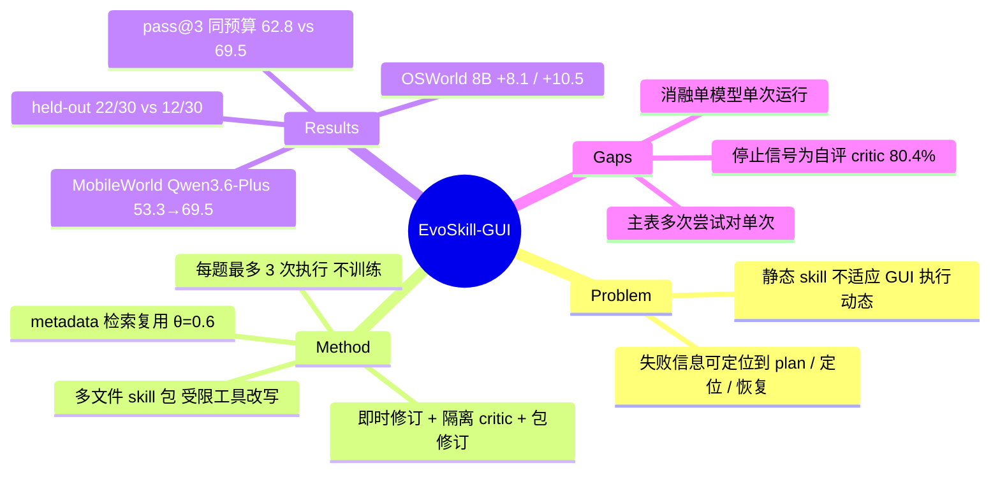

## Summary

EvoSkill-GUI 把 GUI skill 写成多文件包（检索 metadata、plan、备用定位、恢复规则、accessibility 工具、失败案例），部署时走 reflect → revise → reuse 循环：executor 执行中可即时改文件，失败后由同 backbone、只看指令与轨迹的隔离 critic 诊断，executor 再按诊断改包，每题最多 3 次执行；全程不训练。MobileWorld GUI-only 上四个 base model 提升 7.6–16.2 点（Qwen3.6-Plus 53.3→69.5），OSWorld-Verified 上两个 8B 模型 +8.1 / +10.5，AndroidWorld +2.6 / +6.0。主表把最多 3 次执行与单次执行的 base model 对比，唯一预算对齐的对照是 MobileWorld pass@3（62.8%，103.00M tokens 对 69.5%，94.75M tokens），held-out 30 题上 22/30 对 12/30。

## Problem & Motivation

GUI 任务里弹窗、延迟加载、控件挪位会让执行前写好的计划失效。现有 agent skill 框架（Anthropic Agent Skills、SkillWeaver 一类）大多不针对 GUI 执行动态设计，把 skill 当作部署前固定的产物。作者的主张是 GUI agent 需要的不是更好的静态 skill，而是能在部署期依据执行反馈修订、且无需训练的 skill。失败本身常带有可定位的信息：grounding 错暴露定位不可靠，意外弹窗暴露恢复分支缺失，冗余步骤暴露 plan 有误，因此 skill 应拆成可分别修改的部件。

## Method

**Skill 包**：每个 skill 是一个目录，含 metadata（id / intent / app / platform 等，用于检索）、plan.md（步骤计划 P）、backup.md（备用定位 B）、recover.md（失败恢复规则 C）、accessibility 工具与失败案例 F。executor 只能通过受限工具接口（list / search / create_failure 等）读改这些文件，不能改包外内容；另有只读 accessibility 工具返回当前窗口的 a11y tree。

**Reflect-Revise 循环**：
1. Rollout：executor 带当前 skill 包执行到成功、失败或步数上限；执行中可调用工具即时修订（instant revision），处理挪位控件、弹窗等局部偏差。
2. Reflection：同一 backbone 在独立 session 里充当 critic，只能看指令和执行轨迹（观测 + 动作），看不到 skill 包、executor CoT 和 ground truth；输出失败步定位、直接原因与修改建议。
3. Revision：executor 结合轨迹、执行后的 skill 快照与 critic 反馈修改包；失败时追加一条失败案例。任务成功或达到最大修订轮数时停止。主实验每题最多 3 次执行（初次 + 至多 2 次失败后修订）。

**检索与复用**：skill 按结构化 metadata 而非全文建索引，检索分数超过阈值 θ_r=0.6 时复用已有包（含 domain / keyword bonus），否则新建。

**设置**：每次执行最多 50 步；API 模型确定性解码；MobileWorld 只评 GUI-only 设置，并因稳定性排除 12 个 Google-proxy 任务。

## Key Results

- **MobileWorld GUI-only（Figure 3）**：Claude-Sonnet-4.6 57.1→67.6；Qwen3.6-Plus 53.3→69.5；Qwen3.6-35B-A3B 32.4→44.8；MAI-UI-8B 29.5→37.1。
- **OSWorld-Verified（Table 1）**：GUI-Owl-1.5-8B 46.7→54.8，Qwen3-VL-8B 23.8→34.3。逐 domain 波动大：GUI-Owl 的 VLC 43.8→86.5，OS 70.8→66.7；Qwen3-VL 的 Thunderbird 60.0→46.7，VSCode 26.1→47.8。附录对两处负项给出两个可能原因：运行方差（GUI-Owl 的 OS 两次重跑均为 79.2%）和 skill 指引把简单操作复杂化。
- **AndroidWorld（Table 2）**：seed 30 68.1→70.7（skill 复用率 37.9%），seed 42 55.2→61.2（复用率 100%）。
- **消融（MobileWorld，Qwen3.6-Plus）**：单文件 skill 66.67 对多文件包 69.52；去信息隔离 60.95；去即时修订 62.86；去 plan 65.71；去失败反思 66.67；a11y 工具在三个模型上带来 +3.80 / +1.90 / +2.85。
- **检索**：阈值 0.4 / 0.6 / 0.8 → 55.2 / 69.5 / 66.7；12 个复用案例里 metadata 检索 12/12 过阈值，全文匹配 1/12（平均分约 0.88 对 0.41）。
- **轮次（Figure 6）**：Qwen3.6-Plus 五轮 56.2 → 61.9 → 68.6 → 68.6 → 69.5，前三轮 +12.4，后两轮 +0.9。第 1 轮已与 base 不同（56.2 对 53.3），因为第 1 轮就带检索与即时修订。
- **预算对照（Table 13）**：pass@1 33.20M tokens / 53.3%；pass@3 103.00M / 62.8%；EvoSkill-GUI 94.75M / 69.5%。
- **Held-out（Table 10）**：87 题建库、30 题 held-out：22/30 对 pass@3 12/30；其中检索到 skill 的 16 题 12/16 对 7/16。
- **Critic 审计（Table 11）**：56 个失败任务上 143 条判断，115 条正确（80.4%）；至少 4 例 critic 把失败判为成功、提前终止演化。
- **可修复性（Table 9）**：plan 错 16/23 可修复，grounding 错 6/12，缺恢复分支 1/4；AndroidWorld 失败→成功恢复 27/89（Table 7）。

## Evidence Ledger

| Claim ID | Claim | Type | Source locator | Evidence excerpt | Status |
|:--|:--|:--|:--|:--|:--|
| C1 | skill 为多文件包（metadata、plan、备用定位、恢复规则、a11y 工具、失败案例），training-free | causal-mechanism | Abstract；§3.2 | "a training-free framework in which each skill is a structured multi-file package containing retrieval metadata, executable plans, backup localization" | source-verified |
| C2 | critic 与 executor 同 backbone、只看指令与轨迹，不看 skill 包、CoT、GT；循环在任务"成功"或达轮数上限时停，A.3 显示成功由 critic 判断 | causal-mechanism | §3.3 Eq.7–8；App. A.3 | "the critic receives only the instruction and execution trajectory, without access to the skill package, executor CoT, or ground truth." | source-verified |
| C3 | 每次执行 50 步；每题最多 3 次执行（初次 + 至多 2 次修订）；API 模型确定性解码 | benchmark-setting | §4.1；App. A.1；Table 12 | "at most three execution iterations, corresponding to the initial rollout plus at most two post-failure revision rounds" | source-verified |
| C4 | MobileWorld 只评 GUI-only，为评测稳定排除 12 个 Google-proxy 任务 | benchmark-setting | §4.1；App. A.1 | "For the stability of our evaluation, we exclude 12 Google-proxy tasks from MobileWorld." | source-verified |
| C5 | MobileWorld：Claude-Sonnet-4.6 57.1→67.6；Qwen3.6-Plus 53.3→69.5；Qwen3.6-35B-A3B 32.4→44.8；MAI-UI-8B 29.5→37.1 | number | §4.2；Figure 3 | "raises Claude-Sonnet-4.6 from 57.1% to 67.6% and Qwen3.6-Plus from 53.3% to 69.5%" | source-verified |
| C6 | OSWorld：GUI-Owl 46.7→54.8（VLC 43.8→86.5，OS −4.1）；Qwen3-VL-8B 23.8→34.3（Thunderbird −13.3，VSCode +21.7） | number | Table 1；App. A.4 | "two negative domain-level entries, on OS for GUI-Owl-1.5-8B and Thunderbird for Qwen3-VL-8B-Instruct."（初稿误记为 VSCode，已按 verifier 纠正） | source-verified |
| C7 | 附录给负项两个可能原因：运行方差（OS 重跑均 79.2%）与 skill 指引把直接操作复杂化 | comparison | App. A.4 | "For GUI-Owl-1.5-8B on the OS domain, two independent reruns both achieve 79.2%" | source-verified |
| C8 | AndroidWorld：seed 30 68.1→70.7（复用 37.9%）；seed 42 55.2→61.2（复用 100%） | number | Table 2 | "P1 (seed 30) 37.9 68.1 70.7 +2.6 / P2 (seed 42) 100.0 55.2 61.2 +6.0" | source-verified |
| C9 | 单文件 66.67 对包 69.52；去信息隔离 60.95；去即时修订 62.86（Qwen3.6-Plus） | number | Table 3；Table 4 | "Single-file Skill 66.67 / Skill Package (Ours) 69.52 … w/o information isolation 60.95 / w/o instant revision 62.86" | source-verified |
| C10 | 去 plan 65.71；去失败反思 66.67 | number | §4.3；Figure 5(a) | "Removing planning documents reduces success rate from 69.52% to 65.71%" | source-verified |
| C11 | 阈值 0.4 / 0.6 / 0.8 → 55.2 / 69.5 / 66.7 | number | Table 6（与 Table 8 重复） | "Lowering the threshold from 0.6 to 0.4 reduces the success rate from 69.5% to 55.2%" | source-verified |
| C12 | metadata 检索 12/12 过阈值，全文 1/12（0.8753 对 0.4050） | comparison | Table 5 | "Average / Hit Rate 0.8753 0.4050 12/12 1/12" | source-verified |
| C13 | Qwen3.6-Plus 五轮 56.2→61.9→68.6→68.6→69.5 | number | §4.4；Figure 6 | "rises from 56.2% to 61.9% (+5.7) and 68.6% (+6.7) over the first three rounds, remains at 68.6% in Round 4" | source-verified |
| C14 | pass@1 33.20M/53.3%；pass@3 103.00M/62.8%；EvoSkill-GUI（3 rounds）94.75M/69.5% | comparison | Table 13；App. A.5 | "Baseline pass@3 103.00 … 62.8 … EvoSkill-GUI (3 rounds) 94.75 … 69.5"（A.5 注明早前 168M 为记账错误） | source-verified |
| C15 | held-out 30 题 22/30 对 pass@3 12/30；检索到 skill 的 16 题 12/16 对 7/16 | comparison | App. A.2；Table 10 | "solves 22/30 tasks (73.3%), compared with 12/30 (40.0%)" | source-verified |
| C16 | critic 审计 115/143 正确（80.4%，56 个失败任务）；至少 4 例误判成功并提前终止 | number | App. A.3；Table 11 | "the critic incorrectly judges a failed task as successful and terminates evolution prematurely." | source-verified |
| C17 | 可修复性：plan 16/23，grounding 6/12，缺恢复分支 1/4 | number | Table 9 | "16/23 recovered by revising plan.md; grounding errors … (6/12), while missing contingencies … (1/4)" | source-verified |
| C18 | AndroidWorld 失败→成功恢复 27/89 | number | Table 7 | "Overall 232 27/89 30.3" | source-verified |
| C19 | a11y 工具增益 +3.80 / +1.90 / +2.85（Qwen3.6-Plus / 35B-A3B / MAI-UI-8B） | number | §4.3；Figure 5(b) | "improves Qwen3.6-Plus by +3.80, Qwen3.6-35B-A3B by +1.90, and MAI-UI-8B by +2.85" | source-verified |
| C20 | 代码 github.com/ZJU-REAL/EvoSkill-GUI；作者来自浙江大学（一位兼 UESTC） | license-code | Abstract；作者栏 | "Our code is available at https://github.com/ZJU-REAL/EvoSkill-GUI." | source-verified |
| C21 | 最终 SR 计哪次执行、迭代间是否调用官方 evaluator | benchmark-setting | §3.3；Alg. 1；App. A.6 | 论文未说明；Alg. 1 返回首个"成功"轨迹或最后一条；案例 failure_002.md 含 "Ground truth: 13186" | not-checkable |

## Strengths & Weaknesses

**Strengths**

- 有 GUI self-evolving 论文里少见的预算对照：MobileWorld 上与 pass@3 比 token，且 held-out 上与 pass@3 比，两者都显示"改 skill 再试"比"盲目重采样"多解出题（+6.7 点；22/30 对 12/30）。这是本文最有信息量的证据。
- critic 信息隔离写成了显式约束（不看 skill、CoT、GT），且做了 143 条判断的人工审计，报告了 over-optimism 失败模式，没有只报正面结果。
- 去信息隔离 −8.57、去即时修订 −6.66 的消融直接对应两个设计选择；Table 9 按失败类型拆修复率，说明 plan 层错误容易修、恢复分支难补，这个分布本身有用。
- metadata 检索 vs 全文检索（12/12 对 1/12）给出了"skill 索引该用什么"的具体答案。

**Weaknesses**

- **主表比较口径不对等**：OSWorld、AndroidWorld 与 MobileWorld 主结果都是"最多 3 次执行 + critic 停止"对"base model 单次执行"。只有 MobileWorld Qwen3.6-Plus 一个模型做了 pass@3 对照，其余模型的 +7.6~+16.2 与 +8.1 / +10.5 中有多少来自多次尝试本身，无法从论文得知。
- **"三轮 69.5" 与轮次曲线不一致**：§4.4 / 附录说三轮 EvoSkill-GUI 达到 69.5%，但 Figure 6 中 Qwen3.6-Plus 第 3 轮为 68.6%，第 5 轮才到 69.5%。按 105 题计两者差 1 题，结论方向不变，但说明主表数字与轮次设定的对应关系没有交代清楚。
- **停止信号是自评**：循环在"任务成功"时停，而成功判断来自同 backbone critic（审计正确率 80.4%，至少 4 例把失败判成功）。论文没有说明最终 SR 计的是 critic 终止时那次执行还是最后一次执行，也没有说明迭代之间是否调用官方 evaluator。附录 A.6 案例中写入 failure_002.md 的内容含 "Ground truth: 13186"，与 critic 不见 GT 的约束不符，论文未解释该字段来源；若 GT 或 evaluator 分数进入循环，"同预算优于 pass@3" 就不再是纯自评条件下的比较。
- **OSWorld 增益集中、波动大**：GUI-Owl 的 +8.1 里 VLC 一个 domain 贡献 +42.7，同时 OS −4.1、Qwen3-VL 的 Thunderbird −13.3；附录用 OS 重跑 79.2% 说明负项可能是方差，但主表为单次运行，同样的方差也可能抬高正项，论文没有对正项做重跑。
- **消融和敏感性只在一个模型、一个 benchmark 上**（MobileWorld，Qwen3.6-Plus），单次运行，约 105 题，一题约 0.95 点；单文件 66.67 对包 69.52 只差 3 题。
- **AndroidWorld 增益小且依赖 seed**：seed 30 只 +2.6，seed 42 +6.0 时复用率 100%，说明收益随任务流中能复用多少 skill 变化。Phase 2 复用率在 Table 2 写 100%、在 §4.4 正文写 56.1%，论文未说明两者口径差异。

**定位**：属于"非参数 skill 资产 + 部署期自演化"路线，与 [[Papers/2504-SkillWeaver]]（网页 API skill 合成）、[[Papers/2600-UiMemSelfEvolving]]、[[Papers/2600-UiVoyagerSelfEvolving]] 同族；区别在于把 skill 拆成按失败类型定向修改的文件，并给出 pass@3 预算对照。与 [[Papers/2610-MAGEManuals]] 对比：MAGE 的外部知识来自人写手册且要训练，EvoSkill-GUI 的知识来自自身失败且不训练。

## Mind Map

## Notes

- 相关：[[Papers/2504-SkillWeaver]]、[[Papers/2600-UiMemSelfEvolving]]、[[Papers/2600-UiVoyagerSelfEvolving]]、[[Papers/2600-ContinualGuiAgents]]、[[Papers/2610-MAGEManuals]]、[[Topics/NonInvasive-GUI-Scheduling]]、[[Ideas/FailureConditionedRetry-GUI]]（本文是该 idea 的最近邻居之一）。
- 注意与 vault 中其他笔记提到的通用 "EvoSkill"（如 [[Papers/2605-SkillOpt]]、[[Papers/2610-EviSkill]] 里的 baseline）不是同一工作。
