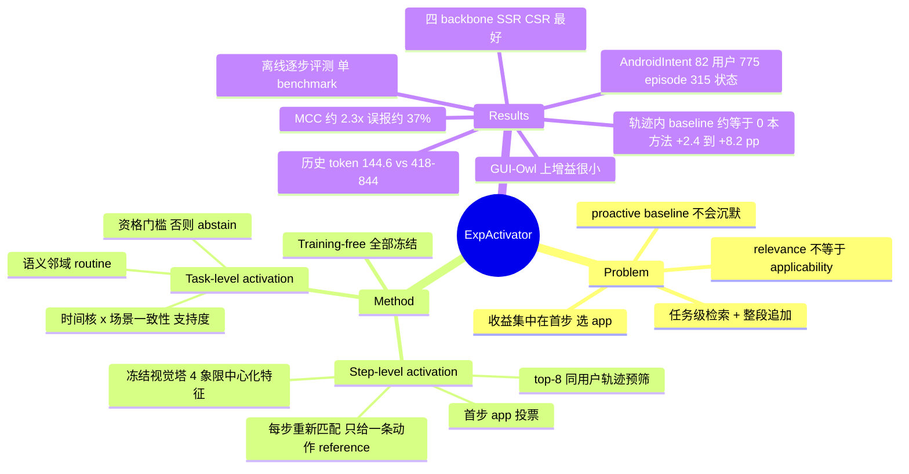

## Summary
个性化 GUI agent 的常见做法是按任务检索用户历史记录、整段追加进 policy context；本文在 AndroidIntent 上把每个 episode 拆成"首步"和"轨迹内"两段打分，发现四种 memory baseline 的收益几乎全部落在首步（选 app），在其余 7,140 个轨迹内动作上与无历史条件无法区分。据此提出 training-free 的 ExpActivator：执行时每一步用冻结 backbone 的视觉特征把当前屏幕匹配到历史轨迹中最像的那一屏，只把那一屏上的历史动作作为 reference 喂给 policy；主动建议时用时间核加场景一致性的支持度门控决定是否建议、否则 abstain。四个 8–9B 开源 backbone 上 SSR、CSR 全部最好（Qwen3-VL-8B SSR 22.6→30.9），proactive MCC 约为最强 baseline 的 2.3 倍，但评测是离线逐步打分、只有一个 benchmark，且对最强的 GUI-Owl-1.5-8B 增益很小（SSR 28.2→28.9）。

## Problem & Motivation
个性化 GUI agent 要从模糊指令（"点我常点的咖啡"）恢复 app、内容和操作方式，或在无指令时判断某个 routine 该不该现在提出。现有方法（Recent、Retrieve、LLM 写的用户画像 LLM-UM、PersonalAlign 的 HIM-Agent）都在任务层面检索相关记录，然后整段追加到 context，隐含假设"与任务相关的经验在任务的每一步都有用"。作者把这个假设命名为 relevance ≠ applicability：相关性在任务层面判定，而适用性取决于决策时刻的情境——当前屏幕对应历史中的哪一步，或者现在的时间和场景是否真的是该 routine 发生的时候。主动建议侧同样问题：检索只能返回相关 routine，不提供"现在不该说"的依据，于是 baseline 倾向于每次都建议。

## Method
统一形式：对候选集合 $\mathcal{B}$ 中按兼容度 $\kappa$ 取 argmax，再用读出算子 $\Gamma$ 取出对应的历史动作或意图（Eq. 1）。所有 encoder 与 policy 冻结，不训练任何参数。

**Step-level activation（执行）**
1. **任务级预筛**：用 paraphrase-multilingual-MiniLM-L12-v2 对指令与历史 goal（去掉开头的"打开某 app"短语）做相似度，取同一用户的 top-$K_\xi=8$ 条轨迹；整个任务内固定。
2. **首步**：$e_0$ 是 `open_app(p*)`，由 top-$K_a=10$ 条相似记录的 app 标签按 rank 加权投票得到（App. B.2）——首步不经过视觉匹配。
3. **之后每一步**：取冻结 backbone 视觉塔最终层 token 网格四个象限的均值（MAI-UI 额外加一个全局块），减去历史统计均值后逐块 L2 归一化拼接（Eq. 2），与 8 条轨迹中的所有历史屏幕做内积，联合在"轨迹 × 步"上取最大者（Eq. 3），把该历史屏上的动作（坐标归一化到 0–999）序列化为一条 action reference。
4. 每次观测后都重新匹配，reference 可以在不同历史轨迹之间跳转，不假设当前执行与历史 step index 对齐；prompt 明确要求 policy "adopt, adapt, or reject"，点击坐标须在当前截图上重新定位。

**Task-level activation（主动建议）**
1. 以每条历史意图为中心，用 MiniLM 意图嵌入、阈值 $\eta=0.94$ 构造语义邻域（routine，允许重叠）。
2. 当前时刻 $(c_x,\tau_x)$ 下的支持度 $M_j$ = 同场景成员的 24h 环形时间高斯核（$\sigma=1$h）之和（Eq. 4）。
3. **资格与排序分离**：只有总次数 $n_j\ge 12$、同场景次数 $\ge 4$、$M_j\ge 0.25$ 的 routine 才有资格；资格集合为空则 abstain；否则按 $M_j/n_j$（每次出现的平均情境匹配）排序选 routine，再取同场景成员中与整个 routine 平均最相似的意图作为 reference，交给冻结 backbone 生成一句建议（与 HIM-Agent 共用同一 prompt）。

## Key Results
**设置**：AndroidIntent（PersonalAlign 的 benchmark），82 用户、15,966 条历史记录（每用户时间上前 80%），775 个执行 episode / 7,915 步，315 个主动建议状态（215 正 / 100 负）。执行评测是离线逐步打分：policy 看当前截图和真实的前序动作，预测动作与记录动作比对（点击须落在 1000×1000 网格上归一化距离 0.14 以内）。四个冻结 backbone：Qwen3-VL-8B、MAI-UI-8B、Qwen3.5-9B、GUI-Owl-1.5-8B；QwenVL-Max 只作外部参照。

**个性化执行（Table 1）**：ExpActivator 在四个 backbone 上 Type / SSR / CSR 均最高。Qwen3-VL-8B 上 SSR 19.4（Base）/ 22.6（最强 baseline Retrieve、HIM-Agent）/ 30.9，CSR 41.4（Retrieve）→ 47.9。最强的 GUI-Owl-1.5-8B 上 SSR 只比 Retrieve 高 0.7（28.2→28.9）。论文汇总为相对最强 baseline 平均约 +20% SSR（逐 backbone 约 +37% / +23% / +16% / +2.5%，后者为本笔记按 Table 1 计算）。

**收益发生在哪一步（Table 2、Table 12）**：Qwen3-VL-8B 上首步 SSR 由 28.26 升到约 62（Retrieve / LLM-UM / HIM-Agent）和 70.06（ExpActivator）；轨迹内 7,140 个动作上，四个 baseline 相对 Base 的差在 −0.80 到 −0.07 pp，95% CI 均跨零，ExpActivator +8.24 [6.51, 10.16]。16 个 baseline×backbone 组合中轨迹内增益从未超过 2.4 pp，12 个与零无法区分；ExpActivator 在四个 backbone 上分别 +8.24 / +5.67 / +3.74 / +2.38，GUI-Owl 上 HIM-Agent 也有 +1.92。

**成本**：Qwen3-VL-8B 上每步追加历史 token 144.6，HIM-Agent 417.8，其余 baseline 730.6–843.7（截图 token 不计入，因各条件相同）。

**按历史规模分层（App. F.3）**：四个历史量分位组中都高于各组最强 baseline；历史最少的一组（≤111 条记录）+8.31 [5.32, 12.50] pp。

**主动建议（Table 1、Table 7）**：68% 状态为正，所以"总是建议"F1 就有 81.1，作者改用 BA 与 MCC。ExpActivator MCC 42.7 / 45.2 / 38.9 / 44.6，最强 baseline（HIM-Agent）20.7 / 14.1 / 22.0 / 19.0（平均约 2.3×）。MAI-UI-8B 上 Recent / Retrieve / LLM-UM recall 与误报率都是 100%，行为与"总是建议"相同。ExpActivator 误报率三个 backbone 上为 36–37%，Qwen3.5-9B 上 21%。

**消融（Table 3、Table 8–10）**
- *选择 vs 追加*（$K_\xi=1$，同一条轨迹）：整条追加 18.47 SSR（与无历史持平），只给匹配到的那一步动作 23.84（+5.36 [3.74, 7.06]）。$K_\xi=8$ 时把匹配步换成历史轨迹中的前一个动作得 23.32，匹配步本身 26.67。
- *刷新时机*：用上一屏匹配 22.63，每四步更新一次 23.17，每步用当前屏 26.67。
- *轨迹间切换*：约 92% 的 episode 从 ≥2 条历史轨迹取 reference（平均 3.4 条），55% 的相邻步切换到不同轨迹。
- *主动建议门控*：去掉时间核 BA 72.66→69.33；去掉场景条件 BA 降到 64.58、误报率 37%→62%；频率归一化不改变任何触发决策，只影响选哪个意图（Semantic +2.11）。

## Evidence Ledger

| Claim ID | Claim | Type | Source locator | Evidence excerpt | Status |
|:--|:--|:--|:--|:--|:--|
| C1 | 全部 encoder 与 GUI policy 冻结，不更新任何参数（training-free） | causal-mechanism | §2.3 末; App. A.2 | "All encoders and policy models remain frozen." / "Neither updates a parameter" | source-verified |
| C2 | Step-level：top-8 同用户轨迹预筛，每步用冻结视觉塔的中心化分块特征（4 象限，MAI-UI 加 1 全局块）匹配历史屏幕，只给一条动作 reference | causal-mechanism | §2.2 Eq. 2–3; App. B.1 Table 5; B.3 | "screen layout B: 4 centered quadrants; MAI-UI adds 1 global block" | source-verified |
| C3 | Task-level：$\eta$=0.94，$n_{\min}$=12，$n_{ctx}$=4，$\sigma$=1h，$\delta$=0.25，不满足则 abstain | causal-mechanism | §2.3 Eq. 4–5; App. B.5 | "η=0.94 , minimum total support is n_min=12 , minimum scenario support is n_ctx=4" | source-verified |
| C4 | AndroidIntent：82 用户、15,966 条历史、775 episode / 7,915 步、315 状态（215 正 / 100 负） | benchmark-setting | §3.1; Table 6 | "82 users ... (15,966 records) ... 775 episodes with 7,915 steps ... 315 states" | source-verified |
| C5 | 执行评测离线：policy 看当前屏与真实前序动作，点击需在 1000×1000 网格归一化距离 0.14 内 | benchmark-setting | App. C.2–C.3; D.1 | "with the current screen and the ground-truth preceding actions visible" | source-verified |
| C6 | Qwen3-VL-8B：SSR 19.4 / 22.6（Retrieve、HIM-Agent）/ 30.9；CSR 41.4 → 47.9 | number | Table 1 | Base SSR 19.4; Retrieve 22.6 / 41.4; ExpActivator 30.9 / 47.9 | source-verified |
| C7 | GUI-Owl-1.5-8B：SSR 28.2（Retrieve）vs 28.9；轨迹内 +2.38 vs HIM-Agent +1.92 | number | Table 1; Table 12 | "+1.92 [+1.24, +2.64]" / "+2.38 [+0.53, +4.41]" | source-verified |
| C8 | Qwen3-VL-8B 首步 28.26 → ~62（三个 baseline）/ 70.06；轨迹内 baseline −0.80~−0.07 pp（CI 跨零），本方法 +8.24 [6.51, 10.16] | number | Table 2 | "+8.24 [+6.51, +10.16]" | source-verified |
| C9 | 16 个 baseline×backbone 组合轨迹内增益不超过 2.4 pp，12 个与零无法区分 | comparison | App. F.2 Table 12 | "never exceeds 2.4 points and is indistinguishable from zero in twelve" | source-verified |
| C10 | 每步历史 token：144.6 vs HIM-Agent 417.8，其余 730.6–843.7 | number | Table 2 | History: 756.6 / 730.6 / 843.7 / 417.8 / 144.6 | source-verified |
| C11 | MCC 42.7/45.2/38.9/44.6 vs HIM-Agent 20.7/14.1/22.0/19.0，约 2.3× | number | Table 1; §3.2 | "about 2.3 times the MCC of the strongest baseline on average" | source-verified |
| C12 | 68% 正例使"总是建议"F1 达 81.1；MAI-UI 上三个 baseline recall=FA=100%；本方法 FA 36/37/21/37% | number | §3.2; Table 7 | "suggesting on every state already reaches 81.1% F1" | source-verified |
| C13 | $K_\xi$=1：整条追加 18.47 vs 选中一步 23.84（+5.36 [3.74, 7.06]）；$K_\xi$=8 前一个历史动作 23.32 vs 26.67 | comparison | Table 3; App. D.1 Table 8 | "raises policy SSR from 18.47% to 23.84%, a gain of 5.36" | source-verified |
| C14 | 上一屏匹配 22.63，每四步更新 23.17，当前屏 26.67 | number | Table 3; Table 9 | Previous screen 22.63; Update every four steps 23.17; Current screen 26.67 | source-verified |
| C15 | 去时间核 BA 69.33，去场景 BA 64.58、FA 37%→62%；频率归一化不改变触发决策 | number | Table 10; §3.4 | "false alarms rise from 37% to 62%" / "leaves every trigger decision unchanged" | source-verified |
| C16 | 首步 $e_0$ 为 top-10 相似记录 app 标签的 rank 加权投票，不经视觉匹配 | causal-mechanism | App. B.2 Eq. 7 | "e0=open_app(p*) ... We use K_a=10" | source-verified |
| C17 | ~92% episode 从 ≥2 条轨迹取 reference（平均 3.4），55% 相邻步切换轨迹 | number | §3.4; Figure 4 | "about 92% of episodes draw their references from at least two past trajectories, 3.4 on average" | source-verified |
| C18 | 各历史量分位组均胜最强 baseline；最小组（≤111 条）+8.31 [5.32, 12.50] pp | comparison | §3.3; App. F.3 | "with at most 111 records, gain 8.31 [5.32, 12.50] points" | source-verified |
| C19 | 官方代码 github.com/fyzhang1/ExpActivator（项目页链接，论文正文只给项目页）；未声明 license | license-code | 摘要区; 项目页; GitHub API | "Official code for \"Relevance Does Not Imply Applicability...\"" | source-verified |
| C20 | LLM-UM 原画像未发布，作者用 Qwen3.5-9B 从最近 150 条记录重新生成 | benchmark-setting | App. C.4 | "since the original profiles are not released, we generate them deterministically" | source-verified |

## Strengths & Weaknesses
**亮点**
- **诊断比方法更有价值**。把 SSR 拆成首步与轨迹内两段，是一个便宜但有力的测量：四种机制不同的 memory baseline（原始记录、相似记录、LLM 画像、分层意图记忆）在轨迹内全部贴着无历史基线，配有 user-cluster bootstrap 区间。这说明"把相关经验塞进 context"在这个 benchmark 上主要解决的是"选哪个 app"，而不是"这一屏怎么操作"。这是对 GUI memory 设计的一条可迁移的负面证据（已知，限于本 benchmark 与 8–9B 模型）。
- **控制实验干净**。$K_\xi=1$ 的选择 vs 追加用的是同一条轨迹、同一 policy，只改变暴露方式，直接把"信息量"和"信息呈现方式"分开；刷新时机的两个对照也把"每步重新匹配"从整体方法里剥出来。
- **主动建议的评测纠偏**。指出 F1 在 68% 正例下被"总是建议"刷到 81.1，改报 BA/MCC，并暴露出多个 baseline 实际不具备沉默能力。这对 proactive GUI 评测本身是一条有用的方法学提醒。
- 方法 training-free、在线开销与总历史量无关（候选最多 8 条轨迹），可套到任意冻结 backbone；代码已公开（GitHub 仓库未声明 license）。

**局限与隐含假设**
- **离线逐步评测 + 真实前序动作**。所有执行数字都是 teacher-forced 的单步匹配，没有在线闭环执行。错误累积、界面版本漂移、reference 把 agent 带偏后能否恢复，都没测（不知道）。CSR 也是由离线逐步结果加权得到。
- **增益依赖"用户重复做同样的事、界面几乎不变"**。案例中被激活的历史屏"nearly duplicates"当前屏。AndroidIntent 来自真实长期日志，评测目标是同一用户在历史中做过的任务的后续执行，step-level activation 本质上是同用户、同任务的最近邻动作复制。对新任务、新 app 版本、跨用户的情形是否成立，论文没有给证据（推测：会显著退化）。
- **越强的 GUI backbone 收益越小**。GUI-Owl-1.5-8B 上 SSR 只比 Retrieve 高 0.7，轨迹内 +2.38 vs HIM-Agent +1.92。一个可能解释是 action reference 主要在弥补弱模型的 grounding / 动作选择，强 backbone 自己已能做对（推测，论文未分析）。"平均 +20%"掩盖了这一趋势。
- **首步收益来自另一个机制**。$e_0$ 是 app 投票规则，不是视觉匹配；ExpActivator 首步 70.06 vs baseline 约 62 的差距，以及更偏重早期步的 CSR 增益，有一部分来自这个投票器，而不是本文核心的 step-level activation。
- **主动建议是手工规则**。六个常数（$\eta, n_{\min}, n_{ctx}, \sigma, \delta, \gamma$），敏感性扫描直接在 315 个评测状态上做（作者声明为诊断、报告值使用事先声明的常数）。MCC 约 0.4、误报率约 37%，离"可放心主动打扰用户"还有距离；$n_{\min}$ 的上限受用户 routine 实际重复次数约束。
- **单 benchmark、绝对水平低**。只在 AndroidIntent 上评测；最好的 SSR 也只有 30.9%，结论是相对改进，不代表个性化执行已经可用。LLM-UM 画像由作者用 Qwen3.5-9B 重新生成（原文未发布），该 baseline 的强度依赖复现质量。

**对领域的意义**：这篇的贡献更像一条测量结论——"任务级检索的经验在首步就用完了"——外加一个最小可行的修补（每步按屏幕重选一条动作）。它与 [[2605-MementoGUI]]（学习型 memory 选择/压缩）形成对照：本文显示不训练、只靠冻结视觉特征做最近邻选择就能拿到轨迹内增益，但前提是历史中有几乎相同的屏幕。对 GUI memory 方向的启发是：评估 memory 机制时应默认拆分首步与轨迹内，否则"memory 有用"的结论可能只是 app 选择被修正了。

## Mind Map

## Notes
- 与 [[2601-PersonalAlign]] 直接相关：本文使用其 AndroidIntent benchmark，并把 HIM-Agent 作为最强 baseline；PersonalAlign 报告的 execution 提升在本文的拆分下主要落在首步。
- 与 [[2409-AgentWorkflowMemory]] 的对照：AWM 抽象出可复用 workflow 整段注入，本文主张每步只取一条具体动作；两者的适用条件可能不同（跨任务泛化 vs 同用户重复）。
- 主动建议评测可与 [[2603-PIRABench]]、[[2603-PSPA-Bench- A Personalized Benchmark for Smartphone GUI Agent]]、[[2606-MyPCBench]] 对照看指标选择是否同样受正例比例影响。
- 待验证问题：在线闭环下，错误的 reference（匹配到"像但不对"的屏）会不会比没有 reference 更伤？论文的 prompt 允许 reject，但没有报告 policy 实际拒绝 reference 的比例。
