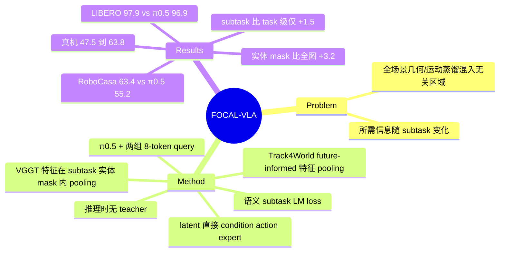

## Summary

FOCAL-VLA 在 π0.5 上加两组各 8 个 learnable query：一组对齐 VGGT 几何特征，一组对齐 Track4World 的 future-informed 运动特征。两路 teacher 特征都只在"当前 subtask 涉及实体"的 mask 区域内 pooling，query 的输出 latent 直接作为 action expert 的额外条件，推理时不运行任何 teacher。结果：LIBERO 平均 97.9%（π0.5 为 96.9%），RoboCasa Atomic-24 Human-50 为 63.4%（同设置 π0.5 为 55.2%），4 个真机任务总成功率 47.5% → 63.8%；ablation 中 subtask 级 mask 比 full-image pooling 高 4.7pp，但比 task 级 mask 只高 1.5pp。

## Problem & Motivation

作者的出发点是：已有 geometry distillation（Spatial Forcing、GLaD 把 VGGT 特征对齐到所有 visual token）和 future-motion distillation（Track4Action 在整幅图上 pool Track4World 特征）都在全场景上施加监督，会混入与当前交互无关的区域。并且当前交互需要的信息随 subtask 变化，例如"把物体放进抽屉"需要物体与抽屉的空间关系，"关抽屉"需要预判抽屉的运动。因此作者主张把几何和未来运动监督都绑定到当前 subtask 的交互实体上。

隐含假设：(1) "全场景监督会分散注意力"是论文的动机性断言，正文没有直接测量注意力或表征的证据，只用 full-image ablation 的成功率差来间接支撑；(2) 方法默认训练数据可以拆成离散 subtask，且每个 subtask 的相关实体能被明确列出。

## Method

**基座**：π0.5（PaliGemma backbone + flow-matching action expert），用官方 OpenPI 实现端到端 fine-tune。

**两组 query**：在 context tokens $C_t$ 后追加 $Q_g$（8 个 token）与 $Q_m$（8 个 token），其 backbone 输出即 geometry latent $Z_g$ 与 future motion latent $Z_m$。注意力结构：$Z_g$、$Z_m$ 各自只看 $C_t$ 和本组 token；action expert 看 $C_t + Z_g + Z_m$；$C_t$ 保持原生通路，不看 query。

**Subtask-Guided Geometry Distillation**：
- 离线用 Qwen3-VL-8B-Instruct，把人工写好的 subtask 描述对齐到 demo 帧上，识别 subtask 起点和涉及实体（被操作物体 + 容器/支撑面/铰接物体，不含 gripper）。
- mask 来源：仿真用 simulator 标注，真机用 entity-prompted Grounded-SAM-2。
- frozen VGGT 处理当前多视角图像，取最后一层 patch 特征（$d_g=2048$），用 mask 覆盖率加权 pooling，各视角平均（只计有效视角）得到 target。
- 预测头：per-query normalization → mean pooling → linear；target 与 prediction 都按训练集逐维 mean/std 标准化，用 masked MSE。

**Implicit World Modeling（future-informed motion distillation）**：
- frozen Track4World 输入当前 agent-view 帧 + 下一个 action chunk 区间内均匀采样的 K 个未来帧（RoboCasa 为 10 帧，覆盖 50 步 chunk；采样不在 subtask 边界截断）。
- 取 Track4World temporally global 3D flow-feature aggregator 在 source time 0 处的输出（$d_m=256$，45×45 grid），用当前帧 mask 加权 pooling。由于这些特征已融合整段 clip 的时序上下文，target 携带"该实体接下来怎么动"的信息。
- 用 Smooth L1（β=1）监督。这里的"world modeling"指在 latent 空间回归一个 256 维向量，不重建未来图像，也不重建 3D 轨迹。

**语义分支**：用 π0.5 原生 LM head 自回归预测 subtask 文本（$\mathcal{L}_{sem}$），attention mask 禁止 context / query / action token 看到 subtask 目标文本。

**总损失**：$\mathcal{L}_{action} + 0.05\mathcal{L}_{geo} + 0.01\mathcal{L}_{sem} + 0.05\mathcal{L}_{motion}$。所有 teacher target 离线缓存。推理时不需要 teacher、未来帧、mask 和 subtask 文本。

**训练**：8×A100 80GB；仿真 30k updates（LIBERO batch 256，RoboCasa batch 128），真机 16k updates；使用官方 π0.5 训练/评测 seed。

## Key Results

**LIBERO（Table I，success rate %）**

| Method | Spatial | Object | Goal | Long | Avg |
|:--|:--|:--|:--|:--|:--|
| π0.5 | 98.8 | 98.2 | 98.0 | 92.4 | 96.9 |
| OpenVLA-OFT | 97.6 | 98.4 | 97.9 | 94.5 | 97.1 |
| Track4Action | 95.0 | 99.6 | 97.6 | 95.8 | 97.0 |
| GeoPredict | 98.0 | 98.2 | 95.7 | 94.0 | 96.5 |
| **FOCAL-VLA** | **100.0** | 98.6 | 97.8 | 95.0 | **97.9** |

- 平均比 π0.5 高 1.0pp；最大增益在 Long（92.4 → 95.0）。Long 上 Track4Action（95.8）高于 FOCAL-VLA；Goal 上 FOCAL-VLA 低于 π0.5（97.8 vs 98.0）。
- 除 FOCAL-VLA 外，表中 baseline 数字均取自原论文；只有 RoboCasa 上的 π0.5 是作者按相同设置复跑的。

**RoboCasa Atomic-24, Human-50（Table II，平均 SR %）**：FOCAL-VLA 63.4，π0.5 55.2（+8.2pp），Robot-Centric Pointmap 62.9（推理时需要 3D 输入），Pri4R 57.0，GeoPredict 52.4。π0 / OpenVLA-OFT 数字引自 Pri4R，KYC / GeoVLA / PointVLA 引自 Pointmap 论文的 π0.5 复现版。FOCAL-VLA 只比需要 3D 输入的 Pointmap 高 0.5pp。

**真机（Table III，Franka Panda + 单个固定外部 RGB 相机，每任务 20 次）**

| Task | π0.5 | FOCAL-VLA |
|:--|:--|:--|
| Two-fruit rearrangement | 25.0 | 50.0 |
| Drawer opening | 70.0 | 80.0 |
| Drawer storage | 20.0 | 40.0 |
| Close the microwave | 75.0 | 85.0 |
| Overall | 47.5 | 63.8 |

350 条 SpaceMouse 遥操作 demo（每任务 50–150），10 Hz，640×480；两种方法各在全部 4 个任务上训练一个 policy。作者提到部分失败来自目标物在单视角下被遮挡。

**Ablation（RoboCasa，Table IV）**

| Variant | SR % |
|:--|:--|
| Full | 63.4 |
| w/o geometry | 60.0 |
| w/o future motion | 59.6 |
| Task-level entity supervision | 61.9 |
| Full-image supervision | 58.7 |
| Supervision-only（latent 不接 action expert） | 58.5 |

信息量最大的是后三行：(1) 把 pooling 范围从 full-image 收窄到 task 级实体，成功率 +3.2pp；再收窄到 subtask 级只多 1.5pp。"subtask"粒度本身的贡献远小于"实体 vs 全图"。(2) 只当辅助 loss、不把 latent 接入 action expert 时为 58.5，与 full-image 版本基本持平，直接 conditioning 带来 4.9pp。

## Evidence Ledger

| Claim ID | Claim | Type | Source locator | Evidence excerpt | Status |
|:--|:--|:--|:--|:--|:--|
| C1 | FOCAL-VLA 在 LIBERO 上平均成功率 97.9%，比 π0.5 高 1.0pp | number | §IV-B LIBERO; Table I | "FOCAL-VLA achieves an average success rate of 97.9%, improving over π0.5 by 1.0 percentage point." | source-verified |
| C2 | FOCAL-VLA 在 LIBERO-Spatial 达到 100.0%，Long 从 92.4% 提升到 95.0% | number | §IV-B LIBERO; Table I | "It reaches 100.0% on Spatial and obtains its largest gain on Long, improving from 92.4% to 95.0%." | source-verified |
| C3 | Table I 中 Track4Action 在 LIBERO-Long 为 95.8%，高于 FOCAL-VLA 的 95.0% | comparison | Table I | "Track4Action [21] | 95.0 | 99.6 | 97.6 | 95.8 | 97.0" | source-verified |
| C4 | FOCAL-VLA 在 LIBERO-Goal 为 97.8%，低于 π0.5 的 98.0% | comparison | Table I | "π0.5 [4] | 98.8 | 98.2 | 98.0 | 92.4 | 96.9" | source-verified |
| C5 | 除 π0.5 在 RoboCasa 上由作者复跑外，其余仿真 baseline 数字取自引用来源 | benchmark-setting | §IV-A Baselines | "We evaluate π0.5 on RoboCasa using the same training and evaluation settings as FOCAL-VLA. Results for the other simulation baselines are taken from the cited sources." | source-verified |
| C6 | FOCAL-VLA 在 RoboCasa 平均成功率 63.4%，比 π0.5 高 8.2pp，并高于表中所有其他方法 | number | §IV-B RoboCasa; Table II | "FOCAL-VLA achieves 63.4% average success, improving over π0.5 by 8.2 percentage points and outperforming the other listed methods." | source-verified |
| C7 | 推理时需要 3D 输入的 Robot-Centric Pointmap 在 RoboCasa 上为 62.9% | comparison | Table II | "Robot-Centric Pointmap [32] | 62.9" | source-verified |
| C8 | RoboCasa 上 KYC、GeoVLA、PointVLA 的数字来自 Pointmap 论文的 π0.5-based 复现 | benchmark-setting | §IV-A Baselines | "RoboCasa results for KYC, GeoVLA, and PointVLA use Pointmap's π0.5-based reimplementations" | source-verified |
| C9 | RoboCasa 使用 Atomic-24、Human-50 设置，每任务评测 50 个 episode | benchmark-setting | §IV-A Simulation benchmarks | "we use Atomic-24 under Human-50 (50 demonstrations per task)... We evaluate 50 episodes per task" | source-verified |
| C10 | 真机总成功率从 π0.5 的 47.5% 提升到 63.8%，四个任务全部提升 | number | §IV-B Real-world; Table III | "FOCAL-VLA improves success on all four tasks, raising the overall success rate from 47.5% to 63.8%." | source-verified |
| C11 | 真机 Two-fruit rearrangement 从 25.0% 提升到 50.0%，Drawer storage 从 20.0% 提升到 40.0% | number | Table III | "Two-fruit rearrangement | 25.0 | 50.0 ... Drawer storage | 20.0 | 40.0" | source-verified |
| C12 | 真机每个方法每个任务评测 20 次，用单个固定外部 RGB 相机，共 350 条 demo | benchmark-setting | §IV-A Real-world experiments; Table III | "totaling 350 demonstrations recorded at 10 Hz... success rates over 20 trials per task" | source-verified |
| C13 | 去掉 geometry 分支后 RoboCasa 从 63.4% 降到 60.0%，去掉 future motion 降到 59.6% | number | §IV-C; Table IV | "Removing geometry reduces success from 63.4% to 60.0%, while removing future motion reduces it to 59.6%." | source-verified |
| C14 | Task-level entity supervision 为 61.9%，full-image supervision 为 58.7%，subtask 级比 task 级多 1.5pp | number | §IV-C Supervision scope; Table IV | "Task-level entity supervision achieves 61.9% success, exceeding full-image supervision at 58.7%, while the full model achieves 63.4%." | source-verified |
| C15 | Supervision-only 变体（latent 不接 action expert）为 58.5%，直接 conditioning 带来 4.9pp | number | §IV-C Action conditioning; Table IV | "The supervision-only variant achieves 58.5% success, compared with 63.4% for the full model." | source-verified |
| C16 | 推理时不使用 teacher、未来帧、relevance mask 和语义 target | causal-mechanism | §III-D | "The teachers, future demonstration frames, relevance masks, and semantic targets are not used." | source-verified |
| C17 | 两组 query 各由 8 个 learnable token 组成 | number | §III-B; §III-C | "The geometry query group Qg consists of eight learnable tokens appended to Ct." | source-verified |
| C18 | Motion target 取 Track4World 3D flow-feature aggregator 在 source time 0 的输出，d_m=256，45×45 source grid | benchmark-setting | §III-C | "temporally global 3D flow-feature aggregator at source time index zero... where dm=256" | source-verified |
| C19 | Subtask 与实体标注由 Qwen3-VL-8B-Instruct 基于人工指定的 subtask 描述完成，mask 在仿真中来自 simulator 标注、在真机中来自 Grounded-SAM-2 | benchmark-setting | §IV-A Implementation details | "Masks come from simulator annotations or entity-prompted Grounded-SAM-2 [42, 43] for real-world data." | source-verified |
| C20 | 损失权重为 λg=0.05、λs=0.01、λm=0.05 | number | §IV-A Implementation details | "For the full model, we use λg=0.05, λs=0.01, and λm=0.05" | source-verified |
| C21 | 训练使用 8 张 A100 80GB，仿真 30,000 updates | number | §IV-A Implementation details | "Training uses eight NVIDIA A100 80GB GPUs... Simulation training uses 30,000 updates" | source-verified |
| C22 | GR00T N1.7 的 LIBERO 结果来自 LeRobot 的初步官方评测，而非同行评审论文 | benchmark-setting | §IV-A Baselines; Ref [40] | "GR00T N1.7 results follow the preliminary official LeRobot evaluation [40]." | source-verified |
| C23 | 论文只给出项目主页，正文未给出代码仓库链接 | license-code | Abstract | "Project website: https://zhiyuan-gao.github.io/FOCAL-VLA/." | source-verified |
| C24 | 作者承认评测只覆盖两个仿真 benchmark 和单一真机平台 | benchmark-setting | §V Limitations | "Our evaluation covers two simulation benchmarks and a single real-world robot platform" | source-verified |

## Strengths & Weaknesses

**Strengths**
- 设计干净：只在 π0.5 上加 16 个 query token、两个线性头和三项辅助 loss，teacher 特征离线缓存，推理时额外开销只有 16 个 token，可以直接套到其他 VLA 上。
- Ablation 切中要害：supervision-only 一行把"辅助 loss 改善表征"和"latent 直接作为 action 条件"拆开（58.5 vs 63.4）；task 级 vs subtask 级 vs full-image 三档 mask 把"空间范围"这个变量单独拿出来看。
- RoboCasa 上 π0.5 是同设置复跑，+8.2pp 这一主比较的可比性比 LIBERO 表更可靠。

**Weaknesses**
- **subtask 粒度的贡献在噪声范围内**：RoboCasa 24 任务 × 50 episode = 1200 次 rollout，63% 左右成功率的二项标准误约 1.4pp。subtask 级比 task 级多 1.5pp，大约 1 个 SE；论文未报告多 seed 结果或误差条。标题主打的"subtask-guided"本身证据最弱，可靠的结论只到"实体 mask 优于全图"（+3.2pp）。
- **缺关键对照**：没有"π0.5 + 语义 subtask loss + 两组 query，不加任何蒸馏"的变体。w/o geometry 与 w/o motion 都还保留语义 loss 和另一路 query，所以从 π0.5 的 55.2 到 59.6–60.0 的约 4–5pp 里，有多少来自 subtask 文本监督或额外 token，论文没有拆分。
- **Full-image 版本比单分支还差**：full-image（58.7）低于 w/o geometry（60.0）和 w/o motion（59.6），说明全图 pooling 不只是"没帮助"，可能有害。作者没有分析原因，例如全图均值 pooling 把 2048 维特征压成一个场景全局向量后信息退化，这与"冗余信息分散注意力"是不同的机制解释。
- **LIBERO 表可比性弱**：除 FOCAL-VLA 外数字都取自各自论文，backbone、训练步数、seed 各不相同；GR00T N1.7 用的是 LeRobot 的初步结果。在已经饱和的 LIBERO 上，97.9 vs 97.0/97.1 的差距不足以排序。
- **依赖特权标注**：训练需要人工写的 subtask 描述 + VLM 对齐 + 仿真 mask（或 Grounded-SAM-2）。在仿真里 mask 来自 simulator，是近乎完美的特权信息；真机 mask 质量与 VLM 分段误差对结果的影响没有量化，作者在 Limitations 里只是一句话带过。
- **真机证据薄**：每任务 20 次，单一相机、单一 robot，baseline 只有 π0.5。Drawer opening 70 → 80 和 Microwave 75 → 85 都只差 2 次成功。
- **"Implicit world modeling"的命名大于实际内容**：实际只是回归一个 256 维、来自未来上下文的 pooled 特征向量，没有 rollout、不能被查询，也没有验证 $Z_m$ 是否真的编码了未来运动（比如对未来 3D track 做 linear probe）。
- 正文未给出代码链接。

**适用边界**：适合能被分解成"实体明确的离散 subtask"的桌面/厨房操作；对 deformable 物体、实体不明确的任务（擦桌、整理散乱物品）或无法事先列出 subtask 的开放任务，mask 的构造前提不成立。

## Mind Map

## Notes

- [[2606-GeoPredict]]：同一问题（不在推理时输入 3D、在训练中注入几何与未来预测），在两篇论文的表中都作为 baseline 出现。注意 GeoPredict 原文 RoboCasa 52.4 是相对 π0 baseline（42.3）报告的，而 FOCAL-VLA 基于更强的 π0.5（55.2），两者的提升幅度不能直接比较。
- [[2606-3DThinkVLA]]：同属"把 3D 先验蒸馏进 action-query states"的路线；3DThinkVLA 在全图层面对齐几何和空间推理特征，正是 FOCAL-VLA 所说的 full-image 范式，可以用来检验"实体 mask 优于全图"是否对其他蒸馏方式也成立。
- [[2606-HiFVLA]]：同样用 motion representation 引入 foresight，但用 motion vector 做显式预测；FOCAL-VLA 只回归 pooled 特征。两者都没有探针证明 latent 编码了未来运动。
- [[2503-VGGT]]：几何 teacher；FOCAL-VLA 只用其最后一层 patch 特征的 masked mean，没有用到 VGGT 的 camera/depth head 输出。
