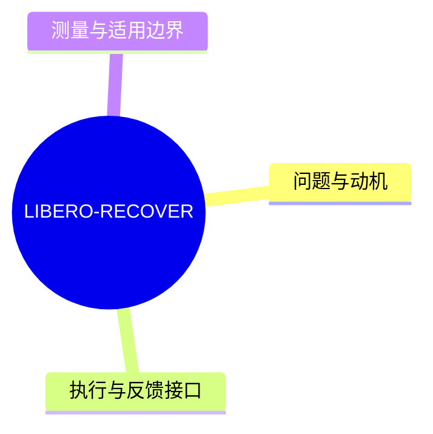

## Summary

LIBERO-RECOVER 从常规仿真 rollout 保存有代表性的失败状态，再对恢复操作进行条件评测。 [原文与版本](https://arxiv.org/html/2609.05178v4)

## Problem & Motivation

常规成功率聚合了正常回合和失误后的结果，难以定位恢复动作本身的能力。人为改变初始画面也和执行造成的落物、夹持失败或中途阻塞不同。

## Method

在 LIBERO 仿真中运行多个策略，从自然 rollout 选出失败场景并按难度分类。恢复评测恢复中途仿真状态，加入小扰动并覆盖夹爪开闭，重新运行到终止。另采人类遥操作恢复轨迹供混合训练。

## Key Results

评测覆盖 2,178 个场景、130 项子任务和 16 个维度。Table 2 中 GR00T N1.5 混入恢复数据后，reset recovery 平均 17.8%→21.2%，初态标准 LIBERO 86.5%→87.2%。OFT 的 LIBERO-100 恢复为 19.3%→23.6%，同子集标准成功率 94.5%→91.6%。

## Evidence Ledger

| Claim ID | Claim | Type | Source locator | Evidence excerpt | Status |
|:--|:--|:--|:--|:--|:--|
| C1 | 从仿真策略执行失败构造 2,178 个场景、130 项子任务、16 项评估维度 | benchmark-setting | §§2.4–2.5 | Benchmark Statistics | source-verified |
| C2 | 从中间失败状态 reset 并进行扰动、夹爪条件下的恢复评测 | benchmark-setting | Appendix D.2–D.4 | Recovery Rollout | source-verified |
| C3 | GR00T 和 OFT 在 reset-to-failure 条件下的提升未对应一致的标准 LIBERO 提升 | comparison | §4.2.3 Table 2 | failure-recovery transfer gap | source-verified |

## Strengths & Weaknesses

失败初态回放能隔离一类恢复能力，但跳过了检测和触发阶段。标准 LIBERO 是总成功率代理，不能直接推出在线恢复条件概率。OFT 的正文汇总基线与 Table 2 分套均值不一致，数字采用表内可配对子集。

## Mind Map

## Notes

- [[Topics/AgenticRobotArm-Survey]]
