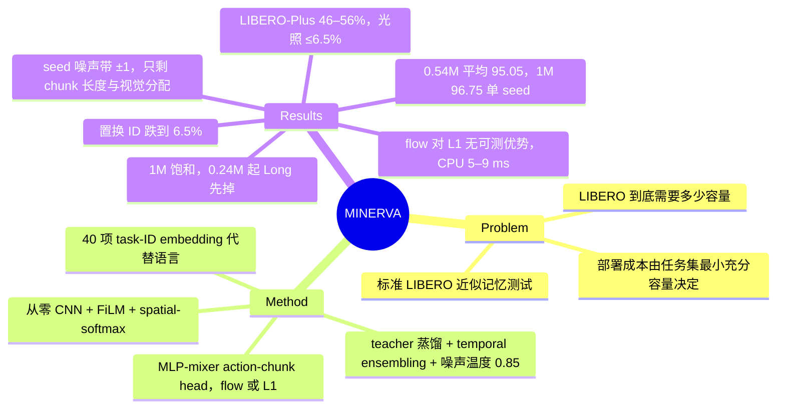

## Summary
MINERVA 把 LIBERO 当成"40 个已知任务的记忆题"来设计 policy：从零训练的小 CNN + 40 项 task-ID embedding（无语言编码器、无预训练视觉）+ MLP-mixer 式 action-chunk head，再把总参数从 9.66M 一路缩到 0.09M，找出仍能解 LIBERO 的最小规模。0.54M 参数在四个标准 suite 上 2,000 rollouts 平均 95.05%（π0.5 LeRobot 参考值 97.50，非协议匹配），性能在约 1M 饱和、0.24M 起先从 Long suite 掉下去；三 seed 消融给出 ±1 点的训练 seed 噪声带，只有 action-chunk 长度和视觉容量分配越过它，flow matching 对 L1 regression 没有可测优势。置换 task ID 后成功率跌到近机会水平，LIBERO-Plus 扰动下掉到 46–56%、光照扰动近乎全灭，说明这 95% 测的是任务索引式的视觉运动记忆。

## Problem & Motivation
LIBERO 已被数十亿参数的 VLA 刷到 95–98%，但这个 benchmark 本身到底需要多少模型容量从没被量过。作者从部署角度提问：任务集一旦固定，决定部署成本的是"仍能解这组任务的最小 policy"（任务集的 minimal sufficient capacity），知道这个下限就可以直接训练或蒸馏到它并跑在边缘 CPU 上。动机还来自 LIBERO-PRO 的结论：标准 LIBERO 在训练场景、训练任务、训练指令上评测，指令的作用主要是从 40 个记住的任务里选一个。既然如此，语言通路可以换成 40-way task ID，全部参数预算花在视觉状态估计和闭环动作生成上。作者把 empirical capacity floor 定义为"在固定训练与评测协议下、本 policy family 中仍保持目标成功率的最小被测模型"——它是该 recipe 下的上界估计，不是任务的本征下限。

## Method
**感知**。agent-view 与 wrist 两路 256² 图像缩到 144²（训练随机裁 128²，评测中心裁）后共用一个从零训练的 CNN（加 view embedding）：四级 stride-2 的 depthwise-separable 残差块，每级用 FiLM 注入 task embedding，接 spatial-softmax keypoint 提取再线性投影；8 维本体状态过两层 MLP。两帧观测（n_obs=2）的视觉特征、状态特征与 task embedding 拼成条件向量 c。7M 规模下从 1 帧到 2 帧，Goal +6、Long +4。

**动作头**。H=16 的 action chunk 用 conditional flow matching 生成（τ 从偏向高噪声的 Beta 分布采样，推理 10 步 Euler）。head 是 4 层 DiT；在 sub-1M 模型（0.5M / 1M）中，对 16 个 action token 的 self-attention 换成 token-mixing MLP，AdaLN-Zero 调制 MLP 在各 block 间共享。5M 恢复 self-attention，10M 再取消 AdaLN 共享（见下段），所以"MLP mixer + 共享 AdaLN"只描述 sub-1M 的配置。同一 head 也可训练成 learned query → chunk 的一次前向 L1 regression，作者最终发布的就是这个版本。另有训练时专用的 episode progress 辅助头（<9k 参数，推理时丢弃）。

**模型族与蒸馏**。0.5M（0.54M，CNN 宽度 32/64/112/160，48 keypoints，head 宽 96）与 1M（0.99M，40/80/160/224，64 keypoints，head 宽 128）只差宽度；5M（4.89M）恢复全宽 CNN 与 head self-attention；10M（9.66M）再取消 AdaLN 共享。小模型用更大 teacher 做 velocity distillation（L = L_fm + λ‖v_θ − v_φ‖²，λ=1），teacher 参数不计入。sub-1M 模型对 Long suite episode 损失加权 3×。

**推理**。每个控制步都重新规划，并用 ACT 式 temporal ensembling 对覆盖同一时刻的所有 chunk 预测做指数加权平均（每步衰减 0.01）；sub-1M 模型初始噪声乘 σ=0.85（mode-seeking）。

**训练与评测**。lerobot/libero 数据集 1,693 条示教、273k 帧、40 任务混训；90–120k steps，batch 128，AdamW lr 1e-4 cosine；单张 GH200 或 RTX 5080 约 2 小时。评测默认每任务 50 episodes × 40 任务 = 2,000 rollouts，固定评测 seed；消融筛选用 25 episodes/task，结论在 50 下复核。

## Key Results
**主表**（Table I，均为单 seed 1000、2,000 rollouts）：

| policy | params | Spatial | Object | Goal | Long | avg |
|:--|:--|:--|:--|:--|:--|:--|
| MINERVA-0.5M | 0.54M | 94.4 | 99.6 | 96.4 | 89.8 | 95.05 |
| + L1 head（发布版） | 0.54M | 96.8 | 99.6 | 97.4 | 89.2 | 95.75 |
| MINERVA-1M | 0.99M | 97.0 | 99.8 | 97.4 | 92.8 | 96.75 |
| MINERVA-5M | 4.89M | 99.0 | 99.2 | 98.0 | 92.4 | 97.15 |
| MINERVA-10M | 9.66M | 98.4 | 99.0 | 98.4 | 94.0 | 97.45 |
| π0.5（LeRobot 报告值，400 rollouts） | 4.1B | 97.0 | 99.0 | 98.0 | 96.0 | 97.50 |

**Scaling**（§V-B，Figure 3）。1M→10M 平均只涨 0.7 点；0.24M 为 88.6%（Spatial 95.2 / Long 73.0），0.09M 为 68.3%。崩塌先从 Long suite 开始，短程 suite 在小得多的模型上仍存活。其余扫描点的逐 suite 数字只在 Figure 3 中（正文无数字）。

**Seed 噪声带与消融**（Table II，1M 规模，每格 2,000 rollouts）。baseline（chunk 16 + flow matching）三 seed 95.63±1.08，范围 94.60–96.75，Long 单项 87.6–92.8。三 seed 复训的配置里：chunk 8 为 92.47（−3.16，Goal 掉到 86–89）、chunk 32 为 93.43（−2.20，Long 掉到 80–82）；把视觉从 0.49M 压到 0.13M（总量不变）为 94.22±0.20（−1.41，Long −4.6）；flow → L1 为 95.97±0.80（+0.34）。单 seed 时 L1 是 −1.70、视觉饥饿是 −2.50，三 seed 后前者反号、后者减半。单次运行的 conditioning 方式（concat −0.40、FiLM −0.10）、去掉蒸馏（+0.10）、恢复 self-attention（+0.05，参数 +26%）都在噪声带内。

**容量分配**（§V-D）。固定约 1M 总量的六点扫描中，vision 占 50–80% 的配置都落在 96.3–96.8（单次）；开发期把参数从 attention head 挪进 CNN，Long 从 80.8 到 91.0。

**推理策略**（§V-E，0.54M 同一 checkpoint，25 episodes/task 筛选）。每次 replan 只执行 1–2 步明显优于 4 步、4 步优于 8 步；horizon 1 时 temporal ensembling 96.3 > BID 95.0 > plain chunking 94.1 > RTC 91.8。噪声温度 0.85 对每个 sub-1M 模型加 0.2–2.25 点，1M 及以上无效。

**延迟**（Table III，RTX 5080 Laptop GPU / 8 CPU 线程，batch 1，每 chunk）：0.54M flow 8.2 / 8.9 ms，L1 2.2 / 5.1 ms；1M 8.5 / 10.0；10M 11.1 / 17.8；SmolVLA 118 / 1,010；π0.5 196 / 12,781 ms、9.36 GB VRAM。论文的"113× / 1,400×"按 CPU 列算出，GPU 列上约为 14× / 24×。

**置换探针**（§V-G，已发布 1M checkpoint，只改 task-ID 映射）。suite 内轮换 ID：96.75 → 6.5%；全部强制为 task-0 ID：16.2%，其中 Spatial / Goal / Long 为 10.0 / 10.0 / 8.8（恰为 1/10 预测），Object 残留 22–36%，视觉差异大的场景能部分纠正错误 ID。

**LIBERO-90**（§V-H）。0.995M、无蒸馏，89 个有示教的任务平均 94.6%；90 个任务只有 74 条不同指令，共享 ID 的任务 93.6 vs 独占 ID 95.1；最差任务 50–60%。单 seed、10 episodes/task。

**LIBERO-Plus**（Table IV，分层抽样、每 variant 2 episodes，三个模型用同一批 variant）：

| factor | 0.54M | 0.99M | 4.89M |
|:--|:--|:--|:--|
| language（≈ 无扰动基线） | 96.7 | 96.7 | 99.2 |
| new objects | 69.7 | 62.1 | 95.5 |
| sensor noise | 68.5 | 60.0 | 73.8 |
| robot init | 57.1 | 60.3 | 63.5 |
| object layout | 50.0 | 51.8 | 58.9 |
| camera | 11.5 | 18.5 | 34.6 |
| background | 9.3 | 4.7 | 7.0 |
| light | 1.1 | 2.2 | 6.5 |
| average | 46.7 | 46.0 | 55.7 |

1M 以下鲁棒性不随容量变；5M 多出的约 10 点几乎全来自 new objects 这类语义/几何因素；光照在所有规模都 ≤6.5%。

**作者自述局限**（§VI）。task-ID embedding 无法处理没训练过的任务；只有五个关键消融配置做了三 seed，headline 模型、LIBERO-90、其余扫描点和蒸馏对比都是单次；全部结果来自一个模拟器、一个评测 seed；没有真机验证。

## Evidence Ledger

| Claim ID | Claim | Type | Source locator | Evidence excerpt | Status |
|:--|:--|:--|:--|:--|:--|
| C1 | Table I 单 seed：0.54M 95.05（94.4/99.6/96.4/89.8）；+L1 95.75；1M 96.75；5M 97.15；10M 97.45 | number | Table I | "MINERVA-0.5M \| 0.54M \| 94.4 \| 99.6 \| 96.4 \| 89.8 \| 95.05" | source-verified |
| C2 | π0.5 LeRobot 参考值 97.50，10 episodes/task、400 rollouts，非协议匹配 | benchmark-setting | Table I caption；§V-A | "measured at 10 episodes/task — a reference point rather than a protocol-matched comparison" | source-verified |
| C3 | 0.54M 比 π0.5 低 2.4 点、参数少 7,700×；0.99M 差 0.75；差距主要在 Long（92.8 vs 96.0） | comparison | Abstract；§V-A | "The remaining gap is almost entirely the long-horizon suite (92.8 vs. 96.0 at 1M)" | source-verified |
| C4 | 1M→10M +0.7；0.24M 88.6（Spatial 95.2、Long 73.0）；0.09M 68.3 | number | §V-B；Figure 3 | "88.6% at 0.24M, 68.3% at 0.09M … still solves 95.2% of Spatial but only 73.0% of Long" | source-verified |
| C5 | 1M baseline 三 seed 95.63±1.08，范围 94.60–96.75，Long 87.6–92.8；Table I 的 1M 行是 seed 1000 | number | Table II；§V-C；§V-A | "the baseline spans 94.60–96.75; its long-suite score alone spans 87.6–92.8" | source-verified |
| C6 | 三 seed：chunk 8 −3.16、chunk 32 −2.20、vision 0.13M −1.41（Long −4.6）、L1 +0.34 | number | Table II top；§V-C | "flow matching \to L1 regression \| 95.97\pm 0.80 \| +0.34" | source-verified |
| C7 | chunk 8 使 Goal 掉到 86–89、chunk 32 使 Long 掉到 80–82，另一 suite 不变 | comparison | §V-C | "Chunk 8 breaks the goal suite (86–89% vs. 96.6–97.4% at chunk 16) while leaving the long suite intact" | source-verified |
| C8 | flow vs L1 单 seed −1.70 三 seed 反转 +0.34；vision 饥饿单 seed −2.50 三 seed −1.41 | comparison | §V-C | "The single-seed comparison had regression -1.70 worse; over three seeds this reverses to +0.34" | source-verified |
| C9 | 单次消融：concat −0.40、FiLM −0.10、no distillation +0.10、self-attn +0.05（+26% 参数） | number | Table II bottom | "no distillation \| \| +0.10 … mixer \to DiT self-attn. head ( +26\% params) \| \| +0.05" | source-verified |
| C10 | 蒸馏在 5M 单次 +1.85，4.89M 学生超过 7.12M teacher；1M 处在 seed band 内 | comparison | §III-B | "+1.85 average over the same architecture trained alone; the distilled 4.89M model even beats its own 7.12M teacher" | source-verified |
| C11 | ≈1M 预算六点分配扫描，vision 50–80% 均在 96.3–96.8；开发期 Long 80.8→91.0 | number | §V-D | "every allocation giving vision 50–80% of the budget lands in a flat 96.3–96.8 band" | source-verified |
| C12 | horizon 1：temporal ensembling 96.3 > BID 95.0 > plain 94.1 > RTC 91.8（25 episodes/task） | comparison | §V-E | "temporal ensembling, 96.3% … BID-style candidate selection (95.0%) … plain chunking (94.1%); RTC-style soft inpainting hurts (91.8%)" | source-verified |
| C13 | 噪声温度 0.85 对 sub-1M 模型 +0.2 到 +2.25，1M 及以上无收益 | number | §V-E | "initial-noise temperature 0.85 adds +0.2 to +2.25 points on every sub-1M model … nothing at 1M and above" | source-verified |
| C14 | 延迟：0.54M 8.2/8.9 ms，L1 2.2/5.1；SmolVLA 118/1,010；π0.5 196/12,781、9.36 GB；快 113× 与 1,400× | number | Table III；§V-F | "the 0.54M model is 113 \times faster than SmolVLA and 1,400 \times faster than \pi_{0.5}" | source-verified |
| C15 | regression 在 GPU 上最多快 3.8× | number | Abstract；§V-C | "direct regression is up to 3.8 \times faster" | source-verified |
| C16 | 置换探针：轮换 ID 96.75→6.5；强制 task-0 16.2，Spatial/Goal/Long 10.0/10.0/8.8，Object 22–36 | number | §V-G | "collapses the average success rate from 96.75% to 6.5% . Forcing every task to its suite's task-0 ID yields 16.2%" | source-verified |
| C17 | LIBERO-90：0.995M、无蒸馏 94.6%（89 任务）；74 条不同指令；共享 93.6 vs 独占 95.1；单 seed、10 episodes/task | number | §V-H | "94.6% average over 89 tasks at 0.995M parameters"; "Caveats: single seed, 10 episodes/task" | source-verified |
| C18 | LIBERO-Plus 平均 46.7/46.0/55.7；light 1.1/2.2/6.5；camera 11.5/18.5/34.6；new objects 69.7/62.1/95.5 | number | Table IV；§V-I | "the 0.54M, 0.99M and 4.89M models fall to 46.7%, 46.0% and 55.7%" | source-verified |
| C19 | 训练数据 1,693 示教 / 273k 帧；90–120k steps、batch 128；单 GPU 约 2 h；sub-1M Long 损失 3× | benchmark-setting | §IV Data and training | "one model trains in \approx 2 h on a single GH200 or consumer RTX 5080 GPU" | source-verified |
| C20 | 2,000 rollouts 固定 seed；仅五个关键消融三 seed，其余单次；一个模拟器一个评测 seed；无真机 | benchmark-setting | §IV；§VI Limitations | "everything rests on one simulator and one evaluation seed" | source-verified |
| C21 | 从零 CNN + FiLM + spatial-softmax，40 项 task-ID embedding 代替语言，H=16，MLP mixer 替代 self-attention；7M 时 2 帧观测 Goal +6、Long +4 | causal-mechanism | §III-B | "at 7M parameters, moving from one to two observation steps gains +6 points on Goal and +4 on Long" | source-verified |
| C22 | 代码、配方与全部 checkpoint 开源（github.com/k1000dai/MINERVA）；论文 CC BY 4.0 | license-code | Abstract；arXiv 页头 | "Code, recipes and all checkpoints are open sourced here" | source-verified |

## Strengths & Weaknesses

**亮点**
- **问题本身选得好**。不是再做一个更便宜的 VLA，而是用一个刻意"什么都不会"的 policy 量 benchmark 的需求。0.54M、无语言、无预训练就能到 95%，这个数字对任何拿 LIBERO 97–98% 做卖点的工作都是一条直接的校准线：标准 LIBERO 上 97% 以上的差异很难归因到大模型独有的能力。
- **把训练 seed 噪声带量出来了**。1M baseline 三 seed 跨度 2.15 点（94.60–96.75），Long 单项跨度 5.2 点。同一套实验里，单 seed 时"flow 比 L1 好 1.70"三 seed 后反号，"视觉饥饿 −2.50"减半到 −1.41——这是单 seed 消融在 LIBERO 上会误导的现场例证，比一般性的"应报多 seed"有说服力得多。
- **chunk 长度的失败是可解释的双向结构**：太短伤 Goal（同场景多目标，需要提交到一个分支），太长伤 Long（多阶段任务需要在子目标边界反应）。这与 OpenVLA-OFT 观察到的 L1 ≈ diffusion 一起，进一步削弱了"生成式动作头在 LIBERO 上必需"的默认假设。
- **置换探针是干净的因果干预**：权重不动、只改 ID 映射，Spatial/Goal/Long 精确落到 1/10，Object 的残留又说明视觉能部分补偿错误的条件信号。LIBERO-Plus 审计主动给出 headline 不包含的部分，作者没有回避 46% 这个难看的数字。
- 全部 checkpoint 和配方开源，2 小时单卡训练，复现门槛极低。

**局限与隐含假设**
- **headline 的 1M 行取的是三 seed 中最高的那个**。Table I 的 1M（96.75，seed 1000）正好是 Table II 三 seed 范围 94.60–96.75 的上端；三 seed 均值 95.63，对 π0.5 的差距是约 1.9 点（97.50 − 95.63）而不是 0.75。scaling 叙述也受影响：以三 seed 均值为起点，1M→10M 约 +1.8 点（95.63→97.45）而不是 +0.7；10M 本身也只跑了一个 seed，"约 1M 饱和"的判断需要打这个折扣。置换探针的"96.75→6.5%"同样以最好 seed 的 checkpoint 为基准。作者在 §V-A 写明"rows are single runs"，但摘要和讨论里的"0.75–2.4 points"没有这层说明。0.54M 的 95.05 / 95.75 同样是单次。
- **对 π0.5 的比较协议不匹配**：π0.5 是 LeRobot 报告值，10 episodes/task 共 400 rollouts；MINERVA 是 2,000 rollouts。作者自己承认是参考点。此外表中没有 OpenVLA-OFT（97.1）和 TurboVLA（97.7）——它们只出现在 Figure 1 和相关工作里，与 MINERVA-10M 的 97.45 同样在噪声带内。
- **"capacity floor" 依赖 recipe**。0.54M 模型是用更大 teacher 蒸馏、Long 损失 3× 加权、噪声温度 0.85、temporal ensembling 共同堆出来的，teacher 参数不计入。它是"该 recipe 下最小被测模型"的上界（作者定义里写了），也不等于 0.54M 规模的模型从零训练就能到 95%。门槛设在 95% 也是人为选择：0.24M 仍有 88.6%，摘要说"collapses below a quarter million"略重，真正的崩塌在 0.09M（68.3%）。
- **"instruction conditioning 主要在记忆任务间选择"是对 benchmark 充分性的论证，不是对 VLA 行为的测量**。置换探针只证明了 MINERVA 自己用 task ID 选任务；而且引言写的"collapses success … to chance level"说过头了——轮换 ID 得 6.5%，但强制 task-0 ID 时是 16.2%，Object suite 残留 22–36%，视觉在一部分场景里能压过错误 ID。大 VLA 是否也这样用语言，本文没有测（这一点要靠 LIBERO-PRO 一类工作）。
- **LIBERO-Plus 没有同协议的 VLA 对照**。抽样方式（分层抽样、每 variant 2 episodes）与 LIBERO-Plus 全量 10,030 × 1 不同，抽样总数在正文中未给出。[[Papers/2609-LatentInterfaceTraining]] 在全量协议下报的 π0.5（其自训 baseline）Lighting 82.40、Camera 58.29、Overall 68.97，对照 MINERVA 的 1–6.5% 光照说明从零训练的小 CNN 在光照上远差于预训练视觉——但两边协议和 checkpoint 都不同，只能作方向性参考。
- **发布版（L1 head）的鲁棒性和置换行为没测**。置换探针用的是 1M flow 版（96.75），LIBERO-Plus 用的是 0.54M flow 版（标准成绩 95.05）。
- **推理策略比较落在噪声带里**。TE 96.3 vs BID 95.0 是同一 checkpoint、25 episodes/task 的单次筛选，差 1.3 点；噪声温度的 +0.2~+2.25 也是单次。这些排序可信度低于 Table II 顶部的三 seed 结论。
- **内部数字小出入**：4.1B / 0.54M ≈ 7,600×（文中 7,700×）；8.2 / 2.2 ≈ 3.7×（文中"up to 3.8×"）；"113× / 1,400×"只按 CPU 列算（1,010 / 8.9、12,781 / 8.9），GPU 列上只有约 14×（118 / 8.2）与 24×（196 / 8.2）；§V-F 只写"on identical hardware"，只有摘要注明是 laptop CPU。另外摘要"113× faster than SmolVLA"用的是 flow 版 8.9 ms，而同句的"5–9 ms"包括 L1 版（5.1 ms 对应约 198×）。都不改变结论。
- 单一模拟器、单一评测 seed、无真机；对 photometric 失败给的"光度增强可能修复"是推测，未做实验。

**对领域的意义**。这篇的价值主要在测量而不是 MINERVA 这个模型：给 LIBERO 标准分一个 0.5M 参数的记忆基线，并示范了 seed band 应该怎么用来读消融。之后在 LIBERO 上报告 1 点以内增益、或拿"轻量 VLA 达到 97%"做主张的工作，都应该对照这条线。

## Mind Map

## Notes
- [[Papers/2502-OpenVLA-OFT]]：同结论的另一端——OFT 在 7B OpenVLA 上发现 L1 regression 与 diffusion 在 LIBERO 几乎打平（95.3 vs 95.4），MINERVA 在 1M 规模三 seed 下得到同一结论（+0.34，噪声带内）。两端规模都没看到生成式头的优势，LIBERO 的动作分布可能本来就接近单峰。
- [[Papers/2607-TurboVLA]]：同为"把 LLM 移出控制通路"的思路，TurboVLA 0.2B 保留 BERT 语言编码与 DINOv3 视觉达到 97.7%；MINERVA 连语言和预训练视觉都去掉，参数低约 370 倍，平均分差 2.0–2.7 点（MINERVA 0.54M 单 seed 95.05–95.75 对 97.7）。二者之间的差距大致就是"预训练表征 + 语言"在标准 LIBERO 上的价值上界。
- [[Papers/2506-SmolVLA]] 与 [[Papers/2504-Pi05]]：Table III 的延迟对照对象；π0.5 的 LIBERO 参考值来自 LeRobot 实现而非 PI 原报告。
- [[Papers/2609-LatentInterfaceTraining]]：同用 LIBERO-Plus 读"视觉捷径"，LIT 认为 VLA 的视觉 OOD 崩塌来自 action expert 直接吃 visual token 的 shortcut；MINERVA 的光照几乎全灭提供了一个更极端的端点（从零 CNN、完全没有预训练视觉）。
- 待核：Figure 3 其余扫描点的逐 suite 数字；LIBERO-Plus 分层抽样的总 variant 数；发布版 L1 head 在 LIBERO-Plus 上的表现。
