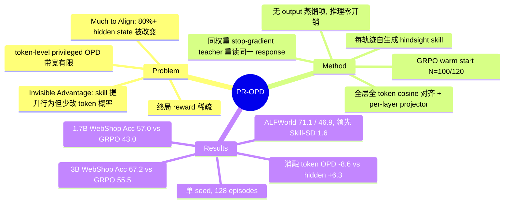

## Summary

PR-OPD 认为 privileged self-distillation 里 skill 带来的增益主要体现在 teacher 的 hidden state 而非 token 概率，于是在 GRPO warm start 后让 policy 为每条轨迹写 hindsight skill，再把 student 经 projector 投影后的各层 hidden state 对齐到"带 skill 重读同一 response"的 stop-gradient 自身。在 ALFWorld / WebShop、两个 Qwen backbone 上，它在 step 150 的总体指标均排第一，WebShop accuracy 比 GRPO 高 11.7（3B）/ 14.0（1.7B）点；但所有数字来自单 seed、128 episode 的评测，ALFWorld 上与最强 baseline 只差 1.6 点。

## Problem & Motivation

多轮 agent 的 RLVR 每个 episode 只给一个终局 reward，信号稀疏。近期的 privileged on-policy self-distillation（SDAR、OPID、SEED、PCSD、Skill-SD 等）让同一 policy 在上下文里拿到 skill / hindsight 后充当 teacher，把它的 token log-prob 蒸馏回不带 skill 的 student。作者质疑这一通道：token 概率只反映 teacher "会生成什么"，不直接反映 skill 如何改变了内部推理。他们给出两个诊断现象：

- **Invisible Advantage**：3B 模型在 WebShop in-training validation 上，带 skill 的 teacher success 为 56.2%，不带 skill 的 student 为 42.2%；但在 ALFWorld GRPO@100 上，加 skill 后不到四分之一的 response token 的采样概率发生变化，action token 上几乎没有变化。
- **Much to Align**：同样两次 forward 中，超过 80% 的 response token 的 hidden state 发生变化；linear probe 能从 hidden state 区分"本轨迹的 skill"与"其他轨迹的 skill"，output-side feature 则接近随机。

由此提出的问题是：teacher 的优势几乎不出现在 token 上，student 能否从 hidden state 学到它。

## Method

两阶段训练，student / analyzer / teacher 三个角色共享同一套权重：

1. **Stage I：GRPO warm start**。只用 GRPO 训练 N 个 update（ALFWorld N=100，WebShop N=120），理由是 analyzer 就是 policy 本身，需要先学会任务才能写出有价值的 hindsight。
2. **Self-generated hindsight skill**。Stage II 每轮用当前 policy 不带 skill 地 rollout；每条轨迹结束后把交互记录与 outcome 序列化，prompt 同一 policy 写一段短的 actionable rules（成功轨迹写可复用流程，失败轨迹写关键错误与修正）。生成不可微、无 SFT，每个 batch 重新生成，不维护 skill library。
3. **Privileged Representation Alignment (PRA)**。student 处理 (x, y)，teacher 处理 (H(x, s), y)：同一组 response token，teacher 不生成新动作。因为两个 pass 是同一网络，层 ℓ 直接对应层 ℓ，无需 layer mapping；按 response token 而非绝对位置配对。student 每层 hidden state 先经一个 per-layer MLP projector（d→512→d），再与 stop-gradient 的 teacher hidden state 做归一化 L2（等价于 2−2cos），对所有 Transformer 层、所有 response token（reasoning + action）平均。projector 的作用是让 student 不必把喂给 LM head 的原始 state 直接改成"长上下文下的 state"。
4. **总目标**：L = L_GRPO + β·L_KL − η·H + λ_t·L_PRA，t ≤ N 时 λ_t=0，之后 λ=0.01；**不含任何 output-space 蒸馏项**。teacher state 每次 update 重新计算，目标随 policy 移动。推理时 skill、teacher、projector 都不需要。

实现基于 SDAR 代码 + verl + vLLM，8×B200。

## Key Results

**主表（Table 1，step 150，ALFWorld success / WebShop Acc / Score）**

| Backbone | Method | ALFWorld All | WebShop Acc | WebShop Score |
|:--|:--|:--|:--|:--|
| Qwen2.5-3B | GRPO | 66.4 | 55.5 | 70.4 |
| | SDAR | 68.8 | 56.3 | 74.7 |
| | Skill-SD | 69.5 | 59.4 | 75.6 |
| | **PR-OPD** | **71.1** | **67.2** | **83.7** |
| Qwen3-1.7B | GRPO | 43.8 | 43.0 | 66.4 |
| | Skill-SD | 45.3 | 54.7 | 73.7 |
| | **PR-OPD** | **46.9** | **57.0** | **73.8** |

- 摘要里的 "WebShop accuracy 最多 +14.0" 按 Table 1 推算来自 1.7B（57.0−43.0，论文未明说）；3B 上是 +11.7。
- OPSD baseline 在 3B ALFWorld 上只有 23.4，与未训练的 Vanilla 相同。
- baseline 的 skill 全部来自 SDAR 的手写 skill（每个 task type 一条），PR-OPD 用每条轨迹自生成的 skill，两者的 skill 来源并不相同。

**消融（Table 2，ALFWorld，从 GRPO step 100 分支到 step 150）**

| 变体 | 3B | 1.7B |
|:--|:--|:--|
| GRPO | 66.4 | 43.8 |
| + token-level OPD（同样的自生成 skill） | 57.8（−8.6） | — |
| + hidden-state alignment，无 projector | **72.7（+6.3）** | 36.7（−7.1） |
| + alignment + projector（PR-OPD） | 71.1（+4.7） | **46.9（+3.1）** |

- 在 3B 上，最好的变体是去掉 projector 的版本，完整 PR-OPD 反而低 1.6 点；projector 只在 1.7B 上必要。
- **Warm start 时机（Table 3，WebShop 1.7B）**：N=120 时 acc 57.0，N=100 时 49.5（后者多 20 个 supervised update）。与同 checkpoint 继续 GRPO 配对（6 个评测 seed 平均），direct alignment 的增益在 N=120 / 30 updates 时为 +9.62，N=120 / 10 updates 时为 +8.22，N=100 / 30 updates 时为 +3.15，N=140 / 10 updates 时为 +3.63（仅 Δ 行是 6 seed 平均，57.0 / 49.5 为单次 step-150 评测）。

**诊断分析（Sec 4.4、App E–H）**

- 三种 skill context 引起的 hidden state 变化最多是 length-matched unrelated text 的 9 倍（3B）和 7 倍（1.7B）。
- 中间层 hidden state probe 区分 own skill 与 other-trajectory skill 的准确率：3B 65.4%，1.7B 79.4%；三种 output-side feature 为 50.4–51.9%。
- 初始 3B policy 上，own skill 的 same-layer linear CKA 平均 0.996，全局结构基本不变；从第 13 层起 1−CKA 高于三种对照。
- 不加 projector 时，原始 hidden-state alignment loss 在每个 run 中都与初始值相差不超过 0.01。

## Evidence Ledger

| Claim ID | Claim | Type | Source locator | Evidence excerpt | Status |
|:--|:--|:--|:--|:--|:--|
| C1 | 3B WebShop in-training validation：skill 在上下文中使 success 由 42.2% 升至 56.2% | number | Sec 1 / Fig 1(c) | "lifting WebShop success from 42.2% to 56.2%" | source-verified |
| C2 | ALFWorld GRPO@100：<1/4 response token 的概率变化，>80% 的 hidden state 变化 | number | Sec 1 / Fig 1(a,b) | "fewer than a quarter of response tokens change their probability" / "hidden states of more than 80% of response tokens" | source-verified |
| C3 | Table 1 3B：PR-OPD 71.1 / 67.2 / 83.7 vs GRPO 66.4 / 55.5 / 70.4，Skill-SD 69.5 / 59.4 / 75.6，SDAR ALFWorld 68.8 | number | Table 1 | Table 1 3B 行：PR-OPD 71.1 / 67.2 / 83.7；GRPO 66.4 / 55.5 / 70.4 | source-verified |
| C4 | Table 1 1.7B：PR-OPD 46.9 / 57.0 / 73.8 vs GRPO 43.8 / 43.0 / 66.4，Skill-SD 45.3 / 54.7 / 73.7 | number | Table 1 | Table 1 1.7B 行：PR-OPD 46.9 / 57.0 / 73.8；Skill-SD 45.3 / 54.7 / 73.7 | source-verified |
| C5 | "最多 +14.0 WebShop acc" 来自 1.7B，3B 为 +11.7 | comparison | Abstract / Sec 1 / Table 1 | "up to 4.7 points in ALFWorld success and 14.0 points in WebShop accuracy"；+14.0 归属 1.7B 由 Table 1 推算 | source-verified |
| C6 | OPSD 在 3B ALFWorld 为 23.4，与 Vanilla 相同 | number | Table 1 | Table 1：OPSD All 23.4，Vanilla All 23.4；"OPSD falls to roughly the level of the untrained policy" | source-verified |
| C7 | skill-based baseline 用 SDAR 手写 skill（每 task type 一条），PR-OPD 用每轨迹自生成 skill | benchmark-setting | Sec 4.1 / 4.2 | "All skill-based baselines use the hand-written skills of SDAR (Lu et al., 2026a), one per task type." | source-verified |
| C8 | 3B ALFWorld 消融：token OPD 57.8（−8.6）、无 projector 72.7（+6.3）、PR-OPD 71.1（+4.7） | number | Sec 4.3 / Table 2 | Table 2：57.8 (−8.6) / 72.7 (+6.3) / 71.1 (+4.7)；"branch from the GRPO checkpoint at step 100" | source-verified |
| C9 | 1.7B ALFWorld：无 projector 36.7，有 projector 46.9 | number | Table 2 | "where direct alignment falls to 36.7%, below GRPO, the projector lifts ALFWorld success to 46.9%" | source-verified |
| C10 | WebShop 1.7B：N=120 acc 57.0 vs N=100 49.5；配对增益 +9.62（N=120/30 upd）/ +3.15（N=100/30）/ +3.63（N=140/10） | number | Sec 4.3 / Table 3 | "gains 9.62 points after 30 updates ... against 3.15 from step 100 and 3.63 from step 140" | source-verified |
| C11 | own vs other-trajectory skill probe：中间层 65.4%（3B）/ 79.4%（1.7B），output feature 50.4–51.9% | number | Sec 4.4 / App E | "middle-layer hidden states reach 65.4% and 79.4% ... compared with 50.4–51.9% across the output features" | source-verified |
| C12 | skill context 的 hidden state 变化最多为 unrelated text 的 9×（3B）/ 7×（1.7B） | number | Sec 4.4 Obs 6 | "by up to nine times for 3B and seven times for 1.7B" | source-verified |
| C13 | 单次训练（seed 0），step 150、128 episodes、temperature 0.4；ALFWorld seen split 140 实例 | benchmark-setting | App C | "single training run with training seed 0"；"128 episodes"；"140 task instances" | source-verified |
| C14 | 150 updates；warm start WebShop N=120、ALFWorld N=100 | benchmark-setting | Sec 4.1 / App C | "Every method trains for 150 updates ... N=120 on WebShop and N=100 on ALFWorld" | source-verified |
| C15 | 无 projector 时原始 alignment loss 与初始值相差不超过 0.01 | number | App H | "stays within 0.01 of its initial value in every run" | source-verified |
| C16 | PRA：所有层、所有 response token 的归一化 L2（2−2cos），stop-gradient 共享权重 teacher；唯一新增模块为 512 维隐层的 per-layer projector；无 output-space 蒸馏项 | causal-mechanism | Sec 3.5 / 3.6 | "No output-space distillation term is used."；"one 512-dimensional hidden layer" | source-verified |
| C17 | λ=0.01、β=0.01、η=0.001、projector lr 1e-4；基于 SDAR + verl + vLLM；8×B200 | benchmark-setting | App C | "β=0.01, ... η=0.001, and alignment weight λ=0.01"；"eight NVIDIA B200 GPUs" | source-verified |
| C18 | 代码开源于 github.com/balibata/PR-OPD | license-code | Abstract | "Code is available at https://github.com/balibata/PR-OPD." | source-verified |
| C19 | 初始 3B policy：own skill same-layer CKA 平均 0.996（≥0.9884），第 13 层起 1−CKA 超过三种对照 | number | Sec 4.4 Obs 9 / App G | "same-layer linear CKA averages 0.9959 ... at least 0.9884"；"From layer 13 onward ... exceeds ... all three controls" | source-verified |

## Strengths & Weaknesses

**Strengths**

- 诊断先于方法。作者先测"skill 改变了多少 token 概率、多少 hidden state"，再据此换蒸馏通道，问题提法清楚。同权重 self-distillation 天然让层一一对应，从而绕开了跨模型 representation distillation 的 layer mapping 问题（LastOPD 讨论的 collapse），这个观察本身有价值。
- 最有信息量的是受控消融 C8：同一 warm start、同一批自生成 skill，只改"读 teacher 的哪个通道"，token OPD −8.6，hidden alignment +6.3。
- 推理零开销，实现简单（一个 projector 加一个 cosine 型 loss），对 SDAR 类框架是低成本的替换。

**Weaknesses**

- **统计强度不够**（已知）：每个配置单次训练、单个 seed，128 个 episode 评测。ALFWorld 每个 task type 只有约 20 个 episode，主表上 PR-OPD 比 Skill-SD 只高 1.6 点（两个 backbone 都是），可能落在噪声范围内。WebShop 3B 的 +7.8 才是较可信的差距。
- **N 按环境分别选，且选择依据疑似就是评测结果**（推测）：WebShop 用 N=120，而 Table 3 显示 N=100 时 acc 只有 49.5，低于 Skill-SD 的 54.7。论文没有说明 N 在独立 validation split 上选取。
- **projector 的结论在两个 backbone 上相反**：3B 上去掉 projector 更好（72.7 vs 71.1），默认配置并非 3B 的最优。
- **机制论证存在缺口**（推测）：
  - probe 能从 hidden state 区分不同 context，几乎是必然的（hidden state 会 attend 到 prompt），这只说明 skill 信息被编码，不等于"advantage"被编码；output feature 只取了 1 维 / 64 维 / 256 维随机投影，作者自己在 App F 也承认 near-chance 不代表输出中没有信息。
  - 更关键的是，训练时没有做"对齐到带 unrelated text / 他人 skill / shuffled skill 的 teacher"的对照。因此无法排除增益来自通用的 representation 正则化（例如 consistency 或 smoothing），而非 hindsight 内容的迁移。
  - App H 显示无 projector 时原始 alignment loss 几乎不下降（与初值差 ≤0.01），却在 3B 上带来 +6.3。这更像正则化效应，而不是 student 真的"追上了"teacher 的表征，这一点与"传递 advantage"的叙事存在张力。
- **baseline 公平性**：token-level baseline 用 SDAR 的手写 skill，PR-OPD 用自生成 skill，主表混合了"skill 来源"和"蒸馏通道"两个变量（只有 C8 是干净对照）。OPSD 退化到 Vanilla 水平（23.4），说明它的配置可能没调好，不宜当作 token-level 路线的代表。
- **自生成 skill 包含 outcome 信息**：token-level OPD 在自生成 skill 下掉 8.6 点，可能源于 teacher 的 token 概率泄漏了轨迹结局（已知的 privileged-info leakage 问题），而不只是 token 通道"带宽不够"。论文没有分析这一替代解释。
- 只在 text-only 的 ALFWorld / WebShop、≤3B 模型、150 步训练上验证，没有覆盖 GUI / 多模态或更大模型。

**对领域的意义**：如果"hidden-state 通道优于 token 通道"在多 seed、加入 context 对照后仍然成立，它会改变 SDAR 系 self-distillation 的默认设计；目前更稳妥的读法是"一个可信的方向信号 + 一个干净的单 seed 消融"。

## Mind Map

## Notes

- 相关 self-distillation 谱系：[[2607-SEED]]、[[2608-PCSD]]、[[2604-Skill0]]、[[2605-Skill1]]；同权重 representation 对齐与 [[2607-DirectOPD]] 的"只迁移增量"思路可对照。
- 值得补的实验：训练时用 other-trajectory skill / unrelated text 作 teacher context 的对照，多 seed，以及 projector 在 3B 上的取舍。若对照也能带来相近增益，"advantage 迁移"的叙事就不成立，需改为 representation consistency 正则。
- GUI agent 上 skill / hindsight 往往是长文本，teacher 的 context 长度开销与 hidden state 漂移会更大，这是一个可迁移但未经验证的方向。
