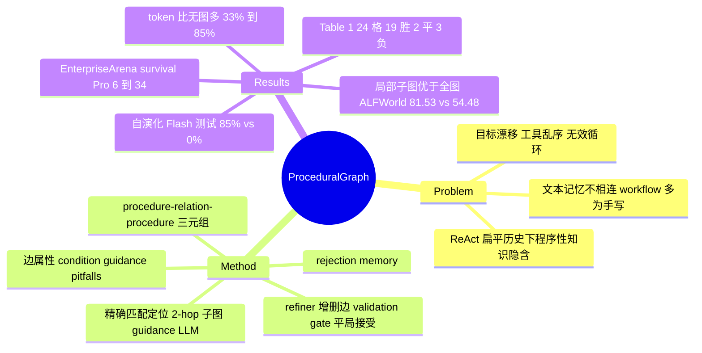

## Summary
Procedural Graph（PG）把任务的程序性知识写成 (procedure, relation, procedure) 三元组的有向图，每条边带 condition / guidance / pitfalls 三个文本属性；推理时按 agent 上一个动作精确匹配到图中节点，取 2-hop 出边邻域，由一个与 solver 同款的 guidance LLM 把邻域翻译成当步建议追加进 ReAct prompt。离线时 LLM refiner 对比成败轨迹提出增删节点/边的编辑，候选图只有在 held-out validation 上不降分才提交，被拒候选进入 rejection memory。Table 1 在 6 个 benchmark × 4 个 LLM 的 24 格里对最强 memory baseline 19 胜 2 平 3 负（sign test p=4.3e-4），但多数单格差距落在 95% CI 内，主实验所用图是手写还是演化得到的全文未说明。

## Problem & Motivation
ReAct 类 agent 在不断增长的扁平历史上自由生成下一动作，"该做什么、按什么顺序、在什么条件下"这类程序性知识全隐含在生成里，轨迹一长就出现目标漂移、工具调用乱序和无效循环。已有补救各缺一块：Reflexion / ExpeL / MemoryBank 存的是自由文本经验，solver 仍需自行推断它对当前步意味着什么；AutoGuide 的 state-conditioned guideline 有条件但步与步之间不相连；AWM 与 FlowBench 式 workflow 把步骤串起来，但多为线性或手工设计；AFlow 离线搜索 workflow 却不随当前进度给建议。作者想要的是一种可编辑、可按当前进度局部检索、又能从执行反馈里改结构的程序性表示，并以知识图谱作类比：KG 回答 what-is，PG 回答 what-to-do。

## Method
**表示**。\(\mathcal G=(\mathcal V,\mathcal R,\mathcal E,\Phi)\)，节点抽象工具调用、技能、内部推理步或任务状态；边 \((u,r,v)\) 表示在关系 \(r\) 下 \(v\) 可接在 \(u\) 之后；实际用到的关系词表只有 LEADS_TO / TRIGGERS / PROVIDES_INPUT_FOR / CONVERGES_TO 四种。属性 \(\Phi(e)\) 实现为 condition（何时走这条边）、guidance（怎么做）、pitfalls（避免什么）三段文本。图很小：除 BFCL v3（131 节点 / 265 三元组，对应其函数目录）外均为 7–17 节点、7–27 三元组（Table 7）。

**在线 guidance（locate → extract → generate）**。\(u_t=\mathrm{Match}(a_{t-1},\mathcal V)\) 对上一个动作做**精确名字匹配**；匹配成功取 \(h=2\) 步出边邻域，失败则退回全图。guidance 模型 \(\Psi\) 读邻域 + 用户 query + 最近 \(w=3\) 步轨迹，生成一段自然语言建议 \(g_t\)，追加到 solver prompt；solver 仍自由选动作（soft integration，不做 decoding 约束）。guidance 模型、refiner 与 solver 用同一个 LLM，全部 greedy decoding。

**离线自演化（Algorithm 1）**。每轮用当前保留图在一批训练任务上 rollout，refiner 拿到拼接轨迹（超过 \(L_{\max}\) 时从开头截掉、保留结尾）、各任务分数、当前图 JSON、历次被拒候选，输出 add_nodes / delete_nodes / add_edges / delete_edges 四个数组；属性修改通过"删边再加边"实现。候选先过结构检查（端点存在、每个节点有到零出度终点的路径、可选去环），不过则直接记入 rejection memory、不做 validation rollout；通过则在独立 validation 集上评估，\(S_{val}(\mathcal G^{cand})\ge S_{val}(\mathcal G_{k-1})\) 即接受（**平局也接受**）。被拒候选从不作为下一轮起点。

**构图模式**（§5.3、App D.2）。Mode 1 手写专家图零样本；Mode 2 专家图 + 全训练集一次性更新、无 gate；Mode 3 专家图 + 分批迭代演化 + gate；Mode 4 从 Start→End 骨架一次性生成、无 gate；Mode 5 从骨架分批迭代演化 + gate。

## Key Results
**主表（Table 1，greedy decoding，95% CI；未报告重复运行或多 seed）**。7 个 baseline 共用同一 ReAct solver 且消费同一训练轨迹。PG 在 24 个 model–benchmark 格中 21 格第一或并列第一；对每格最强 baseline 19 胜 2 平 3 负。三处负场（按 Table 1 逐格比较得出）：Claude Sonnet 4.6 HotpotQA（74.50 vs AutoGuide 75.40）、Grok 4.1 Fast ALFWorld（39.55 vs ExpeL 42.54）、Grok 4.1 Fast τ-bench（67.83 vs KnowAgent 68.70）。最大领先：BFCL v3 + Gemini 3.5 Flash 67.00 vs 58.00、GDPval + Gemini 3.1 Pro 78.78 vs 71.37、τ-bench + Gemini 3.1 Pro 80.00 vs 73.04。HotpotQA 上对最强 baseline 的差距仅 −0.90 到 +1.30。测试集规模偏小：GDPval 44、BFCL 100、τ-bench retail 115、ALFWorld 134、MultiChallenge 166（Table 5），因此很多单格领先（如 Claude GDPval 51.49 [38.44, 64.54] vs MemoryBank 50.13 [37.04, 63.22]）在 CI 内。

**EnterpriseArena（Table 8，50 episodes，只对比 RAP 与 MemoryBank）**。132 个月 CFO 模拟、3 次未告知的危机。full-horizon survival：Claude 44.0→58.0、Gemini 3.1 Pro 6.0→34.0、Grok 26.0→40.0、Gemini 3.5 Flash 所有配置均为 0.0（PG 平均寿命 33.58→40.62 月）。Claude 上 PG 的 Avg. Score（\$70.38M）低于 baseline（\$78.86M），融资额也更低（\$130.44M vs \$152.12M）。工具调用方向随模型而变：Flash 18.94→12.53 次/月，Claude 0.13→0.36、Pro 0.89→3.18。

**构图模式（Table 2，Gemini 3.5 Flash；MultiChallenge 用 56 题 fast split）**。

| Mode | HotpotQA EM / F1 | MultiChallenge Overall |
|:--|:--|:--|
| 无图 baseline | 58.8 / 71.21 | 87.50 |
| 1 手写专家 | 62.80 / 76.61 | 58.93 |
| 2 专家 + 一次性更新 | 63.80 / 77.16 | 53.57 |
| 3 专家 + 迭代演化 | 63.10 / 76.34 | 92.86 |
| 4 骨架 + 一次性生成 | 55.40 / 69.49 | 89.29 |
| 5 骨架 + 迭代演化 | 66.30 / 78.79 | 91.07 |

两处值得注意：HotpotQA 上带 gate 的 Mode 3 测试 F1（76.34）略低于无 gate 的 Mode 2（77.16）和未演化的 Mode 1（76.61）；MultiChallenge 的专家图本身就把成功率从 87.50 拉到 58.93，Mode 3 的"修复"是从一个自伤的先验恢复，相对无图 baseline 的净增益为 +5.36 点，即 56 题中约 3 题。

**EnterpriseArena 十轮自演化（§5.4、Table 11，Gemini 3.5 Flash，train/val/test 各 20 episodes）**。validation survival：baseline 0 → R1 45（发现"查现金 → 预测 runway → 存笔记 → 查市场 → 决定融资"主干）→ R2 80（加入 recall_notes）→ R8 90；R3/R4/R6 被 gate 拒绝、R5 结构检查失败、R10 被拒。返回的 R9 图测试 survival 85% vs baseline 0%（Fisher p=2.6e-8）；搜索过程中 R7 的测试 survival 曾达 95%，作者明确不以此为报告值。R4 被拒时 validation Avg. Score 实际高 +\$3.793M（survival 75 vs 80），R9 Avg. Score −\$0.801M 而 survival 持平却被接受，说明 gate 实际按 survival 判（论文未声明指标）。E.3 称 Round 8 的拓扑 "retained through Round 10"，但 R10 已被拒，最终返回的是 R9 的图（测试 survival 85%）；95% 来自 R7。Table 11 的 Round 5 validation 行标为 "Validate (R04)"，按 Algorithm 1 应沿用 R2 的 80% / \$46.038M 而非被拒 R4 的 75% / \$49.831M（只影响报告数字，不影响最终图）。validation 每月工具调用 17.23 → 3.08（R2，−82.1%），R8 为 3.13（−81.8%）；原文 E.1 把 R2 的 3.08 与 R8 对应的 81.8% 写在一起，引用时取其一并注明轮次。作者自述 20 episodes 下单次 accept/reject 只取决于 1–2 个 episode，应作搜索轨迹而非显著性检验来读。

**用法消融（Table 3，Gemini 3.5 Flash，固定子集）**。

| 配置 | MultiChallenge | GDPval | ALFWorld | ALFWorld tokens |
|:--|:--|:--|:--|:--|
| 无图 | 80.27 | 54.80 | 72.58 | 18,055 |
| 全图原样注入 | 86.60 | 57.17 | 70.34 | 21,062 |
| 全图 + generative guidance | 87.35 | 56.75 | 54.48 | 96,360 |
| 局部子图 + generative（PG） | 89.31 | 63.99 | 81.53 | 28,064 |

全图 generative 在 ALFWorld 上比无图低 18 点；局部化相对全图 generative 省 token 70.9% / 18.1% / 14.8%（ALFWorld / GDPval / MultiChallenge），但相对无图仍多 55.4%（ALFWorld）、33.4%（GDPval），MultiChallenge 上 12,295 vs 6,629（约 1.85 倍，正文未给百分比）。

**附录补充**。HotpotQA 上 Mode 5 validation F1 从 77.59 升到第 10 代 83.31；MultiChallenge 上 Mode 3 validation 从 54.0 升到 93.9（边数 13→10），Mode 5 达 94.9（图 6）。Gemini 3.5 Flash 的 BFCL 案例（F.1）中，PG agent 在用户只问票价时停下，baseline 继续执行订票并失败。

## Evidence Ledger

| Claim ID | Claim | Type | Source locator | Evidence excerpt | Status |
|:--|:--|:--|:--|:--|:--|
| C1 | Table 1 中 PG 在 24 格里 21 格第一或并列第一；对最强 baseline 19 胜 2 平 3 负，单侧 sign test p=4.3e-4 | number | §5.1 | "PG ranks first or joint first in 21 of 24 model–benchmark settings … 19 wins, two ties, and three losses" | source-verified |
| C2 | 最大领先：BFCL v3 Flash 67.00 vs 58.00；GDPval Pro 78.78 vs 71.37；τ-bench Pro 80.00 vs 73.04 | comparison | §5.1；Table 1 | "BFCL v3 with Gemini 3.5 Flash ( 67.00% vs. 58.00% , +9.00 points), GDPval with Gemini 3.1 Pro ( 78.78 vs. 71.37" | source-verified |
| C3 | 三处负于最强 baseline：Claude HotpotQA 74.50 vs AutoGuide 75.40；Grok ALFWorld 39.55 vs ExpeL 42.54；Grok τ-bench 67.83 vs KnowAgent 68.70 | comparison | Table 1 | "AutoGuide … 75.40"; "Procedural Graph (Ours) | 74.50"; Grok "ExpeL … 42.54"; "KnowAgent … 68.70" | source-verified |
| C4 | HotpotQA 上 PG 对最强 baseline 差距 −0.90 到 +1.30 | number | §5.1 | "margins over the strongest baseline range from -0.90 to +1.30 points" | source-verified |
| C5 | 所有方法共用同一 ReAct solver，学习型 baseline 消费同一训练轨迹；guidance 模型与 refiner 与 solver 同一 LLM；temperature 0；h=2、w=3 | benchmark-setting | §4 | "The guidance model and the offline refiner always share the same underlying LLM as the solver. All calls use greedy decoding" | source-verified |
| C6 | 测试集规模：HotpotQA 1,000、MultiChallenge 166、GDPval 44、ALFWorld 134、τ-bench retail 115、BFCL v3 100、EnterpriseArena 50 | benchmark-setting | Table 5（App B.1） | "GDPval … 88 | 44"; "τ-bench … 500 | 115 | Test uses the retail domain" | source-verified |
| C7 | Claude GDPval：PG 51.49 [38.44, 64.54] vs MemoryBank 50.13 [37.04, 63.22]，领先在 CI 内；主表未报告重复运行或多 seed | benchmark-setting | Table 1；§4 Models | "Brackets give 95% confidence intervals"; "51.49 [38.44, 64.54]" | unsupported → reworded |
| C8 | EnterpriseArena full survival：Claude 44→58、Pro 6→34、Grok 26→40、Flash 全部 0；对比臂只有 RAP 与 MemoryBank | number | Table 8；§5.2 | "raises survival from 44.0% to 58.0% for Claude Sonnet 4.6, from 6.0% to 34.0% for Gemini 3.1 Pro" | source-verified |
| C9 | Claude 上 PG Avg. Score \$70.38M 低于 baseline \$78.86M，Raised \$130.44M 低于 \$152.12M | comparison | Table 8 | "Baseline | 44.0% | 89.80 | \$78.86M"; "Procedural Graph (Ours) | 58.0% | 98.58 | \$70.38M" | source-verified |
| C10 | 工具调用：Flash 18.94→12.53 次/月；Claude 0.13→0.36；Pro 0.89→3.18 | number | §5.2；Table 8 | "It issues 18.94 tool calls per month, which the graph reduces to 12.53" | source-verified |
| C11 | Table 2 MultiChallenge Overall：baseline 87.50、Mode 1 58.93、Mode 2 53.57、Mode 3 92.86、Mode 4 89.29、Mode 5 91.07 | number | Table 2；§5.3 | "using the hand-crafted expert graph (Mode 1) lowers success from 87.50% to 58.93%" | source-verified |
| C12 | Table 2 HotpotQA EM/F1：baseline 58.8/71.21、M1 62.80/76.61、M2 63.80/77.16、M3 63.10/76.34、M4 55.40/69.49、M5 66.30/78.79 | number | Table 2 | "Mode 5: Scratch + Online Evolution | 66.30 | 78.79" | source-verified |
| C13 | 构图实验全部用 Gemini 3.5 Flash；MultiChallenge 100/100/56、HotpotQA 1000/1000/1000；迭代步长 S=100（HotpotQA）/ S=20（MultiChallenge） | benchmark-setting | App D.3；App D.2 | "powered by the frozen Gemini 3.5 Flash model snapshot"; "100 training samples, 100 validation samples, and 56 test samples" | source-verified |
| C14 | EnterpriseArena 自演化：validation survival 0→45（R1）→80（R2）→90（R8）；返回图测试 85% vs 0%，Fisher p=2.6e-8；R7 测试曾达 95% 但不作报告值 | number | §5.4；Table 11 | "The returned graph reaches 85.0% test survival against the baseline's 0.0% (Fisher's exact p=2.6×10^-8)" | source-verified |
| C15 | 自演化实验为 20/20/20 episodes 配置；作者称单次 accept/reject 取决于 1–2 个 episode | benchmark-setting | §5.4；Table 5 Notes | "With 20 episodes per split, individual accept/reject decisions turn on one or two episodes" | source-verified |
| C16 | R3/R4/R6 被 gate 拒、R5 结构检查失败、R10 被拒；R4 被拒时 validation Avg. Score +\$3.793M、survival 75 vs 80 | number | Table 11；App E.2 | "Round 04 [× Rolled Back] … Validate | 75.0% | 109.20 | \$49.831M"; "+\$3.793M" | source-verified |
| C17 | validation 每月工具调用 17.23（baseline）→ 3.08（R2），R8 稳定在 3.13；原文"降 81.8%"对应 17.23→3.13（R8），17.23→3.08 应为 82.1%，原文混用 | number | App E.1 | "drops from 17.23 in the Baseline to 3.08 in Round 2 … This is an 81.8% reduction" | source-verified |
| C18 | Table 3：无图 / 全图原样 / 全图 generative / 子图 generative 在 MultiChallenge 80.27/86.60/87.35/89.31、GDPval 54.80/57.17/56.75/63.99、ALFWorld 72.58/70.34/54.48/81.53 | number | Table 3 | "Full-graph generative guidance further reduces ALFWorld success to 54.48 while increasing token consumption" | source-verified |
| C19 | 局部化相对全图 generative 省 token 70.9%/18.1%/14.8%；相对无图 GDPval 多 33.4%、ALFWorld 多 55.4% | number | §5.5；Table 3 | "by 70.9% on ALFWorld, 18.1% on GDPval, and 14.8% on MultiChallenge"; "remains 33.4% and 55.4% higher" | source-verified |
| C20 | 节点定位是对上一动作的精确匹配，失败退回全图；candidate 平局也接受；被拒候选写入 rejection memory 供下一轮 refiner 参考 | causal-mechanism | §3.2；§3.3；Algorithm 1 | "Match locates the agent by exactly matching its most recent procedure"; "Accept, including ties" | source-verified |
| C21 | 图规模：除 BFCL v3（131 节点 / 265 三元组）外 7–17 节点、7–27 三元组；关系词表 4 种 | number | App B.4；Table 7 | "every graph has between 7 and 17 nodes and between 7 and 27 triplets" | source-verified |
| C22 | 全文未说明 Table 1 / Table 8 主实验所用图的构图模式（手写、一次性生成或迭代演化）；F.1 的 BFCL 案例用"骨架 + 一次性离线更新"的图；§4 只说学习型 baseline 消费与 self-evolution loop 相同的训练轨迹 | benchmark-setting | App B.4；App F.1；全文检索 | "The PG agent uses a graph built from scratch by a one-time offline update" | source-verified |
| C23 | Table 8 中 Flash + PG full survival 为 0%，而 §5.4 自演化图在 Flash 上测试 survival 85%；作者称后者为独立实验 | comparison | App C.2；§5.4 | "This result describes the configurations evaluated here; the separate self-evolution experiment is reported in Section 5.4" | source-verified |
| C24 | Table 11 的 Round 5 validation 行标为 "Validate (R04)"、沿用被拒的 R4 数字，而 Algorithm 1 规定结构失败时保留状态不变（应为 R2） | benchmark-setting | Table 11；App E.2；Algorithm 1 | "The reported validation metrics for this round carry forward the Round 4 results" | source-verified |
| C25 | 附录 Fig 6：HotpotQA Mode 5 validation F1 77.59→83.31（第 10 代）；MultiChallenge Mode 3 validation 54.0→93.9，边 13→10，Mode 5 94.9 | number | App E.4.1；E.4.2 | "initial validation accuracy of only 54.0%"; "raising validation accuracy to 93.9% (ultimately approaching the scratch-built Mode 5 at 94.9%)" | source-verified |
| C26 | 论文未给出代码仓库链接 | license-code | 全文检索 | 正文与 HTML 中无项目 GitHub 链接（仅 arXiv/LaTeXML 反馈链接） | source-verified |

## Strengths & Weaknesses

**亮点**
- **Table 3 是最有信息量的一张表**：同一张图、同一 solver，只换"看多少图"和"怎么用图"。全图 generative 在 ALFWorld 上比无图低 18 点、token 多 5 倍，局部子图 generative 比无图高 9 点。说明决定收益的是"把当前步相关的少数几条边给 LLM 去翻译"，而不是图本身的存在；全图交给 guidance 模型反而制造噪声。这条结论与图结构类比 KG 的叙事无关，可迁移到任何 skill / workflow 检索系统。
- **对自己搜索结果的报告纪律较好**：EnterpriseArena 报返回图 85% 而非过程中见到的 95%，并直说 20 episodes 下 accept/reject 是搜索轨迹而非显著性检验；主表给 95% CI 和跨 24 格的 sign test。
- 演化轨迹可读：Round 1 发现的"查现金 → 预测 → 存笔记 → 查市场 → 决定融资"主干、Round 2 的 recall_notes、Round 8 的 bypass 都是能被人检查的结构改动，是 graph-structured 之外真正改了结构的例子。

**局限**
- **主实验用的是哪种图，全文没说**。Table 1 与 Table 8 是标题级证据，但 Table 7 只给节点数，B.4 未交代这些图是手写专家图、一次性生成还是迭代演化；F.1 的案例用的是 Mode 4（一次性生成）。若主表用了专家图，那么"自演化"并未参与主结论；若用了演化图，则 PG 额外用了 baseline 没用的 validation 集做选择（HotpotQA 的 validation 有 1,000 题），这在 B.3 "相同训练轨迹"的公平性声明之外。两种情况都需要作者澄清。旁证有二：§4 写 "every learning-based baseline consumes the same training trajectories as our self-evolution loop"，暗示主表用了演化但未明说；同为 Gemini 3.5 Flash，Table 8 中 PG 的 full survival 为 0%，而 §5.4 演化图的测试 survival 为 85%，由此推断（未经原文确认）主表在 EnterpriseArena 上用的不是 §5.4 演化出的图。
- **没有 compute-matched 对照**。PG 每步多一次 guidance LLM 调用；Table 3 显示总 token 比无图多 33%–85%。主表 baseline 中只有 AutoGuide 有逐步检索，且无一做每步生成。"同 token 预算下让 ReAct 多想一步 / 做自我检查"这一臂缺失，因此无法区分收益来自程序性结构还是来自每步多一次 LLM 反思。
- **统计强度不均**：sign test 把 24 格当独立样本，但同一 benchmark 跨 4 个 LLM 共享图与任务，相关性未处理；单格层面 GDPval（44 题，CI 宽约 ±13）与 BFCL（100 题）的领先多在 CI 内。MultiChallenge 构图实验 56 题，Mode 3 相对无图 +5.36 点约等于 3 题。
- **"修复专家先验"的说法需要限定**：MultiChallenge 的专家图本身把成功率从 87.50 打到 58.93，作者没有解释这张图为何如此失败；从一个明显有害的先验恢复，与"改进一个合理先验"不是同一种证据。HotpotQA 上 gated 的 Mode 3（76.34）反而略低于无 gate 的 Mode 2（77.16）和原始专家图（76.61），说明 validation gate 并不保证测试提升。
- **EnterpriseArena 结论随指标与模型翻转**：Claude 上 survival 提高但 Avg. Score 和融资额都更低；Flash 在 Table 8 里 survival 全为 0，而 §5.4 的演化图在 Flash 上达到 85%，两者差别（50 vs 20 episodes、图不同）未被调和。论文未写 EnterpriseArena 自演化的 validation gate 用哪个指标；从 Table 11 看实际按 survival 判、持平也接受（R4 Avg. Score +\$3.793M 但 survival −5 被拒；R9 Avg. Score −\$0.801M、survival 持平被接受），这一选择正文未声明。
- 精确名字匹配定位意味着 PG 只适用于"动作名有限且与节点一一对应"的工具环境；GUI 点击坐标、自由文本动作或动作名不规范的场景都会退回全图，而 Table 3 恰好显示全图 generative 是最差配置。论文没有报告匹配失败率。
- 内部不一致：Table 11 Round 5 的 validation 行沿用被拒的 R4 数字（C24），与 Algorithm 1 的"保留状态不变"不符。无代码。

## Mind Map

## Notes
- **[[Papers/2409-AgentWorkflowMemory]]**：AWM 是本文的直接 baseline（线性 workflow 注入 prompt）；PG 主表在 ALFWorld + Gemini 3.1 Pro 上对 AWM 只多 0.75 点（100.00 vs 99.25），在 Claude 上 AWM ALFWorld 仅 67.16，跨模型波动很大，AWM 在本文里的实现细节（B.3）值得在引用时注明。
- **[[Papers/2607-RethinkSkillEvolve]]**：同样是"LLM optimizer 提议、validation 过滤"的多轮演化，那篇的结论是演化更像稀疏的 validation 过滤搜索；Table 11 的 10 轮里只有 5 轮提交（R1/R2/R7/R8/R9）、4 轮被 gate 拒绝、1 轮结构失败，模式一致，可作为同一现象的另一个数据点。
- **[[Papers/2608-GraphEngineering]]**：按其 graph-structured 与 graph-engineered 之分，PG 的 EnterpriseArena 演化（结构改动经 validation 过滤后持久保留）属于少见的 graph-engineered 实例；但主表是否用了演化图不明（见 C22），不能把整篇算作该类证据。
- **[[Papers/2608-SkillZipGraph]]**：同样把程序性知识组织成图并在推理时取局部子图、同样测 ALFWorld；SkillZip 以 dependency-closed 子图 + 预算控制交付，PG 以 2-hop 出边 + LLM 翻译交付，两者都在说明"交付哪一小块"比"存多少"更关键。
- **[[Papers/2606-ProceduralMemoryAFTER]]**：AFTER 要求 procedural memory 经受跨 task / role / model 迁移检验；PG 的图按 benchmark 单独构建、同一 LLM 生成与使用，结论里作者自己把跨 solver 迁移列为 future work，正是 AFTER 要测的维度。
- 待核：主实验图的来源；GDPval rubric 打分者是谁（B.2 只说按 per-task rubric 评分）；Table 3 "fixed subsets" 的规模。
