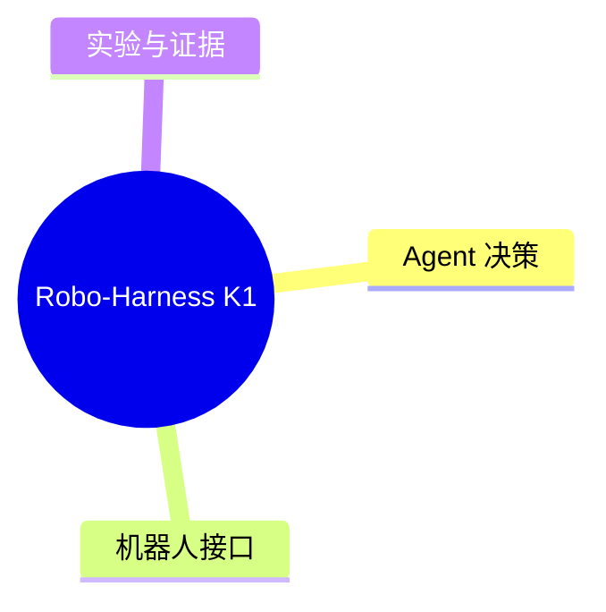

## Summary

K1 将区域、几何、跨帧跟踪与抓取候选提供为工具，让多模态 Agent 在操作中请求所需的物理信息。 [原文](https://arxiv.org/html/2609.29389v2)

## Problem & Motivation

直接从单帧像素推断全部抓取动作，对深度模糊、物体遮挡和跨帧位置变化敏感。

## Method

四组感知工具分别处理区域 grounding、深度和局部几何、跨帧 anchor 和抓取候选。Agent 选择工具、更新记忆并发动作。作者从成功的 Gemini 轨迹提取工具调用来监督小模型。

## Key Results

真机 Piper 的 3 项任务各 3 次纳入评估，完整系统 8/9，Clean 对照 1/9。一个回合有外部完成复核和夹爪单位提示，另有中断尝试单列。小模型轨迹 SFT 的新场景和 held-out 成绩来自仿真。

## Evidence Ledger

| Claim ID | Claim | Type | Source locator | Evidence excerpt | Status |
|:--|:--|:--|:--|:--|:--|
| C1 | 感知 API 包括区域、几何、跨帧跟踪与抓取建议 | causal-mechanism | §3.2 | Four perceptual tool families | source-verified |
| C2 | Piper 三任务 Clean 1/9、完整 K1 8/9，存在人工辅助边界 | comparison | §4.5 | Real-robot experiments | source-verified |
| C3 | 从 107 条教师成功轨迹提取 2,482 工具调用做 SFT，结果有仿真留出条件 | benchmark-setting | §§3.4, 4.6 | Agentic SFT | source-verified |

## Strengths & Weaknesses

真机试验用于检验可行性。感知和记忆等组件同时改变，实验支持完整 harness 的贡献。自动维护 anchor 和模型主动请求跟踪也需要区分。

## Mind Map

## Notes

- [[Topics/RobotUseAgents-Survey]]
