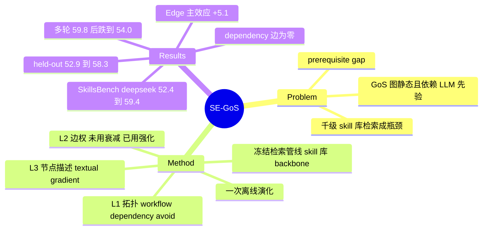

## Summary
SE-GoS 把 Graph-of-Skills 的检索图当作可维护的索引：检索管线（lexical seed + reverse-aware PPR + 预算 hydration）、1,000-skill 库与 backbone 全部冻结，只用一次评测已产生的 trace 离线做三类更新（拓扑：workflow / dependency / avoid 边归纳；边权：对"常被召回却从不被用"的 skill 入边减半、对成功轨迹里被用 skill 的入边按 reward 加权；节点：用 ProTeGi 式 textual gradient 改写"被用却排名太低"的 skill 的检索描述）。SkillsBench（87 tasks × 2 attempts，deepseek-v4-flash-0731）上一轮演化把 reward 从 GoS 的 52.4 提到 59.4，高于 SkillDAG 55.3，输入 token 比全库加载少 32%；在 50/37 的 held-out 划分上 52.9 → 58.3；第二轮 59.8 持平、第三轮跌回 54.0。所有数字为单次运行点估计，无置信区间，且三个 backbone 中两个的 Vanilla/Vector/GoS 是引自 GoS 的历史值、reward 口径与 SE-GoS 的自测分数（按单测通过比例的 fractional reward）不同。

## Problem & Motivation
skill 库扩到上千条后，瓶颈从"用不用 skill"变成"加载哪一小撮"。全库塞进 context 成本线性增长且模型会漏看；向量检索只按语义相似度取，常取到高层 solver 却漏掉语义上不像、执行上必需的 parser / setup 工具（作者称 prerequisite gap）。Graph-of-Skills（GoS）用带类型的有向 skill 图加 reverse-aware PPR 补这个缺口，但图是一次性离线构建、靠 LLM validator 判断 skill 间关系的静态先验，错的依赖、缺的关系、对不上 query 的描述都无法从执行反馈中修正。SkillDAG 已经在线编辑 typed graph，但编辑靠 LLM 提议、冷启动图也依赖 LLM pair classifier。作者要回答的是：不训练模型、不改检索代码、不改 skill 内容、不让 LLM 判断 skill 相关性，仅凭 trace 能否把检索图修得更好，且增益能否迁移到没见过的任务。

## Method
**冷启动图**。不用 GoS 的 LLM 验证 typed graph，改用确定性的 token-overlap（signature-token Jaccard）semantic-only 图：官方 1,000 个 skill 节点、k=1、863 条 semantic 边。作者给的理由是离线 replay 87 个任务 query 时，它与官方 embedding-kNN 图的 hit@5（70/73）和 mean best rank（1.19）完全一致，但最大度数 98 vs 484，更不容易出现 PPR hub 塌缩（App B.2）。

**检索（继承 GoS，不改）**。lexical seed（name / capability / description / tags / tooling / I/O / examples / entrypoints 的加权 token overlap），typed adjacency 合成正反向 operator 后跑 PPR（α=0.2，reverse 系数 dependency 1.0 / workflow 0.5 / semantic 0.2），top-N=5、seed-K=4，单 skill 1,800 字符、全局 9,000 字符预算。

**信号**。每个 trial 记录 \((q_t, r_t, B_t, U_t, \text{tokens}_t)\)，\(U_t\) 是从 shell / file-read / code-execution 工具调用里匹配 hydrated skill 源路径得到的"实际使用"集合，另存首次使用顺序。演化只用每个任务最后一次 attempt 的 trace（87 条）。

**L1 拓扑**。workflow 边：成功 trial（r≥0.9）里某 query 的 lexical seed u 与被用的 v 共现，按 query 计数，权重 \(\min(0.9, 0.6+0.05(c-1))\)；dependency 边：成功 trial 中 u 先于 v 被用且 I/O schema 重叠 ≥ζ=0.6；avoid 边：失败 trial 共用 ≥1 次且从未在成功 trial 共用，权重 0、不参与扩散，只在组 bundle 时丢掉与已选 skill 成 avoid 对的候选（不回填）；已有任何边（含 semantic）的 pair 不加 avoid；avoid 只有在 ≥2 个成功任务共用后才撤销。

**L2 边权**。被 ≥2 个不同任务召回却从未被用的 skill，其 semantic 入边一次性乘 0.5（不删、无下限）；正 reward trial 中每个被用 skill 的所有非 avoid 入边加 \(\eta r_t\)（η=0.1），不管入边源头是否被召回。

**L3 节点描述**。目标是"在失败 trial（r<0.9）中被用、但对该 query 排名差于 3"的 skill。LLM critic 看当前描述与全部 miss query，editor 出 1 个改写、paraphraser 出 2 个变体（≤50 token 编辑），再用同一套离线检索按"先最大化命中数、再最小化排名和"选；至少要在一个 miss query 上进 top-3 才提交，并有 no-eviction guard（任何训练中被用过且当前在某 query top-K 的 skill 不得被挤出）。只改图节点上的检索描述字段，不改 SKILL.md。

三类更新按 L1 → L2 → L3 的顺序离线执行一次；附录给的 confidence-weighted 插值（Eq. 9–10）在实验里没有启用。

## Key Results
**设置**。SkillsBench 87 tasks + 1,000-skill 库，ALFWorld valid_seen 140 episodes；每任务 2 attempts（SkillsBench 每格 174 次、ALFWorld 280 次）；三个 backbone 同用 Codex-CLI harness。SkillsBench reward 是单测通过比例（CTRF），不是上游的全部通过才算 1 的二值 reward。主协议沿用 SkillDAG 的 deployment-utility 口径：87 个任务产生 trace，演化后在同样 87 个任务上重测。minimax-m2.7 与 gpt-5.2-codex 两块中，Vanilla / Vector / GoS 是引自 GoS 的历史值，SE-GoS 与 SkillDAG 是新测值。单次运行，无显著性检验（§4.1 自述）。

**主表（Table 2，SkillsBench R / 每 attempt 输入 token M）**：

| backbone | Vanilla | Vector | GoS | SkillDAG | SE-GoS |
|:--|:--|:--|:--|:--|:--|
| deepseek-v4-flash-0731 | 46.2 / 5.06 | 38.7 / 3.11 | 52.4 / 3.67 | 55.3 / 3.62 | 59.4 / 3.45 |
| minimax-m2.7 | 17.2 / 0.94 | 10.4 / 0.85 | 18.7 / 0.87 | 27.3 / 1.05 | 28.5 / 0.92 |
| gpt-5.2-codex | 27.4 / 3.19 | 21.5 / 1.24 | 34.4 / 1.38 | 36.8 / 1.65 | 38.1 / 1.56 |

相对 GoS 分别 +7.0 / +9.8 / +3.7。对 SkillDAG 的领先在后两个 backbone 上只有 1.2 与 1.3 点。runtime 上 SE-GoS 在 deepseek 块最慢（883.7 s vs GoS 843.8 s）。ALFWorld 接近饱和：deepseek 91.1 vs SkillDAG 90.4 vs GoS 88.2；gpt-5.2-codex 上 GoS / SkillDAG / SE-GoS 三者都是 93.6；minimax 68.6 vs SkillDAG 67.1。

**Held-out（Table 3，deepseek，按 8 个 skill 域分层的 50 训练 / 37 评测，n=74）**：Vanilla 44.8、Vector 38.1、GoS 52.9、SkillDAG（训练集演化）54.2、SE-GoS（训练集演化）58.3；token 3.30 → 3.19 M。

**多轮（Table 4，deepseek，n=174）**：round 0 52.4（863 边）→ round 1 59.4（1,118 边，6 处节点改写）→ round 2 59.8（1,375 边，2 处）→ round 3 54.0（1,502 边，4 处）。作者结论是只演化一次。

**消融（Table 5，从 semantic-only 冷启动图出发的 2³ 因子设计，n=174/格）**：冷启动 50.8；+Topology 54.1、+Edge 57.3、+Node 53.6；T+E 58.8、T+N 55.8、E+N 59.1；全量 59.4。因子主效应 Edge +5.1、Topology +1.8、Node +1.7（按表格重算一致）。T+E 到全量的 +0.6 作者明说只是描述性的。

**机制诊断（App B.3、B.4）**。dependency 边一条都没产生：87 个任务里 22 个成功 trial 给出 68 个有序 pair，其中只有 26 对两侧都有 I/O 字段，最大重叠 0.500 < ζ；1,000 个 skill 中只有 332 个有 inputs、337 个有 outputs。avoid 通道提出 51 对，非矛盾约束拦掉 24 对，剩 27 条。因此结构增益只来自 workflow 边（以及 avoid 的 bundle 剪枝）。

## Evidence Ledger

| Claim ID | Claim | Type | Source locator | Evidence excerpt | Status |
|:--|:--|:--|:--|:--|:--|
| C1 | deepseek-v4-flash-0731 SkillsBench：Vanilla 46.2 / Vector 38.7 / GoS 52.4 / SkillDAG 55.3 / SE-GoS 59.4；SE-GoS 输入 token 3.45M vs Vanilla 5.06M | number | Table 2 | "SE-GoS reaches 59.4% ( +7.0 over GoS), exceeding SkillDAG (55.3%) … 3.45M input tokens per attempt ( 32% below Vanilla)" | source-verified |
| C2 | minimax-m2.7 SkillsBench GoS 18.7 / SkillDAG 27.3 / SE-GoS 28.5；gpt-5.2-codex GoS 34.4 / SkillDAG 36.8 / SE-GoS 38.1 | number | Table 2 | "SE-GoS improves over GoS by +9.8 on minimax-m2.7 and +3.7 on gpt-5.2-codex" | source-verified |
| C3 | ALFWorld valid_seen：gpt-5.2-codex 上 GoS、SkillDAG、SE-GoS 均为 93.6；deepseek 上 SE-GoS 91.1 vs SkillDAG 90.4 vs GoS 88.2 | number | Table 2 | "GoS 93.6 … SkillDAG 93.6 … SE-GoS 93.6" | source-verified |
| C4 | Held-out 37 任务（n=74）：GoS 52.9 → SE-GoS 58.3，SkillDAG 54.2；token 3.30 → 3.19M | number | §4.3, Table 3 | "SE-GoS lifts static GoS from 52.9% to 58.3% ( +5.4 points) with tokens essentially unchanged" | source-verified |
| C5 | 多轮演化：52.4 → 59.4 → 59.8 → 54.0，边数 863 → 1,118 → 1,375 → 1,502 | number | §4.4, Table 4 | "Reward rises to 59.4% at round 1, is essentially flat at round 2 ( 59.8% ), then drops to 54.0% at round 3" | source-verified |
| C6 | 因子消融：冷启动 50.8，单加 Edge 57.3 / Topology 54.1 / Node 53.6；主效应 Edge +5.1、Topology +1.8、Node +1.7 | number | §4.5, Table 5 | "Factorial main effects are +5.1 points for edge weights, +1.8 for topology, and +1.7 for node descriptions" | source-verified |
| C7 | SkillsBench reward 为单测通过比例（CTRF），与上游全部通过才得分的二值 reward 不同；先前发表的 baseline 保留原始报告值 | benchmark-setting | §4.1；App C.1 SkillsBench reward | "This fractional local metric differs from SkillsBench's upstream all-tests-pass binary reward." | source-verified |
| C8 | 两个商用 backbone 块中 Vanilla / Vector / GoS 引自 GoS 历史值，SE-GoS 与 SkillDAG 为新测值 | benchmark-setting | §4.1 Evaluation protocol | "Vanilla, Vector, and static GoS are historical values quoted from GoS, whereas SE-GoS and SkillDAG are fresh measurements" | source-verified |
| C9 | 主协议在产生 trace 的同一 87 个任务上重测；单元格不做显著性检验，不确定性估计推迟到后续工作 | benchmark-setting | §4.1 Evaluation protocol | "We report point estimates descriptively and do not test individual cells for significance" | source-verified |
| C10 | 主表 GoS 行用原始 typed GoS 图，而 SE-GoS 从 863 条 semantic 边的 token-overlap k=1 冷启动图演化；消融冷启动为 50.8 | benchmark-setting | §4.1 Configuration；Table 5 | "The main-table GoS baseline uses the original typed GoS graph; it is distinct from SE-GoS's semantic-only cold-start graph." | source-verified |
| C11 | Table 4 的 round 0 行（52.4 / 3.67 / 843.8）与主表 typed GoS 行数值相同，但边数列为 863（semantic-only 冷启动图的边数） | benchmark-setting | Table 4 vs Table 2 / §4.1 | "0 (static) | 52.4 | 3.67 | 843.8 | 863 | –" | source-verified |
| C12 | dependency 边一条未生成：22 个成功 trial 中 68 个有序 pair，仅 26 对两侧有 I/O 字段，最大重叠 0.500 低于 ζ=0.6 | causal-mechanism | App B.3 Why the dependency relation … does not fire | "the largest overlap any of them attains is 0.500 , below ζ . No dependency edge is induced" | source-verified |
| C13 | 1,000-skill 库只有 332 个 skill 有 inputs、337 个有 outputs | number | App B.3 | "the released 1,000 -skill library carries inputs for 332 skills and outputs for 337" | source-verified |
| C14 | avoid 通道提出 51 对 failed-only 共现，非矛盾约束拦下 24 对，剩 27 条 avoid 边 | number | App B.4 | "the update proposes 51 failed-only co-occurrences; the non-contradiction invariant withholds 24 , leaving 27 avoid edges" | source-verified |
| C15 | token-overlap 图与官方 embedding-kNN 图在 87 个 query 的离线 replay 中 hit@5 同为 70/73、mean best rank 同为 1.19；最大度数 98 vs 484 | number | App B.2 | "hit@5 and mean best rank are 70/73 ( 0.959 ) and 1.19 for both" | source-verified |
| C16 | 演化只用每个任务最后一次 attempt 的 trace（87 条），不合并 attempt | benchmark-setting | §4.1；App C.1 Attempt accounting | "the signal parser retains the final attempt of each task, yielding 87 per-task traces" | source-verified |
| C17 | 关键超参：PPR α=0.2，η=0.1，θ_avoid=1，θ_obs=2 个任务，semantic 衰减 0.5，r_success=0.9，n_rank=3，top-N/seed-K=5/4 | benchmark-setting | App A.2 Table 6 | "Reinforcement rate η | 0.1 … Avoid threshold θ_avoid | 1" | source-verified |
| C18 | 节点更新每个 skill 调 3 次 LLM（critic、editor、paraphraser p=2），离线检索按命中数再按排名和选候选，有 no-eviction guard | causal-mechanism | App A.4 | "a critic sees the current description and all miss queries; an editor proposes one rewrite; and a paraphraser proposes p=2 variants" | source-verified |
| C19 | 正文提到 released code、evo_data/split.json 与 SEGOS_MERGE_ATTEMPTS 开关，但全文未给出代码仓库 URL | license-code | §4.3；App C.1 | "The released code can pool attempts when SEGOS_MERGE_ATTEMPTS=1" | source-verified |
| C20 | App C.2 称 cold-vs-edited 检索召回诊断"随演化结果一并报告"，但正文与附录未见该诊断的数字 | benchmark-setting | App C.2 | "This diagnostic is reported with the evolution results rather than used as a headline claim." | source-verified |
| C21 | 87 个任务包的 instruction.md、tests/、task.toml 与上游 SkillsBench v1.1 快照（commit d75b2187）逐字节一致；7 个任务的 Docker 构建层有本地改动 | benchmark-setting | App C.3 | "instruction.md (the prompt given to the agent): 0 of 87 differ" | source-verified |
| C22 | 作者称 SE-GoS 在 Table 1 定位上是唯一同时满足 graph substrate / evolving / training-free / LLM-prior-free / skill selection 的方法，与 SkillDAG 只差 LLM-prior-free | sota-novelty | Table 1 caption | "SkillDAG, the closest row, differs from SE-GoS only on LLM-prior-free" | source-verified |
| C23 | 作者把多轮退化解释为后续轮次吃的是演化图自己产生的 trace，新边编码的是上一轮排序而非新执行证据（标为 one reading） | causal-mechanism | App B.3 Overfitting and deployment windows | "later rounds consume traces produced on the evolved graph, so the edges they add encode the previous round's ranking" | source-verified |

## Strengths & Weaknesses

**亮点**
- **问题切得干净**。把"经验存在哪里"从模型权重、skill 内容、agent 流程三处都移开，只放在检索图的边权与节点描述上，冻结检索代码和 backbone。这个设计让增益可以归到图本身，演化产物（加了哪些边、改了哪些描述）也能逐条审查和回滚。
- **2³ 因子消融**在同一冷启动图、同一批 trace 上把三类更新拆开，并报告了主效应与 leave-one-out，比多数 skill-evolution 论文的逐项叠加更规范。Edge-weight 是主要来源（主效应 +5.1）的结论与"PPR 直接读边权"的机制一致。
- **负面结果写得诚实**。dependency 规则在这个库上一条边都没产生，作者给出了原因链（成功 trial 少、I/O 字段覆盖约三分之一、最大重叠 0.5），也没有为了凑边把 ζ 从 0.6 降到 0.5；多轮演化第三轮退化也照实报告。这直接限定了"从执行中恢复结构"的范围：能看到的是共现（workflow / avoid），看不到生产-消费的机制。
- held-out 划分（50/37，按 8 个 skill 域分层）回答了 deployment-utility 协议里"训练集即测试集"的记忆化质疑，且 held-out 增益（+5.4）与全量增益（+7.0）量级接近。

**局限**
- **无方差估计，而系统内的波动和头条增益同量级**。每格单次运行、2 attempts、87 或 37 个任务；同一方法从 round 2 到 round 3 掉了 5.8 点，与 GoS → SE-GoS 的 +7.0 相当。只改 6 处节点描述（Table 4）的 +Node 单项就带来 +2.8，这个效应量对 1,000 个 skill 中 6 个描述的改动偏大，没有 seed 重复很难排除噪声。作者自己在 §4.1 承认窄差距不能当作显著增益。
- **跨 backbone 比较的口径不统一**。SE-GoS 的 SkillsBench reward 是单测通过比例，而 minimax / gpt-5.2-codex 两块的 Vanilla / Vector / GoS 是引自 GoS 论文的原值（App C.1 明说保留原始口径）。fractional reward 对部分通过给分，通常不低于二值 reward，这会系统性地抬高 SE-GoS 相对这些历史 baseline 的差值；+9.8 和 +3.7 因此不能直接读作方法增益。只有 deepseek 块全部是同口径新测。
- **SkillDAG 数字疑似并非独立新测**（推测，待核）。§4.1 说 SkillDAG 两块是 fresh measurements，但 minimax 27.3 / ALFWorld 67.1、gpt-5.2-codex 36.8 / 93.6 与 [[Papers/2608-SkillZipGraph]] Table 1 中的 SkillDAG 值逐位相同，同时 minimax 块的 Vanilla 17.2、Vector 10.4 也相同。两篇独立重测在四个格子上都撞到同一位小数的可能性很低，更可能两边都引自 SkillDAG 原文或同一来源。若如此，对 SkillDAG 的 +1.2 / +1.3 也存在口径差。
- **起点不对齐**。主表 GoS 52.4 用的是 LLM 验证的 typed 图，SE-GoS 却从 semantic-only 冷启动图（消融中 50.8）演化；同一个 52.4 又在 Table 4 被写成 round 0 且边数标为 863（冷启动图的边数），图 1 也把 GoS 画成 round 0。"+7.0 over GoS" 混合了两个不同起点，从自家冷启动算是 +8.6。作者说明了这一点，但没有做"从 typed GoS 图出发演化"的实验，所以"演化能改进 GoS"这个标题级说法其实没被直接测过。Table 3 的 GoS 行用的是哪张图也没写明。
- **"LLM-prior-free"的边界**。结构通道确实不调 LLM，但节点更新用了 critic / editor / paraphraser 三次 LLM 调用。作者用"prior vs operator"区分来辩护（LLM 只对已观察到的 miss query 做改写，并经离线检索把关），逻辑上成立，但 Table 1 打勾时读者容易误读为完全不依赖 LLM。
- **workflow 边的证据是相关不是因果**，作者自己也写了（"does not establish that retrieving u caused the later use of v"）。L2 的强化对被用 skill 的所有入边一视同仁，不论源头是否被召回，属于很粗的 credit assignment。
- 承诺的 cold-vs-edited 检索召回诊断（App C.2）在全文没有出现，使"演化后图更常召回 agent 实际使用的 skill"这一中间环节没有数字支撑，只能从端到端 reward 倒推。
- 只在 1,000-skill 一个规模上测试，标题里的 "at Scale" 没有 200 / 500 / 2,000 规模的证据（App D 明说不作 claim）。代码提到已发布但未给 URL。

## Mind Map

## Notes
- **与 [[Papers/2608-SkillZipGraph]] 同 benchmark 可比**：两者都用 SkillsBench 87 tasks / 1K-skill 库 + ALFWorld valid_seen 140，SkillDAG 都是最强对手。SkillZip 的 minimax 33.3 / gpt-5.2-codex 43.0 高于 SE-GoS 的 28.5 / 38.1，但两边 harness（OpenHands vs Codex-CLI）与 reward 口径不同，不宜直接排名。SkillZip 有 5 次配对运行的 95% CI，SE-GoS 没有。两篇的 SkillDAG / Vanilla / Vector 数字逐位相同，值得回到 SkillDAG 原文（arXiv 2606.03056，vault 无笔记）核对来源。
- **与 [[Papers/2607-RethinkSkillEvolve]] 互证**：后者发现多轮 skill self-evolution 更像稀疏的、被 validation 过滤的搜索而非稳步改进；SE-GoS 的第二、三轮 59.8 → 54.0 也是"多轮无持续收益"，只是演化对象从 skill 内容换成了检索图。两者都指向同一个问题：用自己产生的 trace 继续演化，信号会自我强化。
- **与 [[Papers/2609-DiverseSkillRouting]] 正交**：后者只改 top-k 截断为 DPP 子集选择、只报检索指标；SE-GoS 改的是图而不是选择规则，只报端到端 reward。两者恰好各缺对方那一半证据。
- **与 [[Papers/2608-ContinualSkillBench]] 的关系**：ContinualSkillBench 要求分离"显式 skill 抽象"与"上下文 / 反馈滞留"的贡献；SE-GoS 的经验存放在检索索引里、不进 context，是第三种存放位置，可以作为该 benchmark 上的一个对照臂。
- 待核：Table 3 GoS 行使用 typed 图还是 semantic-only 图；SkillDAG 两块数字的真实来源；GoS 原文的 SkillsBench reward 是否为二值口径（决定 C7/C8 的偏差方向是否成立）。
