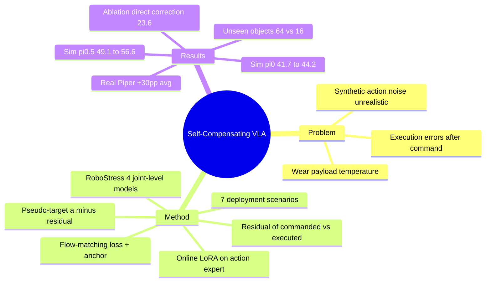

## Summary
把 VLA 部署时"指令动作 vs 实际执行动作"的残差（由 proprioception 测得）当作自监督信号，用它在线更新 action expert 的 LoRA，使后续 action chunk 预先补偿机器人的执行误差（self-compensating VLA）。同时提出 RoboStress：把 friction / backlash / compliance / gravity-compensation error 四种关节级模型组合成 7 个部署场景的仿真 benchmark。仿真增益温和（π0 平均 41.7→44.2），真机 Piper 上增益大（平均 +30pp 以上）但每任务仅 25 episodes。

## Problem & Motivation
VLA 鲁棒性研究多集中在视觉扰动、干扰物、指令改写，或直接给输出的 end-effector 命令加合成噪声（RobustVLA 等）。真实部署中的执行误差来自磨损、负载、温度变化，发生在命令被执行之后，且依赖机器人当前状态与近期运动历史、各关节贡献不同——合成的 action 噪声不具备这些性质。作者认为这类误差随机器人个体而异，需要部署时适配；而收集一批机械状态各异的真机 fleet 不现实，所以需要可控的仿真压力测试。

## Method
**Compensation signal（§3.1）**：策略输出 delta-pose action chunk。每个执行步用 proprioception 测得实际位姿变化 Δx，与指令 a^policy 相减得残差 η^obs = Δx − a^policy（旋转用 SO(3) log map，并按指令到物理单位的 scale 归一化到同一量纲）。

**Policy adaptation（§3.2）**：构造 pseudo-target a^target = a^policy − η^obs。残差只能在执行后观察到，所以只用于更新后续 chunk，不能修正当前 chunk。对 π0 / π0.5 的 action expert 挂 rank-4 LoRA，冻结预训练权重，用 flow-matching 损失把 velocity 回归到 (ε − a^target)，再加对 LoRA 初始值的 anchor 正则（λ_anc=1e-4）；target chunk 累积在 online buffer 中，Adam lr=1e-6。低层控制器不改，不需要 task reward、label 或动力学模型。真机 Piper 输出绝对关节位置，因此在 joint space 计算残差与目标。

**RoboStress（§4）**：四个文献中的关节级噪声模型——Stribeck friction（力矩级）、gravity-compensation error（力矩级，= β·g(q)）、Tao-Kokotović backlash deadband（位置级，历史依赖）、二阶 spring-mass-damper compliance（位置级，历史依赖）。经 operational space controller 注入后由物理引擎传播，所以单关节扰动会按位姿产生不同的末端误差。通过 per-joint severity factor 组合成 7 个场景：Heavy Payload（抓取时开启）、Thermal Drift-Stribeck / -Backlash（episode 内线性增大）、Aged Transmission、Aged Joint-Uniform / -Shoulder (J1–J3) / -Elbow (J4)。基于 LIBERO 四个 suite，每任务 20 episodes。

## Key Results
- **RoboStress（Table 2，LIBERO 平均，不含 Clean）**：π0.5 上 Base 49.1 / DR 51.0 / RobustVLA 49.8 / Ours 56.6；π0 上 41.7 / 39.8 / 38.8 / 44.2。七个场景在两个 backbone 下 Ours 均最高。DR 与 RobustVLA 在 π0 上平均低于 Base。最大单场景增益在 π0.5 Heavy Payload（44.1→56.8）与 Aged Joint-Elbow（55.6→62.3）；π0 的 Thermal Drift-Backlash 仅 75.5→78.8。
- **Clean 设置**：π0.5 上 Ours 95.8，低于 Base 97.0；π0 上 92.6 高于 Base 91.1。
- **消融（π0，Table 4）**：Direct residual correction（固定策略，减去上一 chunk 平均残差）仅 23.6%，远低于 Base 41.7；令 η^obs=0 的在线更新 40.8%，略低于 Base；完整方法 44.2。结论：残差提供信号，策略适配提供状态条件化的补偿。去掉 anchor 平均 44.2→41.8（附录 D.1）。
- **噪声成分（π0）**：单成分 Base→Ours 平均 50.0→51.5；compliance 增益最小（74.1→74.2）。
- **真机（两台 AgileX Piper，每任务 25 episodes，Table 6）**：Robot A 上 π0.5 平均 Base 43 / RobustVLA 52 / Ours 76，π0 为 40 / 47 / 72；Robot B 上 π0.5 为 43 / 50 / 74，π0 为 38 / 49 / 71。四个任务（3 个 bowl pick-and-place + 1 个开抽屉）全部最优。新机器人平均归一化残差 32.9%，使用一年的机器人 35.0%。
- **DOB（Robot A, Task 1, π0.5）**：Base 48 / DOB 56 / Ours 84 / DOB+Ours 80。
- **未见物体（Robot A, Task 1, 5 个变体 × 5 episodes）**：Ours 64% vs Base 16% vs RobustVLA 36%。
- **Heavy Payload 对照**：用 1 kg 真实 payload 回放校准参数后，RoboStress 的 DTW 距离低于 Gaussian action noise 参照。

## Evidence Ledger
| Claim ID | Claim | Type | Source locator | Evidence excerpt | Status |
|:--|:--|:--|:--|:--|:--|
| C1 | 在 RoboStress 上 π0.5 的平均成功率 Base 49.1% 提升到 Ours 56.6% | number | §5.2, Table 2 | "raises average success from 49.1% to 56.6% with π0.5 and from 41.7% to 44.2% with π0" | source-verified |
| C2 | π0 的平均成功率 Base 41.7% 提升到 Ours 44.2% | number | §5.2, Table 2 | "from 41.7% to 44.2% with π0" | source-verified |
| C3 | 七个场景、两个 backbone 下 Ours 均优于 Base、DR、RobustVLA | SOTA | §5.2, Table 2 | "outperforms the base policy, DR, and RobustVLA in all seven scenarios with both backbones" | source-verified |
| C4 | DR 与 RobustVLA 在 π0 上平均成功率低于 Base | comparability | §5.2, Table 2 | "DR and RobustVLA yield inconsistent gains and fall below the base policy on average with π0" | source-verified |
| C5 | π0.5 Heavy Payload 成功率 Base 44.1 → Ours 56.8 | number | Table 2 | "Heavy Payload 44.1 42.1 38.9 56.8" | source-verified |
| C6 | π0.5 Clean 设置下 Ours 95.8 低于 Base 97.0 | number | Table 2 | "Clean 97.0 97.1 96.6 95.8" | source-verified |
| C7 | 真机 Robot A 上 π0.5 平均成功率 Base 43 → Ours 76 | number | §5.3, Table 6 | "Avg. 43 52 76 40 47 72" | source-verified |
| C8 | 真机 Robot B 上 π0.5 平均 Base 43 → Ours 74，π0 为 38 → 71 | number | Table 6 | "Avg. ... 43 50 74 38 49 71" | source-verified |
| C9 | 真机每任务评估 25 episodes | benchmark | §5.1 Evaluation Protocol | "using 25 episodes per task" | source-verified |
| C10 | 新机器人也存在显著指令-执行失配，平均归一化残差 32.9%（旧机器人 35.0%） | mechanism | §5.3 | "mean normalized residual of 32.9%, compared with 35.0% on the older arm" | source-verified |
| C11 | 去掉 η^obs 的在线更新（η^obs=0）在 π0 上 40.8%，低于 Base | causal | §5.2, Table 4 | "This variant reaches 40.8%, below the base policy and our method." | source-verified |
| C12 | 固定策略的 direct residual correction 仅 23.6%，远低于 Base | causal | §5.2, Table 4 | "Direct residual correction ... reaching only 23.6%" | source-verified |
| C13 | 去掉 anchor loss 使 π0 平均成功率从 44.2% 降至 41.8% | number | Appendix D.1 | "reducing the average from 44.2% to 41.8% (2.4 percentage points)" | source-verified |
| C14 | DOB 单独 Task 1 成功率 56%，DOB+Ours 80%，Ours 单独 84% | number | §5.3, Table 5 | "DOB alone raises success from 48% to 56%, while adding our adaptation raises it further to 80%, compared with 84%" | source-verified |
| C15 | 未见物体变体上 Ours 64%，Base 16%，RobustVLA 36%（5 变体共 25 episodes） | number | §5.3, Figure 6 | "64% success with π0.5, compared with 16% for the base policy and 36% for RobustVLA" | source-verified |
| C16 | 噪声成分分析中 π0 平均 50.0→51.5，compliance 下增益最小 | number | §5.2, Table 3 | "raises the average success rate of π0 from 50.0% to 51.5%" | source-verified |
| C17 | RoboStress 的 Heavy Payload 模型比 Gaussian action noise 更贴近真实 1 kg 负载偏差（DTW 更低） | benchmark | §5.2, Figure 4 | "yields a lower dynamic time warping (DTW) distance to the real mean profile than the Gaussian reference" | source-verified |
| C18 | RoboStress 的 4 个噪声模型均沿用既有关节级模型，非新提出 | novelty | §1 / §2 | "RoboStress uses them to generate execution errors for evaluating VLA robustness." | source-verified |
| C19 | 方法不需要 task reward、label 或误差来源知识，且不改低层控制器 | mechanism | §1 | "without task rewards, labels, or knowledge of the error sources" | source-verified |
| C20 | 作者承诺发布 self-compensating VLA 与 RoboStress 的代码（尚未发布） | license/code | 正文末段/附录 | "We will release the code for self-compensating VLA and RoboStress" | source-verified |
| C21 | RoboStress 覆盖四个 LIBERO suite 各 10 个任务，每任务 20 episodes，附录称三 seed 取平均 | benchmark | §5.1 / Appendix B.1 | "using 20 episodes per task in each setting" | source-verified |

## Strengths & Weaknesses
**优点**
- 问题 formulation 清楚：把"命令后发生的执行误差"与已有"命令前注入的 action 噪声"区分开，并给出可对应物理原因的四类误差模型和状态/历史依赖。
- 方法简单：一个残差、一个 LoRA、一个 flow-matching 回归，不碰低层控制器。Table 4 的 ablation 很有信息量：固定的 chunk 级残差减法（23.6%）反而远差于 Base，而 η^obs=0 的更新（40.8%）也不好，说明增益确实来自"残差 + 参数更新"的组合，而非"在线微调"本身。
- 与 DOB 的对比诚实地报告了 DOB+Ours (80) 低于 Ours alone (84)，没有为叙事掩盖。

**缺点与边界**
- 仿真增益小：π0 上只有 +2.5pp，Thermal Drift-Backlash +3.3、Aged Joint-Uniform +1.0；没有报告置信区间（附录称 3 seed 取平均，但主表无误差棒）。
- 真机增益大但统计力弱：每任务 25 episodes，单任务 SE 约 ±9pp；未见物体实验只有 5 变体 × 5 episodes。真机 baseline 只有 base 与 RobustVLA（RobustVLA 针对的是 adversarial 视觉/动作扰动，并非为执行误差设计），没有与 test-time adaptation 方法（EVOLVE-VLA、TT-VLA）、经典 adaptive control 或 residual RL 对比，也没有在 RoboStress 里加 DOB baseline，所以"policy-level 补偿优于已有的 controller-level 补偿"只在单任务（Task 1）得到支持。
- 新机器人（32.9%）与使用一年的机器人（35.0%）的归一化残差几乎相同，削弱了"不同使用历史带来不同误差"的叙事；Base 在两台机器人上平均也几乎一样（43 / 43）。真机收益的来源可能包括 fine-tune 数据与部署间的整体失配（teleop 数据采集 vs 策略回放），而不仅是"磨损"。
- 未见物体泛化的解释存疑：该实验改变的是外观，而方法补偿的是动力学；64% vs 16% 更可能说明"在线适配让策略更贴近该机器人的状态分布"，作者没有给出机制性分析。
- 依赖假设：执行误差在短时间内近似稳定、可由 proprioception 的末端位姿差如实反映；残差只能修正后续 chunk，因此对 episode 内快速变化或只发生一次的误差（如抓取瞬间的负载冲击）天然滞后。对 close-loop 控制器已含强积分作用的机器人，增益可能变小（DOB 对比提示两者重叠）。
- Clean 设置下 π0.5 略降 1.2pp（97.0→95.8），在线更新有轻微副作用；anchor 去除即降 2.4pp，说明 adaptation 对 drift 敏感，长期运行的稳定性未评估。
- RoboStress 的真实性只通过单个 1 kg payload 的 DTW 对照验证，其余 6 个场景的参数是作者设定；benchmark 仍是仿真、仅基于 LIBERO。代码尚未发布。

## Mind Map

## Notes
- 与 π0 / π0.5 的关系：本文的两个 base policy，LoRA 加在其 flow-matching action expert 上，见 [[2410-Pi0]]、[[2504-Pi05]]。
- 同属"VLA 部署期可靠性"但机制不同：[[2601-CycleVLA]] 靠 VLM 判定 subtask 并回退重试（语义层 self-correction），本文靠 proprioception 残差做低层动力学补偿，二者可组合。
- [[2608-CofactVLA]] 同样以 π0.5 为底座、在 AgileX PiPer 真机上评估鲁棒性，针对的是 vision-override 而非执行误差，两者的 OOD 评测预算都偏小，可对照看真机统计力问题。
- 疑问：残差信号能否同时作为故障检测信号（残差突变 = 触发 recovery）？以及在线 LoRA 在长期运行下是否会 catastrophic drift，值得跟踪后续工作。
- 观察时的状态：10-08 daily-papers 中曾标为"留观"，本篇为补读。
