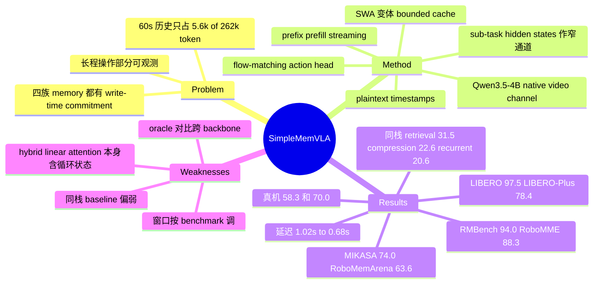

## Summary
SimpleMemVLA 不加任何专用 memory 模块，把最近 T_w 秒的 head-camera 历史帧以 Qwen3.5-4B 预训练时的带 plaintext 时间戳视频格式直接塞进 context，由 backbone 生成一句 sub-task，其 hidden states + token embeddings 作为唯一通道驱动 flow-matching action head，并在动作执行期间预填共享历史前缀把决策延迟压到 0.68 s。在 RMBench 94.0%、RoboMME 88.3%、MIKASA-Robo 74.0%、RoboMemArena TSR 63.6% 四个 memory benchmark 上领先，LIBERO 97.5% 持平最强 reactive VLA；同 backbone 重建的 retrieval / token compression / recurrent state 变体在 RoboMME 只有 31.5% / 22.6% / 20.6%。核心论点是现有 VLA memory 的瓶颈在 "write-time commitment"（在需求未知时就决定保留什么），而不是写入质量。

## Problem & Motivation
长程操作是部分可观测的：决定下一动作所需的信息（哪个盖子下是红块、已经按了几次按钮）可能只在几分钟前的观测里出现。主流 VLA（π0.5、OpenVLA、GR00T 等）只看单帧或亚秒窗口，原理上解不了这类任务。已有 VLA memory 分四族（symbolic store、retrieval、learned compression、recurrent state），共同点是在未来决策需求未知时就决定保留什么，作者称之为 write-time commitment。这些机制的前提假设是"分钟级历史太大，无法直接处理"，但作者指出 60 s 历史只占 Qwen3.5 262k context 中约 5.6k token，容量已不是压缩的理由；真正的问题变成：policy 能否用好一段直接给它的历史。

## Method
- **Native video history**：每个决策步取最近 T_w 秒 head-camera 帧，以 f_v 下采样为至多 K = T_w·f_v 帧，走 backbone 的 video channel，processor 把相邻帧组为 temporal patch 并加 backbone 原生 plaintext 时间戳（标准部署用 window-relative 时间戳）。当前 wrist 帧走 image channel，不带时间戳。prompt 里还有 embodiment、相机布局、时间戳约定的文字描述。
- **Sub-task 作为窄通道**：backbone（Qwen3.5-4B）以普通 assistant response 生成一句当前 sub-task g_t（不是 CoT）；action expert（DiT 式 flow-matching）只接收 g_t 每个 token 的 embedding ⊕ hidden state，加一个 proprioception token，不直接看 prompt token。所以历史信息必须经由 sub-task span 才能到达动作。训练时 sub-task 标签由 cloud VLM 离线对每个 supervision anchor 标注，teacher forcing；联合损失 λ_sub·CE + λ_act·flow-matching。
- **Streaming prefix prefill**：相邻决策只差一个 temporal patch，机器人执行当前 action chunk 时预填共享前缀的 KV cache，下一次决策只处理新 patch + 指令，输出与全量重算一致。
- **按 benchmark 配置**（Table 8）：RMBench/RoboMME 窗口 60 s、2 fps、120 帧；MIKASA-Robo 窗口仅 3 s、20 fps；RoboMemArena 126 s、1 fps；LIBERO 30 s。T_w 按"覆盖该 suite 任务留下证据的时间跨度"设定，f_v 取不漏掉关键事件的最低速率。每 suite 训练一个模型，128 张 H100 上 14–28 小时。
- **SWA 变体（Appendix F）**：Qwen3.5-4B 是 24 层 linear-attention + 8 层 softmax-attention 的混合结构；只对 8 层 softmax 加 sliding window（L=5,888 tokens ≈ 60 个 unit），改用 episode-absolute 时间戳使 cache 不可变，episode 级 packing 训练。窗口外的证据只能靠 linear-attention 的循环状态保留。

## Key Results
- **四个 memory benchmark**（相对各 suite 最强 prior VLA）：RMBench 94.0%（+11.0）、RoboMME 88.3%（+43.7）、MIKASA-Robo 74.0%（+29.6）、RoboMemArena TSR 63.6%（+17.4）。RMBench 上它是唯一一个 multi-memory 平均（97.0%）高于 single-memory（91.6%）的方法；但 RMBench 大部分 baseline 是 per-task specialist，SimpleMemVLA 是单个多任务模型。
- **同栈对照**（RoboMME，同 backbone / 数据 / sub-task 监督 / action head / optimizer）：native context 88.3% vs retrieval 31.5% vs token compression 22.6% vs recurrent state 20.6%。三个变体的具体实现：retrieval = 8 帧均匀采样且丢掉顺序和时间戳；compression = 全历史压到 64 token；recurrent = 16-token state、4 步 unroll 反传。token compression 在计数任务 SwingXtimes 上几乎追平（92% vs 96%），但 Permanence 13.5%、Reference 12.5%。
- **Oracle 对照**：RoboMME 报告里给 ground-truth VLM 输出的 GroundSG 为 84.1%，低于 88.3%；同一 pipeline 换成真实感知（QwenVL）为 32.7%。注意 GroundSG 是 benchmark 方的 π0.5 栈，与 SimpleMemVLA 不同 backbone。
- **通用控制**：LIBERO 97.5%（与 RIPT-VLA 的 97.5% 持平）；zero-shot LIBERO-Plus 78.4%，比最强 baseline MemoryVLA++ 73.1% 高 5.3 点，但 Language 维度 68.6% 低于多个 baseline（MemoryVLA++ 88.7%），Layout 78.0% 也低于 MemoryVLA 84.7%。
- **MIKASA-Robo 剂量效应**：RememberColor 候选数 3→5→9 时，相对最佳 prior VLA 的领先从 12 扩大到 28、39 点；RC-3 上 71% 低于非 VLA 参照 GMP 的 80%。
- **RoboMemArena**：Transferring 类上不领先（TSR 35.8 vs FrameSamp+Modul 63.8，CSR 37.4 甚至低于 π0.5 的 42.8）。
- **History intervention**：遮掉一次已完成的 pick-and-place，PickXtimes 的推断计数恰好减一（"fourth time"→"third time"）并多执行一次 pick；用另一 rollout 的视频替换证据，policy 改去替换视频指示的目标，无参数更新。作者称之为 visual in-context learning。
- **消融**（RMBench cover-blocks / press-button）：15 s 窗口丢掉 ~25 s 前的覆盖事件后 cover-blocks 失败；打乱帧序两任务都失败；时间戳置零只伤 press-button（计数）；替换 hidden states 会改变目标，替换 token embedding 基本不变；复用上一步 hidden states 成功率骤降。
- **延迟**（单 H100、bf16、batch 1）：60 s 历史下 1.02 s → 0.68 s，单帧基线约 0.65 s；人工构造 45 min 输入（约 245k token）下 32.1 s → 1.18 s。SWA 变体中位延迟 0.92 s，RMBench 91.0%（vs 94.0%），掉分集中在 Obs&PU（65→56）和 Battery（90→71）。
- **真机**（双臂 Piper）：Cover Blocks 35/60 = 58.3%（180 条示教），Put Back Block 28/40 = 70.0%（308 条示教）；无任何 baseline 对比。

## Evidence Ledger

| Claim ID | Claim | Type | Source locator | Evidence excerpt | Status |
|:--|:--|:--|:--|:--|:--|
| C1 | SimpleMemVLA 在 RMBench 达 94.0%，比最强 prior VLA 高 11.0 点 | number | §4.2; Table 1 | "94.0% on RMBench (+11.0 points)" | source-verified |
| C2 | RoboMME 达 88.3%，比最强 prior VLA 高 43.7 点 | number | §4.2; Table 2 | "88.3% on RoboMME (+43.7)" | source-verified |
| C3 | MIKASA-Robo 达 74.0%，领先 29.6 点 | number | §4.2; Table 3 | "74.0% on MIKASA-Robo (+29.6)" | source-verified |
| C4 | RoboMemArena task success 63.6%，领先 17.4 点 | number | §4.2; Table 4 | "63.6% task success on RoboMemArena (+17.4)" | source-verified |
| C5 | RMBench 大部分 baseline 是 per-task specialist，SimpleMemVLA 是单个多任务模型 | benchmark-setting | Table 1 caption | "Most baselines train one specialist model per task while SimpleMemVLA is a single multi-task model" | source-verified |
| C6 | RMBench 上 SimpleMemVLA 是唯一 multi-memory 平均高于 single-memory 的方法（91.6%→97.0%） | comparison | §4.2 | "the only method in Table 1 whose average rises from the single-memory to the multi-memory setting, from 91.6% to 97.0%" | source-verified |
| C7 | 同栈对照下 RoboMME：native 88.3%，retrieval 31.5%，token compression 22.6%，recurrent state 20.6% | comparison | §4.4; Table 2 | "Native context reaches 88.3% on RoboMME, compared with 31.5% for retrieval, 22.6% for token compression and 20.6% for recurrent state" | source-verified |
| C8 | 同栈 retrieval 变体是 8 帧均匀采样，丢掉顺序与时间戳 | benchmark-setting | §4.4 Retrieval | "Eight uniformly sampled frames preserve visual content but omit temporal order and timestamps." | source-verified |
| C9 | token compression 变体把全历史压到 64 token，SwingXtimes 上 92% vs native 96% | number | §4.4 Token compression | "Compressing the full history into 64 tokens nearly matches native context on SwingXtimes (92% versus 96%)." | source-verified |
| C10 | recurrent 变体为 16-token state，4 步连续决策 unroll 反传 | benchmark-setting | Appendix A | "maintains a 16-token state, with gradients propagated through unrolls of four consecutive decisions" | source-verified |
| C11 | GroundSG（ground-truth VLM 输出）在 RoboMME 为 84.1%，低于 native 88.3% | comparison | Appendix E.2; Table 2 | "GroundSG handed ground-truth VLM outputs ... yet it reaches 84.1%, below the 88.3% of the raw stream" | source-verified |
| C12 | 作者推断（原文用 "suggesting"）同栈差距源于 write-time commitment 本身而非写入准确性；这是归因推断，未经直接实验证明 | causal-mechanism | §1 | "what limits these mechanisms is write-time commitment itself rather than the accuracy of what they commit" | source-verified |
| C13 | LIBERO 平均 97.5%，持平最佳报告值 | number | §4.2; Table 5 | "matches the best reported average on LIBERO at 97.5%" | source-verified |
| C14 | LIBERO-Plus zero-shot 78.4%，比最强 baseline 高 5.3 点 | number | §4.2; Table 6 | "transfers zero-shot to LIBERO-Plus at 78.4%, exceeding the strongest reported baseline by 5.3 points" | source-verified |
| C15 | LIBERO-Plus Language 维度 SimpleMemVLA 为 68.6%，MemoryVLA++ 为 88.7% | number | Table 6 | "SimpleMemVLA (Ours) 76.9 68.4 68.6 96.4 96.8 74.2 78.0 78.4" | source-verified |
| C16 | MIKASA RememberColor 候选 3→5→9 时领先幅度 12→28→39 点 | comparison | §4.2; Table 3 | "the margin over the best prior VLA on each RememberColor task widens from 12 to 28 to 39 points" | source-verified |
| C17 | RoboMemArena Transferring 类 SimpleMemVLA 不领先 | comparison | §4.2; Table 4 | "while it does not lead on Transferring" | source-verified |
| C18 | 遮掉一次已完成 pick-and-place 事件，推断计数减一并多执行一次 pick | causal-mechanism | §4.5; Figure 6 | "Masking one completed pick-and-place event causes the policy to infer that one fewer repetition has occurred" | source-verified |
| C19 | 替换历史证据可在无参数更新下改变 policy 目标，作者称为 visual in-context learning | causal-mechanism | §4.5 | "This behavior reveals an emergent visual in-context learning capability." | source-verified |
| C20 | 时间戳置零不影响 cover-blocks 但显著降低 press-button；打乱帧序两任务都失败 | causal-mechanism | §4.7; Figure 8b | "Setting the plaintext timestamps to zero leaves cover-blocks unaffected but substantially degrades press-button" | source-verified |
| C21 | 替换 hidden states 会改变选中目标，替换 token embedding 基本保留原行为 | causal-mechanism | §4.7; Figure 8d | "substituting hidden states redirects it toward the substituted target; zeroing the hidden states causes failure" | source-verified |
| C22 | 单 H100 上 60 s 历史 streaming 把决策延迟从 1.02 s 降到 0.68 s，单帧约 0.65 s | number | §4.6; Figure 7a | "streaming reduces decision latency from 1.02 s to 0.68 s, close to the approximately 0.65 s latency" | source-verified |
| C23 | 45 min（约 245k token）人工输入下延迟 32.1 s → 1.18 s | number | §4.6; Figure 7b | "full-recomputation latency reaches 32.1 s per decision, whereas the streamed decision path requires only 1.18 s" | source-verified |
| C24 | SWA 变体 RMBench 91.0% vs 标准 94.0%，中位延迟 0.92 s | number | Appendix F; Table 13; Figure 14 | "the overall score is 91.0 vs. 94.0" | source-verified |
| C25 | 真机 Cover Blocks 35/60 = 58.3%，Put Back Block 28/40 = 70.0%，分别用 180 / 308 条示教 | number | §4.3; Table 7 | "success rates of 58.3% (35/60) across six Cover Blocks layouts and 70.0% (28/40)" | source-verified |

## Strengths & Weaknesses
**Strengths**
- 问题表述到位。把四族 memory 统一成 "write-time commitment" 一个失败模式，并给出可检验的预测：丢顺序的 retrieval 应在 swap/PatternLock 上崩，压缩应保留计数而丢具体 percept。同栈变体的 per-category 分布大体符合这些预测，比单纯报 SOTA 更有信息量。
- 方法简单。没有新模块，只有窗口长度、采样率、时间戳三个旋钮，外加 sub-task 窄通道；作者明确主张 native context 应作为未来 VLA memory 工作的 matched baseline。这一主张合理，且成本低，容易被复现。
- 机制证据扎实。history intervention 在同一 policy 上固定当前观测、只改历史，验证了 policy 确实在"读"特定证据（计数减一、目标跟随替换视频）。hidden state vs token embedding 交换实验说明控制信号走的是 contextual hidden states，而不是可见文字。
- 工程诚实度较高：报告了 Transferring 不领先、LIBERO-Plus Language/Noise 较弱、残余失败集中在精细控制和 re-identification，并在附录给出 SWA 变体的掉分。

**Weaknesses**
- **同栈对照的 baseline 偏弱，是最大硬伤**。"retrieval" 变体其实是 8 帧均匀采样加丢弃顺序和时间戳，不是 query-conditioned retrieval；compression 只有 64 token，recurrent 只有 16 token、4 步截断反传。这三个实现各自去掉了作者消融里已证明关键的因素（顺序、时间戳、旧帧），所以 88.3 vs 20–31 的差距在相当程度上是被构造出来的。要支撑"write-time commitment 本身是瓶颈"，至少需要一个保留顺序和时间戳、带 query 的 retrieval 变体，或预算接近 5.6k token 的压缩变体。
- **Oracle 论证有 backbone 混杂**。GroundSG 84.1% 跑在 benchmark 方的 π0.5 栈上，SimpleMemVLA 用 Qwen3.5-4B 且有 sub-task 监督，所以"oracle 写入的上限低于原始流"这一推论不是同条件比较。C12 的因果表述强于证据。
- **"无 memory 模块"有一半是措辞**。Qwen3.5-4B 32 层中 24 层是 linear attention，本身就是 recurrent state；只是这个 state 来自预训练、在 60 s 窗口内重新积分。对 Qwen2.5-VL 这类纯 softmax backbone 是否同样有效，文中没有测试。
- **窗口按 benchmark 定**。T_w 按"覆盖该 suite 任务证据跨度"设，相当于用任务先验调了 memory 预算（MIKASA 3 s、RoboMemArena 126 s）。cover-blocks 上 15 s 窗口直接失败，说明在证据年龄未知的开放部署里，需要什么窗口仍是开放问题。窗口外的证据在标准版里直接丢失，SWA 版只剩 linear-attention 残余，Obs&PU 和 Battery 已开始掉分。
- **跨表可比性**：RMBench baseline 多是 per-task specialist，混合了 published 数字和不同 seed 数；RoboMemArena 的 FrameSamp+Modul 引自 leaderboard。部分 SOTA 幅度（尤其 RoboMME +43.7）同时包含 backbone 差异（π0.5 vs Qwen3.5-4B）。
- **依赖离线 cloud VLM 标注 sub-task**。sub-task 通道是 history → action 的唯一路径，标注质量和粒度对结果的贡献没有消融；任务若没有自然的 sub-task 分解（连续技能、接触丰富操作），这个窄通道是否够用未知。
- **真机实验没有 baseline**（没有单帧 VLA 或 memory VLA 对照），且只有 2 个任务、10 个配置，58.3% / 70.0% 只能说明"可用"。
- **"visual in-context learning" 是 overclaim 风险点**。替换实验展示的是 policy 读取并服从训练分布内类型的证据（位置、颜色、首步动作），不是从示范学到新行为；称为 in-context learning 有拔高之嫌。

**对领域的意义**：这篇论文最值得记住的不是 SOTA 数字，而是它把 VLA memory 的默认 baseline 抬到了"把原始历史视频直接给 backbone"。今后 VLA memory 论文若不与 native-context baseline 对比，结论都可疑。与 MEM 的发现（拼接的 sub-task 文本历史不如压缩摘要）形成有价值的张力：两者差异可能在于 MEM 存的是文本、本文存的是原始视频。

## Mind Map

## Notes
- [[2603-MEM]]：结论有张力。MEM 发现拼接 sub-task 文本历史不如压缩语言摘要，本文发现直接给原始视频历史远胜压缩；差别可能在于文本历史会被失败重试污染，而视频历史保留了原始证据。
- [[2607-LaMemVLA]]：同一问题的对立路线。LaMem-VLA 把历史重构成 latent memory token 织进 self-attention，正属于本文批评的 learned compression 族；两者都在 LIBERO 约 97.5% 饱和，区分不开，需要在 RoboMME/RMBench 上做 native-context 对照。
- [[2511-EchoVLA]]：EchoVLA 的 declarative memory 属于本文分类中的 retrieval 族（本文 §1 引用为 Lin et al., 2025a），可作为 write-time commitment 论点的反例检验对象。
- [[2606-NaiveVisualMemory]]：GUI agent 中把历史整屏截图直接当 visual memory 会加重 action-level 失败，与本文"原始历史最优"的结论相反；本文的 sub-task 窄通道可能正是隔离 action head 不受长历史干扰的关键，这一可组合性值得在 GUI 场景检验。
