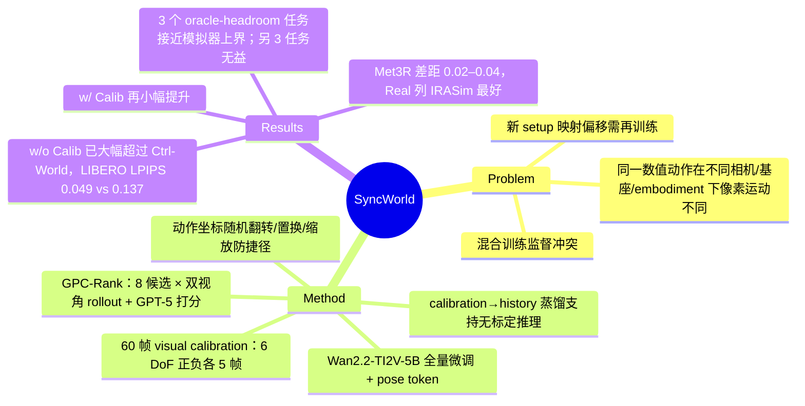

## Summary
SyncWorld 把"同一数值动作在不同相机/基座/机械臂下对应不同像素运动"当作需要在上下文里标定的隐变量：在 action-conditioned video world model（Wan2.2-TI2V-5B 全量微调）前面拼一段 60 帧 visual calibration（6 个运动 DoF 正负各 5 帧），训练时对动作坐标做随机符号翻转/轴置换/缩放迫使模型从 calibration 读语义，再用 calibration→history 蒸馏让模型在没有 calibration 时也能靠交互历史推断映射。在未见的 LIBERO / ManiSkill 环境与未见的 xArm 真机上，无 calibration 版本已在 PSNR/LPIPS/FID 上大幅超过微调后的 IRASim / WorldGym / Ctrl-World（LIBERO LPIPS 0.049 vs Ctrl-World 0.137），加 calibration 再小幅提升（0.035）；作为 GPC-Rank 的 rollout 模拟器，在 3 个按 oracle headroom 挑出的 LIBERO 任务上把 π0 成功率从 0.52/0.56/0.48 提到 0.58/0.72/0.60，接近用真实模拟器的 0.60/0.80/0.66。

## Problem & Motivation
action-conditioned world model 被越来越多地当作 policy-in-the-loop 的"想象环境"，这要求 rollout 对低层动作有细粒度可控性。作者指出扩展这类模型的一个具体障碍：数值动作不是像素空间的通用语言。相机外参、机器人基座位置、embodiment 一变，同一个动作向量在画面里的运动方向和幅度就变了，于是 (1) 混合多源数据训练时同一动作值对应互相冲突的视觉监督；(2) 部署到新 setup 时映射偏移，模型通常需要再训练。已有路线要么设计一种通用的视觉化动作表示（ray map、visual action prompt、embodiment mask、把关节投影成画面标记），要么显式估计外参或做测试时微调；作者的选择是不追求通用表示，而是给每个 setup 一段短的"标定视频"，让模型在上下文里读出这个 setup 的 Action–Visual Mapping。

## Method
**问题形式化**。标准 world model 建模 \(I_{t+1:t+H}\sim W_\theta(\cdot\mid H_t,A_t)\)；SyncWorld 改为 \(W_\theta(\cdot\mid\mathcal C^s,H_t,A_t)\)，\(\mathcal C^s\) 是 setup \(s\) 的 calibration context。

**Calibration episode**。每个 setup 用固定单相机录一段交互：平移 {x,y,z} 与旋转 {yaw,pitch,roll} 各自随机打乱顺序后拼接，每个 DoF 随机选一个方向执行"前进 \(n_d\) 步—停 \(n_p\) 步—反向 \(n_d\) 步"（\(n_d\) 随机以变化幅度）。从中对 12 个带符号 DoF 各抽取位移最大的连续段（阈值平移 1 mm / 旋转 0.2°），取起点后 5 帧并把动作重新锚定到首帧，按固定规范顺序拼成 60 帧前缀。gripper 不进 calibration（作者认为其视觉含义直接）。

**模型**。Wan2.2-TI2V-5B（4×16×16 时空压缩 VAE），每个 DiT block 加线性 pose encoder + identity 初始化投影；每帧机器人条件是 8 维向量，4 帧拼成 32 维 token；样本为 60 帧 calibration + 25 帧 history + 16 帧 future，512×512。全部 denoising 参数微调，4×8 H100、batch 64、2–3 天。推理用 action classifier-free guidance（null-action 基线，λ=5.0），FlowMatch 20 步。

**防捷径的两个训练设计**。
- *Action-coordinate augmentation*：对 calibration / history / future 三路 pose 施加同一个随机右手系带符号置换矩阵 \(\mathbf S\)（附录约束 det=+1；正文只说"随机翻转 xyz 符号并置换"）与平移缩放 \(s\sim U(0.7,1.5)\)，视频不变；这样同一画面配不同动作坐标，模型只能从 calibration 读出当前约定。另加三路一致的光度扰动。
- *Calibration distillation*：同一轨迹构造 teacher（含 calibration）与 student（null-calib：全黑视频、零 pose、flag −2.0），损失 \(\mathcal L_{base}+\lambda\|\hat\epsilon(\text{history},\text{null})-\mathrm{sg}(\hat\epsilon(\text{history},\text{calib}))\|^2\)，让模型学会只靠交互历史近似映射。
- 两阶段 curriculum：先全部样本带 calibration、\(p_{axis}=0.3\)；再混入无 calibration 样本（含 DROID）、\(p_{axis}=0.6\)。

**训练数据**。RLBench / RoboCasa / RoboMimic 专家轨迹在随机相机位姿下重放（要求 gripper 可见，最多 150 次采样）并为每个 setup 录 calibration；加入两类反事实扰动轨迹（断点后接合成运动段 / 稀疏控制点加高斯噪声）以避免模型总是预测成功；再加 DROID 真机数据（无 calibration）。总量约 166 小时、约 29,880 段视频、约 8,300 条唯一轨迹、平均 3.6 个视角，真机约 54 小时。

**Zero-shot policy improvement**。沿用 GPC-Rank：π0 每步采 N=8 个 16 步候选 chunk，SyncWorld 为每个候选生成 front + side 两个视角的 rollout，下采样 3 帧给 GPT-5 打分，执行最高分候选。

## Key Results
**单 chunk 视频预测**（Table 1；给定短历史，预测下 16 步；ManiSkill 50 + LIBERO 50 + 真机 25 条轨迹各 2 视角 = 100/100/50 段视频；单次报告无方差）：

| 方法 | LIBERO PSNR/LPIPS/FID | ManiSkill PSNR/LPIPS/FID | Real (xArm) PSNR/LPIPS/FID |
|:--|:--|:--|:--|
| IRASim | 23.5 / 0.149 / 19.9 | 21.8 / 0.188 / 29.4 | 24.2 / 0.165 / 31.2 |
| WorldGym | 24.1 / 0.142 / 17.4 | 22.2 / 0.183 / 27.6 | 24.6 / 0.154 / 24.4 |
| Ctrl-World | 24.8 / 0.137 / 16.5 | 22.6 / 0.178 / 26.5 | 25.2 / 0.142 / 22.8 |
| SyncWorld w/o Calib | 27.9 / 0.049 / 8.7 | 26.0 / 0.071 / 14.0 | 28.8 / 0.042 / 5.9 |
| SyncWorld w/ Calib | 28.3 / 0.035 / 7.0 | 27.0 / 0.049 / 9.7 | 29.2 / 0.039 / 5.5 |

基线"在同一 downstream dataset 上微调"，但论文没说明这份数据是 SyncWorld 的训练集还是评测环境的数据。差距的主体（如 LIBERO LPIPS 0.137→0.049）出现在"无 calibration"一行，测试时给 calibration 只再带来 PSNR +0.4/+1.0/+0.4。

**跨视角一致性**（Table 2，Met3R，一个视角的生成 vs 另一视角 GT，越低越好）：均值 SyncWorld w/ Calib 0.538、w/o 0.542、IRASim 0.560、Ctrl-World 0.565、WorldGym 0.577，两路 GT 互比 0.523。差距只有 0.02–0.04；且 Real 列 IRASim 0.468 优于 SyncWorld w/ Calib 0.473 和 w/o Calib 0.474（表中 IRASim 加粗），SyncWorld 只在 Avg 上领先（0.538 vs IRASim 0.560）。真机 xArm 正是论文主打的 embodiment 泛化场景，恰好在这一列没赢；正文"所有设置都低于所有基线"的说法与表不符，§4.2 的 "on every metric" 只对 Table 1 成立。

**训练设计消融**（Table 4/5，只在无测试时 calibration 设置下报告——Table 4 的完整模型行与 Table 1 的 w/o Calib 行逐数相同）：LIBERO PSNR/FID 完整 27.9/8.7、训练去掉 calibration 25.0/15.6、去掉 distillation 24.2/17.8；Real FID 5.9/18.2/20.1。Met3R 均值 0.542/0.566/0.574。去掉 distillation 比去掉 calibration 更差，说明"训练见过 calibration 但没学过脱离它"的模型在无 calibration 时会崩；(-) Distill 在三个域都比 (-) Calib 差（LIBERO PSNR 24.2 vs 25.0、ManiSkill 22.5 vs 23.2、Real 26.0 vs 26.7）。作者说去掉 distillation "主要在无 calibration 时受损"，这需要两种测试设置的对比，但论文没给带 calibration 的消融数字，这句无法从表中核对。增强概率消融（Table 9，带 calibration）：0.0 / 0.3 / 默认 0.6 / 0.9 → LIBERO PSNR 26.6 / 27.5 / 28.3 / 26.7，倒 U 形。

**Policy improvement**（Table 3；LeRobot 非官方 LIBERO π0，每任务 50 episodes，GPT-5 judge）：

| 任务 | π0 直接执行 | + SyncWorld w/o Calib | + SyncWorld w/ Calib | + LIBERO 模拟器（oracle） |
|:--|:--|:--|:--|:--|
| BBQ Sauce | 0.52 | 0.54 | 0.58 | 0.60 |
| Orange Juice | 0.56 | 0.68 | 0.72 | 0.80 |
| Black Bowl | 0.48 | 0.58 | 0.60 | 0.66 |

这 3 个任务是按"oracle 模拟器 rollout 能否提升直接策略"挑出来的，每任务 50 episodes 单次运行，0.02–0.04 的差异只相当于 1–2 个 episode（如 BBQ Sauce w/o→w/ Calib 0.54→0.58）。附录 Table 8 的另 3 个任务里 SyncWorld 持平或更差：Alphabet Soup 0.58→0.58（oracle 0.62）、Ketchup 0.80→0.72（oracle 0.74）、Put Cream Cheese 0.34→0.34（oracle 0.30）。Table 8 标题称这些任务"没有一致的 oracle 提升空间"，但 Alphabet Soup 的 oracle 仍高出 0.04；该表 SyncWorld 行也未注明是 w/ 还是 w/o Calib。

**推理成本**（Table 6）：SyncWorld 1×H100 20 步 15.6s/段、4×H100 USP 3.2s；Ctrl-World 1×H100 50 步 4.0s。policy improvement 每个决策步要生成 8 候选 × 2 视角 = 16 段 rollout，再加 8 次 GPT-5 调用。

**失败模式**（App E、F.5）：极端近距视角下只能粗略给出旋转趋势；ManiSkill 未见物体（peg）模糊错位；多物体场景轻微幻觉；xArm 细粒度旋转时夹爪中间帧模糊。作者承认无 calibration 版本数值接近，但在未见 embodiment 上逐 DoF 的方向一致性明显变差，即"只用 history 就够"的数值证据与定性证据方向不一致。

## Evidence Ledger

| Claim ID | Claim | Type | Source locator | Evidence excerpt | Status |
|:--|:--|:--|:--|:--|:--|
| C1 | Wan2.2-TI2V-5B 全量微调，512×512，16 步 chunk，4×8 H100、batch 64、2–3 天 | benchmark-setting | §4.1；App B.1.1 | "trained end-to-end on 4×8 H100 GPUs with a total batch size of 64. Training converges within 2–3 days." | source-verified |
| C2 | 样本 = 60 帧 calibration（12 段×5 帧）+ 25 帧 history + 16 帧 future；calibration 不含 gripper | benchmark-setting | App B.1.1；Figure 3 caption | "Each training sample contains 60 calibration frames, 25 history interaction frames, and 16 future frames" | source-verified |
| C3 | 三路动作同一坐标扰动（符号翻转/置换/缩放 U(0.7,1.5)），视频不变；p_axis 0.3→0.6 | benchmark-setting | §3.2；App B.1.2、B.1.4 | "randomly flip the signs of {x,y,z}, permute these axes, and apply a global scale factor" | source-verified |
| C4 | null-calib（全黑、零 pose、flag −2.0）student 对 stop-grad teacher 做 L2 蒸馏 | benchmark-setting | App B.1.3 | "the calibration video is set to an all-black tensor … with an additional calibration flag value of -2.0" | source-verified |
| C5 | 约 166 h、29,880 视频、8,300 唯一轨迹、3.6 视角；真机约 54 h 占三分之一；DROID 无 calibration | number | §3.4；App B.2.5 | "approximately 166 hours of video in total … real-world data account for about 54 hours" | source-verified |
| C6 | 评测 100/100/50 段视频；ManiSkill/LIBERO 为未见环境但同为 Franka Panda，真机为未见 xArm | benchmark-setting | §4.1 | "the real-world evaluation uses an unseen robot arm (xArm), enabling a stronger embodiment generalization test" | source-verified |
| C7 | w/ Calib vs Ctrl-World：LIBERO 28.3/0.935/0.035/7.0 vs 24.8/0.892/0.137/16.5 等 | number | Table 1 | "SyncWorld w/ Calib 28.3 0.935 0.035 7.0 27.0 0.870 0.049 9.7 29.2 0.936 0.039 5.5" | source-verified |
| C8 | w/o Calib 已全面超过三个基线（LIBERO 27.9/0.933/0.049/8.7） | comparison | Table 1 | "SyncWorld w/o Calib 27.9 0.933 0.049 8.7 26.0 0.845 0.071 14.0 28.8 0.934 0.042 5.9" | source-verified |
| C9 | 基线"在同一 downstream dataset 上微调"，未说明该数据集是哪份 | benchmark-setting | §4.2 | "baselines finetuned on the same downstream dataset and evaluated on the same held-out trajectories" | source-verified |
| C10 | Met3R 均值 0.538 / 0.542 / 0.560 / 0.565 / 0.577，Oracle 0.523 | number | Table 2 | "SyncWorld w/ Calib. 0.540 0.602 0.473 0.538 … Oracle 0.515 0.594 0.459 0.523" | source-verified |
| C11 | Real 列 IRASim 0.468 优于 SyncWorld 0.473，与正文"低于所有基线"矛盾 | comparison | Table 2 vs §4.3 | "IRASim 0.579 0.633 0.468 0.560"; "consistently achieves lower Met3r scores than all baselines across ManiSkill, LIBERO, and real-world" | source-verified |
| C12 | Table 3：0.52/0.56/0.48 → w/o 0.54/0.68/0.58 → w/ 0.58/0.72/0.60，Oracle 0.60/0.80/0.66 | number | Table 3；§4.4 | "SyncWorld w/ Calib 0.58 0.72 0.60; Oracle 0.60 0.80 0.66" | source-verified |
| C13 | Table 8：Ketchup 0.80→0.72（oracle 0.74），另两任务持平 | number | App C.4.3 Table 8 | "Baseline 0.58 0.8 0.34; SyncWorld 0.58 0.72 0.34; Oracle 0.62 0.74 0.3" | source-verified |
| C14 | LeRobot 非官方 π0；N=8 候选×16 步；front+side 双视角；3 帧给 GPT-5 | benchmark-setting | §4.4；App C.4.1–C.4.2 | "We use a non-official pre-trained π0 checkpoint on LIBERO from LeRobot as our base policy" | source-verified |
| C15 | 消融 LIBERO PSNR/FID 27.9/8.7、(-)Calib 25.0/15.6、(-)Distill 24.2/17.8；Real FID 5.9/18.2/20.1 | number | Table 4 | "SyncWorld (-) Calib. 25.0 0.895 0.134 15.6 … SyncWorld (-) Distill. 24.2 0.885 0.148 17.8" | source-verified |
| C16 | Table 4/5 的完整模型行 = Table 1/2 的 w/o Calib 行，消融只在无测试时 calibration 下报告 | benchmark-setting | Table 1 vs 4；Table 2 vs 5 | Table 4 "SyncWorld 27.9 0.933 0.049 8.7"；Table 5 "SyncWorld 0.545 0.607 0.474 0.542" | source-verified |
| C17 | Met3R 消融均值 0.542 / 0.566 / 0.574，Oracle 0.523 | number | Table 5 | "SyncWorld (-) Calib. 0.560 0.643 0.496 0.566; SyncWorld (-) Distill. 0.569 0.649 0.504 0.574" | source-verified |
| C18 | 增强概率 0.0/0.3/0.6/0.9 → LIBERO PSNR 26.6/27.5/28.3/26.7；正文误引 Table 4 | number | App D Table 9 | "SyncWorld Aug. 0.0 26.6 0.920 0.055 8.2"; "As shown in Table 4, both insufficient and overly aggressive augmentation" | source-verified |
| C19 | 推理 1×H100 50 步 39.4s / 20 步 15.6s / 4×H100 3.2s；Ctrl-World 4.0s；CFG λ=5.0 | number | App C.2 Table 6；C.1 | "Ours 1 H100 50 39.4; 1 H100 20 15.6; 4 H100 20 3.2" | source-verified |
| C20 | 作者自述：无 calibration 时在未见 embodiment 上逐 DoF 可控性下降；四类失败模式 | causal-mechanism | App F.5；App E | "without explicit visual calibration, the model is less consistent in mapping each action dimension to the correct visual motion direction" | source-verified |
| C21 | Table 3 任务按 oracle 模拟器能否提升策略挑选，非按 SyncWorld 表现 | causal-mechanism | App C.4.3 | "This selection is not based on SyncWorld's performance. Instead, it is based on whether a perfect simulator can improve the policy" | source-verified |
| C22 | 只给项目页，无代码仓库；arXiv v1 2026-09-08，cs.CV，CC BY 4.0 | license-code | 文头；Abstract 后 | "https://umass-embodied-agi.github.io/SyncWorld/"; "arXiv:2609.09155v1 [cs.CV] 08 Sep 2026" | source-verified |
| C23 | 全文无 seed、方差或置信区间；成功率每任务 50 episodes 单次报告 | benchmark-setting | 全文检索；§4.4 | "We run 50 episodes per task with GPT-5 as the VLM judge." | source-verified |

## Strengths & Weaknesses

**亮点**
- **问题拆得对**。把跨 setup 泛化失败归因到"动作语义依赖 setup"，并用一个可操作的机制回应：在上下文里给出 6 个 DoF 的视觉响应，同时用坐标增强把"背下全局约定"这条捷径堵死。坐标增强是这套方法里最关键的设计——没有它，calibration 前缀可以被模型忽略。与需要外参/URDF 把动作渲染成画面标记的路线（PiL-World、World Action Planner）相比，标定视频只要求能在新 setup 上执行几秒钟的单轴运动，不需要几何标定。
- **Oracle 对照设计干净**。policy improvement 用同一 GPC-Rank + GPT-5 管线、只把 rollout 来源换成真实 LIBERO 模拟器，作为上界；把"世界模型保真度"与"VLM 排序能力"两个因素分开，并在附录主动列出 oracle 也无益甚至有害的任务（Ketchup、Cream Cheese）。
- 真机评测用训练中未出现的 xArm，embodiment 泛化测试比只换相机更强。

**局限与疑点**
- **calibration 本身的贡献比标题暗示的小，主要增益来源未被拆开**。对基线的大差距在 w/o Calib 一行就已出现；测试时加 calibration 只带来 PSNR +0.4–1.0。训练时去掉 calibration 的变体（LIBERO PSNR 25.0、LPIPS 0.134）与 Ctrl-World（24.8、0.137）几乎持平，说明"训练时用 calibration + 增强 + 蒸馏"这一整套才是主效应——但 (-) Calib 是否同时去掉了坐标增强、是否用同一份数据，论文没写。对基线的差距还混入了 backbone（Wan2.2 5B vs 各基线原生架构）与训练数据（166 h 多视角 + 反事实扰动）两个因素，没有"同 backbone、同数据、无 calibration 设计"的对照。
- **基线微调口径不清**。"在同一 downstream dataset 上微调"未说明是哪份数据；若指评测域，则基线是域内微调而 SyncWorld 是零样本，比较对 SyncWorld 不利，但"零样本泛化"与"域内微调"也就不是同一口径的对比；若基线只在 SyncWorld 训练集上微调，则比较的是"谁更会跨 setup 泛化"，这才是论文想证的。读者无法判断。
- **Met3R 证据弱且有内部矛盾**。差距 0.02–0.04、无方差；Real 列 IRASim 最好（表中自己加粗），正文仍写"在真机上也低于所有基线"。真机 xArm 是论文主打的 embodiment 泛化场景，Real 列 w/ 与 w/o Calib 都输给 IRASim，SyncWorld 只在 Avg 上领先。另外两个视角是各自独立生成后与对方 GT 比，衡量的更多是单视角预测精度，不是模型显式维持了跨视角一致的 3D 状态。
- **policy improvement 的统计力不足**。3 任务 × 50 episodes 单次运行，0.02–0.04 的差异只相当于 1–2 个 episode；0.52→0.58 的差在二项标准误（约 0.07）之内；w/o vs w/ Calib 的 0.02–0.04 差距更不能支撑"calibration consistently improves"。主表 3 个任务是条件选择（oracle 有 headroom）的结果，附录另 3 个任务里 SyncWorld 无益或有害（Ketchup −0.08）。没有用 Ctrl-World 等其他世界模型做同管线对照，所以"接近 oracle"不能说明 SyncWorld 比别的世界模型更适合当模拟器。基线 π0 本身在 LIBERO 上训练过，"zero-shot"只针对世界模型。
- **消融只在无 calibration 下报**（Table 4/5 与 Table 1/2 的 w/o 行逐数相同），"去掉 distillation 主要在无 calibration 时受损"的说法没有带 calibration 的对照数字支撑。(-) Distill 在三个域都比 (-) Calib 差，(-) Calib 已接近 Ctrl-World（LIBERO PSNR 25.0 vs 24.8）。
- **"无 calibration 也够用"的证据方向不一致**。Table 1–3 中 w/o Calib 与 w/ Calib 数值接近，但附录 F.5 承认不给 calibration 时，在未见 embodiment 上逐 DoF 的可控性变差；数值指标可能没有抓到动作方向错误。
- **成本**：每个决策步 16 段 rollout，单段 1×H100 15.6s，比 Ctrl-World（4.0s/50 步）慢；论文没报 policy improvement 的端到端 wall-clock。
- **适用边界**：只验证了 7-DoF 单臂、单视角 RGB、末端位姿动作；calibration 只覆盖运动 DoF 的方向与尺度，不覆盖接触与物体动力学（未见物体的 peg 失败即此类）；对双臂、移动底盘、关节空间动作是否成立未测。
- 小问题：附录 B.1.4 两处写 p_axis=0.3/0.6 "as in the main paper"，但正文没有出现 p_axis；正文把坐标增强描述为"随机翻转 xyz 符号"，附录实际约束为 det=+1 的右手系带符号置换，二者不等价（独立翻符号可得 det=−1）；附录 D 正文把 Table 9 写成 Table 4；B.2.3 引用 "Eq. (5)" 实为规范顺序的 Eq. (4)；C.4.2 把世界模型称为 "differentiable simulator"，但排序过程并不用梯度。

## Mind Map

## Notes
- 与 [[Papers/2606-PiLWorld]] 和 [[Papers/2607-WorldActionPlanner]] 是解决同一问题（动作怎样落到画面上）的两条路线：后两者用运动学+相机投影把动作渲染成画面标记/骨架图，需要外参与 URDF；SyncWorld 用一段标定视频在上下文里让模型自己读出映射，不需要几何信息但需要在新 setup 上先执行几秒单轴运动。三者没有在同一设置下比较过。
- [[Papers/2608-WorldSimProbe]] 的 action-realization probe 正好可以检验 SyncWorld 的核心主张（换视角后动作是否仍驱动正确方向的运动）；SyncWorld 自己只用 PSNR/LPIPS/FID 和 Met3R，没有逐 DoF 的方向正确率指标，F.5 的可控性证据只是定性的。
- [[Papers/2406-IRASim]] 是 Table 1/2 的基线之一，同属 frame-level action-conditioned DiT world model；在 SyncWorld 的 Real 列 Met3R 上它反而最好。
- 待核：基线微调所用的 "downstream dataset" 具体指什么；(-) Calib 变体是否保留坐标增强；policy improvement 是否对 Table 3 的 3 个任务做过多次运行。项目页 https://umass-embodied-agi.github.io/SyncWorld/ （无代码仓库链接）。
