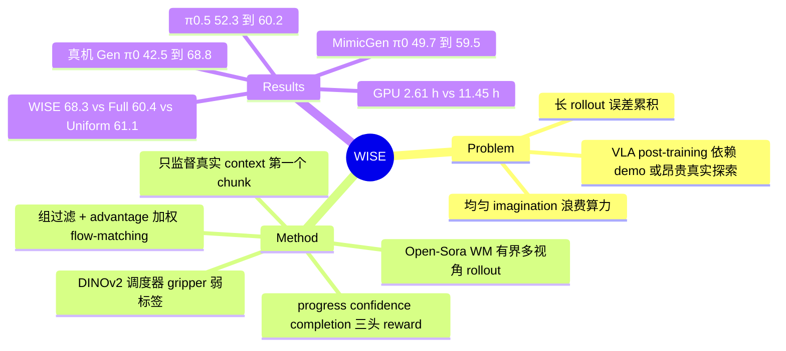

## Summary
WISE 用一个冻结的 action-conditioned multi-view world model（Open-Sora 改造、DROID 预训练）给 π0 / π0.5 做 post-training：一个 DINOv2 调度器只在"交互相关"状态（弱标签来自 gripper/grasp 信号）触发 imagination，对 M 个候选 action chunk 做 L 个 chunk 的有界 rollout，再由 progress / confidence / completion 三头 reward model 打分，组内相对优势只回传给真实 context 下的第一个 chunk（flow-matching loss 加权，只训 action head）。MimicGen 五任务上 π0 49.7 → 59.5、π0.5 52.3 → 60.2，真机 Galaxea R1 Lite 四任务泛化设置 π0 42.5 → 68.8。调度消融（Table 3）是最有信息量的数据：28 个选中状态的 WISE 68.3，对 138 个状态的 Full Imagination 60.4、同预算 Uniform 61.1 / Random 59.1，GPU 时间 2.61 h 对 11.45 h。

## Problem & Motivation
VLA 的 post-training 要么靠昂贵的专家 demo 做 SFT，要么靠真实环境 RL 探索（代价高、可能撞坏硬件）。用 world model 的想象 rollout 评估候选动作是第三条路，已有 WMPO、World4RL、VLA-RFT 等工作，但它们把 imagination 均匀用在整条轨迹上。作者的判断是：预训练 VLA 已能处理粗粒度移动，想象的价值集中在交互关键阶段；而长 rollout 会累积预测误差、产生不可信的学习信号。因此问题被重新表述为 imagination 的分配问题：在哪里调用、推多远、如何把预测结果转成可信监督。

## Method
**有界反事实 imagination（§3.2）**。在调度器选中的真实 context 上，policy 采样 M 个候选 action chunk；冻结 world model \(p_\psi\)（Open-Sora 改造，rectified-flow 训练，只对未来 latent 监督）以腕部 + 第三人称双视角预测 H 帧未来，proprioception 由确定性函数 \(F_s\) 按动作更新，policy 在想象帧上继续出下一个 chunk，共 L 个 chunk、LH 帧。限定 L 用来控制误差累积。M、L、H 的具体取值正文与附录均未给出。

**Imagination 调度（§3.3，App B.1）**。共享权重的 DINOv2 ViT-L/14 编码双视角，拼接后经两层 256 维 MLP 输出 \(s_t\in[0,1]\)，\(s_t>\kappa\) 时触发 imagination。训练标签由离线轨迹的 gripper / grasp 状态自动生成（抓取或主动操作 = 1），加权 BCE；post-training 时只看图像。

**反事实轨迹评估与策略更新（§3.4，App B.2）**。另一个 DINOv2 + 三头 MLP 预测 progress \(p\)、confidence \(c\)、completion \(q\)。轨迹 reward \(R=G-\alpha B+\beta T\)：G 为 confidence 加权、截断到 δ 的正向 progress 增量，B 为倒退量，T 为 completion 最大值；\(\alpha=0.2,\beta=2.0,\delta=0.2\)。每个候选想象两次取均值；只保留组内 reward 极差 ≥0.02、两次排序相关 ≥0.5、重复 imagination 的 reward 波动 ≤0.2 的组。组内标准化得到 advantage \(A_i\)，更新方向为 \(\frac1M\sum_i \mathrm{sg}(A_i)\nabla\mathcal L_{FM}(\theta;a_{t,i},h_t)+\lambda_{ref}\nabla\mathcal L_{ref}\)，即用 advantage 加权的 flow-matching loss 做 GRPO 式更新。只监督真实 context 下的第一个 chunk，想象出的状态-动作对不用作训练样本。

**训练设置（App A Table 5）**。WM 在全量 DROID 上预训练（16×A800 约 7 天），再用每任务 300（仿真）/ 100（真机）条 demo 适配（8×A800 约 10 h/任务）；π0 / π0.5 先按任务用同样的 demo 微调。WISE 阶段 WM 与 VLA backbone 冻结，只训 action head，每次更新累积 256 条 rollout。

## Key Results
**仿真主结果（Table 1，MimicGen D0 五任务，每任务每变体 96 episodes，base 与 post-trained 用相同评测 seed）**：

| 方法 | Stack | Coffee | Square | Threading | Mug Cleanup | Avg. |
|:--|:--|:--|:--|:--|:--|:--|
| π0 | 72.2 | 46.9 | 28.1 | 61.5 | 39.6 | 49.7 |
| π0 + GRPO | 74.3 | 50.0 | 30.2 | 60.4 | 42.7 | 51.5 |
| π0 + DSRL | 77.9 | 50.5 | 21.1 | 61.6 | 38.8 | 50.0 |
| π0 + DPO | 78.1 | 52.3 | 27.1 | 64.6 | 46.9 | 53.8 |
| π0 + WISE | 84.4 | 56.3 | 36.5 | 68.8 | 51.6 | 59.5 |
| π0.5 | 81.2 | 40.6 | 39.6 | 45.8 | 54.2 | 52.3 |
| π0.5 + WISE | 88.5 | 46.8 | 50.0 | 53.1 | 62.5 | 60.2 |

π0 上比最强 baseline DPO 高 5.7 点。GRPO / DSRL / DPO 只在 π0 上跑，π0.5 没有对照 baseline；正文未说明这些 baseline 用的是真实/仿真环境交互还是同一个 world model，也未给出其交互或算力预算。

**Reward 消融（Table 2，Stack / Threading / Mug Cleanup 三任务平均；Full 行与 Table 1 的 π0+WISE 数字完全一致，推测 backbone 为 π0，论文未明说；Full 行与 Table 3 的 WISE 行即主结果数字本身，不是独立重跑）**：Progress only 57.3、Completion only 57.3、w/o Confidence 58.0、w/o Backward Penalty 59.4、Full 68.3。同三任务上 π0 base 的平均为 57.8（由 Table 1 计算），即任一简化 reward 的增益都在 0–2 点以内，全部增益依赖完整 reward 组合。

**调度消融（Table 3，同三任务）**：

| 调度 | Avg. | selected states | GPU Hours |
|:--|:--|:--|:--|
| Full Imagination | 60.4 | 138 | 11.45 |
| Uniform | 61.1 | 28 | 2.90 |
| Random | 59.1 | 28 | 2.89 |
| WISE | 68.3 | 28 | 2.61 |

Full Imagination 对 base（57.8）只多 2.6 点，与只用 1/5 状态的 Uniform 持平；WISE 比 Full 高 7.9 点、选中状态少约 80%、GPU 时间少 77%。摘要写"GPU computation time 减少约 80%"，与 Table 3 的 77% 不完全一致，80% 对应的是 selected states。GPU Hours 只计 post-training imagination，不含 WM 预训练与任务适配。

**真机（Table 4，Galaxea R1 Lite，四任务各 20 次试验，Gen = 高度/光照/干扰物/语言改写四种独立变化的平均）**：π0 Std 60.0 / Gen 42.5 → π0+WISE 77.5 / 68.8；π0+DPO 55.0 / 45.0；π0.5 61.3 / 50.0 → π0.5+WISE 77.5 / 71.3。Pick & Place 的 Std 全部 100，无区分度；Open 是 Open-and-Close 的子任务，四任务并不独立。失败案例只在 Figure 5 定性展示（高度变化、相对位置变化、把手定位）。

**Reward model 判别力（App B.2，Figure 6）**：每任务 20 条成功 + 20 条失败视频上 final-reward AUROC 0.938–1.000；confidence 在失败视频上也可能保持高位。这是在真实/仿真视频上测的，不是在 world model 生成帧上测的。

**作者自述局限（§5）**：imagination horizon 固定；调度监督是粗粒度阶段标签；未来想用预测不确定性和 policy 置信度做更细的调度。

## Evidence Ledger

| Claim ID | Claim | Type | Source locator | Evidence excerpt | Status |
|:--|:--|:--|:--|:--|:--|
| C1 | MimicGen 五任务平均：π0 49.7 → π0+WISE 59.5（+9.8）；π0.5 52.3 → 60.2（+7.9） | number | Table 1；§4.2 | "WISE increases the average success rate from 49.7% to 59.5% … improves the average success rate from 52.3% to 60.2%" | source-verified |
| C2 | π0 baseline 平均：GRPO 51.5、DSRL 50.0、DPO 53.8；WISE 比 DPO 高 5.7 | comparison | Table 1；§4.2 | "outperforms the strongest post-training baseline, π0+DPO, by 5.7 points" | source-verified |
| C3 | π0+WISE 分任务 84.4/56.3/36.5/68.8/51.6；π0.5+WISE 88.5/46.8/50.0/53.1/62.5 | number | Table 1 | "π0 + WISE 84.4 56.3 36.5 68.8 51.6 59.5" | source-verified |
| C4 | GRPO/DSRL/DPO 只在 π0 上报告，π0.5 只有 base 与 WISE | benchmark-setting | Table 1；§4.1 | "For π0 … we compare WISE against … GRPO, DSRL, and DPO. We further apply WISE to the stronger π0.5" | source-verified |
| C5 | Reward 消融三任务平均：Progress only 57.3、Completion only 57.3、w/o Confidence 58.0、w/o Backward Penalty 59.4、Full 68.3 | number | Table 2；§4.3 | "Progress only 75.0 58.3 38.5 57.3 … Full Reward 84.4 68.8 51.6 68.3" | source-verified |
| C6 | Full Imagination 60.4（138，11.45 h）、Uniform 61.1（28，2.90）、Random 59.1（28，2.89）、WISE 68.3（28，2.61） | number | Table 3 | "Full Imagination … 60.4 138 11.45 … WISE 84.4 68.8 51.6 68.3 28 2.61" | source-verified |
| C7 | 相对 Full Imagination 状态少约 80%、GPU 时间少 77%、成功率 +7.9；同预算比 Uniform +7.2、Random +9.2 | comparison | §4.3 | "reduces selected states by approximately 80% and GPU time by 77%, while improving success by 7.9 percentage points" | source-verified |
| C8 | 摘要称 GPU 时间减少约 80%，Table 3 实为 77%；80% 对应 selected states | number | Abstract vs §4.3 | "reducing GPU computation time by approximately 80% compared with full imagination" | source-verified |
| C9 | 真机 π0 Std 60.0 / Gen 42.5 → π0+WISE 77.5 / 68.8；π0+DPO 55.0 / 45.0 | number | Table 4；§4.4 | "from 60.0% to 77.5% under the standard setting and from 42.5% to 68.8% under generalization" | source-verified |
| C10 | 真机 π0.5 61.3 / 50.0 → 77.5 / 71.3（+16.3 / +21.3） | number | Table 4；§4.4 | "Similar improvements are observed for π0.5, from 61.3% to 77.5% and from 50.0% to 71.3%" | source-verified |
| C11 | 仿真每任务每变体 96 episodes、相同 seed 配对；真机每任务每变体 20 次、失败不重试、无人工干预 | benchmark-setting | App D.3 | "evaluated on 96 episodes using identical evaluation seeds"; "each task and policy variant is tested over 20 independent trials" | source-verified |
| C12 | 调度器 DINOv2 ViT-L/14 + MLP 从双视角预测 relevance，弱标签来自 gripper/grasp 状态，阈值 κ 触发 | causal-mechanism | §3.3；App B.1 | "weak interaction-relevance labels automatically derived from gripper and grasp states in the offline trajectories" | source-verified |
| C13 | 每候选 imagine 两次取均值；组过滤 ΔR≥0.02、ρ_rank≥0.5、σ_WM≤0.2；只监督真实 context 的第一个 chunk | causal-mechanism | §3.4 | "Only the first action chunk a_{t,i} from the real context is supervised; imagined rollouts are used solely for candidate evaluation." | source-verified |
| C14 | R = G − αB + βT，α=0.2、β=2.0、δ=0.2 | benchmark-setting | §3.4；App B.2 | "R=G−αB+βT, α=0.2, β=2.0, δ=0.2" | source-verified |
| C15 | WM 基于 Open-Sora，DROID 全量预训练 16×A800 约 7 天；任务适配 300/100 条 demo，8×A800 约 10 h/任务 | benchmark-setting | App A Table 5 | "WM Pre-training Dataset Full DROID Compute 16 × NVIDIA A800 Training time ∼ 7 days" | source-verified |
| C16 | WM 与 VLA backbone 冻结，只训 action head；每次更新 256 条 rollout | benchmark-setting | App A；Table 5 | "We accumulate 256 rollouts from each selected context before performing a policy update." | source-verified |
| C17 | Reward model final-reward AUROC 0.938–1.000（每任务 20 成功 + 20 失败视频） | number | App B.2；Figure 6 | "Final-reward AUROC ranges from 0.938 to 1.000, indicating strong outcome discrimination on the evaluated videos" | source-verified |
| C18 | 代码在匿名仓库，发表后公开，论文无链接 | license-code | Reproducibility statement | "provided in an anonymous repository and will be made publicly available upon publication" | source-verified |
| C19 | Gen 为高度/光照/干扰物/语言四种独立变化的平均；Open 是 Open-and-Close 的子任务 | benchmark-setting | §4.4；App D.4 | "Here, Open is a subtask of Open-and-Close, requiring only the opening phase." | source-verified |
| C20 | 作者自述局限：固定 horizon、粗粒度阶段监督 | benchmark-setting | §5 | "The current framework uses a fixed imagination horizon and coarse stage supervision for scheduling" | source-verified |
| C21 | 未给出 M、L、H、κ、λ_ref 取值；L_ref 称在 Appendix A 但 Appendix A 无定义；无训练 seed 数与置信区间 | benchmark-setting | §3.2–3.4；App A（全文检索） | "The policy is updated along −g_WISE, with L_ref detailed in Appendix A." | source-verified |
| C22 | App D.2 称真机为三个任务，与正文四任务不一致 | benchmark-setting | App D.2 vs §4.4 | "Representative right end-effector trajectories for the three real-world tasks on the Galaxea R1 Lite platform" | source-verified |

## Strengths & Weaknesses

**亮点**
- **问题表述有价值**：把 world-model post-training 的瓶颈从"预测得准不准"挪到"在哪调用、推多远、怎么转成监督"。Table 3 支持其中一半：Full Imagination（138 状态）只比 base 高约 2.6 点，与 1/5 预算的 Uniform 持平，说明均匀堆 imagination 基本不带来收益，这对 WMPO / World4RL 一类均匀 rollout 方法是一个值得追问的反例。
- **监督只落在真实 context 上**：想象帧只用于给候选排序，不生成合成的状态-动作对，避免了 world model 幻觉直接进入训练分布。加上"想象两次 + 排序一致性 + 波动上限"的组过滤，对 WM 噪声做了显式防护。
- 同预算（28 状态）下与 Uniform / Random 的对照是 budget-matched 的，这是此类论文少见的设计。

**局限**
- **调度器的增益来源没有被隔离**。调度器的训练标签就是 gripper / grasp 状态，仿真里这一信号本身可直接读取。缺少"直接用 gripper 规则选状态"这一臂，无法判断学习到的视觉调度器比一个零成本规则多做了什么；"interaction-relevant"的定义也就等价于"夹爪在抓或在操作"，对推、擦、插入前对位这类非抓取交互的覆盖未经检验。
- **增益集中在一个特定组合上**。由 Table 1 计算，同三任务 π0 base 平均 57.8：任一简化 reward 只得 57.3–59.4，Full Imagination 60.4，Uniform 61.1，Random 59.1，全部在 base 附近；只有"完整 reward + 学习调度"到 68.3。没有训练 seed 数、置信区间或方差（每任务 96 episodes，单任务成功率标准误约 5 点），2–3 点的差距不足以排序，而 +10 点的整体增益是否稳健也只能靠单次运行支撑。
- **baseline 比较的公平性不清楚**。GRPO / DSRL / DPO 的训练信号来源（仿真交互、真机交互还是同一个 WM）、交互量和算力都未报告，Appendix A 只描述了 WISE 自己的设置；π0.5 上没有任何 post-training baseline。"比最强 baseline 高 5.7 点"因此不是 budget-matched 比较。
- **"免去真实探索"的说法需要打折**。rollout 起点是"real interaction contexts"，policy 需要在环境中执行才能到达这些状态；真机上到底执行了多少条轨迹没有报告。Table 3 的 GPU Hours 只计 post-training imagination，WM 预训练（16×A800 约 7 天）与每任务适配（8×A800 约 10 h）远大于 11.45 h，"约 80% 计算节省"只在 post-training 阶段内部成立；摘要把 77% 写成约 80%。
- **Reward model 的可靠性只在真实视频上验证**（AUROC 0.938–1.000），没有在 WM 生成帧上测，而训练时打分的对象恰是生成帧；group 过滤的通过率也未报告。
- **复现信息缺口**：M、L、H、κ、λ_ref 均无取值，L_ref 说在 Appendix A 但附录无定义；代码只说"匿名仓库"。
- **内部不一致**：App D.2 写"three real-world tasks"（Pick Cube / Stack Two Cubes / Open-and-Close），正文是四任务；App D.3 称 96 episodes 的设置"As described in Appendix D.1"，D.1 中并无此描述。Table 1 的部分数值与 96 episodes 无法整除（如 π0 Stack 72.2、π0+WISE Mug Cleanup 51.6、DSRL 整行、Table 3 Random 行），可能是多次运行平均，但论文没有说明；π0.5+WISE Coffee 46.8 与同样 45/96 的 π0 Coffee 46.9 舍入不一致。
- 真机 Pick & Place Std 全部 100、Open 与 Open-and-Close 重叠，每格 20 次试验时 5–10 点的差异是 1–2 次成功；"泛化增益大于标准设置增益"的结论建立在 4 任务 × 20 次的样本上。

## Mind Map

## Notes
- 与 [[Papers/2606-RehearseVLA]] 同属"用 action-conditioned video WM 替代环境做 VLA RL post-training"：RehearseVLA 用 VLM reflector 给连续 reward 并决定终止，WISE 用 DINOv2 三头 reward 并加调度；两者 benchmark 不同（LIBERO vs MimicGen），不可直接比较数字。
- 与 [[Papers/2602-WorldVLALoop]] 对照：World-VLA-Loop 让 WM 与 policy 互相迭代（失败 rollout 反哺 WM），WISE 的 WM 全程冻结；WISE 没有处理 policy 改进后 WM 分布外的问题。
- [[Papers/2410-Pi0]] 与 [[Papers/2504-Pi05]] 是两个被 post-train 的 backbone；WISE 只训 action head，结论不涉及 VLM backbone 的适配。
- [[Papers/2609-RealTimeExpoFT]] 也是"采样多个候选 action chunk + 打分器选优"的结构，但打分器是 action critic，用于执行时选择候选，而非训练时生成 advantage；两者可以对比"候选排序信号放在推理时还是训练时"。
- 待核：Table 1 非整数计数的来源（多 seed 平均还是评测 episode 数不是 96）；GRPO / DSRL / DPO baseline 的交互来源。
