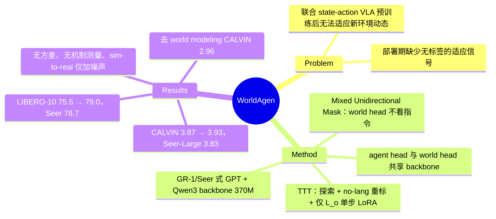

## Summary
WorldAgen 在一个 370M 参数的 GR-1/Seer 式 GPT 架构（Qwen3 backbone）里同时训练 task-conditioned 的动作头和不看语言指令的未来帧预测头，部署时先在目标环境里做短时探索、把指令换成 "no-lang"，只用 observation reconstruction loss 对 backbone 做一步 LoRA 更新（test-time training），期望"世界模型更准 → 动作更准"。CALVIN Avg. Len. 由 3.87 升到 3.93（Seer-Large 3.83），LIBERO-10 平均成功率由 75.5 升到 79.0（Seer 78.7）。TTT 的增益幅度小、没有方差报告，"更新世界模型间接改善策略"这一机制也没有被直接测量，证据强度明显弱于标题的主张。

## Problem & Motivation
联合预测状态与动作的 VLA（GR-1、Seer、PAD、UWM 一类）在静态数据集上预训练，部署后面对新的物体布局、光照或物理属性时无法更新自己对环境动态的内部表示。作者的问题是：能否在测试时让 VLA 主动收集环境交互、用自监督信号更新"对世界的理解"，而不需要任务标注？选择的切入点是把 world modeling 从预训练辅助目标改成部署期的适应信号——world model 的训练目标（预测下一帧）在新环境里不需要任何标签，探索轨迹本身就是监督。

## Method
**架构**。沿用 GR-1 / Seer 的 GPT 视频架构：MAE 预训练 ViT-B 编码 static + wrist 双视角 RGB，经 Perceiver Resampler 压缩 token；CLIP ViT-B/32 编码语言；7 维 robot state / action 用 MLP 投影。backbone 是 24 层、12 头的 Qwen3 结构，总参数 370M、可训练 120M（App B）。每个 trajectory unit \(U_i=(G_i,O_i,S_i,A_i,A_p,O_p)\) 包含指令、观测 chunk、状态 chunk、动作 chunk，以及零初始化的动作与观测 placeholder。

**两个头**。agent head \(p_a(\hat A_i\mid G_i,O_i,S_i,h^a_i)\) 预测动作 chunk；world head \(p_w(\hat O_i\mid O_i,S_i,\hat A_i,h^w_i)\) 预测下一观测 chunk，其历史 \(h^w_i\) 不含指令。两者靠 **Mixed Unidirectional Attention Mask** 分开：local mask 阻止同一 unit 内的 \(O_i,S_i,G_i,A_p\) 看到真实动作 \(A_i\)；global mask 让 world head 在所有时间步都看不到指令 \(G_i\)，并让指令与观测互不可见；整体严格因果。

**Trajectory splitting**。观测 chunk 长度 \(n\) 与动作 chunk 长度 \(m\) 解耦：每个 unit 取 \(m\) 个连续动作，但只在这 \(m\) 步内均匀子采样 \(n\) 帧观测与状态，减少冗余帧（Algorithm 1）。主实验 CALVIN 取 \(n=1,m=5\)，LIBERO 取 \(n=1,m=3\)。

**预训练**。\(\mathcal L=\mathcal L_a+\lambda\mathcal L_o\)，\(\mathcal L_a\) 为动作 cross-entropy，\(\mathcal L_o\) 为未来观测 chunk 的重建损失；teacher forcing。推理时两步交替：先用零 placeholder 预测 \(\hat A_i\) 并写回，再由 world head 预测 \(\hat O_i\)。4×H100 上 CALVIN 约 60 小时、LIBERO 约 5 小时。

**Test-Time Training（两阶段）**。Stage 1：在目标环境探索，记录 \((O_i,S_i,A_i)\)，所有轨迹的指令统一替换为 "no-lang" token。Stage 2：只用 \(\mathcal L_o\) 对 Qwen3 backbone 的 attention（q/k/v/o）和 MLP（gate/up/down）投影层做 LoRA，policy head 冻结。具体协议（App C）：
- CALVIN：只在第一个测试样本的场景上做一次。以 34 条训练集出现过的指令"引导"探索 60 帧，每任务均匀采样 6 次，共 204 条轨迹；LoRA rank 128，AdamW，lr 0.005，weight decay 0.01，单 epoch 单步优化。
- LIBERO：LIBERO-10 的 10 个场景各做一次，6 个随机种子 × 6 次采样，LoRA rank 64，其余同上。
- 耗时：RTX 4090 上 CALVIN 约 8 分钟/task，LIBERO 约 2 分钟/scene。

## Key Results
**CALVIN**（Table 1，Avg. Len. 与 1–5 连续任务成功率；正文未写 split，从 GR-1 3.06、RoboFlamingo 2.47 等 baseline 数值推测为 ABC→D，属推测）：

| 方法 | T1 | T2 | T3 | T4 | T5 | Avg. Len. |
|:--|:--|:--|:--|:--|:--|:--|
| GR-1 | 85.4 | 71.2 | 59.6 | 49.7 | 40.1 | 3.06 |
| Seer | 93.0 | 82.4 | 72.3 | 62.6 | 53.3 | 3.64 |
| Seer-Large | 92.7 | 84.6 | 76.1 | 68.9 | 60.3 | 3.83 |
| WorldAgen | 96.3 | 87.7 | 76.8 | 67.3 | 59.1 | 3.87 |
| WorldAgen-TTT | 96.6 | 88.5 | 78.5 | 68.7 | 60.5 | 3.93 |

无 TTT 时 WorldAgen 的 T4/T5 低于 Seer-Large，领先来自前两步；TTT 的总增益 +0.06。

**LIBERO-10**（Table 2，十个长程任务成功率）：WorldAgen 75.5 → TTT 79.0；Seer 78.7、MPI 77.3、MVP 68.2、OpenVLA 54.0。TTT 的逐任务变化并非"几乎全部提升或持平"：mug microwave 35→60、soup/box basket 70→85、mugs on plates 85→90，但 mug-on-plate + pudding 60→50，其余六项不变。平均 +3.5 实际由两项任务贡献。

**消融**：
- 去掉 world modeling（移除 image-prediction token，Table 3）：CALVIN 3.87→2.96；LIBERO 表中 46.5%→75.5%，正文写 78.0%（+67.7%），表文不一致。这是全文最大的效应，但它是预训练期的辅助目标效应（与 GR-1/Seer 的已有发现一致），不是 TTT 的效应。
- LoRA rank（Table 4，CALVIN）：16/32/64/128/256 → 3.928/3.918/3.918/3.930/3.923，极差 0.012（原文概括为 "within 0.02"）。
- TTT 数据量（Table 5）：6/90/204/340 → 3.871/3.922/3.928/3.917；作者把 340 处的下降归因于过拟合 image generation。Figure 6（\(N=5,m=3\) 配置）显示小数据量下近线性增长、过多数据后下降（图中，正文无数字）。
- LoRA vs FFT（Table 8）：3.87 / +LoRA 3.93 / +FFT 3.85。
- 不同 chunk 配置下 TTT（Table 9）：\(N{=}3,m{=}3\) 3.89→3.90；\(N{=}5,m{=}3\) 3.50→3.67；\(N{=}3,m{=}5\) 3.87→3.93。增益最大的恰是 baseline 最弱的配置。首行只用 170 条数据，正文概括为 "around 200 samples"。
- chunk 长度（Table 7）：CALVIN (1,3) 3.82、(1,5) 3.87、(1,7) 3.43、(1,9) 3.16、(3,5) 3.30、(5,5) 1.78；LIBERO (1,3) 78.0、(1,5) 74.5、(1,7) 47.0。chunk 数 3 最优（Figure 4，图中无数字）。
- Backbone（Table 10）：GPT-2 CALVIN 3.32 / LIBERO-10 75.0；Qwen3 3.87 / 75.5。
- LIBERO 子集（Table 11）：Spatial 93.0、Object 79.5、Goal 91.0、LIBERO-10 79.0（未说明是否含 TTT；Appendix A 称只用 LIBERO-100，Spatial/Object/Goal 子集的训练与评测协议未交代）。

**"Simulator to Real World"**（Table 6）：实际是对仿真观测加 std=0.1 的 Gaussian noise，CALVIN 3.87（无 TTT、无噪声）/ 3.93（TTT 无噪声）/ 3.90（TTT 有噪声）；LIBERO 75.5 / 79.0 / 78.0。Ablation 一节开头预告的 "transfer from simulator to the real robot" 在全文没有任何真机实验。

**作者自述局限**：只评测了单一模型尺寸和架构；TTT 只作用于 world-model 部分。

## Evidence Ledger

| Claim ID | Claim | Type | Source locator | Evidence excerpt | Status |
|:--|:--|:--|:--|:--|:--|
| C1 | CALVIN Avg. Len.：WorldAgen 3.87、TTT 3.93、Seer-Large 3.83、Seer 3.64、CLOVER 3.53、GR-1 3.06 | number | Table 1 | "WorldAgen 96.3 87.7 76.8 67.3 59.1 3.87 / WorldAgen-TTT 96.6 88.5 78.5 68.7 60.5 3.93" | source-verified |
| C2 | 无 TTT 时 T4/T5 低于 Seer-Large（67.3/59.1 vs 68.9/60.3），TTT 后 68.7/60.5 | comparison | Table 1 | "Seer-Large 92.7 84.6 76.1 68.9 60.3 3.83" | source-verified |
| C3 | LIBERO-10 平均：WorldAgen 75.5、TTT 79.0、Seer 78.7、MPI 77.3、OpenVLA 54.0 | number | Table 2 | "Seer 78.7 … WorldAgen 75.5 … WorldAgen-TTT 79.0" | source-verified |
| C4 | TTT 后 mug+pudding 60→50；mug microwave 35→60；soup/box basket 70→85 | comparison | Table 2 | "85.0 90.0 60.0 100 45.0 35.0 / 90.0 90.0 50.0 100 45.0 60.0" | source-verified |
| C5 | 去 world modeling：CALVIN 3.87→2.96；LIBERO 表 75.5% 但正文 78.0%（+67.7%） | number | Table 3；§World Modeling Ability | "the success rate rises from 46.5% to 78.0% (+67.7%)" | source-verified |
| C6 | LoRA rank 16–256：3.928/3.918/3.918/3.930/3.923 | number | Table 4 | "Performance only varies within 0.02 across ranks" | source-verified |
| C7 | TTT 数据量 6/90/204/340 → 3.871/3.922/3.928/3.917 | number | Table 5 | "further increasing the data to 340 slightly reduces performance to 3.917" | source-verified |
| C8 | Sim-to-real 实验仅为 std=0.1 Gaussian noise，无"有噪声无 TTT"对照、无真机 | benchmark-setting | Table 6；§Simulator to Real World | "We add Gaussian noise (std = 0.1) to the observations to simulate real-world conditions" | source-verified |
| C9 | TTT 耗时 RTX 4090 上 CALVIN 约 8 分钟/task、LIBERO 约 2 分钟/scene | number | §Implementation Details | "approximately 8 minutes per task for CALVIN and 2 minutes per scene for LIBERO" | source-verified |
| C10 | TTT 只用 L_o 做 LoRA，指令换为 no-lang，policy head 冻结 | causal-mechanism | §Test-Time Training | "relabeled with a generic “no-lang” token"; "adapt only the shared backbone with LoRA … keeping the policy head frozen" | source-verified |
| C11 | Global mask 使 world head 看不到 G_i；local mask 阻止访问同 unit A_i | causal-mechanism | §Mixed Unidirectional Attention Mask；Figure 3 | "guarantees that the world model head remains invisible to the task instruction G_i across all time steps" | source-verified |
| C12 | L = L_a + λL_o，L_a 为 CE，L_o 为重建损失，teacher forcing | benchmark-setting | §Pretraining | "\mathcal{L}_{a} is the cross-entropy loss … \mathcal{L}_{o} is the reconstruction loss" | source-verified |
| C13 | Qwen3 24 层 12 头，370M 总参 / 120M 可训练；4×H100，CALVIN 约 60h、LIBERO 约 5h | benchmark-setting | Appendix B Pretraining；Appendix A | "total network size of 370M parameters with 120M trainable parameters" | source-verified |
| C14 | CALVIN TTT 只在首个样本场景做一次，34 指令 × 6 = 204 条，rank 128，lr 0.005 | benchmark-setting | Appendix C TTT Details | "we conduct adaptation by sampling only on the first sample’s scenario" | source-verified |
| C15 | LIBERO TTT 每场景 6 seed × 6 次采样，rank 64，lr 0.005 | benchmark-setting | Appendix C TTT Details | "generates 6\times 6 samples per scenario. Also we set LoRA rank to 64" | source-verified |
| C16 | LoRA vs FFT 对照 lr 写作 0.0005（与 0.005 不一致）；3.87/3.93/3.85 | number | Appendix C；Table 8 | "Both LoRA fine-tuning and FFT used identical hyperparameters: learning rate lr=0.0005" | source-verified |
| C17 | chunk 长度消融 CALVIN (1,5) 3.87 最优，(5,5) 1.78；LIBERO (1,3) 78.0% | number | Table 7 | "CALVIN 1 3 3.82 / 1 5 3.87 / 1 7 3.43 / 1 9 3.16 / 3 5 3.30 / 5 5 1.78" | source-verified |
| C18 | Table 9：3.89→3.90；3.50→3.67；3.87→3.93 | number | Table 9 | "5 1 3 256 204 3.50 3.67" | source-verified |
| C19 | GPT-2 3.32 / 75.0 vs Qwen3 3.87 / 75.5 | comparison | Table 10 | "GPT2 3.32 75.0 / Qwen3 3.87 75.5" | source-verified |
| C20 | LIBERO 子集 Spatial 93.0 / Object 79.5 / Goal 91.0 / LIBERO-10 79.0 | number | Table 11 | "Spatial Object Goal LIBERO-10 / 93.0 79.5 91.0 79.0" | source-verified |
| C21 | 未说明 CALVIN split 与评测序列数，无 seed 数、方差或置信区间 | benchmark-setting | 全文检索 | 全文无 "ABC" / "ABCD" / std / confidence 命中 | source-verified |
| C22 | 只给项目页，无代码仓库链接 | license-code | 文头 | "https://worldagen.github.io" | source-verified |
| C23 | 作者自述：单一模型尺寸与架构，TTT 只作用于 world model | benchmark-setting | §Limitations and Future Work | "Our study evaluates only a single model size and architecture, and focuses test-time training exclusively on the world-model component." | source-verified |
| C24 | Northwestern University；arXiv 2026-09-08；Comments "Accepted to AAAI 2026" | benchmark-setting | 文头；abs 页 | "Accepted to AAAI 2026" | source-verified |

## Strengths & Weaknesses

**亮点**
- 问题提法有价值：world model 的下一帧预测目标在新环境里天然无需标签，用它做部署期自监督是一条干净的适应路径，不需要 reward、不需要任务标注，计算代价也小（单步 LoRA，4090 上几分钟）。
- Attention mask 让 world head 不看指令，使 TTT 的数据可以是与任务无关的探索轨迹，这是"任务无关适应"能成立的结构前提，设计上自洽。
- World modeling 辅助目标的消融（CALVIN 2.96→3.87）效应大，和 GR-1 / Seer / UWM 系"联合预测未来帧有助策略"的已有结论一致，算是又一个数据点。

**局限**
- **TTT 增益在噪声量级且无统计报告**。CALVIN 上 +0.06 Avg. Len.，LoRA rank 之间的差异就有 0.012，数据量 6 条时（3.871）与不做 TTT（3.87）无差别；全文没有 seed 数、方差或置信区间，CALVIN 评测序列数与 split 都没写。LIBERO 的 +3.5 来自十个任务中的两个，另有一个任务降 10 点，每个任务的评测 episode 数也没给。以现有报告无法排除 TTT 增益是随机波动。
- **"更新世界模型 → 策略更好"的机制没有被测**。论文从未报告 TTT 前后 world head 的预测误差，也没有"在同样数据上随机 LoRA 扰动 / 用其他自监督损失"的安慰剂对照。更新的是 policy 与 world 共用的 backbone，增益也可能来自对目标环境视觉分布的一般性适应，与"world model 变准"无关。方法节的更新式写成 \(\theta_w\)（world head 参数），文字却说更新 shared backbone，两者不一致。
- **"新环境"的分布偏移没有被界定**。CALVIN 的 TTT 只在第一个测试样本的场景上做一次；LIBERO-10 的场景与 LIBERO-90 大面积重叠，论文没写 LIBERO 的训练数据是否含 LIBERO-10 demo。所谓 "unseen scenarios with novel dynamics" 在实验中没有对应的受控偏移（如改变摩擦、质量、相机位姿）。探索也并非纯随机：CALVIN 用 34 条训练集指令"引导"探索，探索策略本身就是已训练的 policy，这与 Stage 1 "random exploration" 的描述有出入。
- **Sim-to-real 实验名不副实**。Ablation 一节开头列出 "transfer from simulator to the real robot"，但全文没有真机实验；Table 6 只加了 Gaussian noise，且缺少"有噪声、无 TTT"这一必要对照，正文却称其 "consistently outperforms the baselines"。
- **SOTA 声明依赖 baseline 选择**。CALVIN 表只收到 Seer-Large（3.83）为止，没有更强的 VLM-based VLA（如 RoboVLMs，vault 笔记记其 ABC→D 4.25，推测同 split）；LIBERO 只比 LIBERO-10 一个 suite，TTT 后 79.0 与 Seer 78.7 相差 0.3 点。
- **Baseline 不是 budget-matched**。TTT 在测试环境里额外收集交互并更新参数，对照的 Seer、OpenVLA 等都没有这项额外数据；没有"把同样 204 条探索轨迹用于其他适应方式"的对照。Seer-Large 与 WorldAgen 规模、预训练数据是否可比也未讨论。
- **内部不一致（数量多，影响对主结果的信任）**：
  - LIBERO 同一配置出现两个结果：Table 3 去 world modeling 消融中完整模型为 75.5%，正文写 "46.5% to 78.0% (+67.7%)"，百分比按 78.0 算得；Table 7 的 LIBERO (1,3) 也是 78.0，而 Appendix B 说主实验就用 image 1 / action 3，Table 2 与 Table 10 却是 75.5。
  - TTT 学习率：Appendix C TTT Details 写 lr 0.005 + AdamW，LoRA vs FFT 段与 Figure 6 写 0.0005 + Adam；Table 8 的 +LoRA 3.93 与主结果相同但 lr 不同，要么一处写错，要么不是同一次运行。
  - m=3 基线：Table 9 中 N=3,n=1,m=3 的 TTT 前基线 3.89，高于主配置 (1,5) 的 3.87，与论文依据 Table 7（(1,3) 3.82）选 m=5 的理由冲突；Table 7 未写 N，两表口径无法对齐。
  - Mask 描述：Figure 3 图注把 \(A_p\) 与 \(A_i\) 的角色写反，与正文 local mask 定义不一致；Two-Step Inference 说 world model step 以 \(G_i\) 为条件，与 global mask "world model head 看不到 \(G_i\)" 冲突。
  - TTT 描述：Stage 2 文字说用 LoRA 更新 shared backbone，更新式里 \(\theta_w\) 却定义为 world model head 参数；Stage 1 称 random/free exploration，而 Appendix C 的 CALVIN TTT 实际用 34 条训练集指令引导探索，且只在第一个样本的场景做一次。
- Venue 只有 arXiv Comments 的自述（"Accepted to AAAI 2026"），v1 日期 2026-09-08 晚于 AAAI 2026 会期，未核实。无代码仓库，只有项目页。

**对领域的意义（推测）**：作为"VLA 部署期权重更新"路线的一个弱证据点。它表明这条路线在仿真 benchmark 上至少不会伤害性能，但没有回答 test-time world-model update 何时、为什么帮助策略这一核心问题。

## Mind Map

## Notes
- [[Papers/2609-SelfCompVLA]]：同为部署期用自监督信号在线更新 VLA 的 LoRA。SelfCompVLA 的信号是指令动作与实际执行动作的残差，直接对应执行误差；WorldAgen 的信号是下一帧重建，与动作误差的关系是间接的。两者可作为"适应信号离策略误差有多近"的对照。
- [[Papers/2608-Zeva]]：明确主张部署期权重更新慢且易 collapse，改用冻结 policy + 因果交互记忆的 in-context 适应。WorldAgen 是 Zeva 所批评路线的一个实例，但 WorldAgen 单步更新、未报告 collapse，两者没有同 benchmark 对比。
- [[Papers/2504-UWM]]：同为联合预测 action 与 future observation 的统一模型（扩散 vs 自回归），UWM 把同一模型切换为 policy / forward dynamics / video prediction，并做了 action-free 视频共训；WorldAgen 的 world head 原则上也能吃 action-free 探索数据，但只在测试时用。
- [[Papers/2412-RoboVLMs]]：vault 笔记把 GR-1 的 3.06 记为 CALVIN ABC→D 结果，支持"WorldAgen 的 CALVIN 表为 ABC→D"的推测；同一笔记记录 RoboVLMs 在 ABC→D 上 Avg. Len. 4.25，高于 WorldAgen-TTT 的 3.93，且不在 Table 1 的 baseline 中。若 split 确为 ABC→D，"state-of-the-art on CALVIN"的说法只对表内所选 baseline 成立（RoboVLMs 数值取自 vault 笔记，未回查原文）。
- 待核：CALVIN 的评测 split 与序列数；LIBERO 训练是否含 LIBERO-10 demo；Table 11 的 LIBERO-10 79.0 是否为 TTT 结果。
