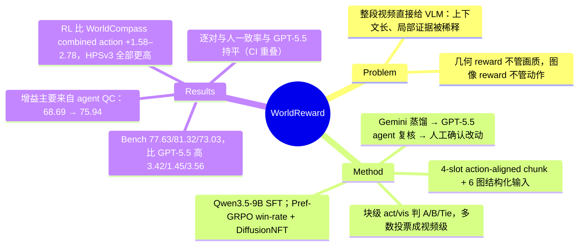

## Summary
WorldReward 是一个从 Qwen3.5-9B SFT 得到的 pairwise VLM reward model，用来给 camera-conditioned world model 的两段同条件视频分别判 action consistency 与 visual quality：把轨迹切成 4 个 action slot 一块的 chunk，每块喂 6 张图（source image、frame-grid、4 个 action 首尾帧对比面板），逐块判 {A, B, Tie} 再投票成视频级偏好。训练数据由 Gemini 3.1 Pro 蒸馏、GPT-5.5 tool-using agent 审核（42.1% 被改）、人工复核 agent 修改项得到；在自建 760 对的 WorldReward-Bench 上三维三分类一致率 77.63 / 81.32 / 73.03，分别比 GPT-5.5 高 3.42 / 1.45 / 3.56 点（Table 3）。替换 WorldCompass 的 reward 后对 HY-WorldPlay 1.5 做 RL，combined-action 准确率比 WorldCompass 高 1.58–2.78 点、HPSv3 在 6 个设置全部更高（Table 4），但 Table 5 显示学生超过老师的增益几乎全部来自 GPT-5.5 agent 审核这一步，而不是 chunk 化蒸馏本身。

## Problem & Motivation
camera-conditioned world model（WorldPlay、Matrix-Game、Yume 等）生成的视频既要执行键盘/相机指令，又要保持外观、几何与时序连贯。现有 reward 把这两件事拆给异构系统：几何 reward 用 DepthAnything3 / WorldMirror 等 3D 基础模型反推相机轨迹再与指令比对，管不了画质；HPSv3 这类图像 reward 逐帧打分，看不见闪烁、外观漂移和动作是否执行；WorldCompass 把两者拼起来做 RL，有效但仍是两套系统。直接让 VLM 看整段长视频 + 整条动作序列，稀疏采样会漏掉只持续几帧的转向，密集采样又撑爆上下文，局部失败被整体印象稀释。作者因此主张：动作执行的视觉证据是局部的（前进时内容放大、上仰时内容下移），应当按动作对齐切块后在小上下文里判，再自下而上汇总。

## Method
**问题设定**。输入为 source image \(x_0\)、caption \(d\)、\(N\) 步动作 \(a_{1:N}\) 与同条件下生成的两段视频 \(V^A, V^B\)；输出 act / vis 两个维度上的 \(\{A,B,\mathrm{Tie}\}\)。

**Action-video chunk**。在轨迹前补一个对应 \(x_0\) 的 idle slot，再按每 4 个 slot 切块。每块输入 6 张图：source image（检测场景漂移与身份变化）、frame-grid overview（两段视频中每个动作的起/中/末帧）、4 张 action-level panel（每个动作首帧与末帧的 A/B 对比），外加 caption 与局部动作序列。训练轨迹 11 步 → 12 slot → 3 块；benchmark 轨迹 23 步，按同规则应为 24 slot → 6 块（按 §3.2 规则推算，正文未直接写块数）。

**Chunk 级推理与投票**。动作维度先逐动作比较再汇总成块级 winner；视觉维度看 temporal consistency、dynamic generation quality、artifact/structure integrity 三项。评测时 appearance 由 temporal consistency + artifact/structure 决定（两者分歧则该块判 Tie），motion 由 dynamic generation quality 决定。视频级结果按 A/B 票数多数决，票数相等为 Tie（Eq. 3）。

**数据管线**。条件 = WorldPlay 的图文对 × 224 条人工整理的 11 步轨迹（9 个子族：Basic/Diag/Loop 平移、Yaw/Pitch/Diag 旋转、Mixed_Basic/Mixed_Full/Move_View 复合）。生成池为 8 个模型变体（HY-WorldPlay 及其 RL 版本、LingBot-World-Fast、Infinite-World、Yume-1.5、SANA-WM、Matrix-Game 系列），按接口兼容性配对，固定 seed 1，得到 50,000 对 15 fps 视频 → 150,000 块 → 子采样约 100,000 块。标注三步：(1) Gemini 3.1 Pro 按 chunk 协议蒸馏结构化推理与偏好；(2) GPT-5.5 agent harness 多轮调用读图工具，先看 source 与 frame-grid，再按需逐张调 action panel，保留原判或输出定位到 chunk×维度的 diff（Algorithm 1）；(3) 只把 agent 改过的样本送人工确认。最后对多数类偏好组合做 A/B 交换增强，99,954 → 124,942 条（Table 7）。

**训练**。Qwen3.5-9B 全量 SFT（标准 next-token loss，target = 推理文本 + 两个类别偏好），3 epoch，global batch 128，lr 8e-6 cosine，warm-up 0.03。

**用于 RL**。完全沿用 WorldCompass 的 clip-level rollout + DiffusionNFT：共享自回归前缀只生成一次，对目标 clip 采 \(G\) 个候选；每对候选用 WorldReward 判两维 winner，按 Pref-GRPO 的 win-rate（赢 1、平 0.5、输 0）得到 \(R_i^{act}, R_i^{vis}\)，组内各自标准化后以 \(\lambda\) 加权并 clip 成 optimality probability \(p_i\)，代入 negative-aware flow-matching loss。作者明确说贡献只在 reward，不在优化算法。

**WorldReward-Bench**。760 对，图文条件未见过，另建 224 条 23 步轨迹（同 taxonomy、不同分布，Table 2），每段 184 帧；平移 38.4% / 复合 37.1% / 旋转 24.5%。每对 3 人盲标 act / app / mot 三维，多数决，无多数时加第 4 人；指标为把 Tie 当显式类别的三分类准确率（Eq. 12）。

## Key Results
**Reward-model 一致率**（Table 3，WorldReward-Bench 全 760 对，三分类，%；"–" 为该方法不建模此维度）：

| 方法 | Act. | App. | Mot. |
|:--|:--|:--|:--|
| Gemini 3.1 Pro | 65.79 | 80.13 | 60.79 |
| GPT-5.5 | 74.21 | 79.87 | 69.47 |
| HPSv3 | – | 73.68 | – |
| UR-Flex / UR-Think / VideoAlign | – | 64.34 / 66.09 / 61.32 | 49.32 / 38.79 / 40.13 |
| DAv3 / WorldMirror | 70.53 / 68.55 | – | – |
| Qwen3.5-9B（初始化）/ Qwen3.5-27B | 48.42 / 63.68 | 48.29 / 44.34 | 43.82 / 62.76 |
| WorldReward（9B） | 77.63 | 81.32 | 73.03 |

分组结果并非全胜：translation 组 appearance 77.74，低于 Gemini 82.19 与 GPT-5.5 81.16；photo 组 appearance 81.37 低于 Gemini 82.74；art 组 action 73.77 低于 GPT-5.5 75.41，motion 65.57 远低于 GPT-5.5 77.05。几何估计器在 art 组 action 崩到 39.34（DAv3）/ 44.26（WorldMirror），在 game/anime 组却是 75.75 / 74.25。

**标注精修消融**（Table 5，均训成同一 reward model，平均一致率）：Gemini 直接当 judge 68.90 → Gemini 蒸馏 68.69 → + agent QC 75.94 → + 人工复核 77.33。蒸馏本身没有带来增益（action +1.05，appearance −1.21，motion −0.48），+7.25 来自 GPT-5.5 agent 审核，集中在 action（66.84→75.84）与 motion（60.31→71.52）。QC 结果（Table 1）：57.9% 原样保留，42.1% 被改；改动中 67.4% 只改推理文本，23.8% 只改分维度 winner，0.9% 只改块级 winner，7.9% 两者都改；agent 改过的样本里，人工确认 87.0%、驳回 13.0%（分母是被改样本，不是全部标注；文中称 stratified human calibration，是否覆盖全部被改样本未说明）。

**结构化输入与推理监督消融**（Table 6，训练与推理同时去掉）：去 source image 平均 76.07（appearance −2.37）；去 frame-grid 74.85（平均降幅最大 −2.48，action −2.71，motion −3.29）；去 action panel 75.68（action −2.82）。推理监督：只给偏好标签 72.47 → + 整体对比总结 74.94 → + 逐视频分析 77.33。

**位置偏置**（Table 8）：每块独立随机打乱 A/B 顺序后 act / app / mot 下降 1.24 / 0.53 / 0.95。

**RL post-training**（Table 4，HY-WorldPlay 1.5，WorldCompass 协议只换 reward，4,000 个训练条件，评测为 WorldPlay 600 例 split；action 准确率由 DepthAnything3 反推轨迹计算，quality 为 HPSv3）：

| 时长 | 方法 | Combined Act. | Combined HPSv3 | Basic Act. | Basic HPSv3 |
|:--|:--|:--|:--|:--|:--|
| 短（~125 帧） | 基座 / WorldCompass / WorldReward-RL | 21.74 / 58.20 / 59.96 | −1.05 / 0.42 / 0.68 | 62.33 / 68.62 / 74.43 | 1.96 / 3.77 / 3.92 |
| 中（~253 帧） | 同上 | 19.73 / 55.01 / 57.79 | −0.19 / 0.37 / 0.55 | 63.35 / 74.09 / 77.27 | 1.91 / 3.61 / 3.85 |
| 长（~381 帧） | 同上 | 19.70 / 54.82 / 56.40 | −0.33 / 0.73 / 1.02 | 64.28 / 76.56 / 78.84 | 1.90 / 3.72 / 3.94 |

相对 WorldCompass：combined action +1.58–2.78，basic action +2.28–5.81，HPSv3 +0.15–0.29。增益的大头仍是"有 RL vs 无 RL"（combined action 约 20 → 55），两种 reward 之间差 2 点左右。

**Reward 分量消融**（Table 9，长时程 combined action）：无 RL 19.70 / −0.33；只用 action reward 52.73 / 0.21；只用 visual reward 27.82 / 0.89；两者合用 56.40 / 1.02。

**人评**（Figure 6 与 §4.3，长时程 combined-action 子集 200 对 × 3 人 = 600 个判断/维度，不做多数决）：WorldReward-RL vs WorldCompass，action 胜/负为 39.8% vs 34.8%（人）、41.5% vs 39.4%（GPT-5.5）、43.5% vs 38.6%（WorldReward 自评）；visual quality 为 48.9% vs 25.2%、50.6% vs 29.8%、55.9% vs 27.3%。对 HY-WorldPlay 1.5 基座的具体胜率只在图 6 中（正文无数字）。逐对一致率（Table 10，pair-clustered bootstrap 95% CI）：WorldReward action 70.3（66.9–73.6）、visual 72.9（69.6–76.0）；GPT-5.5 69.1（65.6–72.5）、72.0（68.7–75.2），两者 CI 大幅重叠。

## Evidence Ledger

| Claim ID | Claim | Type | Source locator | Evidence excerpt | Status |
|:--|:--|:--|:--|:--|:--|
| C1 | WorldReward 在 WorldReward-Bench 全集上 Act/App/Mot 三分类一致率 77.63 / 81.32 / 73.03；GPT-5.5 为 74.21 / 79.87 / 69.47；Gemini 3.1 Pro 为 65.79 / 80.13 / 60.79 | number | Table 3 | "WorldReward | 77.63 | 81.32 | 73.03"; "GPT-5.5 | 74.21 | 79.87 | 69.47" | source-verified |
| C2 | WorldReward 相对 GPT-5.5 高 3.42 / 1.45 / 3.56 点 | comparison | Abstract；Table 3 | "exceeding GPT-5.5 by 3.42, 1.45, and 3.56 percentage points on action, appearance, and motion" | source-verified |
| C3 | 分组上 WorldReward 并非全胜：translation 组 appearance 77.74 低于 Gemini 82.19；art 组 motion 65.57 低于 GPT-5.5 77.05、action 73.77 低于 75.41 | comparison | Table 3 | "WorldReward … 76.71 | 77.74 | 78.77 … 73.77 | 77.05 | 65.57" | source-verified |
| C4 | DAv3 在 art 组 action 一致率 39.34、WorldMirror 44.26，而在 game/anime 组为 75.75 / 74.25 | number | Table 3 | "DAv3 | 70.53 … 75.75 … 39.34"; "WorldMirror | 68.55 … 74.25 … 44.26" | source-verified |
| C5 | WorldReward 由 Qwen3.5-9B 初始化，SFT 3 epoch、global batch 128、lr 8e-6 cosine、warm-up 0.03；初始化模型在 bench 上 48.42 / 48.29 / 43.82 | benchmark-setting | §4.1；Table 3 | "We initialize WorldReward from Qwen3.5-9B [49] and train it for 3 epochs with a global batch size of 128" | source-verified |
| C6 | 训练数据：224 条 11 步轨迹，50,000 对 15 fps 视频（seed 1），每条 12 slot 切 3 块，150,000 块子采样至约 100,000 | benchmark-setting | §4.1 Preference-data generation | "This process produces 50,000 video pairs at 15 fps using a fixed sampling seed of 1." | source-verified |
| C7 | 每块输入为 6 张图（source image、frame-grid overview、4 张 action-level panel），块大小 4 slot，视频级结果为块级多数投票、票数相等为 Tie | benchmark-setting | Figure 1 caption；§3.2；Eq. 3 | "Each chunk is judged from a six-image input (source image, frame-grid overview, and four action-level panels)" | source-verified |
| C8 | 评测时 appearance 由 Temporal Consistency 与 Artifacts & Structure Integrity 决定，二者分歧该块判 Tie；motion 由 Dynamic Generation Quality 决定 | benchmark-setting | §4.1 Reward-model baselines and metric | "If the two appearance criteria favor different videos within a chunk, its appearance prediction is Tie" | source-verified |
| C9 | Agent QC 保留 57.9%、修改 42.1%；修改中 67.4% 仅推理文本、23.8% 仅分维度 winner、0.9% 仅块级 winner、7.9% 两者；agent 修改样本中人工确认 87.0% / 驳回 13.0% | number | Table 1；§3.4 | "Original retained | 57.9% | Any revision | 42.1%"; "Revision confirmed | 87.0%" | source-verified |
| C10 | 标注精修消融平均一致率：Gemini 直接 judge 68.90、Gemini 蒸馏 68.69、+agent QC 75.94、+人工复核 77.33 | number | Table 5 | "Gemini distillation | 66.84 | 78.92 | 60.31 | 68.69"; "+ Agent-harness QC | 75.84 | 80.46 | 71.52 | 75.94" | source-verified |
| C11 | 作者把学生超过两个闭源老师的优势主要归因于标注精修而非蒸馏本身 | causal-mechanism | §4.4 Impact of annotation refinement | "the final advantage over direct VLM judging comes primarily from annotation refinement rather than distillation alone" | source-verified |
| C12 | 结构化输入消融：去 source image 76.07（appearance −2.37）、去 frame-grid 74.85（平均 −2.48）、去 action panel 75.68（action −2.82） | number | Table 6 top；§4.4 | "Removing the frame-grid overview causes the largest average drop ( -2.48 points)" | source-verified |
| C13 | 推理监督消融：仅偏好标签 72.47 → +整体对比总结 74.94 → +逐视频分析 77.33 | number | Table 6 bottom | "Preference labels only | 71.84 | 77.96 | 67.61 | 72.47" | source-verified |
| C14 | A/B 顺序随机化后 act / app / mot 下降 1.24 / 0.53 / 0.95；交换增强使训练样本 99,954 → 124,942 | number | Table 8；Table 7 | "Randomized order | 76.39 | 80.79 | 72.08"; "Total | 99,954 | 124,942" | source-verified |
| C15 | RL 实验沿用 WorldCompass 协议，基座、训练数据、评测 split、rollout 与 DiffusionNFT 配置不变，只换 reward；action 准确率由 DepthAnything3 估计，quality 为 HPSv3 | benchmark-setting | §4.3 Controlled RL setup；Table 4 caption | "keeping the base model, training data, evaluation split, rollout procedure, and DiffusionNFT [29] configuration unchanged and modifying only the reward signals" | source-verified |
| C16 | 长时程 combined action：基座 19.70、WorldCompass 54.82、WorldReward-RL 56.40；HPSv3 −0.33 / 0.73 / 1.02 | number | Table 4 | "WorldCompass | 54.82 | 0.73 | 76.56 | 3.72 / WorldReward -RL | 56.40 | 1.02 | 78.84 | 3.94" | source-verified |
| C17 | 相对 WorldCompass，combined action +1.58–2.78、basic action +2.28–5.81，HPSv3 在 6 个设置全部提升 | comparison | §4.3 Quantitative comparison；Table 4 | "improves combined-action accuracy by 1.58–2.78 points and basic-action accuracy by 2.28–5.81 points" | source-verified |
| C18 | WorldCompass 的 quality reward 就是 HPSv3（与 RL 评测的 quality 指标相同） | benchmark-setting | §2 Reward signals for world models；§4.3 | "WorldCompass [10] pairs a geometry reward with an image-based HPSv3 reward [13]" | source-verified |
| C19 | Reward 分量消融（长时程 combined）：action-only 52.73 / 0.21，visual-only 27.82 / 0.89，合用 56.40 / 1.02 | number | Table 9 | "Action only | 52.73 | 0.21"; "Visual only | 27.82 | 0.89" | source-verified |
| C20 | 人评 200 对 × 3 人：对 WorldCompass action 39.8% vs 34.8%、visual 48.9% vs 25.2%；GPT-5.5 为 41.5/39.4 与 50.6/29.8；WorldReward 自评 43.5/38.6 与 55.9/27.3 | number | §4.3 Pairwise preference evaluation；Figure 6 | "preferred over WorldCompass by 43.5% versus 38.6% under WorldReward, 41.5% versus 39.4% under GPT-5.5, and 39.8% versus 34.8%" | source-verified |
| C21 | 逐对与人一致率：WorldReward 70.3（66.9–73.6）/ 72.9（69.6–76.0），GPT-5.5 69.1（65.6–72.5）/ 72.0（68.7–75.2） | comparison | Table 10 | "GPT-5.5 | 69.1 (65.6–72.5) | 72.0 (68.7–75.2)"; "WorldReward | 70.3 (66.9–73.6) | 72.9 (69.6–76.0)" | source-verified |
| C22 | WorldReward-Bench：760 对，未见过的图文条件与另建的 224 条 23 步轨迹，184 帧 15 fps；平移 38.4% / 复合 37.1% / 旋转 24.5%；每对 3 人标，无多数加第 4 人 | benchmark-setting | §3.7；§4.1 Benchmark generation；Table 2 | "Pure translation and compound trajectories account for 38.4% and 37.1% of the benchmark" | source-verified |
| C23 | Bench 生成池与训练生成池约 7/8 重叠，基本没有 held-out 生成器（条件与轨迹 held-out）；bench 池多 Hunyuan-GameCraft [7]，训练池多 HY-WorldPlay RL 变体 [10] | benchmark-setting | §3.4 Pairwise reward data generation；§3.7 | "drawn from a broad pool of world models [9, 19, 7, 8, 21, 20, 18, 17]"；verifier 更正：原稿"同一批 8 个模型"不准确，两池各有一个模型不在对方池中 | contradicted → corrected |
| C24 | 自称首个统一 action consistency 与 visual quality 的 camera-conditioned world model VLM pairwise reward model | sota-novelty | §1 Contributions | "to our knowledge the first VLM-based pairwise reward model that unifies action-consistency and visual-quality evaluation" | source-verified |
| C25 | 论文只给项目网站，未给代码/权重仓库链接；全文无 limitation 节，未报告 bench 标注者间一致率、RL 的 seed 数、组大小 G 与 λ 取值 | license-code | 文头 Website；全文检索 | "[Website] https://codegoat24.github.io/WorldReward" | source-verified |
| C26 | 正文表号引用错位四处：§4.2 写 "Table 4.1"（实为 Table 3）；§4.1 称偏好组合见 Table 8（实为 Table 7）；§4.4 reward 分量消融写 Table 10（实为 Table 9）；§4.4 Robustness 段末 swap-based augmentation 引 Table 8（实为 Table 7） | benchmark-setting | §4.1 / §4.2 / §4.4 vs 表注 | "Table 8 reports the training-data preference combinations before and after augmentation"; "Table 10 shows that the two rewards serve different roles" | source-verified |

## Strengths & Weaknesses

**亮点**
- **问题拆法对路**：动作执行的证据是局部、方向特异的，把长视频按动作对齐切块、每块配 source / frame-grid / 逐动作首末帧面板，是把"该看哪里"显式喂给 judge。Table 6 的去组件消融给了每个视图 2–3 点的边际贡献，且效应分维度可解释（panel 主要影响 action，source image 主要影响 appearance）。
- **Table 5 的诚实度高于结论措辞**：它直接显示 Gemini 蒸馏本身 ≈ Gemini 直接判（68.69 vs 68.90），学生能超过老师靠的是 GPT-5.5 多轮读图 agent 的复核。这是一个可迁移的经验：在 reward 数据构造里，"agentic 复核 + 只对改动项做人工确认"比"换更强的一次性标注模型"便宜且有效。
- **RL 对照是同协议只换 reward**，而且评测 quality 用的 HPSv3 正是 WorldCompass 自己训练时优化的 reward（C18）——指标天然偏向 baseline，WorldReward 仍在 6 个设置全部更高，这让 quality 侧的结论比表面数字更可信。
- 人评同时报了 WorldReward、GPT-5.5、人三方，并用 pair-clustered bootstrap 给 CI（Table 10），在 world-model reward 论文里少见。

**局限与隐含假设**
- **"超过 GPT-5.5"的比较条件不清**。正文没说闭源 judge 与 Qwen3.5 基座是用整段视频、还是用同一套 chunk + 6 图输入来评的。若前者，WorldReward 的优势混合了"chunk 协议"与"训练"两个因素；全文没有"GPT-5.5 + 同一 chunk 协议 + 投票"这一臂。Table 5 行 1 的 Gemini 直接 judge 同样未说明输入形式。
- **生成器基本没有 held-out**。Bench 的条件与轨迹是新的，但生成池与训练池约 7/8 重叠（bench 多 Hunyuan-GameCraft，训练多 HY-WorldPlay 的 RL 变体，C23），所以 77.63 衡量的主要是近同分布生成器上的泛化，对新架构/新失败模式的迁移未测。RL 时被评的 HY-WorldPlay 1.5 本身也在池里，RL 后的输出分布则不在。
- **相对 WorldCompass 的 action 增益小且证据层级不一**。DAv3 测的 combined action +1.58–2.78 只有单次运行、无 seed、无方差；人评里 action 胜负 39.8% vs 34.8%，约 25% 判平，差 5 点，600 个判断来自 200 对（非独立），正文没给这项的 CI。visual quality 侧（48.9% vs 25.2%）的差距明显更大，更站得住。
- **Tie 处理可能影响三分类分数**。appearance 两个子判据分歧即判 Tie、块票数相等即判 Tie，而 bench 的人工 Tie 比例、标注者间一致率都没报告，无法判断 Tie 规则是否在拟合 bench 的标注习惯，也无法知道 77% 距离人类上限还有多远。
- **Reward hacking 未检验**。WorldReward-RL 用同一 reward 训练并参与评测；作者用 GPT-5.5 与人评缓解了这一点，但没有报告训练过程中 reward 上涨而外部指标不涨的曲线，也没有对抗样本测试。
- **成本未报**。每个 rollout 组需要 \(G(G-1)/2\) 次 9B VLM 推理（每次 6 图 + 推理文本生成），\(G\)、\(\lambda\)、GPU 时与 WorldCompass 的几何 + HPSv3 reward 的开销对比均未给出。
- **分组弱点被正文淡化**。art 组 motion 65.57，比 GPT-5.5 的 77.05 低约 11.5 点，§4.2 却称其他维度"remaining competitive"。按百分比粒度推算 art 组约 61 对（39.34 = 24/61，推测），样本小。
- **部分基线的分母不是 760 对，论文未披露**。按 Table 3 百分比反推（推算）：UR-Flex overall motion 49.32 约对应 /740，UR-Think 约 /758；art 桶 UR-Flex 约 /55、UR-Think 约 /60、Gemini 约 /61。说明有基线在部分样本上缺输出（可能是解析失败），各方法并非在完全相同的样本集上比较。
- 正文表号引用四处错位（C26）；未见代码/权重链接，只有项目页。

## Mind Map

## Notes
- [[Papers/2608-WorldExam]]：同为 camera/action-driven world model 的控制跟随评测，WorldExam 是规则 + 多层诊断的 benchmark，WorldReward 是可训练的偏好 judge；两者都包含 WorldPlay，可对照"WorldPlay 控制跟随强"在两套口径下是否一致。
- [[Papers/2604-WorldR1]]：同样用 3D 基础模型 + VLM 反馈做视频生成 RL（Flow-GRPO），WorldReward 的立场是把几何与画质统一进一个 VLM judge；两者恰好代表"几何 reward"与"VLM reward"两条路线。
- [[Papers/2608-WorldSimProbe]]：从诊断侧指出 action-conditioned world model 的 action-realization 退化；WorldReward 的 action consistency 维度是同一问题的 reward 化，但只覆盖相机运动，不涉及接触与物体交互。
- [[Papers/2607-SpectraReward]]：T2I 生成 RL 的 reward 侧工作，结论是 reward-policy 分布对齐比 reward 规模更重要；可对照 WorldReward 用与 bench 约 7/8 重叠的生成池训练 reward、再优化池内模型 HY-WorldPlay 1.5 的设定。
- [[Papers/2604-HYWorld2]]：同属腾讯混元 world model 线，WorldReward 的 RL 对象 HY-WorldPlay 1.5 来自这条线。
- 疑问：GPT-5.5 baseline 是否使用了同一 chunk 协议？若没有，最值得补的一行是"GPT-5.5 + chunk + 投票"，它决定 9B 模型的增益是来自训练还是来自输入组织。
