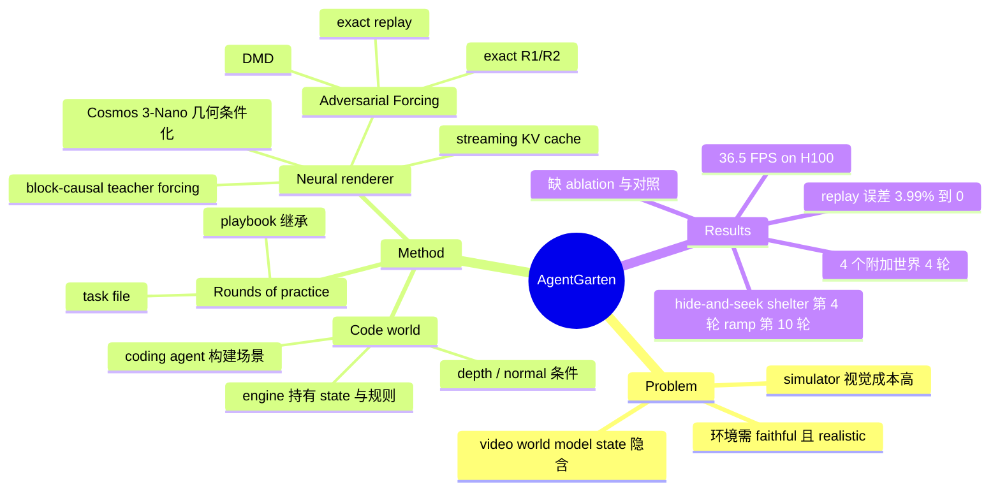

## Summary
AgentGarten 把环境拆成两半：simulator / game engine 用代码维护显式 state 与交互规则，一个共享的实时 neural renderer（Cosmos 3-Nano 改造 + 提出的 Adversarial Forcing 蒸馏）只负责把引擎导出的 depth/normal 条件渲染成逼真第一视角画面。renderer 在单 H100 上 >35 FPS；在此之上，pretrained agent 仅凭渲染画面、靠逐轮累积的 Markdown playbook 在 hide-and-seek 等 5 个世界里"几轮内"提升表现。核心贡献是环境构造范式与 renderer 工程；agent 侧证据是少量单次 episode 的定性/小表格，不足以支撑"learning efficiency 大幅提升"的强表述。

## Problem & Motivation
Agent 能学到什么取决于它练习的环境，环境需要 faithful（state/规则/dynamics 一致）且 realistic（观测符合真实视觉分布）。传统 simulator/game engine 的 state 与规则显式可编辑，但视觉多样性需要大量 3D asset 与渲染管线；video world model（Genie 等）视觉丰富，但 task-relevant state 与转移规则隐含在生成历史里，无法检查、编辑、单测。作者主张把二者解耦：状态由代码持有，外观由神经网络补全。

## Method
**Code world 形式化**：场景程序 p 在引擎中执行，`(s_{t+1}, π_{t+1}) = f_p(s_t, π_t, a_t)`，条件 `c_t = h_p(s_t, π_t)`（colorized depth 或 surface normal），renderer 生成 `x_t = R_θ(x_{<t}, x_0, y, c_{≤t})`，x_0 为外观参考图，y 为文本。关键性质：f_p 不吃渲染画面，渲染误差不会累积进 state；同一条 state 轨迹可换外观/相机重渲染而不改变事件。

**构建世界**：coding agent 从单图（接 instance mask、depth、3D box、mesh 提取等感知/生成工具）或文本写出 scene program，只需粗几何；通过多相机 probe rollout 和引擎校验查询（contact/collision/occlusion）迭代修复。

**Renderer 三阶段训练**：(1) 几何条件化：condition token 与 RGB token 沿序列拼接做 joint attention（不用 channel concat / ControlNet 以避免像素对齐归纳偏置），训练时随机保留 depth/normal、纹理抑制、空间扭曲、加噪以缩小估计几何与引擎几何的 gap；(2) block-causal teacher forcing（clean/noisy 双副本并行训练）；(3) **Adversarial Forcing**：Self Forcing 式 DMD 蒸馏 + exact replay（两遍法，逐 block SDPA 重算，使 replay 与 rollout bitwise 一致，让后续 loss 的梯度回传到 history encoding）+ R3GAN 风格 relativistic 对抗损失，利用 frozen backbone 用 VJP/JVP 精确计算 R1/R2，避开 fused attention 的 double backward。推理：bounded KV cache（sink + 滑窗）、top-aligned RoPE 重映射、Triton kernel、CUDA graph、tiny VAE decoder。

**Agent 侧 "rounds of practice"**：每轮给 task file（目标/动作/限制，无解法），agent 仅看 renderer 画面、用 Python 程序行动，轮后写 playbook（skill files）；下一轮在新对话中继承所有历史 playbook。使用的 agent 为文中引用的 "GPT-6 Astra"。

## Key Results
- **Replay 精度**（Table 1，H100，36 层，480×832，61 latent frames）：SGF 式 FlexAttention replay 与 rollout 相对 L2 误差 3.99%，逐 block SDPA replay 为 0（bitwise）；forward 时间 2.95s → 2.79s（-5.4%），峰值显存 50.83 → 50.92 GiB（+0.2%）。
- **吞吐**（Table 2）：16 帧一个 block 总 wall time 438.8 ms，36.5 FPS（正文称 >35 FPS）；其中 Transformer 四步去噪 + cache 发布 414.4 ms，tiny decoder + 传输 8.8 ms。
- **视觉质量**：仅有与 Self Forcing 的 30 秒 rollout 定性对比（Figure 7），Self Forcing 出现重复纹理与细节丢失；**无定量指标**（无 FVD/一致性/条件遵循度指标，也无与其他 world model 的对比）。
- **Hide-and-seek**（Table 3）：OpenAI 2019 self-play RL 约 25M episodes 出现 shelter、约 100M 出现 ramp；本文 pretrained agent 第 4 轮 hider 用 panel 搭 shelter，第 10 轮 seeker 用 ramp 翻墙。作者自己声明这不是直接 sample-efficiency 比值（不同 paradigm、不同观测）。
- **四个附加世界**（Table 4，每世界 4 轮、每轮 1 个 episode）：companion dog 分数 13→14→19→19；one-lane bridge 双车交换用时 71→68→45→41 s；herding 得分 60→90.1→87.6→88.3，被圈绵羊 3→4→4→4；quarry loader 得分 30→0→30→90.9。

## Evidence Ledger
| Claim ID | Claim | Type | Source locator | Evidence excerpt | Status |
|:--|:--|:--|:--|:--|:--|
| C1 | AgentGarten 将 simulator/game engine 与一个共享 neural renderer 耦合，构建实时交互环境 | sota-novelty | Abstract | "couples simulators and game engines with a shared neural renderer to build real-time interactive environments" | source-verified |
| C2 | 引擎状态转移 f_p 不以渲染观测为输入，渲染误差不会累积进 state | causal-mechanism | Sec 2.1 | "the transition f_{p} takes no rendered observation as input" | source-verified |
| C3 | 结构化条件使用 colorized depth 或 surface normal | benchmark-setting | Sec 2.2 | "We use colorized depth or surface normals as structured conditions." | source-verified |
| C4 | renderer 从 Cosmos 3-Nano 初始化 | benchmark-setting | Sec 3.1 | "We initialize from Cosmos 3-Nano" | source-verified |
| C5 | 条件 token 与 RGB token 沿序列拼接做 joint attention，而非 channel concat 或 control branch | causal-mechanism | Sec 3.2 | "We use neither channel concatenation nor control branches" | source-verified |
| C6 | Self Forcing 的 history 为 detached KV cache，后续 loss 不监督 history-prefill 计算；exact replay 恢复该梯度 | causal-mechanism | Sec 3.4.2 | "Later losses thus update the parameters that write history into the cache" | source-verified |
| C7 | FlexAttention 全序列 replay 相对 rollout 相对 L2 误差为 3.99%，逐 block SDPA replay 为 bitwise 一致 | number | Table 1 / Sec 4.2 | "3.99% relative L_{2} error; block-by-block SDPA replay is bitwise identical" | source-verified |
| C8 | exact replay 使 forward 时间下降 5.4%（2.95s→2.79s），峰值显存增加 0.2% | number | Table 1 | "Forward time decreases by 5.4%, while total peak memory changes by 0.2%" | source-verified |
| C9 | 利用 frozen backbone 以 VJP/JVP 精确计算 R1/R2，无需 double backward | causal-mechanism | Sec 3.4.3, Eq. 11-13 | "No step differentiates through a backward kernel" | source-verified |
| C10 | Self Forcing 的 30s rollout 出现重复纹理与细节丢失，Adversarial Forcing 保持纹理（仅定性） | comparison | Sec 4.1 / Fig 7 | "With Self Forcing, rollouts develop repetitive surface patterns and lose scene detail" | source-verified |
| C11 | renderer 在单 H100、480×832 下生成速度超过 35 FPS（含条件编码、4 步去噪、解码、host 传输） | number | Sec 4.3 | "generates 480\times 832 video at over 35 frames per second on one NVIDIA H100 GPU" | source-verified |
| C12 | 稳态下一个 16 帧 block 总用时 438.8 ms，吞吐 36.5 frames/s | number | Table 2 | "Total wall time 438.8 ms; Throughput 36.5 frames/s" | source-verified |
| C13 | 2019 hide-and-seek 研究中 shelter 约 25M episodes、ramp 约 100M episodes 后出现 | comparison | Sec 5.2 / Table 3 | "roughly 25 million and 100 million training episodes of self-play reinforcement learning, respectively" | source-verified |
| C14 | 本文 agent 第 4 轮 hider 用 panel 搭 shelter，第 10 轮 seeker 用 ramp 翻墙 | number | Sec 5.2 / Table 3 | "hiders used panels to build a shelter by round 4, and the seekers used a ramp to cross walls by round 10" | source-verified |
| C15 | 作者声明与 2019 的 episode 数对比不是直接 sample-efficiency 比值 | benchmark-setting | Sec 5.2 | "these numbers reflect two fundamentally different learning paradigms rather than a direct sample-efficiency ratio" | source-verified |
| C16 | agent 在 hide-and-seek 中不接收物体坐标、隐藏世界状态或对手私有观测 | benchmark-setting | Sec 5.2 Setting | "It never receives object coordinates, hidden world state, or the opponent's private observations." | source-verified |
| C17 | companion dog 引擎分数 13→14→19→19；bridge 用时 71→68→45→41 s | number | Table 4 | "engagement score rose from 13 to 19 ... time they needed fell from 71 to 41 seconds" | source-verified |
| C18 | herding 得分 60→90.1→87.6→88.3，绵羊被圈数 3→4→4→4 | number | Table 4 | "penned all four in every later round" | source-verified |
| C19 | quarry loader 得分 30→0→30→90.9，round 4 送达一块石头并停车，用 329/360 s | number | Table 4 / Sec 5.4 | "in round 4, cleared the rocks, delivered one, and parked, in 329 of its 360 seconds" | source-verified |
| C20 | 附加世界每个仅跑 4 轮，每轮一个 episode | benchmark-setting | Sec 5.4 / Table 4 caption | "one episode per round" | source-verified |
| C21 | 摘要称 agent 只需 4 轮，对比传统 RL 的数百万 | comparison | Abstract | "agents learning from just 4 rounds compared with millions for a conventional reinforcement learning counterpart" | source-verified |
| C22 | 代码仓库公开于 GitHub MirroS-Lab/AgentGarten（license 未在正文中确认） | license-code | 论文元数据 | "[Code] https://github.com/MirroS-Lab/AgentGarten" | source-verified |

## Strengths & Weaknesses
**亮点**
- Problem formulation 干净：把 state 放在代码里、外观交给 renderer，直接解决 video world model 的 state 不可检查/不可编辑/误差累积问题，且同一 state 轨迹可换外观重渲染。这是相对 Genie 类方法的真实结构性差异，不是调参。
- Exact replay + exact R1/R2 是具体、可验证的工程贡献，Table 1 给出了 3.99% vs 0 的误差对照与近乎零的开销。
- Agent 仅通过渲染画面行动、不给坐标，使 renderer 的保真度真正进入闭环，而不是旁路展示。

**局限与存疑**
- **缺乏 renderer 的定量评测**：视觉质量仅一组 Self Forcing 定性对比；没有 FVD / 条件遵循 / 长程一致性指标，也没有对比其他 geometry-conditioned video 模型。Adversarial Forcing 三个组件（DMD / exact replay / adversarial）没有各自的 ablation，exact replay 对最终画质的贡献未知（Table 1 只量化了数值一致性与成本）。
- **Faithfulness 靠假设**：renderer 只看 depth/normal，颜色/材质靠 x_0 与文本；无法保证画面中物体语义（如 ramp 是否真的像 ramp）与引擎状态一致，也没有测 agent 因渲染错觉而失败的比例。幻觉引起的 failure case 未讨论。
- **Agent 证据弱**：Table 4 每个世界每轮仅 1 个 episode、无多 seed、无方差；quarry loader 为 30→0→30→90.9，herding 在 round 2 后略降，说明波动很大，"逐轮提升"难与随机性区分。没有对照：同一 agent 直接看引擎 state / 看 ground-truth 渲染 / 不用 playbook，因此无法归因提升来自 neural renderer、playbook 还是 agent 本身。
- **摘要的 "4 轮 vs 数百万" 有 headline 化倾向**：正文 5.2 自己承认是不同范式（pretrained 大模型 + 反思 vs tabula rasa RL + 特权 state），不是 sample efficiency 比值。hide-and-seek 也改成了顺序式 1 hider/1 seeker 变体，与 2019 原设定并不等价；且 pretrained agent 的 "几轮" 背后是 web-scale 预训练成本。
- 实时性：36.5 FPS 是 H100 单卡、480×832、tiny decoder FP16；每个 16 帧 block 延迟约 439 ms，对需要高频反馈的控制（机器人 low-level）仍偏粗，agent 以 Python 程序高层动作行动恰好回避了这点。
- 世界构建（单图 → scene program）依赖大量外部感知/生成工具与 coding agent，论文未给构建成功率、成本或失败率；"scale in number and difficulty" 仍是 Future Work。
- 训练数据含 DL3DV-10K、OpenDV 与互联网游戏/导航/机器人视频，条件是估计得到的 depth/normal，仅少量渲染合成场景，存在估计几何到引擎几何的 domain gap（作者用增强缓解，未量化）。

**对本 vault 的意义**：与 DreamGym（文本抽象状态的经验合成）、Agent-World（工具/数据库状态环境合成）形成"环境合成"光谱的视觉一端；其 "state in code, appearance in net" 的拆法是 GUI / embodied 环境合成值得借鉴的设计，但需要自己的 faithfulness 验证。

## Mind Map

## Notes
- 与 [[2511-DreamGym]]：同为"合成环境替代真实环境训练 agent"，DreamGym 在文本抽象状态空间用 LLM 推理合成转移与 reward，AgentGarten 保留代码级显式 state 并用视觉 renderer 提供感知；二者在"state 是否显式可检查"上相反，可对比 faithfulness。
- 与 [[2604-AgentWorld]]：Agent-World 做工具/数据库型有状态环境的规模化合成并配 self-evolving arena，AgentGarten 的 "写代码即新世界" 对应其视觉/物理版本，但缺少 Agent-World 那样的可验证任务与多环境 RL 训练。
- 与 [[2402-Genie]]：Genie 的 state 隐含在生成历史中，AgentGarten 正是针对此缺陷把 state 外置到引擎；代价是需要引擎 + 场景程序，失去 Genie 式无需代码的开放生成。
- 与 [[2604-AgenticWorldModel]]：按其 levels x laws taxonomy，AgentGarten 更像 L2 Simulator 加 L3 Evolver（playbook 演化）的组合，但 evolver 仅在 prompt 层，不更新权重。
- 疑问：playbook 式 "经验蒸馏" 与 RL 训练权重的差别没有对照实验；若换成 agentic-RL 在同一 code world 训练，会不会出现 neural renderer 被 exploit 的 reward hacking（agent 利用渲染伪影）？
