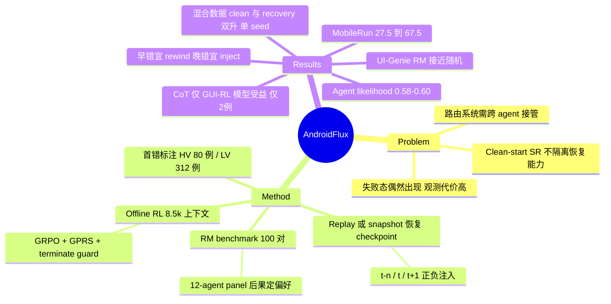

## Summary
AndroidFlux 在 AndroidWorld 上把真实 policy 失败轨迹回放（或用 emulator snapshot 恢复）到第一个可恢复错误前后的受控 checkpoint（$t{-}n$、$t$、$t{+}1^{\pm}$），让不同 target agent 从同一设备状态与重渲染历史继续执行，测 failure recovery；同一批 checkpoint 上再用 12-agent panel 的下游 rollout 成功数构造 100 对 recovery-action 偏好对，测 reward model。主要发现：recovery 与 clean-start 成功率只部分一致，显式 CoT 只对做过 GUI 领域 RL 的模型有帮助，UI-Genie 训练的 BT reward model 在 recovery 偏好上接近随机（0.49–0.52），而 8.5k 条 failure-centered 上下文做 offline GRPO 可同时提升 clean 与 recovery 成功率（单 seed、65 任务）。

## Problem & Motivation
现有 mobile benchmark（AndroidWorld、AndroidLab、MobileWorld）几乎都从 home screen 起跑、只给一个终局 pass/fail，无法隔离"中途出错后能否修复"这一能力；而在 clean-start rollout 中观察失败恢复代价很高——失败态只能偶然出现，每次都要跑完整 episode。作者还给出一个系统层动机：路由式 agent 系统让小模型先做、卡住后把任务交给强模型，强模型必须在"别人造成的状态和别人写的历史"里接手。并发工作 GUI-RobustEval 已在 desktop 上做 post-error 恢复，但只提供负向 $t{+}n$ 起点、不评 reward model；AndroidFlux 的差异点是 mobile、覆盖错误前/中/后三段、跨 agent 接管、以及基于下游结果的 recovery-action 偏好评测。

## Method
**问题形式化。** 把移动交互建模为带 agent-specific context 的有限时域 POMDP；history $h_t^\pi=\Phi_\pi(c,o_{0:t},y_{0:t-1})$ 以 schema-neutral 形式存储、按 target policy 的 prompt 格式重渲染。第一个错误 $t=\min\{i:e_i=1\}$，$e_i$ 表示动作未推进任务；$t$ 之后所有动作都视为 recovery action。只考虑可恢复的第一个错误。target 不被告知前缀是回放的、有错的或来自别的模型——"发现状态已坏"本身是被测能力。

**Error Recovery Benchmark。**
- Human-verified (HV) 集：6 个 source model 各跑 112 个任务共 672 条轨迹，人工逐步标注，按 source 均衡每任务选一条，得 80 例（65 例 action replay 恢复，15 例因 recency 排序界面等残留状态无法复现，改用人工重建的 emulator snapshot）。
- LLM-verified (LV) 集：312 例 / 104 任务 / 21 个 source model，第一错误由 Gemini Flash 3.0 detector–verifier 两阶段标注，刻意偏 precision（step-level precision 90.8，recall 仅 50.8）。
- Checkpoint：$t{-}n$（$n\in\{1,3,5\}$，正确前缀）、$t$（已犯错）、$t{+}1^{+}/t{+}1^{-}$（注入一个来自成功/失败恢复轨迹的动作后）。$t{-}3$、$t{-}5$ 只有 60.0%、32.3% 的 HV replay 例子可行，其余被映射为 clean start，聚合分数混入了 clean start。
- 错误分三类：Stagnation（重复已失败动作）、Direction（执行成功但偏离目标）、Execution（目标对但局部效果错），按 stagnation → direction → execution 优先级判定。

**Recovery-Action Reward Modeling Benchmark。** 100 个恢复状态 / 26 种任务类型（72 个来自检测到的第一错误，28 个为 error-free 对照）。10 个 agent 产生 source 轨迹，5 个 recovery model 生成候选动作，每个候选执行后由 12-agent panel rollout；每个状态取 panel 成功数差最大的两个候选成对，且只保留 margin ≥2 的对（均值 2.86，一半恰在阈值 2）。偏好来自后果而非规则或 LLM judge。

**Offline RL 数据与训练。** 8,499 条 policy-induced 上下文（$t{-}n$ 2,097、$t{-}1$ 与 $t$ 各 2,080、成功轨迹 2,242），来自 10 个 agent、90 个 root task，排除 20 个 unseen-test 任务类型；每条标 `is_next_terminate`（Gemini-3.8-Flash 双 pass 标注，正例仅 2.49%）。训练：Qwen3-VL-4B + LoRA（r=64），ms-swift offline GRPO + GPRS（组内 win-share 居中为 advantage，不除标准差），reward 来自冻结的 UI-Genie BT-128K，K=8，固定 2,400 prompts / 150 steps；加 terminate guard 防止 RM 给未完成任务的 terminate 打高分。

## Key Results
**Failure recovery（Table 2）。**
- HV 集 $t_{\text{all}}$：GUI-Owl-1.5-8B 40.0，Qwen3-VL-8B 28.75、Qwen3-VL-32B 30.0、Gemini Flash 3.0 27.5；MobileRun（Gemini Flash 3.0 驱动）67.5，即同一底座套上 agentic framework 从 27.5 升到 67.5；LV 集 $t$ 从 39.74 升到 66.99。
- Mobile-Agent-v3-7B 在 $t_{\text{rep}}$ 35.38 vs GUI-Owl-7B 24.62。
- Recovery 与 clean-start 排序不一致的直接例子（Table 9）：GUI-Owl-1.5-32B AndroidWorld 66.38 但 HV $t_{\text{all}}$ 仅 32.50；Qwen3-VL-30B-A3B AndroidWorld 23.28 但 $t_{\text{all}}$ 26.25（高于其 Scratch 13.75）。论文未报告任何相关系数，"only partially correlates" 是定性判断。
- 跨 agent 矩阵（C.5）：只有 Mobile-Agent-v3-32B 修复自己的错误优于修复其他 source 的错误；Qwen3-VL-2B 与 Qwen3-VL-4B 对自己的错误恢复率为 0。

**CoT（Table 3，HV $t$，Instruct → Reasoning）。** Qwen3-VL-32B −12.50、Gemini Flash 3.0 −13.75、Qwen3-VL-8B −12.50、Gemma-4-31B −1.25；GUI-Owl-1.5-32B +5.00、GPT-5.6 Terra +17.50。"有 GUI 领域 RL"组只有 2 个模型。

**Rewind vs. Inject（Table 4，LV 312 例）。** 错误前 ≤3 步：rewind +8.76pp、inject −1.01pp；≥7 步：rewind +3.41、inject +5.86。最晚减最早的差 +12.22pp，95% CI [+4.1, +20.8]（按 episode bootstrap）；18 个模型中 17 个方向一致（例外 Qwen3-VL-32B，−9.30），sign test p=0.0001；ICC 0.090/0.111，有效样本只有名义对数的 39%/35%。

**Reward modeling（Table 5）。** UI-Genie 上 BT-128K 0.904、BT-256K 0.915、SFT-Soft 0.878；AndroidFlux 上 BT-128K 0.490、BT-256K 0.520、SFT-Hard 0.160、SFT-Soft 0.450。专家 agent 的 action likelihood 无训练即 0.52–0.60（MAI-UI-8B 0.600 最高）。Oracle：5 个 agent 任一正确 0.82，加 BT-256K 0.87。

**Offline RL（Table 6，65 个 HV replay 任务，单 seed）。** Baseline Qwen3-VL-4B clean 20.0 / error-$t$ 21.5；UI-Genie 100% 23.1 / 16.9；$t$ 100% 18.5 / 30.8；UI40%/$t$35%/$t{-}1$25% 27.7 / 26.2（mean 26.9，最好）。作者自报同配方不同 seed 的 UI-only 运行相差 3.1（clean）/ 6.1（error-$t$）点。

## Evidence Ledger
| Claim ID | Claim | Type | Source locator | Evidence excerpt | Status |
|:--|:--|:--|:--|:--|:--|
| C1 | HV 集共 80 例，来自 6 个 source model，65 例 replay、15 例 emulator snapshot | number | §4.1 | "fixed at 80 cases from 6 source models, 65 restored by replaying the recorded action prefix and 15 from saved emulator snapshots" | source-verified |
| C2 | LV 集含 312 个 replay 例子、104 个任务、21 个 source model | number | §4.1 | "312 replay-based cases over 104 tasks from 21 source models" | source-verified |
| C3 | detector–verifier 第一错误检测 step-level precision 90.8 | number | §4.1.1; Table 24 | "reaching 90.8% step-level precision on the annotated set" | source-verified |
| C4 | detector–verifier 的 step-level recall 约 50.8（detector 单独 51.6） | number | Table 24 | "+ Verifier 90.8 50.8 65.2 95.0 92.1 71.0" | source-verified |
| C5 | RM benchmark 含 100 个恢复状态 / 26 种任务类型，72 个来自第一错误、28 个来自 error-free 步 | number | §4.2 | "100 recovery states over 26 AndroidWorld task types: 72 resume from a detected first error and 28 from an error-free step" | source-verified |
| C6 | RM 偏好对由 12-agent panel 成功数决定，只保留 margin ≥2 的对 | benchmark-setting | §4.2 | "a panel of twelve agents ... keeping the pair only when the margin is at least two" | source-verified |
| C7 | Offline RL 数据集共 8,499 条上下文，$t{-}n$ 2,097、$t{-}1$/$t$ 各 2,080、成功 2,242 | number | §4.3 | "8,499 policy-induced contexts ... $t{-}n$ (2,097), $t{-}1$ and $t$ (2,080 each), and successful contexts" | source-verified |
| C8 | HV $t_{\text{all}}$：GUI-Owl-1.5-8B 40.0，Qwen3-VL-8B 28.8、Qwen3-VL-32B 30.0、Gemini Flash 3.0 27.5 | comparison | §5.1; Table 2 | "GUI-Owl-1.5-8B achieves 40.0 at $t_{\text{all}}$, compared with 28.8, 30.0, and 27.5" | source-verified |
| C9 | MobileRun 用 Gemini Flash 3.0 把 HV $t_{\text{all}}$ 从 27.5 提到 67.5、LV $t$ 从 39.7 提到 67.0 | comparison | §5.1; Table 2 | "raises recovery from 27.5 to 67.5 at $t_{\text{all}}$ ... and from 39.7 to 67.0 at $t$" | source-verified |
| C10 | Mobile-Agent-v3-7B 在 HV $t_{\text{rep}}$ 达 35.4，GUI-Owl-7B 为 24.6 | comparison | §5.1; Table 2 | "Mobile-Agent-v3-7B reaches 35.4 at $t_{\mathrm{rep}}$, compared with 24.6 for GUI-Owl-7B" | source-verified |
| C11 | GUI-Owl-1.5-32B AndroidWorld Docker SR 66.38，但 HV $t_{\text{all}}$ 仅 32.50 | comparison | Table 9 | "GUI-Owl-1.5-32B Expert 77/116 66.38 45/80 56.25 26/80 32.50" | source-verified |
| C12 | 论文未报告 recovery 与 clean-start 成功率之间的相关系数，"partially correlates" 为定性结论 | benchmark-setting | Abstract; §1; locator unknown（全文未检到 correlation 统计） | "recovery performance only partially correlates with clean-start success" | source-verified |
| C13 | 跨 agent 矩阵中只有 Mobile-Agent-v3-32B 修复自身错误优于其他 source；Qwen3-VL-2B/4B 自身错误恢复为 0 | causal-mechanism | Appendix C.5; Table 16 | "only Mobile-Agent-v3-32B recovers its own errors better than the other source agents, and Qwen3-VL-2B and Qwen3-VL-4B recover none of theirs" | source-verified |
| C14 | HV $t$ 上开启 reasoning：Qwen3-VL-32B −12.50、Gemini Flash 3.0 −13.75 | comparison | Table 3 | "Qwen3-VL-32B 30.00 17.50 −12.50 ... Gemini Flash 3.0 41.25 27.50 −13.75" | source-verified |
| C15 | HV $t$ 上开启 reasoning：GUI-Owl-1.5-32B +5.00、GPT-5.6 Terra +17.50 | comparison | Table 3 | "GUI-Owl-1.5-32B 32.50 37.50 +5.00 ... GPT-5.6 Terra 27.50 45.00 +17.50" | source-verified |
| C16 | 作者把 CoT 增益归因于"GUI 领域 reasoning RL"，该组仅含 GUI-Owl-1.5-32B 与 GPT-5.6 Terra 两个模型 | causal-mechanism | §5.1; Table 3 | "GUI-Owl and GPT-5.6 Terra apply reasoning-oriented RL in the target GUI domain" | source-verified |
| C17 | 错误前 ≤3 步时 rewind 增益 +8.76pp、inject −1.01pp；≥7 步时 rewind +3.41pp、inject +5.86pp | number | §5.2; Table 4 | "rewinding is most valuable for early failures (+8.76 pp) and loses most of its benefit for late ones (+3.41 pp)" | source-verified |
| C18 | rewind/inject 差的最晚−最早对比为 +12.22pp，95% CI [+4.1,+20.8]，17/18 个模型方向一致 | number | §5.2; Appendix C (Uncertainty, Robustness) | "The gap between the two grows by 12.22 pp, with a 95% confidence interval of [+4.1,+20.8]" | source-verified |
| C19 | AndroidFlux 上 UI-Genie BT-128K/BT-256K 准确率 0.490/0.520，UI-Genie 上 0.904/0.915 | number | Table 5 | "AndroidFlux 0.600 0.590 0.580 0.520 0.520 0.490 0.520 0.160 0.450 0.820 0.870" | source-verified |
| C20 | 3 个 GUI 专家 agent（MAI-UI-8B、GUI-Owl-1.5-8B、GUI-Owl-7B）的 likelihood 无训练在 AndroidFlux 达 0.58–0.60、UI-Genie 达 0.71–0.74（Qwen3-VL-8B/2B 在 AndroidFlux 为 0.520） | comparison | §5.3; Table 5 | "their likelihoods reach 0.71–0.74 on UI-Genie and 0.58–0.60 on AndroidFlux" | source-verified |
| C21 | 最佳单一 scorer 答对 60/100 对，5 个 agent 任一答对 82 对，加 BT-256K 达 87 对 | number | §5.3; Table 5 | "The best single scorer ranks 60 of the 100 pairs correctly, but at least one of the five agents ranks 82 correctly" | source-verified |
| C22 | Offline RL：baseline Qwen3-VL-4B clean/error-$t$ 20.0/21.5，UI-Genie 100% 23.1/16.9，$t$ 100% 18.5/30.8，UI40/$t$35/$t{-}1$25 为 27.7/26.2 | number | Table 6 | "Baseline (Qwen3-VL 4B) 20.0 21.5 20.8 ... UI 40% / $t$ 35% / $t{-}1$ 25% 27.7 26.2 26.9" | source-verified |
| C23 | Offline RL 每个配比只跑单 seed，在 65 个任务上评测；参考 seed 差异为 3.1/6.1 点 | benchmark-setting | Appendix E.2 (Variance and scope) | "Each training distribution is run with a single seed and evaluated on 65 tasks per condition." | source-verified |
| C24 | Offline RL 训练语料覆盖 90 个 root task，排除 20 个 unseen-test 任务类型 | benchmark-setting | Appendix E.1 | "The corpus covers 90 AndroidWorld root tasks." / "All twenty unseen-test task types are excluded." | source-verified |
| C25 | 论文正文与 HTML 未给出代码/数据仓库 URL，仅称 containerized 环境"随 benchmark 发布"；arXiv HTML 头部（非正文）标 CC BY 4.0 | license-code | §5 首段；arXiv HTML 头部 | "containerized AndroidWorld environment released with the benchmark" | source-verified |

## Strengths & Weaknesses
**Strengths**
- **把"恢复"从 episode 结果中拆出来测。** 固定同一 broken state 与同一历史交给所有 agent，target 不被提示"需要恢复"，这比 ReTrace / GUI-RobustEval 的显式 recovery prompt 更接近部署场景，也让 cross-agent takeover（小模型卡住交给大模型）可以直接测。
- **Rewind vs. Inject 分析是全文最有信息量的部分。** 结论（早错适合回退重试、晚错更需要一个正确动作）有 episode-level bootstrap、ICC/design effect、17/18 模型一致、长度三分位控制，统计处理在 agent benchmark 论文里少见地认真；对 retry/rollback 策略设计有直接含义。
- **RM 偏好来自下游后果。** 12-agent panel 成功数差 ≥2 才成对，避免了 UI-Genie 式"扰动正确轨迹造负例"的分布偏差；结果显示 UI-Genie RM 在该分布上接近随机，而在自家集合 0.9+，说明合成负例 RM 的高分不迁移到真实 policy-induced 错误。
- **诚实披露。** 自报 $t{-}3/t{-}5$ 混入 clean start、LV 标签 recall 只有约 50%、offline RL 单 seed 及 seed 噪声 3.1/6.1 点、GPRS reward 曲线不反映 policy 质量。

**Weaknesses**
- **规模小，很多比较在噪声内。** HV 只有 80 例（每 1 例 = 1.25pp），RM benchmark 只有 100 对（0.60 vs 0.52 的 95% CI 约 ±10pp，单 scorer 之间多数不可区分）；offline RL 最佳配比相对 UI-only 的 clean +4.6pp 小于等于作者给出的 seed 噪声量级，error-$t$ +9.3pp 只略高于 6.1 点。"consistent improvement over UI-only" 是唯一能站住的读法，作者自己也这么说。
- **CoT 结论的因果归因过强。** "有 GUI 领域 RL 才受益"只靠 2 个模型（其中 GPT-5.6 Terra 是闭源模型，其训练是否有 GUI 领域 reasoning RL 无法从论文核实）；另一组 4 个模型中 Gemma-4 在 LV 集还是正的（+2.88）。这是相关观察，不足以支持"domain-aligned RL enhances error recovery"的机制断言。
- **"recovery 与 clean-start 部分相关"没有量化。** 全文无相关系数；而 Scratch 列是同一模型在 80 任务子集上的 clean 成绩，与 $t$ 起点难度不同，排序差异有多少来自任务选择而非能力差异未被分离。
- **Offline RL 的评测集与训练分布的关系不清。** 训练语料来自 10 个 agent、90 个 root task，排除了"20 个 unseen-test 任务类型"，但评测用的是 65 个 HV replay 任务；论文未说明这 65 个任务是否全部落在被排除的 20 类之内、HV source 轨迹是否也进了训练语料（HV 的 6 个 source 中 Qwen3-VL-2B/4B、MAI-UI-8B 也在 RL 语料的 10 个 agent 里）。若存在任务类型重叠，error-$t$ 的提升可能部分是同任务记忆。
- **"第一个可恢复错误"是一个强假设。** 只研究单一首错且可回放的情形，链式错误、不可逆操作（删数据、发消息）被排除；15/80 例需要人工 snapshot 说明 Android 回放本身不稳定。LV 标签 recall ≈50% 意味着大量轨迹里更早的错误没被发现，"第一错误"有一半可能并不是第一个。
- **Agentic framework 的对比不完全公平。** MobileRun 等由 Gemini Flash 3.0 驱动但带 reflection/replanning 多次调用，与单次调用的 VLM 比较时未控制推理预算。
- **代码/数据发布状态不明。** 正文提到环境"released with the benchmark"，但 HTML 中未找到仓库链接。

**对领域的影响**：AndroidFlux 和 ReTrace、GUI-RobustEval 一起把 GUI agent 评测从"clean-start SR"推向"从坏状态继续"。它最可复用的两点是：rewind/inject 随错误位置交叉的现象，以及"合成负例 RM 不迁移到 policy-induced 错误"的证据。后者对用 RM 做 GUI RL 的路线是一个直接警告。

## Mind Map

## Notes
- [[2605-GUIRobustEval]]：相同问题的 desktop 并发工作（policy-induced error + 可控 error depth），但只给负向 $t{+}n$ 起点并用 RoTS 合成恢复轨迹训练；AndroidFlux 补上了错误前 checkpoint 与 RM 评测，两者可对照"恢复能力是否跨 desktop/mobile 一致"。
- [[2610-ReTrace]]：同样测"从错误态恢复"，但 ReTrace 用受控扰动造错误态并显式给 recovery prompt，发现 post-trained 专用模型受益小；AndroidFlux 用真实 policy 错误、不提示恢复，发现 GUI 专家与 agentic framework 更稳。两者结论方向有张力，差异可能来自错误来源（人工扰动 vs policy-induced）与是否提示。
- [[2500-UiGenieSelfImproving]]：AndroidFlux 的 RM baseline 与 offline RL 的 reward 都来自 UI-Genie-RM-517k；本文给出的反证是 UI-Genie 式扰动负例在真实恢复偏好上接近随机（0.49–0.52）。
- [[2606-LearningFromFailure]]：可组合——该文把失败轨迹诊断为 inference-time patch，AndroidFlux 的 rewind/inject 交叉结果可以指导 patch 选择"回退重试"还是"直接给修复动作"。
