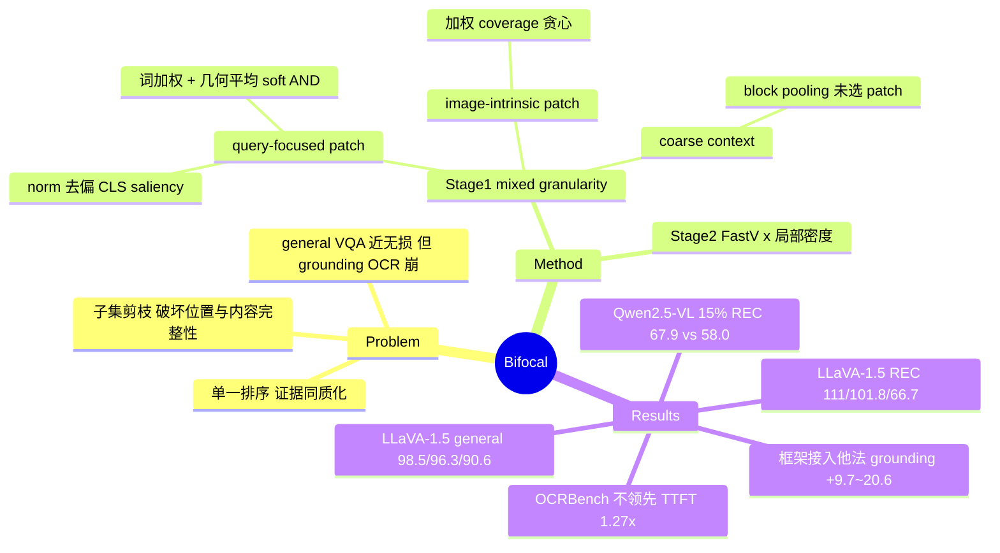

## Summary

Bifocal 指出 training-free visual token pruning 在 general VQA 上"近乎无损"的印象掩盖了 OCR 与 visual grounding 上的严重退化（LLaVA-1.5-7B 在 192 tokens 下 HiPrune/EADP/SID 保留 93.9%–98.1% general、但 grounding 只剩 9.5%–14.0%），并把原因归结为两点：单一重要性排序让保留证据同质化，稀疏 patch 子集破坏了位置与内容完整性。方法上它把 Stage-1 预算显式拆成三份——query-focused 细粒度 patch、image-intrinsic 细粒度 patch、对剩余 patch 做 block pooling 得到的 coarse context——再在 LLM 内用带局部密度先验的 FastV 式注意力做 Stage-2 剪枝。在 LLaVA-1.5-7B / LLaVA-NeXT-7B / Qwen2.5-VL-7B 的 9 个 model–budget 设置中，Bifocal 的 general 与 grounding 平均均排第一；代价是 OCRBench 绝对分并不领先，TTFT 加速也低于最快的单阶段方法。

## Problem & Motivation

现有 training-free pruning（FastV、VisionZip、HiPrune、DART 等）在常见 VQA 上用 1/4 甚至更少 visual tokens 就能保留 ~95% 性能，形成了"visual token 已能低损剪枝"的共识。作者在 10 个方法 × 14 个 benchmark（五个能力组：general、reasoning、OCR/doc、hallucination、grounding）上重测，发现 general VQA 是"宽松测试"（random 或简单 pooling 也能保住大部分），而 grounding 和 OCR 会断崖式下降。这说明以往评测的 benchmark 选择本身制造了乐观结论。作者追问的不是"如何打更准的分"，而是"缩减预算下应保留什么样的视觉证据"。

两个诊断实验支撑其 problem formulation：
- **信息来源互补**：固定 144/576 tokens，image route（CLS attention top-k）与 text route（与问题平均词向量的 cosine top-k）选中的区域重叠很少；OCR/doc 偏向 image route，REC 偏向 text route，二者对半分预算基本贴住两条单路曲线的上包络（Fig. 2）。
- **结构完整性**：在 RefCOCO testA 上，只保留 GT 框内 144 个 patch 仅得 39.1 Acc@0.5，低于两路选择（51.8）；以 GT oracle 为起点保留 80 个 patch、再补 64 个 lattice/random 位置的 patch 恢复位置覆盖可升到 ~55，再把这 64 个换成 block-pooled token 达到 63.0，接近不剪枝的 64.5（Fig. 3 左表）。即瓶颈在"子集式压缩"的表示破坏，而非选不准。

## Method

Bifocal 是两阶段、training-free 的剪枝方法：

**Stage 1（进 LLM 前）：mixed-granularity 三类 token**
1. **Query-focused evidence**（细粒度，native patch）
   - 每个问题词 w 与投影后 patch 特征做 cosine 得 word saliency map，空间平滑 G（低通去除逐 patch 估计噪声）后 min-max 归一化。
   - **Norm-debiased image saliency**：作者论证 CLS attention 可分解为 norm 增益 × 内容分（Appendix D），据此在单张图内把平滑后的 CLS attention 对平滑 patch-norm 图做最小二乘线性回归，取残差作为 image saliency S（去掉 attention sink 等高 norm 背景 patch 的影响）。
   - **Word weighting**：每个词权重 ∝ relu(Pearson corr(词图, S))，与图像显著性不一致的词被丢弃。
   - **Word conjunction**：加权几何平均作为 soft AND（"red shirt" 要求两个词同时支持同一 patch，而不是 max/mean pooling 的 or-like 匹配）。
   - 最终得分 = 词合取图 R、image saliency S、背景惩罚 B=−ν（负 norm）三者 min-max 后的几何平均，取 top-K。
2. **Image-intrinsic evidence**（细粒度，native patch）：定义 CLS-attention 加权的 representational coverage F(A)=Σ_j a_j·max_{i∈A} cos(x_j,x_i)，作者称其单调次模，故在已保留 token 基础上贪心选取边际增益最大的 patch——本质上是加权 facility location。
3. **Coarse context**（粗粒度）：对每个空间 block 中**未被选为细粒度证据**的 patch 做 attention 加权平均，位置取 block 内 attention 加权质心并 round 到最近 patch。保证每个 patch 要么以原分辨率出现、要么恰好进入一个 coarse token。

**Stage 2（LLM 内）**：沿用 FastV，在第 L 层按 last text token 对各 visual token 的注意力取 top-K，但乘以局部密度先验 d_j（该 token 邻域在 Stage 1 后存活的比例），抑制注意力集中在"孤立幸存者"上。

预算口径为 **layer-averaged visual tokens**：例如 LLaVA-1.5-7B 的 128-token 设置中 Stage 1 实际送入 224 tokens（C/I/Q = 64/80/80），再由 Stage 2 削减。Stage-2 层号 L、pooling block 尺寸与各预算下的 K 在论文中未给出数值；平滑算子只在 Appendix C 的分析里出现为 3×3 mean filter，未作为 Bifocal 设置明确声明（见 C18）。

## Key Results

**LLaVA-1.5-7B**（Tables 1–2，三档 avg tokens = 192/128/64，baselines 含 FastV、PDrop、PruMerge+、VisionZip、SID、DART、Nüwa、EADP、VLM-Pruner、HiPrune）：
- General 平均：98.5% / 96.3% / 90.6%，三档均最佳。
- Grounding（RefCOCO/+/g 8 个 split 平均）：111.0% / 101.8% / 66.7%，前两档高于不剪枝模型；64 tokens 下第二名 Nüwa 为 54.9%。同一设置下 HiPrune、EADP、SID 在 192 tokens 时 grounding 仅 10.6% / 14.0% / 9.5%。
- **OCR 并不领先**：192 tokens 时 Bifocal OCRBench 284，低于 HiPrune 316、VisionZip 312、PDrop 308。

**Qwen2.5-VL-7B**（Table 3，保留 50%/25%/15%）：
- 25%：Bifocal general 94.9% / REC 90.2%，最强 baseline Nüwa 为 93.4% / 85.4%。
- 15%：Bifocal REC 67.9%，所有 baseline 均不到 60%（Nüwa 58.0%）；去重类方法 DART、VLM-Pruner 跌到 6.9% / 9.5%。

**LLaVA-NeXT-7B**（Appendix G，~640/320/160 tokens）：160 tokens 下 VisionZip general 78.2% 接近 Bifocal 的 79.8%，grounding 却只有 3.1%，Bifocal 为 52.1%。作者还观察到四个"进 LLM 前剪一次"的 baseline 无论是否使用 query 文本，grounding 表现都相近。

**框架可迁移性**（Appendix B, Table 5）：把 HiPrune/VisionZip（作为 image-intrinsic 选择器，LLaVA-1.5）或 EADP（作为 query-focused 选择器，Qwen2.5-VL）塞进 mixed-granularity 框架，grounding 逐数据集提升 9.7–20.6 点，Avg 提升 6.8–9.7 点。

**Ablation**（Table 4，LLaVA-1.5，128 avg；此表 REC 仅为 RefCOCO+ testA/testB 两个 split，与 Table 2 的 8-split 平均口径不同）：C/I/Q = 64/80/80 是唯一同时在两个平均上领先的配置（Gen 95.4%，REC 102.7%）；去掉 Q（64/160/–）REC 降至 89.0%；只用 I（–/224/–）REC 83.6%；在 I-only 上加 C 把 REC 从 83.6% 提到 89.0%。

**效率**（Appendix H, Table 10，TextVQA，128 tokens）：TTFT 加速 1.27×，快于 EADP/DART/VLM-Pruner，但慢于 VisionZip（1.37×）和 HiPrune（1.38×）；峰值显存 13.4 GiB，与不剪枝（13.5）持平。

## Evidence Ledger

| Claim ID | Claim | Type | Source locator | Evidence excerpt | Status |
|:--|:--|:--|:--|:--|:--|
| C1 | LLaVA-1.5 192 tokens：HiPrune/EADP/SID general 93.9–98.1%，grounding 9.5–14.0% | number | §Intro; Table 1; Table 2 | "retain 93.9% – 98.1% of the unpruned general performance, yet only 9.5% – 14.0% of the grounding performance" | source-verified |
| C2 | Nüwa OCRBench 314→152（64 tokens） | number | §Intro; §4.2; Table 1 | "the OCRBench score of Nüwa [15] falls from 314 to 152" | source-verified |
| C3 | GT 框内 144 patch → 39.1；80 patch + 64 pooled → 63.0；不剪枝 64.5（RefCOCO testA） | number | §1; Fig. 3 table rows ①③⑨ | "keeping exactly the patches on the ground-truth object yields only 39.1 Acc@0.5 on RefCOCO testA" | source-verified |
| C4 | 两路对半分预算贴近单路上包络；OCR 偏 image route，REC 偏 text route | causal-mechanism | §2.1; Fig. 2 | "The even-split curve largely tracks the upper envelope of the two single-route curves" | source-verified |
| C5 | norm 回归残差作为 image saliency；relu(Pearson) 词权重 + 加权几何平均 soft AND | causal-mechanism | §3.1, Eq. 4–7 | "we regress the smoothed CLS attention on ν over the patches of the image by least squares and subtract the fit" | source-verified |
| C6 | image-intrinsic：CLS 加权 coverage F，单调次模，贪心选择 | causal-mechanism | §3.2, Eq. 8–9 | "F is monotone and submodular, so greedy selection is near-optimal" | source-verified |
| C7 | coarse token 只平均 block 内未选 patch、位置取注意力质心；Stage 2 = FastV × 局部密度 | causal-mechanism | §3.3 Eq. 10; §3.4 Eq. 11 | "the content of each pooling block averages only the patches inside the block that were not selected as fine evidence" | source-verified |
| C8 | LLaVA-1.5 general 平均 98.5/96.3/90.6%，三档最佳 | number | §4.2; Table 1 | "It attains the best general average at all three budgets, reaching 98.5%, 96.3% and 90.6%" | source-verified |
| C9 | LLaVA-1.5 grounding 111.0/101.8/66.7%；64 tokens Nüwa 54.9% | number | §4.2; Table 2 | "on grounding it scores 111.0% and 101.8% at 192 and 128 tokens, above the unpruned model" | source-verified |
| C10 | 192 tokens 下 Bifocal OCRBench 284 < HiPrune 316、VisionZip 312 | comparison | Table 1 | Table 1 OCR-B 列：VisionZip 312，HiPrune 316，Bifocal 284 | source-verified |
| C11 | Qwen2.5-VL 25%：94.9/90.2 vs Nüwa 93.4/85.4；15%：REC 67.9 vs 无 baseline >60%，DART/VLM-Pruner 6.9/9.5% | number | §4.2; Table 3 | "At 15%, Bifocal still keeps about two thirds of the unpruned grounding accuracy, while no baseline retains even 60%" | source-verified |
| C12 | LLaVA-NeXT 160 tokens：VisionZip general 78.2% vs Bifocal 79.8%，grounding 3.1% vs 52.1% | number | Appendix G; Tables 8–9 | "VisionZip reaches a general Avg. of 78.2%, close to the 79.8% of Bifocal, yet retains only 3.1% on grounding" | source-verified |
| C13 | 现有方法接入框架：grounding +9.7–20.6 点，Avg +6.8–9.7 点 | number | Appendix B; Table 5 | "the per-dataset gains range from 9.7 to 20.6 points, and Avg. rises by 6.8 to 9.7 points" | source-verified |
| C14 | Ablation：64/80/80 → 95.4% / 102.7%；去 Q → REC 89.0%；I-only → 83.6%（REC 仅 RefCOCO+ testA/testB） | number | §4.3; Table 4 | "removing Q drops REC from 102.7% to 89.0%" | source-verified |
| C15 | TTFT 1.27×，低于 VisionZip 1.37×、HiPrune 1.38×；显存 13.4 vs 13.5 GiB | comparison | Appendix H; Table 10 | "Bifocal also achieves a 1.27× speedup in TTFT, faster than EADP, DART and VLM-Pruner and close to the fastest methods" | source-verified |
| C16 | training-free；代码开源于 github.com/EIT-NLP/Bifocal | license-code | Abstract | "The code is available at: https://github.com/EIT-NLP/Bifocal" | source-verified |
| C17 | 作者声称唯一在三模型所有能力组均保留 >90%，且 9 个 model–budget 设置平均第一 | sota-novelty | Abstract; §1 | "Bifocal is the only evaluated method to retain over 90% of unpruned performance in every ability group across all three models" | source-verified |
| C18 | Stage-2 层号 L、pooling block 尺寸与各预算下 K 未给出数值；平滑算子仅在 Appendix C 分析中写作 3×3 mean filter（原 claim“平滑核也未给出”被 verifier 判 contradicted，已纠正） | benchmark-setting | §3.3–3.4; Appendix C Fig. 9 caption | "the map after the 3×3 mean filter" | contradicted |

## Strengths & Weaknesses

**Strengths**
- **评测纠偏比方法本身更有价值。** 把 grounding 和 OCR 纳入评测后，"general 98% 但 grounding 10%"这种反差把以往 pruning 论文的 benchmark 选择偏差暴露得很清楚。对任何在 GUI/具身场景依赖精确定位的下游用户，这是一个直接可用的警示：只看 VQAv2/GQA/MMB 的 pruning 结论不可迁移。
- **诊断实验设计干净。** Fig. 3 的"GT 框 oracle → 补位置 → 补内容"递进实验把"选不准"与"表示被破坏"分离开，结论有因果味道而非事后解释：即使 oracle 选择也只有 39.1，说明 scoring 再好也不够。
- **框架与具体打分解耦。** Appendix B 显示把别人的选择器塞进三分预算框架就能涨 grounding 10–20 点，说明收益主要来自"预算结构"（mixed granularity + 分源预算）而非 Bifocal 的精巧打分，这个结论更 general、也更简单。

**Weaknesses / 局限**
- **方法部分偏复杂，边际贡献不清。** Query-focused 分数叠了平滑、norm 回归去偏、Pearson 词权重、几何平均 soft AND、背景惩罚五个部件，但 Table 4 只消融了 C/I/Q 三类 token 的预算分配，没有逐一消融这些打分部件；考虑到 Appendix B 表明框架本身贡献很大，这些部件各自的增量是**不知道**。
- **预算口径对两阶段方法有利。** "layer-averaged tokens" 下 Bifocal 在 128-token 设置中先送 224 tokens 进 LLM 前几层，与单阶段方法比较时前若干层的 grounding 信息更多；FLOPs 被拉平（2.458 vs 2.454 T），但 TTFT 加速 1.27× 慢于 VisionZip/HiPrune 的 1.37–1.38×。
- **OCR 绝对分并不最好。** LLaVA-1.5 上 OCRBench 被 HiPrune/VisionZip 等单纯 image-guided 方法超过（284 vs 316/312），"OCR 保留 >90%"是按能力组平均的口径，单项 OCR 上 image-intrinsic 预算被 query 预算挤占的代价是真实存在的。
- **固定预算比例。** C/I/Q 的分配是手工常数（如 64/80/80），任务自适应分配没有讨论；作者自己也承认完整配置"不是每个 benchmark 都最好"。
- **范围限定于 7B 级、单图、单轮 QA。** 多轮对话（参见 [[2606-RethinkingTokenReduction]] 指出的 prompt-dependent pruning 在后续轮次失效问题）、视频、高分辨率 GUI 截图均未评测；query-focused 部分在多轮场景天然面临同样的问题。
- **超参报告不完整**：Stage-2 层号 L 与 pooling block 尺寸未见数值说明（平滑只在 Appendix C 分析中提到 3×3 mean filter），复现需依赖代码。

**潜在影响**：对 VLM 效率方向而言，最可迁移的结论是"pooled coarse context 是廉价且必要的完整性补丁"以及"grounding 应成为 pruning 的标配评测"。对 GUI agent，截图 token 极多且 grounding 是核心能力，这篇的诊断直接说明通用 pruning 方法不能直接拿来压缩 GUI 截图，但 Bifocal 本身也没有在 GUI grounding 上验证。

## Mind Map

## Notes

- 与 [[2606-RethinkingTokenReduction]] 对照：后者认为 prompt-dependent pruning 在多轮 VQA 中会丢后续轮次需要的区域，主张只依赖 image tokens 的可学习压缩；Bifocal 则论证 grounding 必须有 query-focused 预算。两者结论并不矛盾——Bifocal 的 image-intrinsic + coarse context 恰好是 query-agnostic 的"保底"部分——但 Bifocal 的单轮评测无法回答多轮下 Q 预算是否反成负担。
- 与 [[2506-FastVLM]]（从 encoder 侧减少 token）属于不同路线：FastVLM 训练时就产出更少 token，Bifocal 是推理期 plug-in。
- 开放问题：coarse context 的收益是否主要来自"恢复 2D 位置分布"（对 RoPE/position embedding 的依赖）？Fig. 3 ⑧（64 个全图均值 token 也能涨点）提示位置覆盖本身就占了大头，这一点对 GUI 截图压缩（大片空白背景）可能更关键。
- 对 GUI agent 的启发（推测）：GUI 截图 token 冗余度极高且 grounding 是主任务，"query patch + 全局 pooled 底图"的混合粒度可能比 GUI 领域常见的纯 crop/zoom 更省；值得找 GUI-specific pruning 工作对照。
