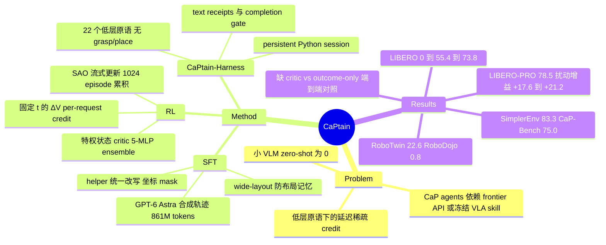

## Summary

CaPtain 把语言 agent 常用的"固定 harness 内 SFT + multi-turn RL"配方搬到 code-as-policy 机器人操作：策略（Qwen3.5-4B）只能调用 22 个低层感知/测量/guarded-motion 原语写 Python，没有 grasp/place 技能，也没有 VLA。RL 阶段用一个读取仿真器特权物理状态的 critic（5 个 MLP 的 ensemble），按每个 request 前后预测成功率的变化（$\Delta V$）给 per-request credit，测试时去掉 critic。结果上，held-out LIBERO 从 0%（zero-shot）到 55.4%（SFT）再到 73.8%（RL），LIBERO-PRO 3-suite 为 78.5%，RL 增益在三个扰动 suite 上保持 +17.6 到 +21.2 点；但全文没有"同一 pipeline 去掉 critic、只用 outcome-only GRPO"的端到端对照，critic 的贡献只有离线 gradient-noise 和 credit 分布分析作支撑。

## Problem & Motivation

已有 CaP agent 基本绕开了训练这一步：一类直接 prompt 闭源 frontier 模型（每回合有 API 成本，无法微调，无法上板载算力），另一类把"怎么抓、怎么放"交给冻结的 VLA 或高层 skill（PyRUA、AgenticRoboRL、Gemini 4 Argon），RL 最多只能学会给 skill 排序，上限受 skill 训练数据约束。小型开源 VLM 直接控机器人则完全失败：Qwen3.5-4B 在作者的 harness 中 LIBERO 成功率为 0。作者认为缺的是一套完整的 SFT+RL 配方，让小 VLM 自己在低层原语上做全部操作决策。

低层动作空间带来语言 agent 没有的 credit assignment 难题：一个 episode 有几十个 request，大多数只是感知或验证，真正的物理效果往往延后几轮才出现，而回报只有 episode 末一个结果。作者利用机器人学的一个不对称：训练在仿真里进行，物体位姿、抓取状态、子目标进度都精确可知，critic 可以读特权状态，部署时的策略只看相机和 receipt。

## Method

**CaPtain-Harness（动作空间 + 反馈）**
- ReAct 式循环，每个 request 是一次模型调用（thinking + 若干 python tool call），每个 episode 最多 60 个 request、150 次物理动作、1,080 s。
- 唯一的工具是带状态的沙箱 Python session，预先 import 了 robot 模块；变量跨 request 保留，所以 context 被压缩后检测结果和 helper 函数仍在。
- 22 个能力 + `finish()`：perception（observe RGB-D、SAM 3 segment、Molmo2-8B point、mark_point、track_target）、measurement（几何、接触/释放检查）、motion（`move_to` 绝对末端位姿或单个夹爪指令、hold、recover、release）、planning/state（只读的可达性检查、位姿运算）。没有 grasp/place/open-drawer 宏。
- 每次调用返回 ≤300 字符的结构化 receipt（停止原因、执行距离、峰值力、夹爪开度、检测的米制位置等）；robot 调用不抛异常。
- Completion gate 只依据 agent 自己记录的测量结果，最多拒绝 `finish()` 两次。指标分两种：host success（benchmark 的终态谓词）和 strict success（另外要求 agent 主动调用了 `finish()`）。
- Context 管理：保留最近 12 张图，每个 cell 最多打印 20 行 receipt，接近 60k token 时逐轮压缩；RL 和测试用同一套规则。

**Stage 1：在 harness 内做 SFT**
- 数据：25,961 行、861M token，主要由 GPT-6 Astra（654M token）和 GPT-6.x Sol 在同一 harness 内生成，其中也包含 RL 策略自己的成功 rollout（1,386 行 / 267 个 episode，占 6.1%）和 Visual QA（loss 权重 0.5）。
- 原始轨迹里同一个"预览再移动" helper 有 226 种写法，作者把它们统一改写成 4 个函数（val/need/downq/go），并用 mock robot 逐个调用点检查等价性。
- 以 0.2 的概率把历史中的 mark_point 坐标替换成 mask token，逼模型从当前图像定位，而不是抄前面的坐标；视觉塔冻结，语言模型全参数微调。
- 数据多样性很关键：官方初始状态下物体位置标准差约 1.4 cm，用这样的数据训出来的模型直接记住了布局，换掉输入图像后坐标似然不变；改用 wide-layout（约 15 cm）后才恢复视觉 grounding。

**Stage 2：带 simulator critic 的 multi-turn RL**
- 特权特征：每个 request 前记录 36 维隐藏快照（末端/夹爪、目标完成情况、各类距离、抬升/位移、关节位置与 held 标志）。刻意排除策略自身行为的计数器。
- Critic $V_\phi(s_t,t)$：5 个 MLP（3×256）的 logit 取平均后过 sigmoid，预测 host success；在更早策略的 1,000 个 episode 上 warm-start，然后按 SAO 的方式在线共训（每轮 2 步 AdamW BCE）。
- Credit：$\delta_t=c_t+V(s_{t+1},t)-V(s_t,t)$，两项用**同一个时间索引 $t$**，所以单纯的时间流逝不产生 credit，纯感知 request 的 $\delta\approx0$，只通过 GAE（$\lambda=0.9$）从它促成的物理动作那里分到 credit。最终 advantage = 组内 outcome 相对项（G=4）+ 轨迹内 GAE 去均值项。
- 回报：带 finish 成功 1 / 成功但没调 finish 0.25 / 其他失败 0 / 预算耗尽 −0.1 / false finish −0.3；另加动作超量、失败动作、成功后多余动作的成本，8 个难任务加 staged 子目标奖励（≤0.1125）。
- 更新：SAO 式流式单遍更新，双侧 token mask（$0.2<r<4$，超出直接丢弃而非 clip），对 SFT 模型施加 k3 KL（β=0.002），每条轨迹最多采 8 个 request 算梯度；每个 optimizer step 累积 1,024 个 episode（依据 gradient-noise scale 选定）。
- 训练分布：40 个 LIBERO 任务的 7,360 个起始状态（5,600 个 wide-layout + 1,760 个官方状态），评测用的官方状态 11–16 不参与采样。CaPtain-4B 是 round 300 的 checkpoint（75 次更新，76,800 个 episode，约 1,290 H100-hours）。

## Key Results

**LIBERO 家族（Table 1，host success %，配对 McNemar 检验）**

| Benchmark | n | Base | SFT | CaPtain-4B | Δ host | Strict SFT→RL |
|:--|:--|:--|:--|:--|:--|:--|
| LIBERO held-out | 240 | 0.0 | 55.4 | 73.8 | +18.3 | 52.1→67.5 |
| LIBERO-PRO 3 suites | 600 | 0.3 | 59.5 | 78.5 | +19.0 | 56.7→71.5 |
| LIBERO-PRO 4 suites | 800 | 0.2 | 49.2 | 68.6 | +19.4 | 45.1→58.9 |
| LIBERO-Plus | 700 | 0.0 | 48.6 | 66.1 | +17.6 | 44.6→59.0 |
| LIBERO-MAX Dynamic | 80 | 0.0 | 40.0 | 61.2 | +21.2 | 40.0→50.0 |
| LIBERO-MAX Base | 80 | 0.0 | 51.2 | 70.0 | +18.8 | 45.0→63.8 |

- held-out LIBERO 上 RL 新增 55 个成功、丢掉 11 个；false finish 从 7.1% 降到 2.1%，平均 request 数从 39.1 降到 32.6。分 suite 看，Goal +26.7 最大，Long +13.3 最小（p=0.13，不显著）。LIBERO-MAX Dynamic 的 strict 增益 p=0.15，同样不显著。
- LIBERO-Plus 的 7 个扰动维度在 p<0.05 下都有提升，Bonferroni 校正后剩 6 个；lighting +23 最大，sensor noise +13 最小。

**与已发表系统比较（Table 2，LIBERO-PRO 3-suite，数字取自各自论文，协议不同）**
- CaPtain-4B 78.5，高于 K1 77.2、WAA 75.6、ASPIRE 71.7、SPARK（27B，用 GT depth）66.8、Guava ≈41.0；低于 OpenRUA（Claude Opus 5）91.8、Harness VLA 87.7、AgenticRoboRL 81.3。
- RL 增益：CaPtain 在 4-suite 上 49.2→68.6（+19.4），AgenticRoboRL 65.1→71.0（+5.9）；作者自己承认两者起点不同。
- 成本：每个 episode 约 32.6 个 request、7.3k output token，约 52 GPU-seconds，估计 \$0.03–0.06（不含感知服务）；对照 OpenRUA 每 episode \$8–22。

**Zero-shot 迁移（只在 LIBERO 上训练）**
- SimplerEnv WidowX 83.3%，接近 ManiAgent（GPT-5）86.8，高于 PhysBrain 1.0 80.2 和 π0.5 57.1。
- CaP-Bench Cube Lift & Stack 75.0，高于 CaP-X 中的 Gemini-3-Pro 73.5 和在该 benchmark 上做过 in-domain RL 的 CaP-RL（Qwen2.5-7B）62.0；跑满整个 episode horizon 时为 97.5%。Wipe 任务因 guarded-contact 原语不允许持续下压而无法执行。
- RoboTwin 2.0 Hard 22.6%（单臂子集 30.0%），π0.5 为 46.0；RoboDojo Score 1.7 / SR 0.8%，GPT-6 Astra 为 29.0。双臂同时运动的任务 0/35，X5 机械臂的可达范围是主要瓶颈。
- 真机：Astrabot XR1，策略先在粗糙 twin 仿真中适配，不使用任何真实数据；论文只展示了两个任务的 episode，没有报告成功率统计。

**Critic 分析（基于更早的 9B 策略离线数据：15k episode，573k 个 request 状态）**
- AUC 0.970，组内 AUC 0.904，校准误差 0.006；4B 用的 warm-start critic held-out AUC 为 0.907。
- 成功抓取的中位 ΔV 为 +0.058，纯感知 request 为 −0.0002；|A| 质量中 motions 占 65%、grasps 14%、releases 14%，纯感知 1.3%。
- 给 critic 喂 LM hidden state 时，35% 的 |A| 质量转移到感知 request 上（hidden state 线性解码 request index 的 R²=0.80）。
- Gradient-noise scale：outcome-only GRPO 9.0k、critic λ=0.9 6.7k、λ=0 12.6k（反而更差）。
- 特权状态敏感性：pose 噪声为 2 cm / 5 cm / 用策略自身感知时，与特权 ΔV 的相关系数分别为 0.49 / 0.36 / 0.21。

## Evidence Ledger

| Claim ID | Claim | Type | Source locator | Evidence excerpt | Status |
|:--|:--|:--|:--|:--|:--|
| C1 | CaPtain-4B 在 held-out LIBERO 上 host success 从 base 0% 到 SFT 55.4%，RL 后 73.8% | number | Abstract; Table 1 | "Starting from Qwen3.5-4B (0% zero-shot), CaPtain-4B achieves 55.4% held-out LIBERO success after SFT and 73.8% after RL." | source-verified |
| C2 | LIBERO-PRO 3-suite host success 78.5%，4-suite 68.6% | number | Table 1; Table 2 | "LIBERO-PRO (3 suites) / 600 / 0.3 / 59.5 / 78.5 / +19.0" | source-verified |
| C3 | RL 增益在 LIBERO-PRO / LIBERO-Plus / LIBERO-MAX 三个扰动 suite 上为 +17.6 到 +21.2 点 | number | Abstract; §4.1 | "its RL gains persist across three perturbation suites (+17.6 to +21.2 points)" | source-verified |
| C4 | CaPtain-Harness 暴露 22 个低层能力加 finish()，没有 grasp/place/open-drawer 技能，也没有 VLA | benchmark-setting | §3.1; Appendix A.1 | "The robot module exposes 22 capabilities plus finish()" / "There are no grasp, place or open-drawer skills and no VLA." | source-verified |
| C5 | SFT 数据共 25,961 行 / 861M token，主要由 GPT-6 Astra 生成，并包含 RL 策略自己的成功 rollout（1,386 行，267 个 episode） | number | Appendix C, Table 5 | "CaPtain-4B-SFT data mix (25,961 rows, 861M tokens). Generating agents: GPT-6 Astra (654M tokens)" | source-verified |
| C6 | Critic 是 5 个 MLP 的 ensemble，输入为 36 维特权物理特征加 request index 和 task，预测 host success | causal-mechanism | §3.3; Appendix A.2 | "From it we compute 36 features x(s_t) in five groups" / "an ensemble of five small MLPs whose logits are averaged" | source-verified |
| C7 | Per-request credit 用同一时间索引 t 计算 V 差分，因此纯感知 request 的 δ≈0 | causal-mechanism | §3.3, Eq. 5 | "Both values in each difference use the same index t, so the passage of time alone produces no credit." | source-verified |
| C8 | Held-out LIBERO 上 RL 使 false finish 从 7.1% 降到 2.1%，平均 request 数从 39.1 降到 32.6 | number | §4.1 | "False finishes fall from 7.1% to 2.1% of episodes, and the mean number of requests per episode falls from 39.1 to 32.6." | source-verified |
| C9 | 分 suite 增益中 Goal 最大（+26.7），Long 最小（+13.3），且 Long 的增益 p=0.13 不显著 | number | §4.1; Appendix K | "goal +26.7 ( p=1.4×10^-4 ), long +13.3 ( p=0.13 )" | source-verified |
| C10 | LIBERO-PRO 3-suite 上 CaPtain-4B（78.5）高于 K1 77.2、WAA 75.6、ASPIRE 71.7 | comparison | §1; Table 2 | "CaPtain-4B reaches 78.5%, above frontier-model agents such as K1 [40] (77.2%), WAA [93] (75.6%), and ASPIRE [50] (71.7%)." | source-verified |
| C11 | LIBERO-PRO 3-suite 上 OpenRUA（Claude Opus 5）91.8、Harness VLA 87.7、AgenticRoboRL 81.3，均高于 CaPtain-4B | comparison | Table 2 | "OpenRUA [13] / Claude Opus 5 / ✓ / ✗ / ✗ / 91.8 / 87.0" | source-verified |
| C12 | 4-suite RL 增益：CaPtain +19.4（49.2→68.6），AgenticRoboRL +5.9（65.1→71.0），作者承认两者起点不同 | comparison | §1; §4.2 | "gains +5.9 points from RL on the 4-suite average (65.1% → 71.0%)" | source-verified |
| C13 | Table 2 的基线数字取自各自论文，评测协议不同（turn budget、oracle 信号、GT depth、温度、试验次数） | benchmark-setting | §4 "Models and baselines"; Appendix K protocol notes | "Baseline numbers are taken from the respective papers." | source-verified |
| C14 | 每个 episode 约 52 GPU-seconds，估计 \$0.03–0.06（不含感知服务），OpenRUA 为 \$8–22 | number | §4.2 Cost | "an estimated \$0.03–0.06 per episode at \$2–4 per GPU-hour, excluding perception services" | source-verified |
| C15 | Zero-shot SimplerEnv WidowX 成功率 83.3%，ManiAgent（GPT-5）86.8 | number | §4.3; Table 3(c) | "CaPtain-4B succeeds in 83.3% of episodes on average" | source-verified |
| C16 | CaP-Bench 得分 75.0，高于 Gemini-3-Pro 73.5 和 in-domain CaP-RL 62.0；跑满 horizon 时为 97.5% | comparison | §4.3; Table 3(d) | "CaPtain-4B reaches a score of 75.0, outperforming both closed frontier models" | source-verified |
| C17 | RoboTwin 2.0 Hard 为 22.6%（单臂 30.0%），RoboDojo Score 1.7 / SR 0.8% | number | §4.3; Table 3(a)(b) | "Transfer remains limited on RoboTwin 2.0 and RoboDojo (22.6% and 0.8% success)" | source-verified |
| C18 | 需要双臂同时运动的 RoboTwin 任务在所有配置下 0/35 | number | Appendix J | "tasks that require simultaneous two-arm motion succeed in 0 of 35 instances in every configuration" | source-verified |
| C19 | 真机部署只用粗糙 twin 仿真中的 XR1 episode 适配，不使用真实数据；论文只展示两个任务，没有成功率统计 | benchmark-setting | §4.4; Figure 4 | "the policy is adapted with simulated XR1 episodes only and uses no real-world data" | source-verified |
| C20 | Critic 在 9B 离线数据上 AUC 0.970、组内 AUC 0.904；4B 用的 warm-start critic held-out AUC 0.907 | number | §4.5 | "overall AUC of 0.970, a within-group AUC of 0.904" | source-verified |
| C21 | \|A\| 质量 65% 分给 motions、grasps 和 releases 各 14%，纯感知 request 只有 1.3% | number | §4.5 | "65% of the total \|A\| mass is assigned to motions, 14% to grasps, and 14% to releases" | source-verified |
| C22 | 给 critic 喂 LM hidden state 会把 35% 的 \|A\| 质量转移到感知 request 上 | causal-mechanism | §4.5 | "feeding hidden states to the critic shifts 35% of the total \|A\| mass onto perception requests" | source-verified |
| C23 | Gradient-noise scale：outcome-only GRPO 9.0k，critic λ=0.9 6.7k，λ=0 12.6k | number | Appendix H, Table 7 | "GRPO (0/1 outcome) / 9.0k / simulator critic, λ=0 / 12.6k / simulator critic, λ=0.9 / 6.7k" | source-verified |
| C24 | Round 340 之后 host success 持平约 65%，strict success 从约 60% 降到 44%（over-verification），因此选 round-300 checkpoint | causal-mechanism | Appendix I, Figure 7 | "After about round 340, host success holds at about 65% while strict success falls from about 60% to 44%." | source-verified |
| C25 | 选 checkpoint 所用的评测包含 40 个官方 seed-11 episode，而官方状态 11 属于 held-out 评测集（11–16） | benchmark-setting | Appendix I Figure 7 caption; §4 Benchmarks | "40 official seed-11 episodes plus 40 wide-layout episodes per checkpoint" | source-verified |

## Strengths & Weaknesses

**Strengths**
- 问题提得准。作者没有在 skill 层上加 RL，而是把操作决策（抓哪里、从哪个方向接近、何时合夹爪）全部交给可训练的策略，这样才能检验"低层 CaP 能不能像语言 agent 一样 post-train"。RL 增益（+19.4）远大于在冻结 VLA 上做 RL 的 AgenticRoboRL（+5.9），方向上支持"skill 层封顶"的论点，但起点不同，不能当作严格对照。
- Credit 设计简单，理由也讲清楚了。用固定时间索引的 ΔV，纯感知 request 自然拿不到直接 credit；作者还找到并排除了两条泄漏通道：策略行为计数器充当时间代理，以及 LM hidden state 可以解码出 request index（R²=0.80，导致 35% 的 |A| 转移到感知 request）。这种负面分析比主表更有信息量。
- 工程上的教训写得坦诚，可复用：布局记忆（1.4 cm vs 15 cm 位置方差）、curriculum 从中间状态起步导致只学会"放"、gradient-noise scale 要上千 episode（不累积时相邻更新近似正交，等于随机游走）、终止决策拿不到 critic credit 引起的 finish collapse。
- 统计口径严谨：配对 McNemar、task-cluster bootstrap，区分 host 和 strict success，并且如实报告了不显著的格子（Long p=0.13，MAX Dynamic strict p=0.15）。
- 代码、SFT 数据和权重全部开放。

**Weaknesses**
- **缺最关键的 ablation**：没有在同一 pipeline 里把 critic 换成 outcome-only GRPO 训练到底、再比较最终成功率。critic 的价值只有离线证据：gradient-noise scale 从 9.0k 降到 6.7k（下降约 26%，而 λ=0 时 12.6k 比 GRPO 还差），以及 credit 分布。73.8% 中有多少来自 critic、多少来自"任何 multi-turn RL + 1,024 episode 累积 + 成本设计"，目前无法判断。标题级的贡献 3 实际上还没有被因果验证。
- **"held-out" 的边界比较窄**：RL 在全部 40 个 LIBERO 任务上训练，held-out 只是同一批任务的未见初始状态；LIBERO-PRO/Plus/MAX 也都是在这 40 个任务上做扰动。checkpoint 是按 Figure 7 的评测挑的，其中包含官方 seed-11，而 seed 11 正属于 11–16 的评测集，存在轻度的测试集选模。作者另给了 seed-11 的干净子集（74.6%），但它恰好是被用来选模的那个 seed，并不能消除这个顾虑。
- **"SFT" 基线并不纯**：SFT 数据里有 6.1% 是 RL 策略自己的成功 rollout，所以 SFT→RL 的差值并不严格等于"RL 阶段带来的增益"。critic 也是在更早策略的 episode 上 warm-start 的。
- **"no frontier model / no VLA" 需要打折扣**：测试时虽然不调用 frontier API，但 SFT 数据几乎全部由 GPT-6 Astra 生成（本质上是 frontier 蒸馏）；感知依赖 SAM 3 和 Molmo2-8B 两个外部基础模型，它们的成本不在 \$0.03–0.06 之内。
- **与 frontier 系统的比较协议不齐**：Table 2 的基线数字来自各自论文，turn budget、oracle 信号、GT depth、温度、试验次数都不一样（Appendix K 有列出）；"超过 frontier agent"只能当作量级参考。
- **迁移结果两极**：单臂、俯视抓放（SimplerEnv、CaP-Bench）很强，双臂和陌生运动学（RoboTwin 22.6%、RoboDojo 0.8%）很弱，而且各 benchmark 的 adapter 里有 benchmark-specific 的辅助（例如 RoboDojo 的自动抓取重试、RoboTwin 的自动 hand-over）。真机只有两个定性 episode。
- **方法的适用边界**：critic 依赖精确的仿真状态，换成 5 cm 位姿噪声后与特权 ΔV 的相关只剩 0.36，用策略自身感知时只剩 0.21，所以这条路线目前无法在真机上在线 RL。终止决策也拿不到 critic credit（V≈1），finish collapse 只是靠成本设计部分缓解。动作空间是 guarded Cartesian 位置控制，Wipe 这类需要持续力控的任务表达不了。

**对领域的意义**：这是第一份把小型开源 VLM 在低层原语上用 multi-turn RL 训成可用 CaP agent 的完整配方，"asymmetric critic + 固定时间索引的 ΔV"是值得迁移的模式（GUI agent 在可读 DOM/后端状态的仿真环境里同样具备这种不对称）。不过，"critic 是关键"这个结论还需要一次端到端 ablation 才能成立。

## Mind Map

## Notes

- [[2607-SAO]]：CaPtain 的 RL 更新直接沿用 SAO 的流式单遍更新、双侧 token mask 和在线共训 critic，区别在于 critic 读的是仿真特权物理状态而非 LM 文本，并且恢复了 G=4 的 group 项；两篇可以对照看 critic 输入的选择如何影响 credit 泄漏。
- [[2609-ShowHarness]]：同样主张"harness/动作接口设计决定小 VLM 能否控机器人"，但走的是相反方向：Show-Harness 用离散语义动作单元 + 确定性 interpreter，CaPtain 用低层位姿原语 + receipt。动作抽象层级的选择对 RL 可训练性和迁移的影响，两篇形成了直接的张力。
- [[2609-MotorMind]]：冻结 VLM + mid-level 参数化动作 + Verifier，在 LIBERO-PRO 三个 base suite 上报告 66.7%，是 training-free 路线的对照点；CaPtain 的 78.5% 是训练后的 4B 模型取得的，但两者协议不同，不能直接比较。
- [[2307-VoxPoser]]：Code-as-policy 的早期 training-free 代表（frontier LLM 写代码组合 value map）；CaPtain 是这条 lineage 上"把写代码的模型本身拿来训练"的转折点。
- 待查：critic vs outcome-only GRPO 的端到端 ablation 是否会在后续版本补上；GUI 仿真环境（可读后端状态）里能否复用"固定 t 的特权 ΔV credit"。
