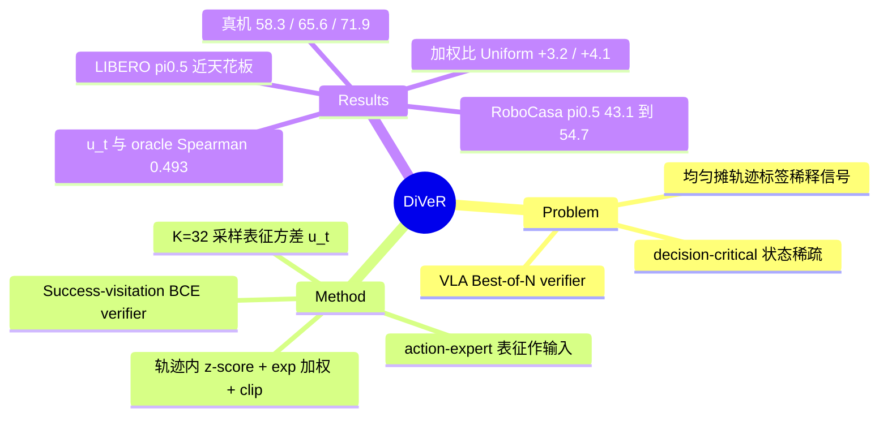

## Summary
DiVeR 针对 VLA 的 verifier-guided Best-of-N 选动作：已有 classification-based verifier（如 SVM）把轨迹级成败标签均匀摊到每个状态上，DiVeR 改为按"frozen policy 在该状态采样 K=32 个 action chunk 的 action-expert 表征方差"给训练样本加权，把监督集中到候选分歧大的 decision-critical 状态。RoboCasa 上 N=16 时 π0 / π0.5 平均成功率 38.1 / 54.7，比均匀加权的同表征 verifier 高 3.2 / 4.1 点；真机 Franka 4 任务平均 71.9%，Uniform 为 65.6%，单样本 Base 为 58.3%。改进是 SVM 式 verifier 上一个便宜、可插拔的样本重加权，但真机样本量小、LIBERO 接近天花板，加权本身的增益只在 RoboCasa 上有干净的 ablation。

## Problem & Motivation
VLA 的 parallel test-time scaling 做法是：从 frozen policy 采样 N 个 action chunk，由 verifier 打分后执行最高分者。现有方案分三类。VLM-based verifier（RoboMeter、RoVer 等）推理开销大；verifier-free 方法（KDPE 的核密度、MG-Select 的 condition-masking confidence）不以任务结果为依据；classification-based verifier（TACO、SVM）轻量，但对轨迹内所有状态一视同仁。作者观察到，free-space motion、抓取后搬运这类 routine 状态上采样出的候选几乎相同，判别信号很弱；pre-grasp、pre-placement 对齐这类少数状态上候选才真正分化（Fig.1b：500 条 LIBERO-Long π0 轨迹中高 criticality 状态稀疏且时间上局部化）。均匀加权会让 routine 状态稀释这部分信号。论文明确借用了 LLM 的类比：少量高熵 forking token 决定生成走向（Wang et al., 2025）。

## Method
- **Success-Visitation Verifier（基座）**：用 BCE 训练二分类器 f_θ，区分成功轨迹与失败轨迹的 state–action visitation。在类别平衡条件下最优 logit 等于 log ρ⁺/ρ⁻（App. D 给出推导），因此用 logit 作为候选打分。输入不是图像加原始动作，而是 VLA action expert 的内部表征 z_t：取最后一层、最后一步去噪时的 action token 表征并在 token 维平均（App. B.1）。
- **Decision criticality 估计**：对每个训练状态 s_t，从 frozen policy 采样 K 个 action chunk，取其 action-expert 表征的逐维方差均值 u_t = Tr(Cov)/d（Eq.8）。整个估计不需要 step-level 标注，也不需要额外环境交互。
- **加权**：在每条轨迹内部对 u_t 做 z-score，再算 w_t = exp(β·ũ_t)，β=0.5，并把 w_t clip 到 [1/2.5, 2.5]（Eq.9，App. B.1）。训练目标为加权 BCE（Eq.11）。权重只由候选分歧决定，不使用 outcome 标签 y_t。
- **Verifier**：两层 MLP，hidden 64，dropout 0.3，约 66K 参数；AdamW，lr 1e-3，30 epochs，class-balanced minibatch。
- **推理**：flow-matching VLA 通过独立采样初始噪声得到 N 个候选，VLM 部分用 KV cache 复用；verifier 对每个候选打分取 argmax。
- **隐含假设**：(1) 表征方差高意味着选择后果大。但两个同样好的抓取模态也会产生高方差，"分歧"不等于"后果"。(2) 轨迹内 z-score 默认每条轨迹都存在相对的 critical 段。(3) 候选集质量完全由 frozen policy 决定，verifier 只能在候选中挑选，无法生成更好的动作（App. G 承认这一点）。

## Key Results
- **LIBERO-Long（Table 1）**：π0 的 N=1 Baseline 为 83.5。Ours 在 N=32 时为 89.3，比 N=1 高 5.8，比最强 baseline SVM（86.5）高 2.8。π0.5 的 Baseline 为 93.5，Ours 在 N=32 时为 97.5，SVM 为 97.0。π0 在 N=4 时 TACO（84.2）略高于 Ours（84.0）。
- **RoboCasa 18 个 atomic 任务，N=16（Table 2）**：π0 从 32.2 提到 38.1（+5.9），π0.5 从 43.1 提到 54.7（+11.6）。π0.5 下最强 baseline 为 MG-Select 51.3，摘要中"比最强 baseline 高 +3.4"即对应这一组。Navigation 类别在 π0 下所有方法都是 0.0。
- **Component analysis（Table 4，RoboCasa）**：Random selection 为 33.0 / 44.1，几乎不涨；Uniform training（同表征、不加权）为 34.9 / 50.6；Ours 为 38.1 / 54.7。加权带来的净增益为 +3.2 / +4.1，表征替换带来的增益（Uniform 对比 SVM）为 +1.0 / +3.7。
- **输入 ablation（Table 5）**：Image & Raw 为 32.4 / 50.2，Image & Repr. 为 37.4 / 54.6，只用 Representation 为 38.1 / 54.7，说明加入图像特征没有额外收益。
- **对比 VLM verifier（Table 6，π0.5 RoboCasa）**：RoboMeter 成功率 50.1%、延迟 0.743 s；Ours 54.7%、0.001 s，作者据此称快 700 倍以上。需要注意 RoboMeter 的候选视觉轨迹"via simulator branching"获得，真机无法部署，延迟比较的口径并不对等。
- **真机 Franka Research 3，π0.5 LoRA，N=16，每任务 24 episode（Table 3）**：Base / Uniform / Ours 平均分别为 58.3 / 65.6 / 71.9。四个任务上 Ours 都最高，其中 Stack block 从 45.8 到 58.3 再到 66.7。
- **Criticality 代理的有效性（App. C.1）**：在 RoboCasa π0.5 上抽 500 个状态，用 simulator branching 估计 oracle criticality（max Q − mean Q）。u_t 与 oracle 的 Spearman ρ=0.493，属于中等相关。
- **其他 ablation**：OpenVLA（自回归）在 LIBERO-Long、N=4 下，Base 52.5、MGS 54.5、SVM 55.0、Ours 55.5，与 SVM 只差 0.5（Table 12）。K=4/16/32/64 对应 52.8/53.9/54.7/55.0（Table 13）。中间层表征只有 44.1，比最后一层的 54.7 低很多（Table 14b）。N=16 时采样延迟约 360 ms（π0）和 205 ms（π0.5），verifier 每个 chunk 不到 0.5 ms（App. C.3）。

## Evidence Ledger

| Claim ID | Claim | Type | Source locator | Evidence excerpt | Status |
|:--|:--|:--|:--|:--|:--|
| C1 | LIBERO-Long 上 π0 在 N=32 时 DiVeR 比 N=1 baseline 高 5.8 点，比最强 baseline 高 2.8 点 | comparison | §5.2 Simulation; Table 1 | "For \pi_{0} with N=32 , our method improves the success rate by +5.8% over the N=1 baseline and by +2.8% over the best-performing baseline." | source-verified |
| C2 | LIBERO-Long π0 的 N=1 baseline 为 83.5，Ours 在 N=32 时为 89.3，SVM 为 86.5 | number | Table 1 | "Baseline 83.5 93.5 … SVM … 86.5 … Ours … 89.3" | source-verified |
| C3 | LIBERO-Long π0.5 的 N=1 baseline 为 93.5，Ours 在 N=32 时为 97.5，SVM 在 N=32 时为 97.0 | number | Table 1 | "Ours … 97.5 … SVM … \underline{97.0}" | source-verified |
| C4 | LIBERO-Long π0 在 N=4 时 TACO（84.2）高于 Ours（84.0） | comparison | Table 1 | "TACO … \mathbf{84.2} … Ours \underline{84.0}" | source-verified |
| C5 | RoboCasa N=16 时 DiVeR 平均成功率比 N=1 高：π0 +5.9，π0.5 +11.6 | comparison | §5.2; Table 2 | "it improves success rate by +5.9% for \pi_{0} and +11.6% for \pi_{0.5} over the corresponding N=1 baselines." | source-verified |
| C6 | RoboCasa π0.5 平均：Ours 54.7，MG-Select 51.3（最强 baseline，差 3.4） | number | Table 2 | "MG-Select … 51.3 … Ours … \mathbf{54.7}" | source-verified |
| C7 | RoboCasa Navigation 类别在 π0 下所有方法都是 0.0 | number | Table 2 | "Navigation … 0.0" (all rows, π0 column) | source-verified |
| C8 | 真机平均成功率：DiVeR 71.9%，Uniform 65.6%，Base 58.3% | number | §5.2 Real-robot; Table 3 | "achieving an average success rate of \mathbf{71.9\%} , compared with 65.6\% for Uniform and 58.3\% for Base." | source-verified |
| C9 | 真机为 Franka Research 3，π0.5 用每任务 40 条示教做 LoRA 微调，每任务评测 24 episode | benchmark-setting | §5.1 Real-world | "We fine-tune \pi_{0.5} with LoRA using 40 human teleoperation demonstrations per task and evaluate on 24 episodes per task." | source-verified |
| C10 | Component analysis（RoboCasa）：Random 33.0/44.1，Uniform 34.9/50.6，Ours 38.1/54.7 | number | Table 4 | "Random selection 33.0 44.1 Uniform training 34.9 50.6 Ours 38.1 54.7" | source-verified |
| C11 | 相比 uniform training，decision-criticality 加权再带来 +3.2（π0）和 +4.1（π0.5）点 | causal-mechanism | §5.3 Component analysis | "decision-criticality weighting ( Ours ) yields an additional +3.2 and +4.1 points over uniform training" | source-verified |
| C12 | 正文把 component analysis 引为 "Table 6"，但数据实际在 Table 4（引用错误） | benchmark-setting | §5.3 Component analysis | "As shown in Table 6 , random selection provides only marginal gains over the N=1 baseline" | source-verified |
| C13 | 只用 action-expert 表征（38.1/54.7）不差于 Image & Repr.（37.4/54.6），优于 Image & Raw（32.4/50.2） | comparison | Table 5 | "Image & Raw 32.4 50.2 Image & Repr. 37.4 54.6 Representation 38.1 54.7" | source-verified |
| C14 | 对比 RoboMeter：成功率 54.7 对 50.1，延迟 0.001 s 对 0.743 s，快 700 倍以上 | comparison | §5.3; Table 6 | "reducing verification latency from 0.743 s to 0.001 s, making the verifier over \mathbf{700\times} faster." | source-verified |
| C15 | RoboMeter 的候选视觉轨迹通过 simulator branching 获得 | benchmark-setting | §5.3 VLM-based verifier | "with candidate visual trajectories obtained via simulator branching." | source-verified |
| C16 | u_t 与 rollout-based oracle criticality 的 Spearman ρ=0.493（500 个 RoboCasa 状态） | number | App. C.1; Fig. 7 | "positively correlated with rollout-based oracle criticality (Spearman \rho=0.493 , p=8.09\times 10^{-23} )" | source-verified |
| C17 | 超参在 RoboCasa π0.5 上调定，随后固定用于其他 benchmark 与 policy | benchmark-setting | App. B.2 | "We tune the verifier hyperparameters on RoboCasa using \pi_{0.5} and then fix the selected configuration for all remaining benchmarks" | source-verified |
| C18 | 加权超参：β=0.5，w_t clip 到 [1/2.5, 2.5]，每个训练状态采样 K=32 | benchmark-setting | App. B.1 | "we set \beta=0.5 and clip w_{t} to [c^{-1},c] with c=2.5 … We sample K=32 action candidates" | source-verified |
| C19 | OpenVLA 在 LIBERO-Long、N=4 下：Base 52.5，MGS 54.5，SVM 55.0，Ours 55.5 | number | App. C.2; Table 12 | "Base 52.5 MGS 54.5 SVM 55.0 Ours 55.5" | source-verified |
| C20 | K=4/16/32/64 对应的成功率为 52.8/53.9/54.7/55.0 | number | App. C.4; Table 13 | "4 52.8 16 53.9 32 54.7 64 55.0" | source-verified |
| C21 | 中间层 action-expert 表征的成功率为 44.1，最后一层为 54.7 | number | App. C.5; Table 14b | "First 52.9 Middle 44.1 Last 54.7" | source-verified |
| C22 | N=16 时采样延迟约 360 ms（π0）和 205 ms（π0.5），verifier 每个 chunk 不到 0.5 ms | number | App. C.3; Fig. 8 | "reaching approximately 360 ms for \pi_{0} and 205 ms for \pi_{0.5} at N=16 … less than 0.5 ms to score each action chunk" | source-verified |
| C23 | Verifier 为两层 MLP（hidden 64），各架构约 66K 参数，MLP 优于 LSTM 和 transformer | comparison | App. B.1; §5.3 Verifier architecture; Fig. 6 | "with approximately 66K trainable parameters each. The MLP performs best across both VLA policies" | source-verified |
| C24 | 正文未给出代码链接，仅有项目页（Microsoft Research article） | license-code | Abstract; HTML links | "Videos are available at: Project Page ." | source-verified |

## Strengths & Weaknesses
**Strengths**
- 改动很小，定位清楚：在 SVM 式 success-visitation verifier 上只加一个由 policy 自身采样方差得到的样本权重，不需要 step 标注、不需要额外环境交互、推理时零开销。Table 4 把"换表征"（+1.0/+3.7）和"加权"（+3.2/+4.1）分开报告，归因比较干净。
- baseline 协议公平：所有方法共用同一组候选（App. E），差异只能来自 selection rule。TACO 也用同一 action-expert 表征，排除了表征这一混淆因素。
- 正面检验了代理是否成立：App. C.1 用 simulator branching 算 oracle criticality 与 u_t 做相关，并在 Fig.5 给出真机 failure case（夹爪高于抽屉、方块偏放），比单纯报告主结果更有说服力。
- 与 LLM 的 forking-token 发现方向一致，提供了一个跨领域数据点：轨迹监督的价值在时间上分布不均。

**Weaknesses**
- **加权增益的干净证据只来自 RoboCasa**。LIBERO 上没有报告 Uniform 对比，π0.5 在 LIBERO 已接近天花板（93.5→97.5，比 SVM 只高 0.5，标准差 ±0.5）。OpenVLA 上只比 SVM 高 0.5。超参又是在 RoboCasa π0.5 上调定的（C17），而这个配置正是主结果中增益最大的一格（+11.6），存在 tuning-on-eval 的风险；论文没有说明调参使用的是训练集还是评测 episode。
- **真机统计力弱**：每任务 24 episode，1 个 episode 约 4.2 点，Ours 对 Uniform 的单任务差距多数只相当于 1–2 个 episode。Table 3 没有给标准差，也没写明是否三 seed。
- **代理与后果之间只有中等相关**（ρ=0.493）。方差高可能只是多模态，例如两种同样可行的抓法。按定义，z-score 加 exp 加 clip 会让每条轨迹都有"相对 critical"的段，即使整条轨迹都是 routine。
- **VLM 对比口径不对等**：RoboMeter 需要 simulator branching 生成候选的视觉轨迹（C15），在真机上无法实现。0.743 s 对 0.001 s 比的是在不同信息条件下的两种打分，"700×" 的工程含义有限。此外 verifier 延迟本来就远小于采样延迟（205–360 ms），端到端瓶颈在采样一侧。
- **离线计算成本未报告**：训练集每个状态都要多采样 K=32 个候选。以 RoboCasa π0 为例，约 28.6 万步（Table 8），即上千万次 action 采样，论文没有给出这部分的时间。
- 小问题：正文多处把 Table 4/5 引成 "Table 6"（C12）；cross-task 泛化（Fig.4）只在图里给出，正文没有数字，"transfers effectively" 无法从文字核对。
- **适用边界**：要求 policy 可多次采样并暴露 action-expert 表征（白盒）；verifier 只能在候选中挑选，候选全错时无能为力；只在单臂桌面操作上验证过。

## Mind Map

## Notes
- [[2601-CycleVLA]]：CycleVLA 用 MBR/medoid 选 consensus 候选，与本文 baseline KDPE 同属 mode-seeking 的 verifier-free 选择。DiVeR 的论点正好相反：恰恰在候选分歧大的状态才需要以 outcome 为依据来挑选，两者可以在同一候选集上直接对比。
- [[2605-DelTA]]：两篇的问题结构相同。DelTA 在 RLVR 中按判别信号对 token 贡献重加权，DiVeR 在 VLA verifier 学习中按候选分歧对状态重加权，都是在挑战"轨迹级标签均匀摊到每一步"这个做法。
- [[2609-CommitFlow]]：CommitFlow 认为 long-horizon 失败集中在 stage transition 处的 commitment 缺失，与 DiVeR"critical 状态在 pre-grasp/pre-placement"的观察一致，但它用的是显式核验加局部修正，而不是 BoN 选择。两者可以组合：用 u_t 决定何时触发核验。
- [[2607-VLACorrector]]：同样是 frozen VLA 上的推理期增强。VLACorrector 修改去噪过程（gradient guidance），DiVeR 只做候选选择，可以作为正交模块叠加。
